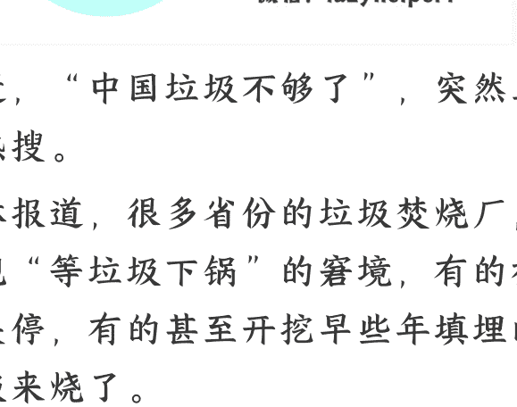

# 中国垃圾不够烧了，1000 座焚烧厂等米下锅？

260416 文/卢克文工作室 嘉宾：概略北方  
整理：公众号懒人搜索，**懒人专属群**精选  
懒人微信：lazyhelper1

最近，“中国垃圾不够了”，突然上了热搜。

媒体报道，很多省份的垃圾焚烧厂，出现“等垃圾下锅”的窘境，有的被迫关停，有的甚至开挖早些年填埋的垃圾来烧了。

那么，这到底是咋回事？是垃圾真的不够了吗？

说起垃圾够不够的问题，就不得不提起十几年前席卷全国的垃圾处理难题。

当年，全中国市长们最头疼的问题，就是垃圾围城，不管大城小城都是如此。

每天要产生 1 万吨垃圾，一年就是 300 多万吨。

垃圾越来越多，但垃圾处理能力完全跟不上，绝大多数垃圾只能简单粗暴地填埋，不仅臭气熏天，产生的剧毒渗滤液更会污染环境。

2010 年，导演王久良拍了一部震动全国的纪录片《垃圾围城》，揭示出了北京被垃圾包围的可怕景象。有人可能会问，垃圾焚烧又不是啥新技术，国外很早就有了，为啥不建垃圾焚烧厂呢？既能处理垃圾，还能发电。

也不是没建，当时国内重金引进了欧洲的先进机械炉排炉技术，但这些设备不仅贵，还水土不服。欧洲人饮食习惯偏冷食、煎烤，加上垃圾分类起步早，进炉子的垃圾热值高、极度干燥，比较好烧。

中国人吃什么？汤面、炒菜、火锅，生活垃圾里混杂了大量的厨余残渣，汤汤水水的，含水率经常超过 50%。这种湿垃圾扔到进口炉子里，就麻烦了。

湿垃圾不好烧，会降低炉温，当燃烧温度低于 850℃时，垃圾中的含氯塑料就会大量合成剧毒的二噁英，毒性相当于氰化钾毒性的 1000 倍。这样一来，垃圾焚烧不仅没起到环保作用，反而会破坏环保了。

所以早期的焚烧厂为了维持炉温不低于 850°C，甚至不得不喷雾化柴油来助燃，但柴油多贵啊，结果就是垃圾焚烧不仅不赚钱，而且还赔钱。

就在这个行业快要被逼上绝路的时候，一位跨界大神入局了。

中国工程院院士——杜祥琬。

杜祥琬的人生堪称传奇，一开始是搞核武器的，1987 年转行干激光，成为中国第一届激光专家组成员兼秘书长。到了 60 岁，他又转行能源战略咨询，参与了中国加入国际热核聚变实验堆（ITER）的论证工作。

到了 2018 年，已经退休的杜祥琬又转行了，进入了垃圾焚烧领域。

杜祥琬带领团队，将核工业领域的高温精准控制技术和流体力学原理，搬到了垃圾焚烧炉的设计中。

仅用半年时间，杜祥琬就研发出了“搓衣板式”焚烧炉结构，延长了炉排的干燥段，让垃圾在进入核心燃烧区之前，就已经在“搓衣板”上反复翻滚、沥干水分，极大降低了垃圾的湿度。

对焚烧产生的烟气，杜祥琬还要求必须在 1100°C 以上的高温区停留整整 2 秒钟。这一温度下，二噁英会迅速分解，再冷却至 200 摄氏度以下，防止新的二噁英生成，处理后的烟气经过过滤、水洗净化，实现有毒物质的高效去除。

通过这一流程，二噁英分解率高达惊人的 99.9%。

实测数据显示，这套技术加持下的排放浓度仅为 0.012 纳克/立方米，比极其严苛的欧盟标准（0.1 纳克/立方米）还要优秀不少。更关键的是在于，杜祥琬这套设备便宜，只有进口货的一半。

在其他关键技术上，中国也陆续取得了突破。

比如，烟气中含有大量粉尘，那就用高速度旋转的喷雾器将石灰浆液喷洒成微小颗粒，促进石灰浆与烟气中的酸性气体充分混合并发生反应沉淀，这样粉尘排放量就大大减小了。

比如活性炭吸附层，可以去除烟气中酸性污染物、颗粒物、氮氧化物、重金属，达标后的洁净气体可以直接排至大气。

还有炉渣处理系统，处理后炉渣直接可用于铺路，最终需要固化填埋的飞灰不到垃圾容量的 3%。

有这个 KPI，各地不得不动起来，给政策给钱给地，于是一座座新式的垃圾焚烧厂相继建成投产。

在疯狂扩产的过程中，很多人没想到，AI 居然也成了垃圾焚烧厂建设的助推器。

## AI 和垃圾焚烧有啥关系？

很简单，垃圾焚烧厂烧出来的电，是“绿电”可以拿到绿色电力证书（GEC），代表其环境属性。

很多 AI 和云计算企业有极其严格的 ESG（环境、社会和公司治理）考核要求，绿电占比是有要求的。如果你的数据中心全靠烧煤的火电来支撑，那你在市场上就很容易遭遇壁垒，甚至面临巨额碳税，所以 AI 和云计算企业都盯上了绿电。

光伏和风能产生的绿电，这玩意它不稳定，太阳下山光伏停工，没有风的时候风机停转，而 AI 服务器是 24 小时运转的，我总不能白天用绿电，晚上用煤电吧？这样一来，用垃圾焚烧厂的绿电，就再合适不过了。

它可以不间断运转，不论白天和晚上，都能产出带证的绿电，比光伏和风能有优势得多。

现在知道为啥过去几年，全国各地都积极建设垃圾焚烧厂了吧？

截至 2026 年初，全国已建成超过 1000 座垃圾焚烧厂，日处理能力突破 110 万吨，年处理能力达 2.8 亿吨。中国的垃圾焚烧处理占比从 2005 年的 9.8% 飙升至 82.5%，处理规模远超欧美日三个地区的总和，独步全球。倒不是什么垃圾不够了，而是垃圾处理产能多了。

不过呢？硬币也有另一面，虽然垃圾处理能力突飞猛进，但问题随之而来。

首先是产能过剩。

建设垃圾焚烧厂是个很赚钱的买卖。

- 首先是政府会提供补贴，处理量越大，补贴越多。
- 其次是垃圾处理费，每烧 1 吨垃圾，政府都会给企业约 150 元/吨的垃圾处理费。
- 第三就是发电补贴了。垃圾焚烧厂发的电，是可以上网卖给电网的，上网价等于当地脱硫燃煤机组标杆上网电价（0.25 元/度到 0.5 元/度范围）+ 省级电网补贴（0.1 元/度）+ 国家可再生能源电价附加基金补贴（剩余部分）。

这样算下来，垃圾发电的上网电价甚至达到了六毛五，而煤电上网电价，只有三四毛左右，多出来的这两毛钱，就是给垃圾焚烧厂的补贴。

处理费 + 国补，让垃圾焚烧瞬间成了稳赚不赔的生意，很多合同一签就是 30 年，只要拿下批文，建了厂，等着数钱就行。各路资本杀红了眼，国企、民企、民间资本，都跑来建垃圾焚烧厂了。

地方政府乐见其成，反正是企业出钱建环保设施，政府批块地就行，不仅解决了环保政绩，还拉动了 GDP。但资本的狂欢是有尽头的。

这几年，因为垃圾发电厂太多了，国家出台新规定，垃圾焚烧发电项目运行满 15 年，或者全生命周期合理利用小时数满 82500 小时后，只给发绿电证，不再享受国家补贴。但是，为了搭上末班车，仍有很多地方在拼命建设垃圾发电厂，且超前建设很严重，很多县城明明常住人口在流失，连一天 300 吨的垃圾都凑不齐，却非要硬着头皮建一个 500 吨/日的焚烧厂。

随之而来的后果，就是垃圾发电厂“吃不饱”。

随着中国人口总规模见顶，城市化率增速放缓，城市生活垃圾的产生量在达到每年 2.6 亿吨左右后，开始进入了平缓的平台期。

一边是疯狂扩张的垃圾需求，另一边是停止增长的垃圾产量，出现垃圾不够烧的情况，太正常了。

更令人想不到的是，垃圾分类，还给了垃圾焚烧厂重重一击。

造汽车的厂子产能过剩了，大不了少生产一点，但垃圾焚烧炉一旦点火就必须一直烧，如果要停炉保炉，每一次启停的成本都是百万级的。

所以，为了让炉子维持运转，这些垃圾焚烧厂开始各出奇招。

比如抢垃圾，本地的垃圾不够，就去隔壁县市抢垃圾用。还有的垃圾焚烧厂，甚至要给物业公司回扣，让物业公司直接把垃圾给他们。

再比如挖现有的垃圾填埋场。过去 30 年，中国各地都有大量垃圾填埋场，现在纷纷成了宝贝，于是各地陈腐垃圾全量开挖，筛分出高热值的轻质物，源源不断地送进焚烧炉。

地方政府对此一般是乐见其成的，消除了污染隐患，腾出了几十亿商业价值的土地，也保证了维持垃圾焚烧的燃料。

但问题在于，挖旧垃圾产生的风险也不容忽视。

有的地方急于开挖，连审批和环评都等不及，结果导致了污染物和渗出液泄漏等其他问题。

有的地方财政紧张，拿不出环境恢复的钱，结果是填埋场挖开了，但环境恢复遥遥无期。

更尴尬的是，这种挖存量是不可持续的，等老垃圾挖完的那一天，炉子又该喂什么呢？

千万不要以为这是个小事情，中国的垃圾焚烧厂，大部分是民营企业在运营。

当国家有补贴、垃圾够合适的时候，企业赚钱，政府省心，大家其乐融融。一旦垃圾不够，企业赔钱的时候呢？

如果企业陷入长期亏损，拍桌子不干了，那怎么办？

到时候，整个城市每天产生的一、两万吨垃圾将瞬间无处可去，不用一个星期，街道就会恶臭熏天，新的垃圾围城也会重现。

并且，中国垃圾不够烧，不是全国垃圾都不够烧，而是局部垃圾不够烧。

现在的情况是，城市里的焚烧厂吃不饱，每天派车到处去找垃圾来凑数。但在广大偏远的农村，垃圾处理一直是短板。

为啥？因为不划算。

以前农村垃圾是“村收集—镇转运—县处理”，一般是填埋。

现在国家要求环保达标，全部送到县城的焚烧厂去烧。但是，很多偏远村寨距离县城有一两百公里的崎岖山路，开车拉一趟，运输垃圾的油费和人工成本，甚至超过了其产生的价值。

谁愿意花几百块钱运费去大山里拉一吨水分极高、发不出多少电的烂菜叶子，偏远村镇的生活垃圾处理依然处于原始状态，要么依旧填埋，甚至直接露天焚烧，对环境污染很大。

还有，中国垃圾处理能力，也处于一种非常不平衡状态，生活垃圾处理产能过剩，特殊垃圾处理能力严重不足。

要知道，除了生活垃圾，还有海量的工业废弃物、建筑垃圾，以及农业与畜禽养殖垃圾（粪便和死猪死牛之类的），垃圾焚烧厂的路子再先进，也难以无害化处理这些垃圾。

如果不同类型的垃圾对应的专属处理设施跟不上，生态灾难随时会爆发。

比如 2024 年，就有不法分子将 40 余车含砷危险废物倾倒在黄河支流不足 5 公里处的农村，填埋量超 4200 吨，污染土壤达 12000 立方米。虽然相关主犯被判刑，但污染已经形成了，代价惨痛。

所以，“垃圾不够烧”，固然意味着中国垃圾处理能力的进步，但也不能就此骄傲自满。

更高效、完善、可持续地处理垃圾，维护来之不易的环境，我们还有很长的路要走。

---

绝大多数人只盯着眼前的工资，却不知道一次远在中东的冲突、一次降息的决议，就能在一夜之间洗牌普通人的财富。

看懂宏观，是为了在周期切换时，不被当作代价。

如果你认同这种“抬头看路”的长期主义，欢迎围观我的个人情报智库：【懒人专属群】。

圈子已稳定运行 7 年。我们每天利用 Python 爬虫与大模型算力，过滤全网最顶级的政经内参和搞钱风向标，做你最冷酷的“外部大脑”。

查阅圈子完整数字资产与上车门槛：
[https://lazyso.com/insider/](https://lazyso.com/insider/)
认同价值的，扫码加我微信，备注：【进群】

