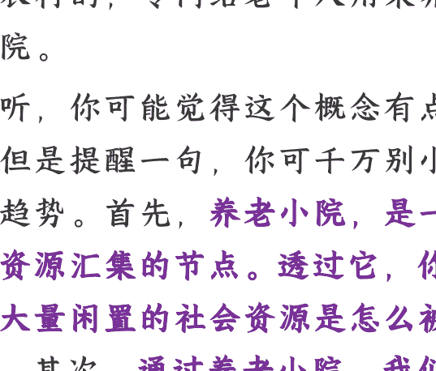
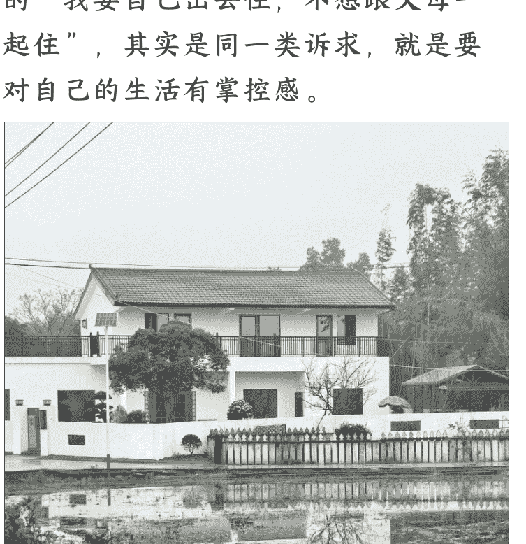
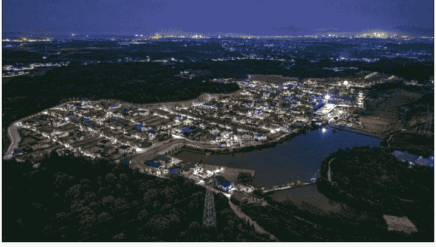

# 空心村和 3.2 亿老人，正在完成一场双向奔赴

260420 整理：公众号懒人搜索，懒人专属群精选 懒人微信：lazyhelper1

今天我们要说一个养老方面的新趋势，叫“养老小院”，也就是在城郊或农村，专门给老年人用来养老的小院。

乍一听，你可能觉得这个概念有点小众。但是提醒一句，你可千万别小看这个趋势。首先，养老小院，是一个多方资源汇集的节点。透过它，你能看到大量闲置的社会资源是怎么被盘活的。其次，通过养老小院，我们也能看到养老产业正在发生的关键变化。

好，咱们正式开始。前段时间，零售咨询专家黄碧云老师，对养老小院做了专门的调研。

要想说清养老小院的模式，我们得先打破一个关于“养老”的常见误解。截止到 2025 年末，咱们国内有超过 3.2 亿 60 岁以上的老人。但过去一提起养老，我们脑子里浮现的画面，要么是住在儿女家、帮忙带娃的爷爷奶奶。

这两张画面有一个共同点，老人是被安置的，是被照顾的，是某种意义上失去了主动权的。

但这个画面，对应的其实只是老年人口里的一部分。

首先，老年，不是一个均匀的阶段。60 岁以后的前十年，大多数人仍然充满活力。有时间，有精力，退休金也基本稳定，是真正意义上的“人生最自由的阶段”。70 岁以后，需要更认真地管理健康，但大多数人仍然能自理，可以独立生活、出行、社交。80 岁以上，才真正进入需要照护的阶段，才是传统意义上养老院主要服务的人群。

而目前，我们几乎所有关于“养老”的资源、政策和服务，都集中瞄准了最后这个阶段，也就是失能、半失能、需要护理的老人。而前面那些年，占老年人口绝大多数的活力老人，反而被忽视了。

前面说过，根据国家统计局 2025 年 1 月发布的数据，中国 60 岁及以上人口达到 3.23 亿，其中 60 到 64 岁的低龄老年人占比最大。这是一个庞大的群体。他们最需要的不是护理，而是有尊严、有自主权、有生活质量的晚年生活方式。

养老小院，就是在这个需求上长出来的。

## 运作模式

虽然前面提到了需求，但实际落地却很复杂。黄碧云老师走访了郑州、西安、长沙、浙江松阳等多地的老人社区。她发现，这个群体有一个高度一致的诉求，用他们自己的话说就是：“我不想在子女家，我也不想进养老院，我要有我自己的地方。”这跟年轻人说的“我要自己出去住，不想跟父母一起住”其实是同一类诉求，就是要在对生活有掌控感。

> 图片注释：长沙城郊的养老小院 图源：黄碧云拍摄

那么，去哪里合适呢？这就要说到另一类资源。农村里有大量闲置的空间，正在等着被激活。

过去二三十年，中国经历了史上规模最大的人口向城市迁移。年轻人进城，农村留下老人和孩子，大量房屋空置，土地荒废，这就是我们常说的“空心村”现象。根据农业农村部的抽样调查数据，2019 年全国农村宅基地闲置率就已经达到了 18.1%。大量的房子空在那里，没人住，也没人用。

这步，一个问题与答案的组合就出现了，也就是，**把有钱有闲、渴望自主生活的活力老人，和那些空置在农村的宅基地，连接在一起。**

这个连接，有一个政策上的关键节点。2019 年 9 月，农业农村部出台了一份文件：《关于积极稳妥开展农村闲置宅基地和闲置住宅盘活利用工作的通知》。这份文件确立了一个基本原则：农村宅基地可以租赁给城市居民使用，但只租不卖，产权不变。这就是养老小院得以合法运营的制度基础。

有了这个基础，养老小院的模式就开始逐渐成形了。

它的运作方式，是一个四方协作的结构：
- 政府负责招商和基础设施建设，包括修路、接水电、配套卫生院；
- 村集体提供宅基地使用权；
- 文旅运营公司负责改造、装修、日常服务管理；
- 老人以租户加“新村民”的身份入住。

在这个过程中，四方各得其所：政府激活了闲置资产，村集体增加了收入，运营公司获得了稳定的客源，老人拿到了他们想要的生活空间。

这种模式，跟养老院很不一样，跟民宿也不同。养老院面向的是需要护理的老人，是机构化管理。民宿面向的是短期游客，住个几天就走。养老小院面向的，是健康自理，但希望换一种活法的活力老人，入住时间通常一年起签，也可以签十年二十年。

费用方面，根据黄碧云老师的观察，基础版本的养老小院，一对老人一年的租金在一万元左右，包含一个带小院的房间和一块菜地。假如选择精装版，含二十年租期和装修费用摊销，总价在十几万到将近四十万元之间。还有短租模式，三千多元住两个月，适合想来体验的人。

这个价格之所以不是很髙，一定程度上是因为，农村宅基地本来就空置着，租出去是纯增量收入，因此不需制定太高的价格。

当然，这里有一个重要前提，选择养老小院，必须选择合规的项目。黄碧云老师说，现在市面上也有打着养老小院旗号，实际上并不合规的项目。合同，公司、个人都要签。其次，政府官网上必须能查到备案。最后，建筑必须是砖混结构，如果是木质结构，基本可以判定未经批准，不可信。

## 生活方式

好，说完了养老小院的运作模式，我们再看看长者在这里的生活状态。

黄碧云老师发现，很多养老小院的氛围，跟传统的养老院很不一样。

首先，入住的老人里，大约七成是组团来的。老人之间本来就是老朋友。

而当一批小院的入住规模变大以后，社区内部就出现了分工：有退休医生愿意兼任村里的健康顾问，有跳舞好的老师开了舞蹈班，有人在院子里养鸡、种菜，然后拿来和邻居交换。

还有很多院子里形成了“认养文化”。比如，认养一棵果树，或者认养一只鸡，给它起个名字，像对待宠物一样照顾。

还有一些运营公司提供了“换住体验”，假如你是他们的会员，你在长沙的院子住厌了，可以申请去西安的窑洞项目住一个月，或者去三亚的海边换换心情。

而到了周末，住在城里的子女，也可以开车去养老小院跟父母聚聚，顺带体验一下周末的田园生活。

对于老年人来说，这背后的经济账也相对划算。他们可以把城里的老破小出租出去，租金收入往往高于在小院的支出。

## 推动力量

好，前面说的是关于养老小院本身。而这个模式背后，还有三个结构性的推动力量，非常值得注意。

- 第一个，是人口。根据民政部副部长唐承沛在 2025 年 3 月中国发展高层论坛上的讲话，中国未来十年，每年新增 60 岁以上老年人口超过一千万。而这拨人，受教育程度更高，经济条件更好，对生活质量的要求也更高。他们不是“等着被养”的一代，而是第一批把退休当成人生新起点的老人。
- 第二个，是政策。2016 年出台的《健康中国 2030 规划纲要》把康养产业明确列为国家战略，目标是 2030 年健康服务业总规模达到 16 万亿元；还有乡村振兴战略，也为农村基础设施建设提供了持续的资金和政策支持。政策层面的基础，也给养老小院提供了一个非常有利经营环境。
- 第三个，是市场。根据行业机构测算，2025 年中国康养产业市场规模已接近 9.5 万亿元，预计到 2030 年接近 15 万亿元。

在地域上，目前北方的推进速度相对更快，郑州、西安是最成熟的市场，原因是北方空心村问题更严重，可供盘活的存量更大，地形相对平整，适合集中连片开发。南方，比如湖南、浙江松阳这样的地方，地形更分散，更多是一院一景的形态，但离城更近，这几年也在快速推进。

> 图片注释：湖南浏阳河城郊民宿群 图源：美栗谷康养民宿

你看，空心村和活力老人，原本是中国城镇化进程里两个各自困顿的群体，一个是被遗弃的空间，一个是被遗忘的需求。现在，他们正在找到彼此。

最后，我们跳出养老小院本身，说说这背后正在发生的，“养老叙事”的变化。

过去很多人对“养老”的想象，大概只有两套剧本：一套是融入家庭，依附子女；另一套是进入机构，等待终点。而养老小院所代表的，也许是第三套剧本开始出现：老人主动设计自己的晚年，按照自己的节奏生活。

从这个角度看，这背后也许是一个比养老小院本身更值得关注的转变。就是“退休”这件事，已经不只是等待终点之前的过渡，而是开始被大规模地，当成一个人生的阶段来认真经营。

---

## 圈子情报

在这个 AI 能替你写代码、写文章的时代，基础技能正在迅速贬值。绝大多数人正被淹没在海量的免费垃圾信息里，陷入低效的体力内卷。

当“努力”不再是壁垒，人与人之间唯一的护城河，只剩下“信息过滤”的效率与“认知系统”的维度。

圈子已稳定运行 7 年。我们每天利用 Python 爬虫与大模型算力，过滤全网最顶级的政经内参和搞钱风向标，做你最冷酷的“外部大脑”。

如果你认同这种“重塑认知防线”的极客主义，欢迎围观我的个人情报智库：【懒人专属群】。
https://lazyso.com/insider/

认同信息过滤价值、想省下每天 3 小时无效阅读时间的读者，扫码加我微信（lazyhelper1）