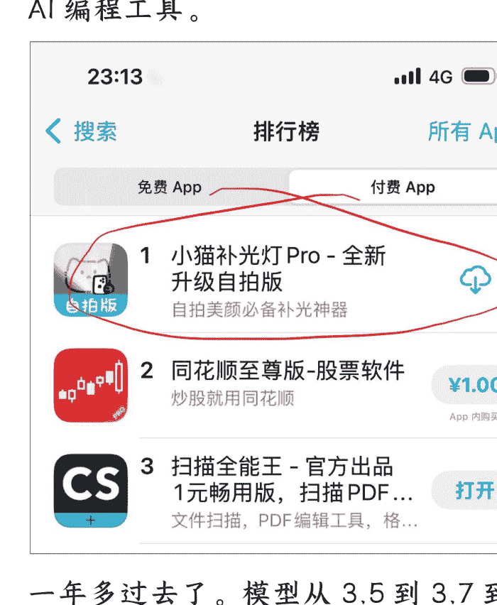
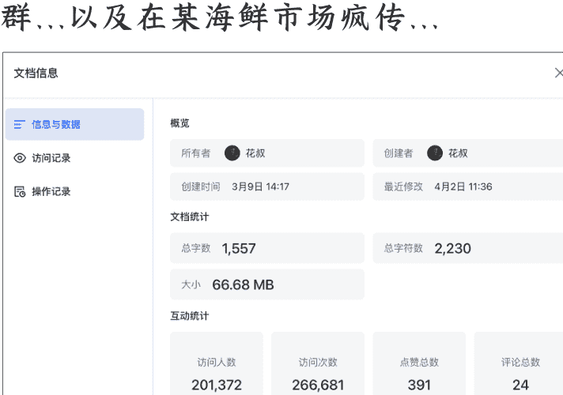
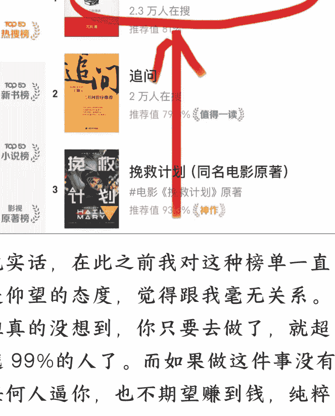
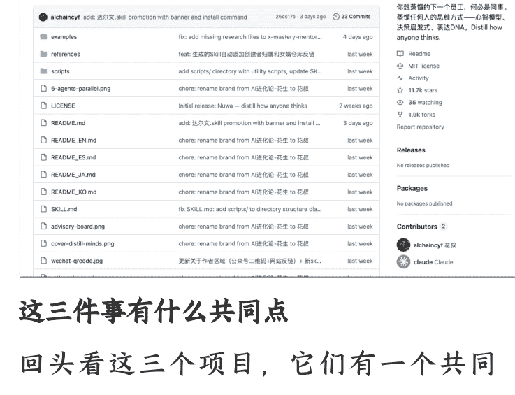

# 工具换了三轮，为什么我还在做爆款

260420 副业 SC 精华
整理：公众号懒人搜索，《<u>懒人专属群</u>》精选
懒人微信：lazyhelper1
作者：花叔 | 时间：2026 年 04 月

谢谢七天的邀请，来给大家分享一下我的一些做内容做产品的经验。

上次在社群分享还是一年多前。那时候聊的是小猫补光灯，一个用 Cursor 写的 iOS App，上了 AppStore 付费榜第一。那时候最强的编程模型是 Claude 3.5 Sonnet，Cursor 是最火的 AI 编程工具。

一年多过去了。模型从 3.5 到 3.7 到 4 再到现在的 Opus 4.7，编程工具从 Cursor 到 Claude Code，AI 圈翻了好几番。

但我回头看了看最近几个月做的事情，发现一个有意思的事：工具一直在换，我好像一直在用同一套方法做事。而且做出来的东西，效果还都不错。

这让我想搞明白，到底是哪个部分在起作用。

## 先说最近发生了什么
前两个月 OpenClaw 爆火的时候，其实我很长很长一段时间都对这个工具不太感兴趣，但是，作为 AI 自媒体博主身份的一部分自我觉得太不对劲了，至少该稍微做点什么。

于是，我让 Claude Code 帮我写了份 98 页的《OpenClaw 橙皮书 🍊》，一是确实有蹭一蹭热点的想法，二是也方便我去做长视频的解读内容，毕竟对着 PDF 去解读对我来说会轻松很多。然后很意外的，这份材料在 X 上收获了 200 万的阅读，飞书文档累计访问人数破 20 万，这份文档在各种 AI 群以及在某海鲜市场疯传。

接着呢，上个月 OpenClaw 橙色书（注：原文可能指 OpenClaw 相关的橙皮书，上下文是 Claude Code 源码泄露）Claude Code 源码泄露的时候，我正好又用上了我去制作一个 AI 内容橙皮书的 skill。很快结合自己的使用经验做了期视频，顺便让 Claude Code 帮我写了份 Claude Code 橙皮书。

因为发出来获得了挺多好评，就随手发到微信读书试试看。

第二天就上了微信读书热搜榜第一。

说实话，在此之前我对这种榜单一直是仰望的态度，觉得跟我毫无关系。但真的没想到，你只要去做了，就超越 99% 的人了。而如果做这事没有任何人逼你，也不期望赚到钱，纯粹因为觉得有意思把它做出来，好像就又超越了 99% 的人。

这是第二个。

第三个是女娲.skill。这个更有意思，它是我在写另一篇文章的时候「顺便」做出来的。

那篇文章叫「把同事作为 Skill」，起因是有个开源项目把公司同事的工作经验蒸馏成了 AI skill，在网上引发了很多讨论。我觉得这个话题好玩，就写了篇评论。写着写着想到，我自己不就一直在做类似的事吗？我非常善于我自己的写作、做视频、写橙皮书等各种能力 skill 化，效果很好。以及尤其想着，既然要蒸馏人的话，为什么要蒸馏身边普普通通的同事呢？我们分明是可以去蒸馏任何人，去获取我们真正仰慕的人的思维框架的。

于是女娲.skill 就诞生了。开源之后一周 GitHub star 破万，很多媒体报道。

## 这三件事有什么共同点
回头看这三个项目，它们有一个共同点：做的时候都没想着要火。

橙皮书是因为基于要做内容的逻辑，写着写着，就随着 OpenClaw 和 Claude Code 内容的出圈成了我的一个独特打发和方法论。女娲.skill 是写文章写到一半顺便想到的。

没有一个是坐下来认真分析「什么内容能火」然后去做的。

但它们还有另一个共同点，这个我是后来才意识到的：做完之后，我都做了同一件事。我把它 skill 化了。

### Skill 化是什么意思
我用 Claude Code 工作，Claude Code 有一个功能叫 skill，你可以把一个工作方法写成一个配置文件，以后遇到类似的事情，Claude Code 会自动按这个方法来做。

写完第一本橙皮书之后，我把「写橙皮书」这件事本身变成了一个 skill。里面包含了怎么搜集信息、怎么规划章节、怎么排版、怎么生成封面、怎么上架微信读书，整套流程。

有了这个 skill 之后，写第二本橙皮书的时间从几天变成了几小时。到现在我一共写了七本橙皮书，每本的初稿基本上半小时就能出来。

同样的事情发生在人物蒸馏上。我蒸馏完芒格的思维框架之后，把「怎么蒸馏一个人物」做成了 skill。后面费曼、Naval、塔勒布、乔布斯、张一鸣，每个人的蒸馏过程都越来越快，因为方法在不断迭代。最后这个方法本身变成了女娲.skill，任何人都可以用它去蒸馏任何人。

我觉得这是关键的拐点。做一件有趣的事，做成了，这是一次经验。把它 skill 化，变成可复用的方法，这就变成了资产。

### 资产之间会产生组合
更有意思的是，这些 skill 不是孤立的。它们之间会互相组合。

女娲.skill 是怎么来的？不是我某天灵光一闪。是因为我手上已经有了 perspective skill（蒸馏人物的产物）、橙皮书 skill（写小册子的方法）、还有大量使用 Claude Code 的经验。这三个东西碰在一起，「把蒸馏方法本身做成一个通用工具」这个想法几乎是必然会冒出来的。

就好像你手里有 20 块不同形状的乐高积木，你看到的不是 20 块积木，而是上万种可能的组合方式。每多一块积木，可能性不是加一，是乘上去的。

我现在手里大概有几十个 skill，覆盖了写作、调研、审校、配图、排版、发布、视频脚本、人物蒸馏各种场景。这些 skill 叠在一起，经常会在我做某件事的过程中，自动冒出新的可能性。女娲.skill 就是这么来的，它不是我规划出来的，是从已有的 skill 组合缝隙里涌现出来的。

### 为什么工具换了，方法没过时
回到开头的问题。一年前用 Cursor 和 Claude 3.5 Sonnet 做小猫补光灯，现在用 Claude Code 和 Opus 4.7 做橙皮书和女娲.skill。工具换了，模型换了，连做的东西类型都换了。

我攒下来的是「怎么把一件做成的事变成一个可复用的方法」这个能力。这个能力跟工具无关。Cursor 换成 Claude Code，3.5 Sonnet 换成 Opus 4.7，skill 化的思路是一样的：你做成了一件事→你把做事的方法提炼出来→下次遇到类似的事你比别人快十倍→你省下来的时间用来做新生的事→新生的事做成了又可以 skill 化。

每次工具迭代，大多数人要从头学新工具。我也要学新工具，但学完之后我会把新工具插进已有的 skill 体系里。别人是重新开始，我是往已有的系统里加一块积木。启动速度完全不同。

这可能就是为什么工具换了三轮，我还在做爆款。不是因为我特别聪明或者特别努力，是因为 skill 在累积，而累积本身有复利。

### 一个可能有用的思路
我不确定这套东西对每个人都适用。毕竟我的情况比较特殊，每天用十几个小时 AI，而且做的事情恰好是内容和产品的创作，skill 化的效率提升特别明显。

但有一个底层的东西我觉得是通用的：你今天做的事情里，有哪些是你做完一次就忘了，下次还要从头来的？

那些事情就是可以 skill 化的。

不一定要用 Claude Code。哪怕只是把一个反复做的事情整理成一个清单、一个模板、一个 SOP，那也是 skill 化。核心是让每次经验变成资产，而不是消耗完就没了。

然后你会发现一件很有意思的事；当你的 skill 攒到一定数量，新的创造机会会自己冒出来。你不需要苦思冥想「接下来做什么」，你手上的积木会告诉你。

至于「有趣」这件事。我知道在生财有术说「做有趣的事」听起来有点凡尔赛。但我的经验是，只有你真心觉得有趣的事情，你才会投入到足够做好的程度。做好了才值得 skill 化。skill 化了才有后面所有的复利。

如果一开始就想着「这个能不能火」「这个能不能赚钱」，你反而做不到那个程度。因为你的注意力在算计而不是在做事。

这个世界像个草台班子。大部分人在痛苦地工作，不知道自己在做什么，而你因为觉得好玩就去做了，做出来的东西反而鹤立鸡群。

这不是什么成功学。这只是一个让我自己也挺意外的观察。

工具会一直换下去。模型会一直迭代。但如果你在每一轮里都把经验沉淀成 skill，你就不是在追工具，而是在建自己的系统。

系统不会过时。

---
# 看完这篇 SOP, 你觉得你懂了。但 90% 的人一到实操就会卡在第一步。

工具和教程只是最低级的壁垒，真正的壁垒是“立刻动手”和“圈层信息差”。

如果你想看全网最新的变现玩法，并且和一群执行力极强的极客一起下场拿结果，欢迎围观我的核心私域：【懒人专属群】。

我们不聊虚的，只做商业闭环的拆解与 AI 效率的压榨。系统内已沉淀 1000+ 跑通的套利实战局。

> > **查阅圈子完整数字资产与上车门槛：**
>
> https://lazyso.com/insider/
>
> 
>
> 
>
> **微信**: `lazyhelper1`

### **备注：**`【实操上车】`，不闲聊