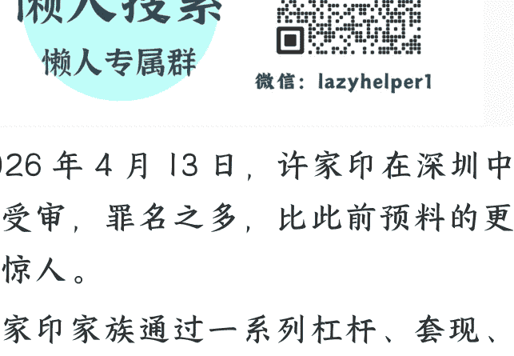

# 许家印受审，如何避免出现下一个“恒大”？

2026 年 4 月 20 日 文/卢克文工作室嘉宾 壹壹壹

整理：公众号懒人搜索，<u>懒人专属群</u>精选

懒人微信：lazyhelperl

2026 年 4 月 13 日，许家印在深圳中院受审，罪名之多，比此前预料的更为惊人。

许家印家族通过一系列杠杆、套现、分红、转移资产的操作，导致恒大最终负债 2.44 万亿，相当于以色列一年的 GDP，目前欠款缺口仍高达整整 6000 亿，30 万套烂尾房仍未交付。

恒大集团被指 6 项罪名，许家印个人被指 8 项罪名，基本上能沾上的金融重罪，许家印全犯了一遍。

世纪骗局，终究曲终人散。这场中国民企史上最惨烈的债务灾难，将苏宁、南通三建等巨头拖入深渊，更让千千万万普通人辛苦攒下的血汗钱，化为泡影。

说实话，许家印最终判多少年，对于购房者意义已经不大。真正值得深思的是，我们要如何吸取教训，避免出现下一个“恒大”？

## 01

许家印狂加杠杆、圈钱坑人固然罪孽深重，但更深层的罪恶在于，“影子银行 + 地产杠杆 + 信息黑箱”这种危险模式，居然横行了十余年。

恒大们狂飙背后，离不开一条灰色资金链疯狂输血。

本质上，它们和银行一样，干着吸储放贷的生意，却不受正规银行的严格监管，主要有两种路子：

- 一是银行卖的理财产品。

  很多银行的理财产品，并不是自有产品，银行负责的只是“销售”。

  这些理财产品，嘴上说跟存款一样安全保本，实则是把钱通过信托，高息放贷给房企。这笔钱不走银行正规账目，银行啥责也不用担。

- 二是各类理财平台、信托、P2P，包括恒大财富这类房企自己的理财平台。

  它们没有银行牌照，不能公开吸储，就打着大房企、大机构的旗号，用远高于银行的利息承诺保本，吸引普通人存钱再高息借给房企，一旦房企爆雷，买了理财的人就会亏到血本无归。

2007 年这类灰色资金还只有 1 万亿，到 2017 年直接暴增到 57 万亿，而这十年，正好是中国房地产涨得最疯的时候。

当年监管不是不想管，而是刚堵住前门，后门又被绕开了。

早在 2010 年监管就察觉出不对劲，立刻出台 72 号文，要求银行 - 信托这类隐形贷款要全部回到银行正规账上，并按监管要求计提坏账准备。

道高一尺魔高一丈，资金很快玩起了多层嵌套，一个典型的链条长这样：银行理财（A 银行）→ 券商资管计划 → 基金子公司专项资管计划 → 最终融资方（比如恒大）。

房企们察觉贷款收紧，开始琢磨自己给自己找钱，于是恒大财富和万科鹏金所这类房企自融平台在 2014-2016 年集中出现。

为什么总是摁下葫芦浮起瓢？

根本原因在于，2017 年前是一行三会分治，央行管货币政策，银监会管银行信托，证监会管券商基金，保监会管保险。四位各管一摊，互不隶属。一笔钱只要在银行、信托、券商之间多绕几层，单看每一步都合规，合起来就是个查不清的黑箱。

2017 年之后，监管开始真正下死手，层层锁死漏洞。

首先是直接掐断灰色资金的水源。

很多小银行自己拉不来那么多存款，又想挣房企的利息，索性找其他银行借钱，再把钱通过资管基金扔给房企。后来监管直接卡死银行间借钱的上限，不许无限制放大杠杆，这条输血通道当场就断了。

与此同时，2018 年资管新规正式落地，明确金融机构不得承诺保本保收益，从根本上破除刚性兑付，理财开始实行净值化管理，像基金一样每天显示涨跌，再也不是稳赚不赔。监管还清理了资金池，不许再用新钱还旧账掩盖亏损，每只产品单独记账，风险再也藏不住了。

包商银行出事时，央行没有全额兜底，部分债券直接减记清零，用事实告诉所有人，哪怕是银行相关的产品，也可能血本无归。

监管层面也迎来大改革，成立金融稳定发展委员会，实行穿透式监管，统一监管银行、保险、信托，形成“一行一局一会”的新格局，分业监管的漏洞彻底补上。

影子银行的水龙头一关，靠它输血的房企扛不住了。恒大，便是最典型的一个。

## 02

恒大之所以背上 2.44 万亿巨债，除了灰色资金链的无序扩张，更关键的是资金随意挪用、运作的过程都是信息黑箱。而挪钱的手段也并不复杂，常见的两类：

- 一是与银行串通，将购房者的按揭贷款划入非监管账户；
- 二是通过关联交易转移资金，或是伙同施工方虚报工程进度，套取监管资金。

为了彻底整治挪用现象，2026 年，住建部推出现房销售制、项目公司制、主办银行制，被视为烂尾楼清零的终极方案。

### 第一道防线是现房销售制

说起期房预售的各种坑，老百姓没有哪个不厌恶。

过去不少人被沙盘、样板间吸引买房，收房时却遭遇质量缩水，甚至楼盘烂尾。有业主苦等五六年，楼盘半途停工，毕生积蓄付诸东流。

客观说，期房预售早期有一定的合理性。

90 年代初，全国房荒严重，人均住房面积不足 7 平方米，国家手里没钱，开发商贷款比较困难，预售能帮开发商快速回款、扩大供应。

但如今，我国人均住房面积已超 40 平方米，户均近 1.5 套，住房供给结构性过剩，继续实行预售制就不合理了。

新政明确，2026 年 1 月 1 日起，新出让土地的商品房项目原则上实行现房销售，按新老划断、因城施策推进。

在新政实施前，多地已先行探索了路子。

海南 2020 年全面推行现房销售后，海口、三亚连续四年无大规模烂尾项目，期房投诉下降近七成；雄安新区自开发起便执行现房销售，先竣工再领证，至今保持零烂尾、零大规模维权。

今后房子必须建成完工、配套落地后才能销售，购房者可实地查验质量、采光、环境，满意再交钱，一手交房一手交钱，从源头杜绝“画大饼式卖房”，彻底消除期房烂尾焦虑。

### 第二道防线是项目公司制

相当于给每个楼盘上“独立户口”。

以前监管看着挺严，说房款必须进监管账户、专款专用，但实际操作下来，很多房企都会把全国各地楼盘的钱，全都收到集团总部统一调配，让原本的监管效果大打折扣。

就拿恒大来说，全国各地楼盘的预售款、贷款全都被放到总部一个大资金池里，搅成一锅粥，根本分不清谁是谁的。

2020 年，恒大账目上的“受限制现金”从 1357 亿突然降到 219 亿，被解锁的 1100 多亿到底拿去干嘛了？谁都说不清，可能被拿去还旧债、买新能源车、理财兑付，唯独就是没有去盖楼。

新规堵死这条路：每个楼盘单独成立项目公司，钱只在这个项目里闭环运行，总部再缺钱也不能抽走，真正做到你的房款，只盖你的楼。

更关键的是，新规把以前“人管钱”改成了系统管钱，开发商想碰钱都没门。

房款一进监管账户就被冻结，开发商只能看不能转。要用钱必须在系统里申请，上传施工证明，住建、银行多方核对无误后，钱直接打给施工队和材料商，不经开发商手，全程留痕，一违规就报警。

系统监管虽不是万能，但只要让开发商没法随意抽走资金，就堵上了最大的漏洞。以前靠人情、签个字就能把钱转走，现在连转账的入口都直接给关了。

### 第三道防线：主办银行制——银行与项目风险共担。

以前一个开发商可以找好几家银行借钱，银行之间信息不通，容易互相抵押，把杠杆加到天上去。现在规定，只能有一家主要银行（或者几家一起组团）来负责，这家银行得从头管到尾，钱从哪儿来、花到哪儿去，有问题就问责你。

更狠的一招是，以前银行只想赚利息，不想担风险，项目一出问题，银行往往是第一个申请冻结资产、抽回贷款的，现在呢？国家不准银行轻易“跳车”，银行在放贷前就不得不擦亮眼睛，放贷后还得想办法帮项目活下去。

### 最后是对违规操作重罚

在房企野蛮生长期，由于能带动就业和土地税收，很多不合规操作都是被默许的，地方银行、审计机构甚至会配合违规操作。

但现在，只要你敢参与违规挪用资金或审计造假，那么你不但将面临最高 200 万元的罚款，而且可能会被撤职、禁业，甚至追究刑事责任。

审计机构如普华永道，在恒大案中被没收全部收入、顶格罚款合计 4.41 亿元，暂停业务 6 个月、撤销分所，签字注册会计师吊销证书。

许家印的倒下，不是个人贪婪的落幕，而是对整个地产野蛮生长时代的彻底埋葬。

随着监管层层锁死漏洞，灰色资金链被斩断，资金挪用漏洞被堵死，预售款被系统严格管住，房企利益链靠胆大钻空子、收割普通人的时代，将彻底画上句号。

——分割线——

绝大多数人只盯着眼前的工资，却不知道一次远在中东的冲突、一次降息的决议，就能在一夜之间洗牌普通人的财富。

看懂宏观，是为了在周期切换时，不被当作代价。

如果你认同这种“抬头看路”的长期主义，欢迎围观我的个人情报智库:【懒人专属群】。

圈子已稳定运行 7 年。我们每天利用 Python 爬虫与大模型算力，过滤全网最顶级的政经内参和搞钱风向标，做你最冷酷的“外部大脑”。

查阅圈子完整数字资产与上车门槛：<https://lazyso.com/insider/>

认同价值的。扫码加我微信，备注:【进群】