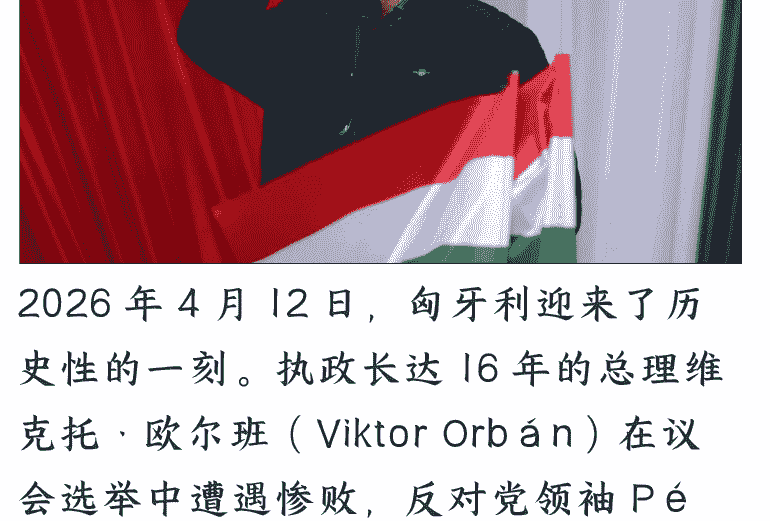

# 欧尔班倒台

2026 年 04 月 20 日

新闻实验室

整理：公众号懒人搜索，懒人专属群精选

懒人微信：lazyhelper1

## “信息专制”的局限性

2026 年 4 月 12 日，匈牙利迎来了历史性的一刻。执政长达 16 年的总理维克托·欧尔班（Viktor Orbán）在议会选举中遭遇惨败，反对党领袖 Péter Magyar 领导的蒂萨党（Tisza）以压倒性优势赢得议会超过三分之二的席位。Magyar 在人群中宣扬：“我们一起推翻了欧尔班体制，一起解放了匈牙利。”

资深记者 Imre Karacs 将这一幕与 1989 年的东欧共产主义政权崩溃相提并论：“欧尔班政权的倒台感觉和 1989 年一样突然、一样具有颠覆性。但对于那些敢于相信的人来说，这两件事似乎都是不可避免的。”

## “电视”与“冰箱”：欧尔班为何失去民心

这场选举不仅改变了匈牙利的政治走向，也在欧洲乃至全球范围内产生了深远影响。今天的会员通讯，我们来聊聊它背后的民粹主义、民主韧性、信息操控、大国博弈等话题。

欧尔班曾是欧洲政坛最精明的政治操盘手。他连续四次赢得压倒性的选举胜利，早在川普 2016 年入主白宫之前，欧尔班就已断言：自由民主已经过时。他拆掉权力制衡机制，在司法系统和独立机构中安插亲信，掌控绝大多数新闻媒体，并在 2014 年公开将自己的治理模式命名为“非自由主义国家”（an illiberal state, a non-liberal state）。

然而，这位强人最终未能改写一条最基本的政治法则：要赢得选举，必须获得民心。

《纽约时报》在报道中引用了一句俄罗斯政治格言：政治永远是“电视”（即宣传）与“冰箱”（即民众现实生活）之间的博弈。2022 年欧尔班以压倒性优势连任后，曾承诺为匈牙利带来经济“黄金时代”，但现实恰恰相反。在腐败的侵蚀下，匈牙利陷入经济衰退，至今仍是该地区经济增长最慢的国家，失业率创下十年新高。据透明国际组织统计，匈牙利的腐败程度在欧盟中排名最差。《大西洋月刊》打到了唯一的一个例子。一名曾经的燃气改装工人变身一变，成为亿万富豪，只因他是欧尔班的童年好友，获得了来自政府的大把合同订单。与此同时，普通匈牙利人的工资水平却不到欧盟平均水平的一半。

痛经敦时期的美驻匈牙利大使 David Pressman 评价说《电视与冰箱之间的博弈已经变成无法逾越的》。《大西洋月刊》也批评道：《多年来，欧尔班从未关注过匈牙利民众面临的实际问题。我们从没听过他提及医疗、教育或生活成本问题。》

面对选战，欧尔班把所有筹码放在宣传攻势上。他动用巨大的政治支持机器抹黑对手，将 Magyar 捧成骗子、指控亲信共治女友为虚拟变、将难民危机规避为至死敌手，声称如果 Magyar 当选且会把战火带到匈牙利。一位政治分析师在接受《大西洋月刊》采访时说，欧尔班的选战信息本质上是《我们的生活可能更糟》。

然而，2026 年 2 月的民调数据显示，只有 23% 的匈牙利人相信欧尔班宣称的“如果他继续领导匈牙利将被卷入战事”这一核心叙事。至于在欧尔班自己的青民党（Fidesz）支持者中，也有近一半（43%）表示不信。也就是说，权力牌局已经失控了。

打破欧尔班阴影的 Magyar 本身是一名保守政客，直到 2024 年还是欧尔班体制的一部分，在移民等诸多问题上与他的观点一致。但他展现出一种更温和、不那么分裂的风格，承诺打造一个与自身及欧盟和平共处的“人性化”匈牙利。对许多选民来说，Magyar 最大的优势并非他的政策纲领（他其实从未详细阐述过），而只是因为：他不是欧尔班。

## 媒体帝国未能拯救政权

欧尔班在匈牙利建立的媒体控制体系，堪称当代威权主义的教科书案例。理解这一体系的崩塌，对于认识信息操控在民主社会中的局限性具有重要意义。

纽约大学法学院的一份报告《报告》总结，欧尔班对独立媒体的系统性打压贯穿其十六年执政期。蒂尔经济学研究所的《报告》进一步将这一进程分为多个阶段：第一步始于 2010 年青民党第二次执政后修订媒体法，用清一色的党派亲信填满媒体监管机构。
</think>

# 欧尔班倒台

**新闻动态**

2026 年 4 月 20 日

新闻实验室

整理：公众号懒人搜索，懒人专属群精选

懒人微信：lazyhelper1

## “信息专制”的局限性

2026 年 4 月 12 日，匈牙利迎来了历史性的一刻。执政长达 16 年的总理维克托·欧尔班（Viktor Orbán）在议会选举中遭遇惨败，反对党领袖 Péter Magyar 领导的蒂萨党（Tisza）以压倒性优势赢得议会超过三分之二的席位。Magyar 在人群中宣扬：“我们一起推翻了欧尔班体制，一起解放了匈牙利。”

资深记者 Imre Karacs 将这一幕与 1989 年的东欧共产主义政权崩溃相提并论：“欧尔班政权的倒台感觉和 1989 年一样突然、一样具有颠覆性。但对于那些敢于相信的人来说，这两件事似乎都是不可避免的。”

## “电视”与“冰箱”：欧尔班为何失去民心

这场选举不仅改变了匈牙利的政治走向，也在欧洲乃至全球范围内产生了深远影响。今天的会员通讯，我们来聊聊它背后的民粹主义、民主韧性、信息操控、大国博弈等话题。

欧尔班曾是欧洲政坛最精明的政治操盘手。他连续四次赢得压倒性的选举胜利，早在川普 2016 年入主白宫之前，欧尔班就已断言：自由民主已经过时。他拆掉权力制衡机制，在司法系统和独立机构中安插亲信，掌控绝大多数新闻媒体，并在 2014 年公开将自己的治理模式命名为“非自由主义国家”（an illiberal state, a non-liberal state）。

然而，这位强人最终未能改写一条最基本的政治法则：要赢得选举，必须获得民心。

《纽约时报》在报道中引用了一句俄罗斯政治格言：政治永远是“电视”（即宣传）与“冰箱”（即民众现实生活）之间的博弈。2022 年欧尔班以压倒性优势连任后，曾承诺为匈牙利带来经济“黄金时代”，但现实恰恰相反。在腐败的侵蚀下，匈牙利陷入经济衰退，至今仍是该地区经济增长最慢的国家，失业率创下十年新高。据透明国际组织统计，匈牙利的腐败程度在欧盟中排名最差。《大西洋月刊》打到了唯一的一个例子。一名曾经的燃气改装工人变身一变，成为亿万富豪，只因他是欧尔班的童年好友，获得了来自政府的大把合同订单。与此同时，普通匈牙利人的工资水平却不到欧盟平均水平的一半。

布达佩斯时期的美驻匈牙利大使 David Pressman 评价说：“电视与冰箱之间的博弈已经变成无法逾越的深渊。”《大西洋月刊》也批评道：“多年来，欧尔班从未关注过匈牙利民众面临的实际问题。我们从没听过他提及医疗、教育或生活成本问题。”

面对选战，欧尔班把所有筹码放在宣传攻势上。他动用巨大的政治支持机器抹黑对手，将 Magyar 捧成骗子、指控亲友共治女友为虚假宣传、将难民危机神秘化为至死敌手，声称如果 Magyar 当选且会把战火带到匈牙利。一位政治分析师在接受《大西洋月刊》采访时说，欧尔班的选战信息本质上是：“我们的生活可能更糟。”

然而，2026 年 2 月的民调数据显示，只有 23% 的匈牙利人相信欧尔班宣称的“如果他继续领导匈牙利将被卷入战事”这一核心叙事。至于在欧尔班自己的青民党（Fidesz）支持者中，也有近一半（43%）表示不信。也就是说，权力牌局已经失控了。

打破欧尔班阴影的 Magyar 本身是一名保守政客，直到 2024 年还是欧尔班体制的一部分，在移民等诸多问题上与他的观点一致。但他展现出一种更温和、不那么分裂的风格，承诺打造一个与自身及欧盟和平共处的“人性化”匈牙利。对许多选民来说，Magyar 最大的优势并非他的政策纲领（他其实从未详细阐述过），而只是因为：他不是欧尔班。

## 媒体帝国未能拯救政权

欧尔班在匈牙利建立的媒体控制体系，堪称当代威权主义的教科书案例。理解这一体系的崩塌，对于认识信息操控在民主社会中的局限性具有重要意义。

纽约大学法学院的一份《报告》总结，欧尔班对独立媒体的系统性打压贯穿其十六年执政期。蒂尔经济学研究所的《报告》进一步将这一进程分为多个阶段：第一步始于 2010 年青民党第二次执政后修订媒体法，用清一色的党派亲信填满媒体监管机构。

第二步是通过经济手段收编保守派媒体。与欧尔班关系密切的商人 Simicska Lajos 曾建立起一个庞大的保守派媒体帝国，但当他在 2015 年批评政府拟征收广告税是“全面媒体战争”和“对民主的又一次攻击”后，其旗下媒体迅速遭到财务绞杀，被贴上“假新闻”标签并被拒绝采访政府官员。

第三步是对独立媒体施压和收购。曾经是匈牙利最受尊敬的在线新闻平台之一的 Origo，在 2014 年因发表批评政府的调查报道而遭到母公司施压，主编被解雇，此后报道方向逐渐转向亲政府立场。

2018 年，欧尔班政府将超过 470 家亲政府媒体合并为中欧新闻与媒体基金会（KESMA），并定性为战略性国家资产，因而豁免于反垄断监管。据无国界记者组织估计，Fidesz 直接或间接控制了匈牙利约 80% 的媒体。匈牙利在世界新闻自由指数中的排名从 2010 年的第 23 位暴跌至 2025 年的第 68 位，并且成为第一个被自由之家从“自由”降级为“部分自由”的欧盟成员国。

这一体系还延伸到国际层面，欧尔班花钱买了一批“洋五毛”。据调查记者 Daniel Nolan 的详细调查，以多瑙河研究所和马蒂亚斯·科维努斯学院（MCC）为核心，一个由英国评论员和媒体人物组成的网络定期领取报酬，并完成约定的任务——在 GB News、《旁观者》等英国出版物上发表有利于欧尔班的文章。美国作者 Rod Dreher 每月领取 8750 美元，英国 Reform UK 党曾经的候选人 Matt Goodwin 更是每月获得高达 10000 欧元的报酬。

然而，在如此恶劣的媒体环境中，独立新闻的力量依然顽强。例如，匈牙利媒体人 Andras Petho 曾在上面提到的转向亲政府立场的网络媒体 Origo 工作，后来因拒绝接受审查而离开，创办了独立调查新闻机构 Direkt36。他旗下的两名记者甚至被匈牙利政府使用间谍软件监控。但他强调，面对威权打压，记者最重要的贡献就是做好本职工作：“我们的信息生态系统充斥着噪音、混乱、宣传和虚假信息。但有雄心的报道项目即使在这样的环境中也能产生强大影响。”

独立新闻在此次选举的最后阶段也发挥了作用。调查记者 Szabolcs Panyi 的报道揭露了匈牙利外交部长与俄罗斯外长之间的密切关系——泄露的录音显示，欧尔班政府一直充当普京利益的传声筒，与俄罗斯分享欧盟方面的机密信息。尽管匈牙利政府随即以间谍罪对 Panyi 提起刑事指控，这一爆料仍然传播开来，并被认为在选举最后几天极大地推动了选情向 Magyar 倾斜。

《The Conversation》的分析文章总结了此次选举的核心意义：“信息专制”的局限性。面对经济停滞和一个团结可信的反对派，欧尔班的宣传机器达到了极限，然后失败了。

## 从布鲁塞尔到华盛顿的多重震荡

欧尔班落败的影响是国际性的，远远超出了一个中欧小国选举的正常影响范围。这是因为，在国际舞台上，欧尔班曾是欧盟内部最令人头疼的搅局者，是俄罗斯在西方阵营中最有价值的盟友，并堪称全球右翼民粹主义运动的精神导师。

因此，他的失败在多个方向引发了连锁反应。

### 对欧盟而言

对欧盟而言，这无疑是一个巨大的解脱。欧尔班长期利用否决权阻挠对乌克兰的援助，此前被匈牙利阻拦的 900 亿欧元对乌援助资金现在有望解冻。大西洋理事会欧洲中心高级主任 Törn Fleck **分析**指出，Magyar 领导的政府预计将摆脱匈牙利在欧盟桌上的搅局者角色，在大多数欧洲事务上回归更具建设性的立场。

### 对乌克兰而言

对乌克兰而言，前景改善但需保持审慎。前乌克兰驻美大使 Oleh Shamshur **指出**，Magyar 虽然已表示不会阻拦欧盟向乌克兰提供贷款，也将俄罗斯定性为“侵略者和对欧洲的威胁”，但他同时也明确反对匈牙利参与对乌军事援助，并承诺将乌克兰加入欧盟的问题交由匈牙利全民公投决定。Magyar 还表示将继续购买俄罗斯石油。总的来说，“新的匈牙利政府对乌克兰来说将是一个比旧政府更好的伙伴——但很难说是一个热情的支持者。”

### 对川普而言

对川普而言，这是一记沉重的打击。大西洋理事会资深研究员 Daniel Fried 直言，川普政府和 MAGA 运动是这次选举的输家。川普一方太希望欧尔班能赢了——美国国务卿卢比奥和副主任万斯都在竞选期间访问了布达佩斯，万斯更是与欧尔班同台造势，川普还在其中一场活动中通过电话连线。但这些努力最终都未能挽救欧尔班。

### 对全球右翼民粹运动而言

对全球右翼民粹运动而言，欧尔班的匈牙利曾是一个重要的“概念验证”——证明非自由主义模式可以在自由民主联盟内部无限期存活。然而，这一范例现在已经失败了。美国卡托研究所在选前发布的分析报告更是直言：“欧尔班治下的匈牙利绝非什么典范，而是一个警示故事，它揭示了行政权力的不受约束和高度集中、裙带资本主义和对法治的系统性破坏会带来怎样的后果。”

# “感觉又有未来了”

Magyar 获得的绝对多数席位赋予了他修改宪法的权力，这意味着他有能力逐步拆解欧尔班精心构建的制度框架。

然而，前路远非坦途。

大西洋理事会自由与繁荣指数显示，2009 年（欧尔班开始长期执政的前一年），匈牙利在 43 个欧洲国家中的政治自由和法治排名均为第 23 位；16 年后，这两项指标分别跌至第 38 位和第 30 位。

新的总理上台后，情况会改观吗？波兰的经验提供了不太美妙的预测：即便在 2023 年从非自由主义的法律与公正党手中接过政权后，波兰总理 Donald Tusk 仍然面临来自右翼总统的立法阻挠，并被批评在某些改革中优先考虑效率，而非严格遵守民主程序和法治。

Magyar 已明确承诺，将从 MCC 收回国家资产，结束利用公共资金构建政治网络的做法，恢复新闻自由和司法独立。欧尔班在 2025 年曾推出一部以“公共生活透明法案”为名、实则针对调查记者和非政府组织的打压立法，Magyar 是否会正式撤回该立法，**将是**检验其真心的试金石。

无论如何，领导人的更迭总是令人感到希望的。《大西洋月刊》采访了一位从 70 英里外赶到布达佩斯、聆听 Magyar 胜选演讲的女警察。她说，匈牙利人用了他们最后的可用机会来推翻欧尔班。她唯一的遗憾是，最近去世的母亲没能活着“看到欧尔班这个幽灵消失”。

而一位名叫 Bendegúz Neszádeli 的十八岁首次投票者举起了一条编织着匈牙利三色的手链（那是发给第一次投票的公民的纪念物）说道：“感觉又有未来了。”

## 分割线

在这个 AI 能替你写代码、写文章的时代，基础技能正在迅速贬值。绝大多数人正被淹没在海量的免费垃圾信息里，陷入低效的体力内卷。

当“努力”不再是壁垒，人与人之间唯一的护城河，只剩下“信息过滤”的效率与“认知系统”的维度。

圈子已稳定运行 7 年。我们每天利用 Python 爬虫与大模型算力，过滤全网最顶级的政经内参和搞钱风向标，做你最冷酷的“外部大脑”。

如果你认同这种“重塑认知防线”的极客主义，欢迎围观我的个人情报智库：【懒人专属群】。

[https://lazyso.com/insider/](https://lazyso.com/insider/)

认同信息过滤价值、想省下每天 3 小时无效阅读时间的读者，扫码加我微信（lazyhelper1）

微信：lazyhelper1