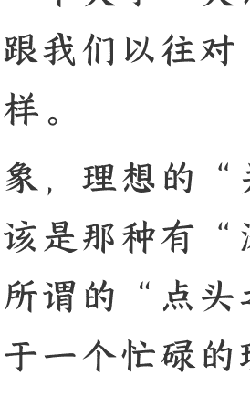

# [PAGE 0]

# 连接不是“积累时间”，而是“交换风险”

260421

整理：公众号懒人搜索，懒人专属群精选
懒人微信：lazyhelper1

今天我们来说一个关于“关系”的新视角。它可能跟我们以往对“关系”的理解都不一样。

按照通常的想象，理想的“关系”是什么样的？应该是那种有“深度”的连接，而不是所谓的“点头之交”。

但问题呢，对于一个忙碌的现代人来说，这样的深度关系是需要花时间，花精力经营的。假如顾不上，怎么办？

这就要说到，我们今天的重点了。英国萨塞克斯大学有一位心理学学者，叫吉尔安·桑斯特伦。她在近年的一项研究里提出一个概念，叫社交冒险。也就是，大胆地跟陌生人说话。当然前提是不对他人造成打扰。

# [PAGE 1]

接下来，我们就说说桑斯特伦的研究。这些研究，可以概括成这么三句话。

## 第一，社交冒险能激活“弱关系”，就是那种普通的日常互动。而“弱关系”对幸福感的提升，要超过很多人的想象。

早在 2013 年，桑斯特伦牵头做过一个实验，叫“星巴克实验”。过程大概是，她在星巴克门口发放 5 美元礼券，邀请顾客参与实验。参与者被随机分成两组：第一组，要求以高效的方式买咖啡，提前准备好钱，到了就买，全程不跟服务人员交流，拿了咖啡就走。而第二组，要求与咖啡师互动，包括微笑、眼神交流、简短聊天等等。

结果呢？第二组，也就是跟服务员闲聊几句的那组，整体的情绪更积极，而且负面情绪减少，对购物体验的满意度更高。说白了，在这个实验里，让你的心情变好的因素，是一个非常微不足道的细节，就是你跟咖啡多聊的那几句。

桑斯特伦还做过另一个实验。她招募了 50 多名志愿者，给每人两个计数器，记录一天中的对话次数。一个计数器记录与亲密朋友、家人的对话，另一个记录与陌生人和不常见面的人的对话。结果发现，拥有更多“弱关系对话”的志愿者，日常幸福感更高。

> 按照桑斯特伦的原话：“这些与熟人的小互动让我们感觉良好，让我们对世界更有信任感，更有社区归属感。我认为这是人类真正需要的东西。”

听到这，有人可能会说，我社恐，我不喜欢向陌生人开口，怎么办？这就要说到，桑斯特伦的第二个发现了。

## 第二，社交意愿就像肌肉，越练越强。

2022 年，她做了一个实验，来解决“不敢开口”这个问题。她设计了一个“寻宝游戏”式的训练方法。参与者在一周内，每天通过手机应用接收任务。这些任务要求他们主动去找陌生人说话。

比如，“找一个戴帽子的人交谈”。或者，“找一个戴眼镜的人交谈”。再或者，“赞美某人的毛衣”。这些任务不是让你去跟特定的人说话，而是给你一个具体的特征目标，比如找一个戴帽子的人。

# [PAGE 2]

实验开始前，大多数参与者认为这个任务会很困难。他们担心被拒绝。但实验结束后，参与者的普遍反馈是：比想象中容易得多，而且很有趣。更重要的是，参与者对被拒绝的担心降低了，而且这些积极效果，在实验结束后至少持续了一周。

说白了，人们普遍高估了“社交冒险”的风险，他们预测对方会拒绝、会觉得尴尬、聊天会失败。但实际上，被拒绝的情况比预想中少得多，而带来的正向感受比预想中多得多。

第三，弱关系背后，指向一个关于“真实连接”的本质。

### 第三，弱关系背后，指向一个关于“真实连接”的本质。

弱关系之所以有用，是因为它恰好满足了“真实连接”的三要素。分别是，在场、脆弱、不确定性。

首先，在场。也就是说，你在，我也在，我们共同经历着同一件事情。不是各自盯着屏幕，只是名义上“在线”。你看，当你在电梯里跟邻居说话，你们是真的面对面，能看到对方的表情，听到对方的语气，感受到对方的存在。

其次，脆弱。这个词听起来有点奇怪，它说的是：我展示了不完美的部分，你没有离开。桑斯特伦认为，这种暴露和被接住的感觉，是亲密感的核心材料。换句话说，当你主动开口跟陌生人说话，你暴露了“我想跟你交流”这个需求，你冒着被拒绝的风险。而当对方回应你，这个“暴露—接住”的过程就完成了。

休斯敦大学有位教授，叫布伦·布朗，她花了二十多年研究脆弱性，她的结论是：脆弱性是连接的诞生地，没有脆弱性，就没有真实的连接。

最后，不确定性。也就是说，我不知道你会怎么回应，但我还是选择了开口。换句话说，当你主动开口时，就等于向不确定性迈出了一步。正是这个不确定性，让这次互动变得真实。

假如结果是完全确定的，就像有的大公司举办颁奖典礼，领导上台嘉奖员工，这个过程里的每一句话，甚至每一个站立的位置都是提前排练好的。没有不确定性，因此就不会产生真实连接。这也是为什么这样的活动之后，领导和员工再见面甚至会装作不认识。

但假如双方都没有经过排练，现场全都是真实的问答、采访、互动，那么双方的关系大概率上能往前走一步。

亚当·格兰特，宾夕法尼亚大学沃顿商学院的组织心理学家，曾经讲过他自己的一段经历。那是 2024 年 1 月洛杉矶的一场演讲活动，为他的新书《隐藏的实力》做宣传。活动前一天，原定的对谈主持人因为生病来不了。于是，格兰特只好在活动当天早上，发出了一份“冒险的邀请”，邀请了他仰慕 25 年，但从未见过面的演员詹妮弗·加纳。好在加纳很给面子，专程赶了过来。

但两个人之间毕竟不熟，按理说，这次对谈应该很勉强。但活动结束后，格兰特收到了很多观众留言，说他们两人“化学反应太好了”，问他们是不是认识很多年的老朋友。

格兰特后来想了很久：这到底是怎么发生的？他的结论是：链接不是时间的累积。

那么，链接是什么？格兰特的答案是：交换风险。就像前面说的，双方都把自己“弱”的一面暴露给对方。

再比如，还有个例子，就是笑。从生理层面看，几个人一起捧腹大笑，也是在“交换风险”。

你想想，当你跟别人一起大笑的时候，你的身体是什么状态？科学研究发现，大笑的时候，人的肌肉张力会明显下降。你的呼吸变得急促，面部肌肉收缩，腹部膈肌抽动，笑得厉害了还会流泪、会喘不过气来。

从神经科学的角度看，当你笑的时候，大脑里负责威胁检测的杏仁核活动减弱了，负责攻击冲动的边缘系统被抑制了。换句话说，大笑的时候，你的身体在向对方传递一个信号，我放弃了攻击，也放弃了防御。

而且，笑是会传染的。研究发现，当你听到别人笑的时候，你大脑里的镜像神经元会迅速被激活，这个反应速度比你意识到“我正在笑”还要快得多。换句话说，笑声能让人不由自主地同步进入那个“卸下防备”的状态。

这就是为什么，陌生人之间一起笑几分钟后，亲密度会明显提高。

好，刚才我们从社交冒险，一路说到“真实连接”的本质。最后，在桑斯特伦的研究里，还有这么几件事，需要尤其注意。

首先，弱关系不是假关系。有人可能会说，弱关系听起来很功利，是不是就是那种表面社交、虚假客套？但是，按照桑斯特伦的标准，真正的弱关系，虽然轻盈，但必须真实。也就是基于真诚、互惠和尊重。假如明明对一个人没兴趣，却为了某个目的，刻意表现得很热情。这既不是强关系，也不是弱关系，而是假关系。真正的弱关系，虽然联系不频繁，但有基本的信任。

其次，社交冒险要有边界。桑斯特伦说的社交冒险，绝不是强人所难地要求别人回应自己。真正的社交冒险，是在尊重对方边界的前提下，主动释放善意。桑斯特伦说，弱关系的核心是轻盈。轻盈意味着，不强求，不纠缠，不给对方压力。这也是弱关系最珍贵的地方之一。

最后，弱关系往往能带来新机会。斯坦福大学社会学教授马克·格兰诺维特，早年发表过一篇著名的论文，叫《弱连接的力量》。他研究了很多人是怎样找到工作的，结果发现，68.6% 的人是通过弱关系找到工作的，只有少数是通过强关系。

---

在这个 AI 能替你写代码、写文章的时代，基础技能正在迅速贬值。绝大多数人正被淹没在海量的免费垃圾信息里，陷入低效的体力内卷。

当“努力”不再是壁垒，人与人之间唯一的护城河，只剩下“信息过滤”的效率与“认知系统”的维度。

圈子已稳定运行 7 年。我们每天利用 Python 爬虫与大模型算力，过滤全网顶级的政经内参和搞钱风向标，做你最冷酷的“外部大脑”。

如果你认同这种“重塑认知防线”的极客主义，欢迎围观我的个人情报智库：【懒人专属群】。
https://lazyso.com/insider/

认同信息过滤价值、想省下每天 3 小时无效阅读时间的读者，扫码加我微信（lazyhelper1）

公众号：懒人搜索
懒人专属群

微信：lazyhelper1