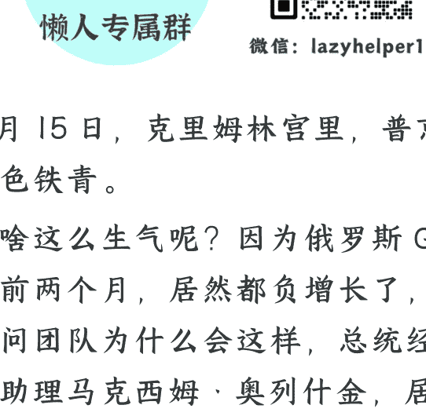

## 油价暴涨，俄罗斯经济却先撑不住了？

260421 文/卢克文工作室嘉宾 概略北方  
整理：公众号懒人搜索，懒人专属群精选  
懒人微信：lazyhelper1

4 月 15 日，克里姆林宫里，普京气得脸色铁青。

为啥这么生气呢？因为俄罗斯 GDP 今年前两个月，居然都负增长了，普京质问团队为什么会这样，总统经济事务助理马克西姆·奥列什金，居然给出了一个扯淡的解释：前两个月工作日少了 3 天。

按照奥列什金的逻辑，工作日少了，创造财富就少了，GDP 下降很正常对吧？工作日少了 7%，GDP 才下降 1.8%，还有啥不满意的？

这是糊弄鬼呢，普京拍着桌子怒斥奥列什金。

余怒未消的普京给奥列什金、央行行长埃尔维拉·纳比乌琳娜，以及财政部长安东·西卢阿诺夫下了死命令，当天就要拿到为啥 GDP 降低的详细报告，而且还要想出办法来。

问题来了，俄罗斯 GDP 为啥连续负增长？还能撑多久？

这几年网上一直有个说法，叫俄罗斯越打越有钱。

从数字来看，的确如此。2023 年，俄罗斯 GDP 增长 4.1%，2024 年是 4.9%，突破 200 万亿卢布，2025 年有所放缓，但也有 1%。

但仔细一想，这不太科学，难道西方国家都白制裁了？

其实，俄罗斯这种 GDP 的增长是有文章的。

GDP 是个增量概念，只要有经济活动进行，就有 GDP 的增长。比如，你雇人挖个坑，创造了 GDP；你再雇人把坑填上，还能增加 GDP。俄罗斯现在搞的，就是个国家级的先挖坑再填坑游戏。

首先是扩大赤字。

俄罗斯把大量资金用于生产海量军需物资，生产繁荣了，原料需求就大，人手需求就多，失业率下降，工资提升，消费旺盛，拉动经济。

俄罗斯为了招兵，大幅度提高军人待遇和抚恤金，一个士兵阵亡，能拿到总统一次性补偿金 500 万卢布、国家保险金死亡赔偿 344 万卢布、国家一次性补偿金约 516 万卢布，再加上地方政府发放的 100 万 -300 万卢布不等的地方补偿金，总额超过 1450 万卢布（人民币约 130 万）。

这可是一本巨款了。

突然有一笔巨款之后会怎样？

肯定是买房嘛。

于是俄罗斯的房地产业原地起飞，4 年时间，涨幅高达 214.6%。

咱们都知道，房地产对经济的拉动效应非常强，房地产一火，经济也就跟着起飞了。

但俄罗斯这一切的源头是什么？

是战争，俄罗斯现在的经济模式，有个经济学名字，叫“军事凯恩斯主义”。

就是政府通过天量的财政赤字去印钱、借钱，再用这些钱去促进生产、发抚恤金，人们拿着钱转头去买房、消费，直接拉动了国内的 GDP 数据。这玩意不可持续。

一个国家扩大赤字，去买进口设备、去搞基建，这些投资会持续产生经济红利，能增加收入，填平赤字。

但战争会产生什么经济红利呢？

花上亿卢布去造一辆坦克，运到顿巴斯前线，碰上一架无人机，这笔财富就从地球上灰飞烟灭了，它没有产生任何价值。

巨额抚恤金可以刺激消费，但随着伤亡人数增加，一个人上千万卢布，已经成了俄罗斯财政越来越重的负担了。2026 年，军人抚恤金（含阵亡 + 伤残 + 遗属）计划 6020 亿卢布，占社会政策预算 23%、占联邦总预算的 4%。

当然可以继续扩大赤字，但赤字不是无限的，短时间寅吃卯粮可以，时间一长，就露馅了。

2025 年的 1% 增长率已经很说明问题了，到了 2026 年，这个游戏终于玩不下去了。

2025 年年底，俄罗斯在做 2026 年预算的时候，定的 2026 年赤字目标是 3.786 万亿卢布（GDP 的 1.6%）。可是今年前两个月赤字是多少？3.449 万亿卢布。

也就是说，2026 年刚过去俩月，已经把全年赤字的 91% 给用光了，后面 10 个月还过不过？

为了搞钱，俄罗斯真是什么招都想了。

比如发债，俄罗斯 10 年期国债收益率已经飙升到了 14.5% 的恐怖高位，俄罗斯政府借的每一笔钱，日后都要还高利贷。

比如动用老本——国家财富基金（NWF），这是俄罗斯过去在高油价时期攒下来的国家小金库，原本是为了应对养老金短缺和极端危机的。开战前，NWF 里有超过 1100 亿美元的高流动性资产，现在呢？只剩几百亿美元了。

前一阵子俄罗斯抛售黄金，卖的就是 NWF 的黄金，想在黄金高位多挣点钱补窟窿，连压箱底的黄金都开始卖了，足可见俄罗斯缺钱缺到什么程度了。

光这么卖黄金吃老本是不行的，还要开源。

但开源很难。

比如，你要生产，要有人吧？

可是你的人呢？大量青壮年被送上战场，每一个战死的士兵，不仅代表着财政要大出血一次，更代表着国家永久性地损失了一个青壮年劳动力。

俄罗斯官方数据显示，现在全国的岗位空缺高达四百多万，劳动力缺口超过两百万。

为了和高薪军工企业抢人，民营企业只能被迫跟着涨薪，企业成本剧增，利润反而低了。还有一批技术精英为了躲避征兵跑到了海外，剩下的劳动力，刨去石油产业和粮食产业，还剩多少？

普京在会上提到，俄罗斯目前的失业率降到了 2.1%，乍一看似乎挺好的，但在战争状态下出现这个数字，本身就说明俄罗斯的劳动力池子已经濒临干涸了。连人都没了，你怎么去振兴经济？

俄罗斯现在的营商环境，也一塌糊涂。除了明面上的税收，还在搞各种名目的摊派和强制性战争捐款。

举个例子，3 月 26 日，俄罗斯组织开展了“工业家与企业家联盟大会”（RSPP），普京亲自主持，核心议题就是：国家现在有困难，你们捐点钱吧？

总统都发话了，寡头们敢不捐么？

还有，从 2023 年下半年开始，俄罗斯掀起了一场“去私有化”运动，总检察院以“90 年代私有化程序违法”为由，直接将大量涉足军工、化工、农业和港口的大型民营企业强行收归国有。

站在国家立场上，拨乱反正，情有可原。

但寡头不服气呀，自己辛辛苦苦几十年，到头来被你没收，那我岂不是白干了？

所以，大部分企业不愿意投资了，大家的心态就是：停止重资产投入，套现、变现、把钱藏起来。

因此，这种竭泽而渔，彻底破坏了俄罗斯本就脆弱的经济环境。

更何况，西方国家的制裁正在一点点显露出威力，俄罗斯很多企业长期依赖西方设备，早期还靠囤积的零部件维持，但随着制裁越来越严，设备老化、零部件断供问题全面爆发。

俄罗斯前两个月轻工业生产下滑了 12.8%，冶金下滑 6.4%，造纸下滑 13.3%，电气设备下滑 17.5%，通用机械下滑 8.7%。

制造业都萎缩成这样了，俄罗斯的 GDP 怎么可能不受影响？

## 2

有人可能会说，3 月份中东爆发了战争，国际油价暴涨，俄罗斯作为石油大国，难道不是躺着数钱，赚了个盆满钵满吗？

以菜市场思维，的确如此，油贵了，挣得就多了。

但国际能源市场，不是菜市场。

面对西方国家的二级制裁，俄罗斯的石油很难找到不怕制裁的买家，为了保证亚洲几个大客户的订单，俄罗斯不得不在价格上做让步，签订大量的长协合同。

举个例子，国际油价在 80 美元的时候，俄罗斯的油可能要打个 7 折，卖 60 美元。现在国际油价飙升到 120 美元了，买家会按比例给你涨价？想什么呢？按照固定折扣和锁定机制给你涨点就不错了。

所以，看起来油价涨了 40 美元，但到俄罗斯这里，可能只能涨 20 美元了。更何况，这 20 美元，也不是俄罗斯都能拿到的。

除了部分管道油之外，俄罗斯大部分石油出口，还是通过油轮，但因为制裁，很少有船东敢接俄罗斯的单，只能通过“影子船队”，通过关闭应答器、海上接驳的方式，偷偷卖油（伊朗也是这么玩的）。

这支船队背后的大老板是谁？有俄罗斯人，但更多的是希腊的航运寡头和中东、印度的空壳公司。

在平时，这帮人就靠着帮俄罗斯逃避制裁，收取着比正常市场高出两三倍的运费，现在好了，油价涨了，你猜运费会不会跟着涨？别忘了，美国已经拦截了三艘影子油轮了，谁知道美国会不会接着拦截？

风险那么大，我每桶油加个 5 美元运费来买保险，很合理吧？

而且，乌克兰可不会眼睁睁看着俄罗斯挣钱的。

从 3 月份开始，乌克兰增加了对俄罗斯能源设施的袭击力度，3 月连续 10 天袭击了波罗的海的普里莫尔斯克港和 NOVATEK 石油综合体，储油罐、输油管线、油轮装载台严重受损，出口作业一度全面暂停。

这两个港口承担了俄罗斯近 40% 原油出口，袭击导致波罗的海出口中断一周，俄石油日产量下降 43%，损失超 10 亿美元。

这样一来，导致俄罗斯一季度的油气收入不仅没能借着油价飙升起飞，反而面临了油价高，但就是交不出货的尴尬局面。

有人可能会说，如果石油卖不出去，那自己炼油，卖成品油行不行呢？似乎还能多卖点钱。

不行，因为乌克兰连炼油厂也炸。在 3 月份，阿尔巴什内夫特、萨拉托夫等大型炼油厂都被乌克兰袭击了，俄罗斯损失了 15% 的炼油产能。炼油厂不少设备都来自西方，在被制裁的情况下，设备一炸，修都没法修。

现在知道，为啥明明油价这么高，明明俄罗斯是产油国，俄罗斯却宣布从 4 月 1 日起停止汽油出口了吧？一个能源帝国，居然自己的汽油都不够用了。

所以，俄罗斯吃到的油价红利，比较有限，3 月的 GDP 能不再滑坡就不错了，就别指望着增长太多了（3 月份 GDP 至今未公布，本身就说明问题了）。

不过，俄罗斯难受归难受，但也不至于崩溃。

俄罗斯这个国家，韧性非常强，它有广袤的国土，以及完全能够自给自足的粮食和庞大的能源基础，还背靠一个大国提供几乎所有的工业产品，就算经济不好，苟也能苟到最后。

乌克兰的情况，比俄罗斯还要惨得多。经过几年的战争之下，财政完全崩溃，全靠西方国家的输血。

现在西方国家不想再填这个无底洞了。

请大家注意，援助乌克兰的资金里面绝大部分都是贷款，而不是无偿援助。也就是说，这笔钱是要还的。可一系列卖国矿产协议签完，土地、矿场都抵押出去了，乌克兰拿什么去还钱？

美国已经停止援助乌克兰，这事咱们都知道，但很多人不知道的是，现在连欧洲国家也不太想援助乌克兰了。

去年 11 月，匈牙利总理欧尔班直接否决了欧盟关于向乌克兰提供 900 亿欧元的贷款项目。

看起来锅都在欧尔班身上。

但大家想想，欧尔班是第一次否决欧盟的提案么？

不是，之前欧盟随便找个理由，就把匈牙利的否决给豁免过去了，这次为啥不豁免？这就是阴险之处，让匈牙利当坏人，自己顺水推舟不给钱。

欧盟预计在入夏之前如果还得不到援助，乌克兰就彻底破产了。

欧盟委员会正在敦促各国，加快发放一笔 450 亿欧元的贷款。这笔钱是当年 G7 答应给的，现在欧洲国家已经把

钱凑出来了，可是日本、英国、美国都在磨洋工，一点也没有掏钱的意思。

如果 7 月再拿不到钱，乌克兰就要出问题。

现在知道为啥泽连斯基突然跑到中东，去掺和这场和乌克兰八竿子打不着的战争了吧？他们把国内反无人机专家、无人机操作员派往中东，无非是向美国证明自己还有价值，换取援助，仅此而已。

虽然俄罗斯的情况很差，但相比乌克兰，俄罗斯还是好不少，双方都到了最困难、最需要咬牙坚持的时刻。

谁能笑到最后，就看谁更能在美以伊战事这场乱局中，把握机会了。

-----------分割线-----------

> “绝大多数人只盯着眼前的工资，却不知道一次远在中东的冲突、一次降息的决议，就能在一夜之间洗牌普通人的财富。”

> 看懂宏观，是为了在周期切换时，不被当作代价。

## 如果你认同这种“抬头看路”的长期主义，

欢迎围观我的个人情报智库：【懒人专属群】。

圈子已稳定运行 7 年。我们每天利用 Python 爬虫与大模型算力，过滤全网最顶级的政经内参和搞钱风向标，做你最冷酷的“外部大脑”。

### 查阅圈子完整数字资产与上车门槛：

https://lazyso.com/insider/

认同价值的。扫码加我微信，备注：【进群】

