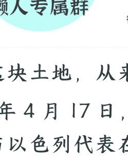
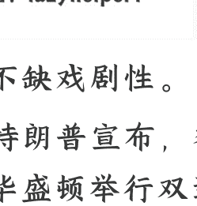

# 黎巴嫩停火协议达成，海峡却再次关闭，到底怎么回事？

2026 年 04 月 21 日 文/卢克文工作室 嘉宾 小小罗
整理：公众号懒人搜索，懒人专属群精选
懒人微信：lazyhelper1

中东这块土地，从来不缺戏剧性。

2026 年 4 月 17 日，特朗普宣布，黎巴嫩与以色列代表在华盛顿举行双边会谈，达成了停火协议，停火协议达成后次日，伊朗和美国相继宣布，霍尔木兹海峡开放。

但仅仅一天后，伊朗宣布，因美国违反协议，将重新封锁海峡。

这画风看着有点让人无语，反反复复，到底是怎么回事？

## 1 事情是这样的。

4 月 16 日美国国务院公布，自美东时间 4 月 16 日 17 点(黎以当地时间 17 日零时)起，实施为期 10 天的停火。停火期间，以色列不对黎巴嫩发动进攻，但保留自卫的权利。

伊朗外长阿拉格齐发帖表示，“为配合黎巴嫩停火，现宣布在停火剩余期间，霍尔木兹海峡将完全向所有商船开放。通行须沿协调确定的航道进行，该航道此前已由伊朗伊斯兰共和国港口与海事组织公布。”

特朗普看到后，在短短一个小时内，发了 9 个帖子，表示双方就停战协议，进行了更多更深入的谈判，伊朗已经同意了五项特别劲爆的内容，分别是：

*   ( 1 ) 对于伊朗“完全”开放海峡表示感谢；
*   ( 2 ) 海峡将正常开展商业活动，正常通话，而美国将保持对海峡的封锁；
*   ( 3 ) 伊朗将交出全部浓缩铀（450 公斤），美国不会给任何补偿；
*   ( 4 ) 在美国的帮助下，伊朗正在清除所有水雷；
*   ( 5 ) 伊朗同意永远不再关闭海峡。

说实话，伊朗要是答应这 5 项内容，和投降有啥区别？一个多月的抵抗，无数牺牲，岂不是打水漂了？如果上述内容，单纯从特朗普嘴里说出来，外界只会觉得他在许愿，没人真当回事。

但有阿拉格齐的表态对照，问题就太大了。连伊朗外交部长都说“霍尔木兹海峡将完全向所有商船开放”，莫非特朗普说的是真话？

于是，不少人相信伊朗要投降，欧美股市反弹了一波，油价大跌。

伊朗官媒迈赫尔通讯社，直接对阿拉格齐开炮：“为特朗普超越现实、宣布自己赢得战争并庆祝胜利提供了最佳机会”，与停火相关的谈判并不只是由外交部负责。

意思就是，你丫的乱说话，给了特朗普发挥空间。

塔斯尼姆通讯社表示“外长的帖子描述是一条糟糕且不完整的推文，它给霍尔木兹海峡的重新开放造成了误导性的模糊”。

然后说，伊朗为海峡通航，设置了三个条件：船只必须是商船，军舰禁止通过；必须按照伊朗官方指定的航线；必须与伊朗武装部队协调通过，也就是得报备。

两个媒体，都和革命卫队有密切联系，尤其是塔斯社，被称为“革命卫队的喉舌”，一国官媒直接点名自家外交部长，这是很罕见的事。显然，革命卫队对阿拉格齐非常不满，强硬派对温和派非常不满。

随后，革命卫队干脆宣布，因美国违反停火协议，决定再次关闭海峡。

阿拉格齐和特朗普有没有什么勾兑？

这个外界不知道，但海峡反反复复关了又开，开了又关，证明停火没那么简单，双方的立场相差很远。

## 02 停火协议，只是提了停火，没提以色列撤军，伊朗舆论是很不满的。

为啥会这样？因为这次停火谈判，由卢比奥主持，黎以两国政府签署。

注意，黎巴嫩真主党，和黎巴嫩政府，是两码事。黎巴嫩政府一直亲西方，对以色列的态度十分暧昧。

黎巴嫩真主党则坚决抵抗以色列。

所以，美国不让真主党参加谈判，让以色列驻美大使，和黎巴嫩驻美大使谈判。

潜台词就是：华盛顿不承认真主党拥有谈判资格，削弱真主党的合法性。

战场上能打仗的，坐不到谈判桌上，坐到谈判桌上的，却又管不住打仗的，那停火协议又该怎么实现呢？

这不，双方会谈结束后，内塔尼亚胡公开表示，要占领真主党重镇宾特朱拜勒，真主党立刻用 50 枚火箭弹回应。

而且，谈判是特朗普直接施压内塔尼亚胡本人达成的，并非以色列政府做出的集体决定。

很多安全内阁成员，是事先通过媒体知晓的停火事宜，惊讶之余才接到内塔尼亚胡的正式通报。

这就导致，内塔尼亚胡不敢在内阁进行公开表决，怕被大家推翻。

显然，这样的停火谈判，很多重要的东西都没法谈，谈了也落实不了，所以，停火协议没提真主党的地位问题，也没提以色列撤军，只是单纯停火十天。

问题来了，十天之后呢？

以色列国防部已经提出，在黎巴嫩南部，建立一个缓冲区。

*   第一，在黎巴嫩南部设立一个 8 公里宽的永久缓冲区，严禁流离失所的平民返回。
*   第二，利塔尼河以南的所有区域将被划定为军事行动区，以色列将在此拆除真主党的基础设施，并彻底解除其武装。
*   第三，利塔尼河以北的黎巴嫩剩余地区，由黎巴嫩军队出面彻底解除真主党武装并瓦解其组织。

三大条件，远远超出停火的范畴。

IDF 的计划就是长期占领黎巴嫩南部，夺取利塔尼河的水资源，消灭真主党。本来撇开真主党谈判，伊朗就不高兴，现在你还要长期占领？伊朗要是没反应，很容易被外界认为，要出卖兄弟。

所以，反手又把海峡的大门给关上了。

说到底，黎以之间的战略诉求，存在巨大落差，谈判很大程度上是为了迎合特朗普，以色列真正期望的是借助黎巴嫩政府的配合，实现解除真主党武装这一战略目标。

而黎巴嫩政府的目标则是尽快推动以色列停火，在解除真主党武装方面徐徐图之，至于和以色列关系正常化，乃至建交，都没有进入其考虑范围。

真主党、美国、以色列、黎巴嫩政府四方的诉求，压根不在一条道上。

而这种分歧，何尝不是这次战争的缩影。

美国、伊朗、以色列三方的诉求，也不在一条道上。

美国希望体面脱身，不想再和伊朗纠缠，希望通过极限施压，让伊朗答应一系列条件，比如前面提到那 5 项；

以色列则希望拖美国下水，对伊朗实行政权更迭；

伊朗要求掌控霍尔木兹海峡，拯救“抵抗之弧”成员，拒绝投降；

诉求完全南辕北辙，这就是停火反反复复、海峡开了又关、关了又开的根源，能谈得拢固然是好事，谈不拢就只能再次开战。

毕竟，强扭的瓜不甜。

当特朗普踏进泥潭的那一刻，他就很难离开了，泥潭下的淤泥，比他想象中要深得多。

## 分割线

绝大多数人只盯着眼前的工资，却不知道一次远在中东的冲突、一次降息的决议，就能在一夜之间洗牌普通人的财富。

看懂宏观，是为了在周期切换时，不被当作代价。

如果你认同这种“抬头看路”的长期主义，欢迎围观我的个人情报智库：【懒人专属群】。

圈子已稳定运行 7 年。我们每天利用 Python 爬虫与大模型算力，过滤全网最顶级的政经内参和搞钱风向标，做你最冷酷的“外部大脑”。

查阅圈子完整数字资产与上车门槛:

https://lazyso.com/insider/

认同价值的。扫码加我微信，备注：【进群】

微信：lazyhelper1