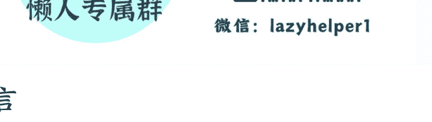

# 该如何教育？！

260421 守夜人总司令付费

整理：公众号懒人搜索，[懒人专属群](https://j.com/lazy/)精选

懒人微信：lazyhelperl

微信：lazyhelperl

## 前言

整个社会都在把女人当孩子哄，把穷人当傻子哄。似乎不这样又不行。

读过《目诬告成风！！》的人会发现，在这个时代，男孩子被毁掉人世的概率越来越大。以前那位男孩不管怎么样都不吃亏的观念逐渐不适合现实生存处境。新一代的父母们发现：要让一个男孩在这个时代健康正常的过完一生，除了要与社会分流机制和电子鸦片对抗之外，在婚恋方面也出现了致命的风险！

有多少屏幕前的中年男性正在为自己当年的草率持续买单——即便像一个 NPC 一样背负所有的生活成本却依然毫无尊严。这里说的不是背负正常的家庭责任，而是作为一个供养者的无奈——这些人燃烧自己来保证整个家庭的生存运转，同时又被所有人忽视和鄙夷，就像一个 NPC 一样！

为什么会活成这样？这源于在那些真正重要的人生议题上的草率和冲动。

而这种草率和冲动都源自于自我想象的滤镜。男性的思维方式是以解决问题为导向。所有正常的男性都是按照这个方向被塑造的！所以，男生在未深入接触女性之前会把对方想象的过于完美。实际上，所有的舆论和影视作品以及文艺载体也在为这种幻想推波助澜。任何一个女生在长大成年之前，都会被反复告诫，情感是不可靠的，男人具有欺骗性。然而，所有的舆论和周围的环境都哄骗小男孩：爱情是神圣的，女性是唯美和温柔的。似乎没有人去追问这种浑然不觉的差异是如何产生的？这种潜移默化的导向性，是为了一个什么样的目的而存在？

所有的清醒，都是从追问这些让人浑然不觉又觉得理所当然的现象开始的。人一旦对自己的东西进行追问，很多让人毛骨悚然的细节就会逐渐浮现出来！人一旦看到了真相，就再也难以自欺欺人。

你去问一个刚毕业的大学生，月薪多少和存款多少是正常的？如果是一个男大学生，他说的数据一定比较少。如果是一个女大学生，她说的数据往往非常的高。哪怕这个男大学生的家庭条件比那个女大学生的家庭条件好的多，也会产生这样的巨大差异！你猜为什么会这样？

因为男大学生在回答这个问题的时候，潜意识中代入的是自己——他脑子中想到的是：以我现在的能力可以做什么才能获得？而女大学生回答这个问题的时候，潜意识中代入的是对方——她给的数据是她内心对别人的要求，她准备用这个要求来筛选别人，而不是要求自己！

如果你留心观察就能在日常的生活中经常发现这样的情况：一个男人遇到自己解决不了的问题，往往会用最尖锐的言辞去批判社会的不公。而一个女人遇到自己解决不了的问题，则会用最恶毒的语言批判老公的无能！哪怕这种事是天灾人祸，也会归因到丈夫头上。

男人为什么在无可奈何的时候抱怨社会不公？这种心态本质上是希望现实世界给自己一席之地，希望现实世界能把解决问题的门槛降低到自己够得着的水平，从而能重新找回胜任感并解决掉眼前的困难。

女性在遇到无可奈何的问题时为什么会本能怪罪于别人呢？这种行为在潜意识中是希望有人能把自己从现实的困境中摘出来。它本质上是不打算解决问题，只想把自己的问题变成别人的问题，从而让自己从各种无力应对的现实问题中抽身出来。

这种差异性不是一天形成的，这是经年累月在潜移默化中逐渐形成的。而且大家都没有觉得这有什么不正常的。恰恰是这种不正常的正常，让彼此从源头上走向不同的塑造之路。

这种不同的塑造和驯化，造成的最终结果就是：婚姻对于男性而言是承担责任和解决各种生存问题的开始。而对于女性而言则是逃避现实生存问题的庇护所——虽然没有人把这个结论直接说出口，但大家都潜移默化的遵循着这个规则。许多女生都不自觉的会产生这样的想法：实在不行找个有钱人嫁了！这种想法在潜意识中意味着那种驯化让许多女生会本能的把婚姻看成是人生兜底的庇护所。这也是为什么女人总是对丈夫不满的深层次原因——因为在那种思维和心态的惯性中，自身所有的诉求和恐惧都需要在这个庇护所中等到解决，如果解决不了怎么办？不能接受！

社会上各种偏向性的规则并不是出于保护弱小的目的，这些东西本质上是一些持续弱化的措施。就如同美国人把印第安人赶入印第安保留地，表面上看起来是一种保护，是给予印第安人超越美国法律的自由和特权。然而，事实上，这是一种永恒的封印——这些印第安人被永远困在保留地上与真实的世界格格不入，最终任其自生自灭。

所有的成长都是逆人性的，不用成长才是顺应人性。所以，整个社会在方方面面都把女人当孩子哄，把穷人当傻子哄。为什么不讲真话？因为，对无力面对现实的人讲真话并不能起到激励作用，反而会激发更强烈的情绪反应。所以，持续的弱化和哄骗就变成了一种必然。

当你理解了这一点，如果你碰巧又有未成年的女儿。你应该明白该如何教育她了。如果你有一个未成年的儿子，或者你自己突然醒悟，你应该知道如何去做了。

> 分割线

在这个 AI 能替你写代码、写文章的时代，基础技能正在迅速贬值。绝大多数人正被淹没在海量的免费垃圾信息里，陷入低效的体力内卷。

当“努力”不再是壁垒，人与人之间唯一的护城河，只剩下“信息过滤”的效率与“认知系统”的维度。

圈子已稳定运行 7 年。我们每天利用 Python 爬虫与大模型算力，过滤全网最顶级的政经内参和搞钱风向标，做你最冷酷的“外部大脑”。

如果你认同这种“重塑认知防线”的极客主义，欢迎围观我的个人情报智库：【懒人专属群】。
https://lazyso.com/insider/

认同信息过滤价值、想省下每天 3 小时无效阅读时间的读者，扫码加我微信（lazyhelperl）

