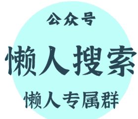

# 苹果换帅：上一任的短板，就是下一任的使命

2026-04-22

整理：公众号懒人搜索，懒人专属群精选

懒人微信：lazyhelper1

今天从一条最近的热搜说起。4 月 20 日，苹果公司正式宣布，现任 CEO 蒂姆·库克将于今年 9 月 1 日卸任，转任执行董事长。接替他的，是苹果硬件工程高级副总裁约翰·特努斯。

要知道，对大公司来说，“交班”这个事向来是最容易破圈的。你看很多公司八百年不上个新闻，可一旦交班，立马热搜。假如这个发生交接的公司是苹果，就更让人在意。

为什么？一来，从乔布斯时代开始，苹果就是一家"CEO 个人势能”极高的公司。即使库克行事风格低调了很多，但依然三天两头上新闻。

二来，苹果这家公司牵扯的范围太广了。苹果现在的市值 4 万亿美元，牵扯到的合作方极多。它的状况不仅直接影响科技行业的竞争格局，还对经济、对社会有着相当大的影响。你看前段时间，苹果只是把“一部分”供应链放到印度，就在当地创造了几十万的直接和间接就业。

因此，苹果的最高权力交接，也被很多媒体看成是，近十年来整个科技行业影响最深远的人事变动之一。

那么，这位即将上任的新 CEO，特努斯，到底是什么来头？苹果又为什么选择他作为库克的继任者？

关于这些问题，我想请你关注一个特别的角度。就是把上一次库克接班和这回特努斯接班，放在一起看。也许我们能从中发现一个特别的交接逻辑。就是苹果每次选 CEO，选的未必是“最好的人”，但一定是“最对题的人”。每一次换人，上一任 CEO 没解决的那个最大问题，恰恰就是下一任 CEO 最核心的任务。

上一任的短板在哪，下一任的价值就在哪。

当然，没人知道苹果董事会真正怎么想的。我们要说的，只是一个单从结果层面所体现出的规律。

要想说清楚这件事，我们得先从苹果的上一次权力交接说起。当年乔布斯为什么选择库克？

要知道，2011 年，乔布斯把苹果交给库克的时候，外界几乎是一片不看好。那一年，乔布斯已经病得很重，几乎所有人都在担心一件事：苹果，能离开乔布斯活下去吗？

这个担心不是没有道理。你看，那个年代的苹果，几乎是建立在一个人的天才之上的公司。产品战略是乔布斯牵头，发布会是乔布斯主持，就连整个苹果的品牌气质也跟乔布斯本人高度绑定。iPhone、iPad、Mac，每一个重磅产品背后都有乔布斯的影子。说白了，苹果那时候不像一家公司，更像是一个人的延伸。外界甚至直接把苹果称为“乔布斯的苹果”。潜台词是，这家公司离开了这个人，可能就什么都不了了。当时还有很多分析师预测，没有乔布斯的苹果，会慢慢失去方向，最终变成一家平庸的科技公司。

因此，2011 年的苹果，面对的最紧迫的问题是什么？不是“下一个革命性产品是什么”，而是“这家公司能不能在没有乔布斯的情况下继续正常运转”。这是两个完全不同的问题，解决这两个问题，需要的是两种不同的人。

而库克呢，他不是一个产品天才，也不是一个技术先知。

他专长是什么？首先，对外，他是一个供应链专家，1998 年，乔布斯第一次把库克招进苹果，给他的任务就是整顿当时混乱的供应链体系。库克上任几个月，就把苹果的库存从超过两个月的积压，压缩到了只有几天。其次，对内，库克之前是苹果的运营负责人，对整个苹果公司的运营有全局把控。

说白了，乔布斯选他担任 CEO，也许不是因为库克能做出下一个 iPhone，库克也永远不可能像乔布斯那样，在聚光灯下做出震撼世界的演讲。但库克能保证这家公司在没有乔布斯之后，仍然可以继续增长，稳定地把产品交付到全球消费者手里。

换句话说，乔布斯之后的苹果，核心目标不是“隔三差五吓你一跳”，而是“长期保持稳健成长”。

而库克接班以后，几个关键举动似乎都在回应这个目标。

- 改造供应链。库克是整套“把苹果供应链放到中国”的设计师。1998 年他加入苹果，就开始推动苹果关闭自有工厂，把生产交给中国的制造商，而富士康是这套体系的核心。
根据库克在 2026 年 3 月来中国时的说法，今天苹果前 100 大供应商里，有 80 家在中国。

在这套体系下，苹果能做到新品上市即全球同步发货，而且很少断货。比如 2020 年，全球新冠疫情出现，芯片短缺，三星、索尼、任天堂都出现了产品断供。而苹果在那段时间里，整个世界行业里控制得最好的，很少出现过“苹果产品缺货买不到”的情况。

- 库克对订阅业务的扩展。他在任期间，把 App Store、Apple Music、iCloud、Apple TV+这些服务业务，打造成了苹果收入的第二条腿。今天，苹果的服务业务每年贡献将近 1000 亿美元的收入，而且毛利率远高于硬件业务。

换句话说，即便哪一年 iPhone 卖得不理想，苹果的财报也不会崩塌。一家靠单一产品支撑的硬件公司，被库克推动转型成了一家硬件加订阅的复合型企业，抗风险能力和估值逻辑都发生了变化。

库克上任时，苹果市值大约 3500 亿美元。他卸任时，苹果市值已经超过 4 万亿美元。根据《华尔街日报》的报道，库克在任期间，苹果股价涨幅超过 1900%。年营收从 1080 亿美元增长到 4160 亿美元。

- 库克是一个非常出色的“政治外交家”。为什么这么说？举个例子你感受一下。

在美国发动贸易战期间，库克一边维护着苹果与中国市场的深度合作，一边处理着来自美国联邦监管机构的反垄断压力，同时还要应对欧盟对 App Store 的合规调查。这些工作，乔布斯时代的苹果根本不需要面对，因为那时苹果还没有大到需要跟政府深度打交道的程度。

换句话说，**乔布斯之后的苹果，面对的问题不是继续“一鸣惊人”**，而是更大更稳。而在很多人看来，库克就是这个新问题的解题人。

说到这，我们再看这一轮交接。在库克之后，苹果面对的新问题是什么呢？很多科技媒体的分析都指向一个东西，AI。而且这个问题对苹果来说，也许已经“如鲠在喉”很久了。

苹果有全球 25 亿台活跃设备，有自研的 M 系列芯片，有全球顶级的消费电子硬件，在隐私保护方面还有天然的用户信任优势。理论上，苹果应该是这场 AI 竞赛里最有底气的选手之一。

但现实呢？在 AI 这场竞赛里，苹果被普遍认为是“落后者”。

比如，Siri 是 2011 年和库克同一年登台亮相的。当时整个行业都觉得苹果在智能语音助手上，走在了前面。但接下来的十年，Siri 却几乎停滞了。据说很多苹果员工自己都不用 Siri。

根据科技分析师丹·艾夫斯的观点，**苹果正在 AI 战略上做重大转型，特努斯将面临巨大压力，尤其在 AI 方面要尽快拿出成果**。《华尔街日报》也说，特努斯面临的最大挑战，是如何在 AI 时代重新定义苹果。

换句话说，**库克没有解决的 AI 问题**，也许将成为特努斯时代最核心的命题。

说到这，我们再看看特努斯的履历。约翰·特努斯，1975 年 5 月出生，马上 51 岁，宾夕法尼亚大学机械工程专业出身。2001 年加入苹果，一待 25 年，从产品设计工程师做起，从未离开过苹果，算是苹果的“原生人才”。

他还主持了 Apple Watch、AirPods、Vision Pro 的全部硬件工程。《卫报》描述他是一个“和蔼的机械工程师”，管理风格更接近沉稳的库克，而非乔布斯式的激励型领导。

根据很多科技媒体的分析，苹果选特努斯，也许意味着公司将从库克时代的运营效率驱动，重回工程与产品驱动。

这里还有个细节值得留意，特努斯主导过苹果 M 系列芯片的研发，而且他在 M 系列芯片里设计了专门的神经网络引擎。从技术上看，这个设计对 AI 的本地部署比较友好。之前谷歌和 OpenAI 的路线，是把 AI 部署在服务器上，用户每次交互都需要通过网络访问云端。而从苹果最近一段时间放出的消息看，他们押注的方向，也许是“端侧 AI"，也就是把大模型直接在手机里运行。理论上，这可以做到更快速，更私密，更稳定。

换句话说，库克之后的苹果，要面对的新问题是 AI，从目前的情况看，特努斯也许更擅长解答这个问题。

现在，回到开头说的，假如把苹果的两次权力交接放在一起，我们能发现什么？也许是，它的每次交接，都不是在找“最完美、最全面、最优秀”的人，而是在找那个“最对题”的人。

乔布斯交棒库克的时候，苹果面对的问题是，一家靠“个人天才”驱动的公司，能不能在那个人离开之后继续稳健发展？而库克擅长的是运营体系和供应链效率，是很合适的解题人。

而库克交棒特努斯的时候，苹果面对的问题是：一家全球最赚钱的科技巨头之一，能不能在新一轮 AI 革命里继续领先？在很多人看来，工程师出身的特努斯，也许是很合适的解题人。注意，再强调一遍，我们并不知道苹果的真实决策逻辑。但至少从结果上看，苹果选接班人，好像不是在找最好的 CEO，而是在找下一个问题的答案。上一任 CEO 的最大短板，也许恰恰定义了下一任 CEO 的核心价值。

在这个 AI 能替你写代码、写文章的时代，基础技能正在迅速贬值。绝大多数人正被淹没在海量的免费垃圾信息里，陷入低效的体力内卷。

当“努力”不再是壁垒，人与人之间唯一的护城河，只剩下“信息过滤”的效率与“认知系统”的维度。

圈子已稳定运行 7 年。我们每天利用 Python 爬虫与大模型算力，过滤全网最顶级的政经内参和搞钱风向标，做你最冷酷的“外部大脑”。

如果你认同这种“重塑认知防线”的极客主义，欢迎围观我的个人情报智库：【懒人专属群】。

https://lazyso.com/insider/

认同信息过滤价值、想省下每天 3 小时无效阅读时间的读者，扫码加我微信

（lazyhelper1）

