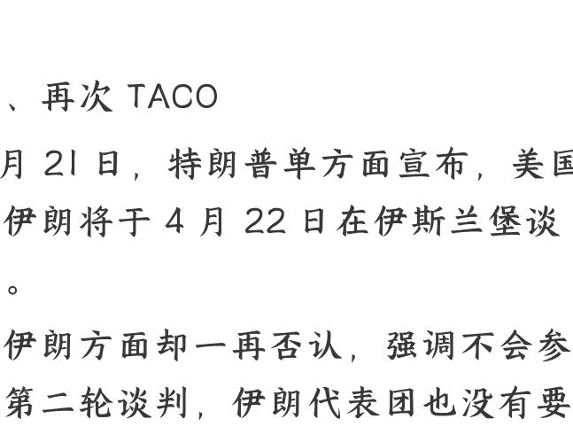

# 一、再次 Talk

260423 文/卢克文工作室 岱山  
整理：公众号懒人搜索，懒人专属群精选  
懒人微信：lazyhelperl

## 既不谈也不打，美伊这是要干什么？

4 月 21 日，特朗普单方面宣布，美国和伊朗将于 4 月 22 日在伊斯兰堡谈判。

可伊朗方面却一再否认，强调不会参与第二轮谈判，伊朗代表团也没有要出发的迹象。

4 月 22 日，也是美伊停火结束的日子，停火倒计时在嘀嗒作响。

最先绷不住的，是特朗普。

> > 华盛顿时间 21 日下午 4 点 9 分，也就是北京凌晨 4 点 9 分，距离停火结束仅 8 个小时，特朗普再次 Talk，宣布了没有最后期限的延长停火期。

特朗普给自己找了两个理由：鉴于伊朗政府严重分裂（这并不令人意外），并且应巴基斯坦陆军元帅穆尼尔和总理夏巴兹请求，我已经指示我们的军队继续封锁，并将停火延长，直到他们提交方案并完成谈判为止。

# 二、双向封锁

4 月 11 日，美伊第一轮伊斯兰堡会谈无果而终。

4 月 13 日，特朗普想了个绝世好主意，反向封锁。伊朗做初一，封锁霍尔木兹海峡。那美国做十五，封锁阿曼湾，禁止伊朗船只进出。

本以为能掐住伊朗的咽喉，没想到伊朗根本不为所动。

霍尔木兹海峡最窄处只有 40 公里，岸上几门火炮便可造成极大威慑。

美军的封锁线，从伊朗东南角恰巴哈尔港附近，至阿曼东北角拉斯哈德角，直线距离大约 350 公里，海域辽阔，扎不紧口袋。

封锁线越长，兵力消耗越大，这就决定了，美军海上封锁是个力气活，不可能做到应检尽检、应拦尽拦。

1961 年，古巴导弹危机期间，美国至少调用了 8 艘航母，100 多艘舰船，40 多艘巡逻船，才完成对古巴的封锁。

而如今对付伊朗，美国只有 1 艘“林肯”号航母，10 来艘驱逐舰，1 万来人，要监控的水域面积却高达 8 万平方公里，显然力不从心。

美军封锁只能走卫星监测——定点跟踪——海上围堵——武力登船这条路，具体如下图所示。

**媒体推测，根据驱逐舰的速度，美军满打满算，一天最多可以拦截 6 艘船只。**

而伊朗有的是方法躲避美军封锁：

- 一是可以走里海的港口，那里有好大哥俄罗斯在帮衬；
- 二是贴着伊朗领海航行或陆上运输，先运到隔壁的巴基斯坦，到那儿自有某大国接收；
- 三是大量伊朗影子舰队甚至不开 AIS（船舶自动识别系统），美军很难捕捉。

13 日以来，至少有 26 只和伊朗有关的船舶突破美军封锁。而美军自己称已指令 27 艘伊朗船只掉头返回。

# 三、开了又关

也就是说，美国海上的封锁效率也就一半一半。

所以说，美军的反封锁策略，压根没能迫使伊朗返回谈判桌。

这个时候，特朗普有点着急了，赶忙再次请巴基斯坦出马，再来一波穿梭外交，替美国传话。

4 月 15 日至 17 日，巴基斯坦大元帅穆尼尔亲自访问伊朗，据说带着特朗普的口信。

穆尼尔这一趟主要是给双方重启谈判找一个体面的台阶。

**这个台阶就是双方各退一步，同步宣布霍尔木兹海峡有限开放。**

于是，4 月 17 日，我们看到，美伊双方几乎同时宣布霍尔木兹海峡商业开放，但也都留有余地。

特朗普说将继续保留对伊朗的海上封锁，伊朗外长阿拉格齐说必须按照伊朗的航线通行。

特朗普连发多条推文“感谢”伊朗，国际油价应声暴跌超过 10%。

**有了这一步相互示好的信号，这才传出双方要在周末（4 月 19 日至 20 日）开启第二轮谈判的消息。**

眼瞅着大局已定，穆尼尔也就打道回府，着手准备接待工作和谈判场地了。

可到了最后时刻，往往越容易出乱子。

问题出在特朗普的大嘴巴上。

得意忘形的特朗普，17 日当天连发七条推文，就差宣布伊朗几乎无条件投降。

特朗普宣称，伊朗已同意不再关闭霍尔木兹海峡，在美国协助下“已经或正在”清除所有水雷。美国将获得伊朗所有“核尘埃”（浓缩铀），且不会以任何方式、任何形式支付任何款项。伊朗将放弃浓缩铀计划，期限不是 20 年，而是永久。

可真实的谈判情况截然不同。据《**华尔街日报**》披露，美国最初要求伊朗冻结铀浓缩 20 年，伊朗则要求缩短至 5 年，后来在巴基斯坦劝说下，同意 10 年暂停期，并再用 10 年时间将现有浓缩铀稀释到低水平。不过前提是，美国解冻伊朗 200 亿海外资产，并允许伊朗继续控制霍尔木兹海峡。

伊朗觉得，将暂停浓缩铀活动从 5 年改成 10 年，已经作出巨大让步，但特朗普居然说不是 20 年，而是永久，且没有任何补偿。

于是，伊朗强硬派震怒，连夜予以回击。

18 日凌晨，温和派代表，伊朗议长卡利巴夫发文驳斥，特朗普此前在 1 小时内发布的 7 项声明均不属实。美方靠谎言没能赢得战争，在谈判中也将注定一无所获。

紧接着，伊斯兰革命卫队发表声明，因特朗普背信弃义，再次全面封锁霍尔木兹海峡。

霍尔木兹海峡的开了又关，伊朗态度的 180 度大转弯，背后折射的实际是伊朗强硬派和温和派的博弈。

“七连推事件”之后，根据美国战争研究所评估，伊朗权力架构出现了显著的变化。

温和派代表，议长卡利巴夫和外长阿拉格齐的声音逐渐边缘化。

卡利巴夫公开担忧，他和阿拉格齐都将面临被解职的风险。

强硬派代表，伊斯兰革命卫队总司令瓦希迪全面掌控伊朗的军事应对和谈判立场。

据称，瓦希迪如今是唯一能直接接触到伊朗最高领袖穆杰塔巴的官员。穆杰塔巴通过瓦希迪向其他官员传达关键决策。

伊朗的强硬转变，令特朗普措手不及，当天进入战情室，紧急开会。

参会人员包括副总统万斯、国务卿鲁比奥、防长赫格塞思、财长贝森特、特使威特科夫、中情局局长拉特克利夫、参联会主席凯恩。

会上进行了激烈的讨论，美国国内势力也在内斗，温和派代表副总统万斯与主战派代表防长赫格塞思的斗争日益白热化，特朗普在两派之间摇摆不定。

根据美国国防部与国家情报总监办公室的联合评估报告，伊朗加快清理地下掩体，挖出了不少好东西，仍保有约 70% 的战前导弹库存、约 60% 导弹发射装置以及约 40% 攻击型无人机武器库。

相关报告同赫格塞思此前宣称“摧毁伊朗 90% 导弹”的政治宣传形成巨大反差，暴露出美国实战战果严重注水。

这意味着，伊朗的军事能力不仅没有在战争中耗尽，反而在停火期间得到了修复和补充。

赫格塞思在会上继续高呼“优势在我”，强调第 82 空降师、第 11 海军陆战队远征军、第三艘航母马上完成集结，下一步可以开展两项计划，

> “特别冲滩行动”指的是夺取哈尔克岛，谈判伊朗石油出口。
>
> “特别空降偷铀行动”指的是空降伊朗核设施掩体，夺取浓缩铀。

知情人士说，特朗普最后还是叫停了赫格塞思的计划，他的原话是：“他们会成为活靶子。"

嗯，特朗普这一句倒是清醒话。

几个人讨论了几个小时，战情室开会的结果是，先拿走一艘伊朗油轮，给伊朗一点颜色看看。

于是 4 月 19 日，美方“斯普鲁恩斯”号驱逐舰在阿曼湾追了伊朗“图斯卡”号油轮 6 个小时，最终扣押了这艘油轮。

特朗普很高兴，又是一篇长推文，我们成功拦截了一艘比航母还要长的伊朗油轮！

毫无疑问，这也进一步激怒了伊朗。第二轮伊斯兰堡会谈彻底泡汤。

直到美国代表团已经出发，伊朗方面也没有任何动静。这就回到了文章开头。

特朗普率先坐不住了，主动延长了停火期。

# 四、90 天期限

截至目前，伊朗战争已经打了 53 天，早已超出特朗普最初设定的四到六周的时间表。

依据美国《1973 年战争权力决议》，未经国会授权的军事行动，60 天内必须获国会授权，否则需在额外 30 天内撤军。

若在 90 天内未获国会授权且拒绝撤军，将触发宪法危机。

特朗普希望通过“有限打击”等由头来规避国会审批，但民主党根本不买账，已经先后提出 10 项议案限制特朗普对外动武。

4 月 16 日，民主党在众议院提出《战争权力决议案》，强制要求总统特朗普立即停止对伊朗的军事行动，且未来任何对伊动武必须先获得国会正式授权。

结果 213 票赞成，214 票反对，议案以极其微弱的 1 票之差被否决。

1 票之差，哪怕再有一名共和党人反水，特朗普的对外军事主导权就岌岌可危。

此前，众议员玛乔丽·泰勒·格林（MTA）、参议员丽莎·穆尔科斯基和苏珊·柯林斯等共和党反战派已经反水，附和民主党提案，反对特朗普对外动武。

随着美国国内民众、MAGA 阵营反对战争的声浪越来越大，不排除有更多的共和党议员反水。

根据 4 月 21 日民调，特朗普的支持率降至 30%，创第二任期以来新低。

63% 的受访者不认可其执政表现，经济议题和伊朗战争是主要原因。

这几天，特朗普反复强调自己没压力、不着急，呼吁美国人保持耐心。

特朗普的推文这样写道：第一次世界大战持续了 4 年 3 个月零 14 天，第二次世界大战持续了 6 年零 1 天，朝鲜战争持续了 3 年 1 个月零 2 天，越南战争持续了 19 年 5 个月零 29 天，伊拉克战争持续了 8 年 8 个月零 28 天，从军事角度来看，击败伊朗的速度远比这快得多。我不会因为那些叛国的参议员和叛国的众议院，而被迫促成糟糕的协议。

可是，特朗普嘴上说得不着急，脚下却急得直跺脚。

下一步，双方是否会重启第二轮谈判，目前还存在不确定性。

伊朗最高领袖穆杰塔巴刚刚重申三项基本立场，包括要求“战争赔偿”、推动霍尔木兹海峡的管理进入新阶段和绝不放弃其正当权利并将本地区所有“抵抗阵线”视为统一整体。

之前有报道称，伊朗温和派外长阿拉格齐在谈判过程中，暗示伊朗或在抵抗阵线问题上显示灵活。

但强硬派已经否认了这一点。

这两天，圣城旅负责人卡尼秘密访问巴格达，秘密接触会见什叶派民兵，强调要为美伊重新开战做准备。

值得注意的是，伊拉克即将举行总理换届，亲美的苏达尼和亲伊朗的前总理马利基正在激烈博弈。

特朗普大为恼火，对伊拉克使出“金融断供”等手段施压。

除了伊拉克之外，美国还面临胡塞武装的曼德海峡威胁、黎巴嫩真主党和以色列的拉扯等等。

## **中东是个无底洞，特朗普越打越发现，美国的战线越来越长。**

> 未来两条路摆在特朗普眼前：是做出一定让步，谈出一份不那么完美的协议，及时止损；还是继续极限施压，升级局部冲突升级，押注更多筹码。

特朗普仍在权衡利弊。

22 日上午，特朗普已经再次召集核心，进入战情室商讨对策。

53 天过去，90 天大限将至，中期选举就在眼前，留给特朗普的时间已经不多了。

---

**绝大多数人只盯着眼前的工资，却不知道一次远在中东的冲突、一次降息的决议，就能在一夜之间洗牌普通人的财富。**

看懂宏观，是为了在周期切换时，不被当作代价。

如果你认同这种“抬头看路”的长期主义，欢迎围观我的个人情报智库：【懒人专属群】。

圈子已稳定运行 7 年。我们每天利用 Python 爬虫与大模型算力，过滤全网最顶级的政经内参和搞钱风向标，做你最冷酷的“外部大脑”。

公众号懒人搜索、懒人专属群分享

查阅圈子完整数字资产与上车门槛：

https://lazyso.com/insider/

认同价值的。扫码加我微信，备注：【进群】

 

12/12