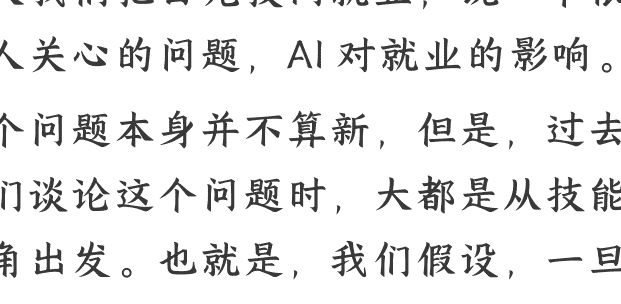

# 就业新趋势：老龄与少子化背后的机会窗口

260424
整理：公众号懒人搜索，懒人专属群精选
懒人微信：lazyhelper1

眼下金三银四，正式招聘旺季。因此今天我们目光投向就业，说一个很多人关心的问题，AI 对就业的影响。

这个问题本身并不算新，但是，过去我们谈论这个问题时，大都是从技能视角出发。也就是，我们假设，一旦 AI 具备某个技能，就可能会替代掉一部分掌握这个技能的人类。其实，这个模型仔细想，多少有点简单粗暴，它背后的逻辑就类似于“教会徒弟，饿死师傅”。

但我们都知道，整个经济体系是个巨大的复杂系统，它的运行逻辑，不是一句简单的“线性替代”能概括的。

那么，回到社会经济的视角，AI 会对就业市场产生哪些影响呢？

关于这个问题，前段时间，经济学家蔡昉出了一本书，叫《中国就业新趋势：人工智能如何重塑劳动力市场》。蔡昉老师主攻的领域，是人口与劳动经济学，他也是这个领域最权威的学者之一。而最近几年，他的研究重心转向了 AI 与就业的关系。马江博老师也在《政经参考》里解读过这本书。

接下来，我们就说说蔡昉的观察。

首先，蔡昉认为，AI 时代，失业是个显性风险，很容易被察觉。但除此之外，还有个不太容易被察觉到的隐性风险，叫，安全幻觉。也就是，一个人觉得自己的职业很安全，不会被替代，但是，这个安全感很可能是“所知信息有限”导致的幻觉。

比如，有人觉得自己的行业缺人，饭碗就稳了。乍一听，好像也有道理，毕竟，企业都招不到人，那我的工作肯定稳定。但蔡昉说，这背后有一个变量被忽视了，就是企业缺人的应对逻辑，已经从“涨工资找人”变成了“花钱买技术”。

过去，企业缺人就只能招人。但现在，他们还有另一个选择，买技术。而且在很多岗位上，AI 可能比人的效能还要高。银行的智能客服，能处理的咨询量可能比人工客服高几十倍。车间里的 AI 质检员，也比人类的用工成本低得多。

企业发现，与其高薪招人，不如投资 AI。一旦 AI 的能力越过“可以干活”的临界点，那么原本缺人的行业，就会一夜之间被 AI 填满。

再比如，蔡昉在书里说，很多人认为体制内就安全。但他认为，体制内大量基层岗位，文件审批、数据录入、信息汇总，恰恰是 AI 最容易替代的技能。这不是说体制内的工作会消失，而是说，如果你的工作内容主要是这些标准化、流程化的任务，那你的能力可能会贬值。

再比如，还有人觉得，大不了我降级就业，从高端岗位转到低端岗位，总能找到活干。

但蔡昉说，降级就业不等于没有风险。你看，在就业结构调整中，如果一个人转向了低效率的工作，为了维持生存就需要投入更多时间，可能会影响到技能提升的机会。比如，一个代码工程师去送外卖，收入降低，他就需要延长工作时间。而一旦自己的时间被填满，他就没有精力去提升自己，就可能会被一直困在这个局面里。

这就成了恶性循环：时间被低效工作占满，没有精力学习新技能，能力进一步贬值，更难转型。

听到这，有人可能会说，不对啊，AI 不是会创造大量新岗位吗？被替代的人去新岗位不就行了？

但是蔡昉认为，事情没有这么简单，因为 AI 技术的发展过程中，可能会出现一些“错位”。

比如，时间错位。借用蔡昉的原话，
“就业调整必然先于就业创造。”也就是说，今天你的岗位被 AI 替代了，但那个为你准备的新岗位，可能要到三年后才出现。这中间的三年，需要面对转型的挑战。

再比如，能力错位。因为被替代的人和让岗位需要的人，能力结构完全不匹配。这也就是蔡昉说的，“人力资本培养速度，制约着新创岗位的数量。”就好比，一个在流水线上工作了十年的工人，突然被机器人替代了。你让他去做什么？去学编程？去做 AI 训练师？

注意，这些分析的重点，不是要说“就业前景悲观”，而是提醒我们换个思路。过去很多人关心的是，什么样的岗位更安全？而蔡昉认为，我们需要从岗位视角切换到能力视角，去思考，什么样的能力更安全，是 AI 不具备的？

具体来说，蔡昉在书里特别强调了三类核心能力：

- 一是，社交情感能力。同理心、情商、沟通力、领导力、团队协作。这些是人类感知和社交系统的产物，AI 目前最难复制。
- 二是，隐性知识。那些从未或难以记录下来，却可以当面传授的经验。比如面对不同顾客表情时的判断，这种微妙的感知，很难被编码。
- 三是，实践智慧。能够恰如其分地融合理性、情感与经验的能力。比如管理者处理团队冲突时的具体变通，这需要对情境的深刻理解。

换句话说，应对 AI 冲击的关键，不是去和 AI 比拼它擅长的技能，而是找到它做不了的事情。我们可以假设，假如 AI 能把自己的工作完成 80%，那么，剩下的 20% 是什么？这 20% 对应着哪些能力？那么这些能力也许就是我们要重点发展的部分。

这是个人层面的建议。而回到宏观的就业市场层面，蔡昉认为，尽管 AI 会对就业市场产生巨大的影响，但是，中国有两个独特的对冲机会。这两个机会，一个来自人口结构的变化，一个来自老龄化的加速。

## 第一个窗口，是少子化释放的教育资源

有人可能会觉得奇怪，少子化难道不是一个挑战吗？怎么成了机会？蔡昉的观点是，少子化意味着大量闲置的教育资源可以被重新利用。学校、老师、教育设施，这些在 AI 转型期都可以用来做职业培训、技能提升。

这也就意味着，一个人的转型成本可能会大幅降低。你看，过去，职业培训很贵，因为教育资源紧张。但现在很多地方的职业学校招不满人，培训资源相对充裕。有些地方还把闲置的中职学校改造成了职业培训中心，向社会开放。

换句话说，当我们面临“能力错位”的挑战时，恰好有大量教育资源可以用来缩小这个错位。这是一个难得的时间窗口。

而且，蔡昉特别强调，这个窗口的价值不只是“有资源”，更重要的是“有时间”。因为少子化也许是个世界性的长期趋势，这意味着未来 10 年、20 年，教育资源都会相对充裕。这代人以及下一代人，都有足够的时间去学习、去转型、去试错。

## 第二个窗口，是银发经济。

2030 年，中国 60 岁以上人口也许将超过 4 亿。这些人需要的不只是医疗，还需要陪伴、照护、精神慰藉、生活辅助。这个进展速度也许意味着，银发服务业的需求缺口，会以超预期的速度打开。

而这些工作，恰恰是 AI 难以完全替代的领域。老年人需要的不只是标准化服务，更需要情感陪伴、个性化照护、经验传承。这些都需要人。

换句话说，假如一个人现在开始准备相关技能，比如老年心理学、康复护理、营养管理、社交陪伴，那么 5 年后可能会迎来大量的机会。

而且，这些技能恰好属于蔡昉说的"AI 难以替代的三类能力”：需要社交情感能力，需要隐性知识，需要实践智慧。

蔡昉认为，这些中国劳动力市场面对 AI 冲击时独有的“对冲”窗口，注意，是“对冲”窗口，也就是，老龄化或者少子化，并不会扭转 AI 对就业带来的长期影响，但是，会让这些影响来得更温和，让人更容易适应。

但是，蔡昉也强调，这个窗口不会一直开着。他认为，2026 到 2030 年这五年，是关键窗口期。这是中国经济结构转型与人口负增长趋势深度交织的时期。而对个人来说，这五年也是主动转型的最佳时机。

为什么？因为教育资源还充裕，转型成本还不高。因为银发经济的需求还在爆发初期，竞争还不激烈。因为 AI 的能力还没有发展到“替代所有人”的程度。

换句话说，现在到 2030 年，也许是为下一个阶段做准备的关键窗口期。

最后，做个总结，我们今天讲了经济学家蔡昉对就业市场的观察。在他看来，AI 对就业的影响，不是简单的技能替代，而是整个就业市场运行逻辑的重构。

长期来看，真正的风险，不是会不会失业，而是沉浸在错误的“安全幻觉”里，让自己的能力慢慢贬值。

而面对这个挑战，我们有自己独特的机会窗口，教育资源的重新配置，银发经济的需求爆发。关键在于，趁着窗口期，主动转型，而不是被动调整。去做那些 AI 做不了的事情。找到自己无法被替代的 20%，然后在窗口期把它打磨到极致。

# ————分割线——

在这个 AI 能替你写代码、写文章的时代，基础技能正在迅速贬值。绝大多数人正被淹没在海量的免费垃圾信息里，陷入低效的体力内卷。

当“努力”不再是壁垒，人与人之间唯一的护城河，只剩下“信息过滤”的效率与“认知系统”的维度。

圈子已稳定运行 7 年。我们每天利用 Python 爬虫与大模型算力，过滤全网最顶级的政经内参和搞钱风向标，做你最冷酷的“外部大脑”。

如果你认同这种“重塑认知防线”的极客主义，欢迎围观我的个人情报智库：【懒人专属群】。

https://lazyso.com/insider/

认同信息过滤价值、想省下每天 3 小时无效阅读时间的读者，扫码加我微信（lazyhelper1）

微信：lazyhelper1