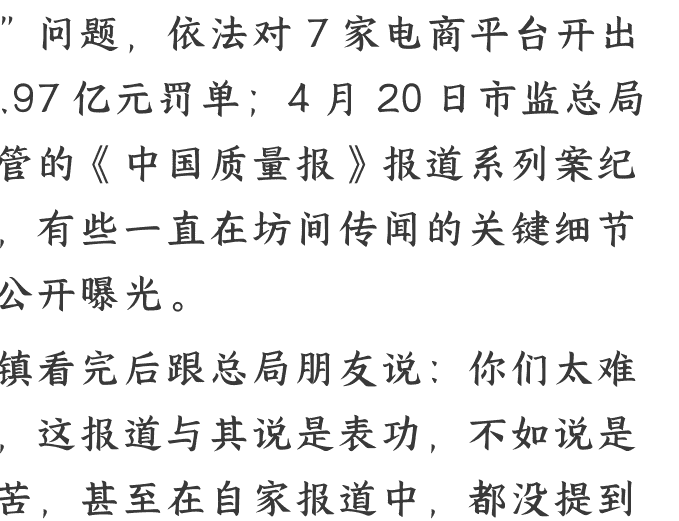

# 20240424 大树乡谈

整理：公众号懒人搜索，懒人专属群精选

懒人微信：lazyhelperl

4 月 17 日，市监总局针对“幽灵外卖”问题，依法对 7 家电商平台开出 35.97 亿元罚单；4 月 20 日市监总局主管的《中国质量报》报道系列案纪实，有些一直在坊间传闻的关键细节被公开曝光。

小镇看完后跟总局朋友说：你们太难了，这报道与其说是表功，不如说是诉苦，甚至在自家报道中，都没提到是哪个平台暴力抗法，就连该平台是哪个城市的都没提。

只是在详述暴力抗法过程时，隐晦的多次点到晚上 11 点这个时间点，还提到晚上 11 点“上下班高峰”的描述，熟悉互联网行业的，都能猜到是哪家。这家公司，前不久还在抖音投诉一个几百万粉的猎头大 V，说这个大 V 发的跟网约车司机交流的视频，提到这家公司晚上 11 点单子还很多，凌晨 1、2 点还有单，损害公司名誉，当晚该公司就盖章发出了投诉信，看来加班挺狠。

最后还是新华社等央媒点出来了暴力抗法的具体平台：拼多多。

> 《中国质量报》报道明确定性为“发生暴力抗法事件”，匪夷所思的是，参与者竟然还包括该平台政府关系部门。

报道中提到的涉案数据难以提取很寻常，这是当前针对平台执法的核心难点之一，但一般也就是弄虚作假、拖延时间、删除隐藏篡改部分数据。但像报道中提到的故意用门挤压，导致执法人员左手食指骨折及右脚踝软组织挫伤；第二天安保人员带着一群人冲击办案现场，把前一天刚骨折的执法人员推倒，导致执法人员头部重重磕地送去急救，所谓技术总监在跟企业负责人单独沟通后，当场倒地，以碰瓷阻碍调查，严重到这种程度实在罕见。

这还没完，还有后续，12 月 5 日晚，总局一位厅级副局长奉命赶到现场，该平台才终于提供了相关数据。但在针对暴力对抗进行谈话时，该平台工作人员在 A4 纸上写“沉默”“不说”等消极对抗，被发现后，当场把 A4 纸吞了。以上只是公开报道，实际还有其他猖狂举动。

这一恶性事件发生后，该平台将涉事政府关系团队 30 多人全部开除，就有**一人**不服，说发生对抗的时候，自己在异地、不在现场，凭什么把自己也开除？

正常人想法是去劳动仲裁或者在网络上公开向该平台施压，然而这个人很独特，他写了一封投诉信，投诉总局执法人员因被暴力抗法心生怨怼，所以对平台施压开除涉事人员等等。这就纯属胡说八道了，平台选择开除了事，执法人员能说啥，难不成干要求平台不允许开除？劳动问题也不归市场监管部门管啊，再说大平台怎么会在意个把厅处级监管人员呢，真要在意也不会暴力抗法了。

这个人之所以不敢对自家公司强硬，也是有原因的。说白了就是欺软怕硬，不敢惹自家公司，但敢欺负监管部门，哪怕他本职工作就是长期对接市监部门。说起来跟这个平台打劳动仲裁官司，胜率不是太高，这其实很奇怪，因为当前劳动保护特别偏向普通劳动者。

 dnes 大概是这样，对国家层面的专案组，暴力抗法、消极对抗到这种程度，如果是小公司倒也不奇怪。比如小镇在基层的时候，那时候还是工商呢，隔壁镇工商抽调了几十人的执法队，想要对一个假酒村展开执法行动，几十人硬是被村民持械打回到当地工商所，双方展开对峙，最后报警后才得救。

但大公司多少得有点体面吧？实在想象不到，一家公司能对顶头主管部门如此霸道，对员工、对消费者又会如何？

小镇觉得，这事不能停留在罚款就算了，必须对相关人员追究刑事责任，目前公开报道没有披露，这应该是刑事办案要求。

话说回来了，为什么堂堂正**正**的监管部门，却对大平台没什么好办法，甚至有时感觉束手无策？

- **首先监管部门内部弱势。** 跟外部、民众、市场打交道多的，在大众看来权力很大，但放在内部体系，顶多就是二线部门，要受到很多制约。在发展经济的大背景下，不仅受到同级其他部门约束，还要承受地方保护的压力。所以这次执法，针对该平台的检查，抽调的是江苏、江西的异地执法力量。
- **其次技术、力量不对称。** 除内部掣肘之外，数字时代背景下，单说监管部门和大平台之间，具体到特定领域，也不好说谁更强。大平台实际已经成为准政府，代行部分公共管理职权。比如市场监管的一个核心功能是新企业和新产品准入监管，现在电商平台崛起，对新企业新产品而言，最重要的是入驻这些大平台，并获得推流等优先展示，而线上新商户、新产品的大量入驻、涌现，已经远远超越了传统监管能力，不得不依赖平台监管，这就出现了权力的转移。

又比如消费者权益保护、交易信用维护、打击造假、知识产权保护等等，都是市场监管的核心职责，现在也不得不大量依赖到平台自治。

大平台治理难，这不是中国独有的问题，全球各国都缺少有效的监管手段，核心是“大而管不了”和“快而跟不上”，而在云时代，数据保存在云上，执法人员控制电脑的做法已经无用了，必须在企业配合下，才能拿到相关数据，而企业想要制造麻烦太容易了，系统升级、数据涉密、用户隐私都是借口，实在不行直接把数据库搞瘫痪，执法人员还能帮着修不成？

就算提供数据，也可以提供杂乱、阉割、篡改后的数据，大不了就说自己对外吹牛了，数据底层架构做的不好，所以很乱，又能如何？

指望平台工作人员站出来举报？怎么可能啊，平台工作人员还想着保住工作呢，就像前面那个丢了工作的，敢写大字报攻击总局监管人员，就是不敢向公司提出劳动仲裁。小镇之前接触过某行业，当时该行业监管部门为加强监管，依法建了数据平台，要求行业企业把订单数据去敏后上传，然而这些企业普遍搞了两套数据，还在内部把这个造假系统作为优先攻关项目。

- **第三监管部门缺乏强制手段。** 在欧美国家，一般执法部门普遍具有自己的强制力量，但在中国，这一权力被极大限制，仅限公检法、监察、海关、国家安全等极少数部门拥有采取强制措施的权利，虽然也规定一般行政机关在特殊情况下可以采取强制手段，但实际很难，所以只能协调当地公安部门，但公安也有很多事要忙，不可能每次都响应。但不限制也不行，比如远洋捕捞问题，而且强龙不压地头蛇，外地或者上面来的执法人员，就算为了自己的人身安全，也得请当地相关部门带着去，要不然执法对象就是装傻充愣，非说执法人员是假的，硬是先打一顿，又能怎样？人家顶多交几个人出去，大不了行政拘留两周，打成轻伤还能争取缓刑，给个十万、二十万，有的是人愿意扛。前些年推行简政放权、服务式执法，再加上网络环境并不友好，很容易被造谣扭曲，执法人员本身面临巨大的人身、名誉和职业发展风险。小镇认识不少一般行政部门的执法人员，现在都说出执法提心吊胆，既怕没查出问题以后担责，又怕碰到二愣子暴力抗法、扭曲造谣，就算事后查实，对自己也会带来不可弥补的损失。

- **第四是执法力量不足，骨干人才本就稀缺还在持续流失。** 这次针对“幽灵外卖”的执法行动就是典型，工商、质检、食药三大部门合并而成的经济领域第一监管部门，从全国才能抽调到百人左右的骨干执法力量，《中国质量报》报道点到的几个名字，都是系统内知名的，为办理这起案件，很多地方的执法工作都要受到影响，涉案的几十万家店面，都得调动全国力量查实。但这支骨干力量面对的对手，实力太强了，无论按人数还是薪资，不是一个级别，仅暴力抗法的平台这次负责对接的政府事务团队，就有 30 多人，这只是政府关系部门的一小部分而已。按市场价，这帮人合并年薪资不低于 3000 万，掌握的经费就更多了，这怎么打？实际在暴力抗法事件发生后，该平台政府关系团队内部就扭曲造谣，说之所以针对该平台，是监管部门替前同事出头，因为该监管部门之前一位厅局级辞职后到该平台任职，后来被排挤走了，这都是什么想法？

- **第五当前法律对执法支持也严重不足。** 这次罚款 30 多亿元，真是巨大突破，如果按照常规，可能也就能处罚几十万、几百万，最大的突破是确定以涉事店面一店一罚，而不是针对平台统一处罚，《中国质量报》的报道中提到"*总局领导先后 4 次带队拜访立法和司法部门，就平台责任认定、处罚幅度设定等核心问题反复征求意见*"。这句话背后，挺心酸的，因为面对的对手实力太雄厚了，在办案中，执法部门才是弱势群体，但凡办案中有任何瑕疵，都会被盯上。不要觉得民告官稀罕，大平台跟监管部门打官司，这不是啥新鲜事，就算不打官司，搞舆论或者不断投诉举报、申请行政复议，那也受不了啊。当然，总的来说，搞出暴力抗法的大平台实属罕见，正常平台顶多就是拖拖时间，处理下不相干的数据，避免扩大打击面，这也都可以理解。对平台而言，这种行政处罚，无论是几百万还是几亿、十几亿，相对平台收入和利润而言，不值一提。就连暴力抗法的某平台，报道后的市值都是稳的，就在于这种处罚对企业而言甚至算利好，影响非常有限，资本、市场更看好该平台跨境电商业务的利好。甚至会觉得事情搞得这么大，竟然也不过罚十几亿，更看好这家公司所谓的实力。目前看，平台真正怕的也就是反垄断调查，并非怕处罚结果，而是能够以反垄断立案，就意味着很多事，代表着上升到更高层级。

营商环境需要维护，但法律尊严也得维护，相比薪资低，正常执法工作得不到认可和保障，带来的打击更大，长此以往，执法人员的心气就没了，真就猪八戒分家了。

要小镇说，执法要什么服务呢？又凭什么需要获得执法对象的满意？这是执法啊，针对的是违法群体，被执法人员怎么可能满意呢？真这么好说话，又怎么会违法呢？执法只需要做到一点：依法即可，态度好坏又如何呢？对违法份子难道还要客客气气？哪有这个道理嘛。革命不是请客吃饭，执法也不是迎来送往。

***

在这个 AI 能替你写代码、写文章的时代，基础技能正在迅速贬值。绝大多数人正被淹没在海量的免费垃圾信息里，陷入低效的体力内卷。

当“努力”不再是壁垒，人与人之间唯一的护城河，只剩下“信息过滤”的效率与“认知系统”的维度。

圈子已稳定运行 7 年。我们每天利用 Python 爬虫与大模型算力，过滤全网最顶级的政经内参和搞钱风向标，做你最冷酷的“外部大脑”。

如果你认同这种“重塑认知防线”的极客主义，欢迎围观我的个人情报智库：【懒人专属群】。

[https://lazyso.com/insider/](https://lazyso.com/insider/)

认同信息过滤价值、想省下每天 3 小时无效阅读时间的读者，扫码加我微信 (lazyhelperl)

