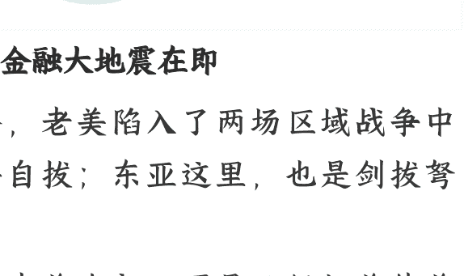

# 合集《当帝国不再无所不能》之——1、沃什上任真相：美联储换的不是掌门，是整个货币底层逻辑

260427 A 视野付费整理：公众号懒人搜索，懒人专属群精选懒人微信：lazyhelper1

## 全球金融大地震在即

如今，老美陷入了两场区域战争中，无法自拔；东亚这里，也是剑拔弩张。

至于老美内部，更是已经把美债美股等，玩成了史诗级的钢化泡泡，绝不能破灭。

问题是，即将上任的新美联储主席，却提出了一个极为匪夷所思的货币政策思路：降息 + 缩表 + 取消前瞻指引。财政越是缺钱，美联储越是不下场购买更多美债，这在当前全球其它国家大幅减持美债持仓的前提下，近乎是极致疯狂！

正所谓，反常即妖~在帝国不再无所不能之际，美联储货币政策面临如此重大的转向，注定意味着，这背后的战略算计，非同小可。

也因此，今天 A 森需要抢在这位新任美联储主席上来施政前，给大家说一下，这背后的真相和底层逻辑。尤其作为中国人，这一局，不得不防！

本系列围绕【当帝国不再无所不能！】，将前后分三篇文章：

- 第一篇《沃什上任真相：美联储换的不是掌门，是整个货币底层逻辑》...

- 即本篇章目。第二篇《全球进入“沃什时代”：真正的风暴，将在市场、中国、地缘三层同时爆发》...预计于 4/28 日发布。

- 第三篇《全球货币秩序重构在即，中国的终极应对走向何方？》...预计于 4/30 日发布

- A 森将分别从三个维度，系统性、一次性、独家原创性的给大家讲清楚底层逻辑。
    1、详述本次货币政策转向背后的划时代底层逻辑，即，这不是换了个美联储主席，而是不可逆的范式级别的改变。
    2、对金融市场、对中国、对地缘等诸多方面的冲击，到底会是如何演绎？
    3、面对这个全新的情况，中国该怎么办？村里可能会出什么政策？个人又该怎么办？

全球金融市场的游戏规则，即将发生范式级别的改变。唯有先知先觉，才能先破局。因此，理解本系列的核心内容，将是你绕不开的超级干货。

使用 880 微信豆可以阅读整个合集的完整 3 篇文章。

下面开始今天的正文，各位多多支持！

此前，全球其它各国央行的外储中，黄金规模已经超过了美债规模。这不仅是一个史诗级的里程碑，更意味着，大家对于美债的真实态度。

所以，美联储亲自下场买美债，是唯一确保美债永续的办法，毕竟，没有其它更大的长期买家了。

特别是，现在美国财政部新增债务结构中，8 成是短债，2 成是长债。

你不去把这么多短债切换为长债，如何化债？如何让债务软着陆？

这不，老中就积极化债，现在银行体系内的钱这么多，就是积极用于地方债务的化债。

印钞，又要其它国家相信美元的内在价值，凭什么？

用我们今天的话语来表达，则是：既要化债，又要保美元信用，还要没有替代品，三者如何兼得？

石油美元体系的诞生，就是为了回应这个史诗级的难题。美国在中东跟阿拉伯国家的安全换石油战略，又用约束看着阿拉伯国家，层层地缘政治结构嵌套，确保其它国家为了发展，只能用石油美元。

而有了石油美元，老美就算胡乱印钞，其它国家又能怎么办？这不，一切就慢慢又能够走通了。

后来，互联网革命、冷战结束、海湾战争、全球一体化等重大历史变故，都在强化一个要点：老美太牛逼了，美元信用不用担心，就算老美疯狂放水，也无可替代。

这个时候，美国建制派从欧洲引入新自由主义的叙事，将自己包裹成灯塔之国，完成了整个石油美元体系最后的闭环。即，道统上的无可争议，运行机制有效，军事实力碾压，科创遥遥领先，收你们点铸币税，天下莫敢不服。

可是，次贷危机后，老美的国策就发生了范式级别的一次改变。

保权贵，屠中产，慰民。

代际战争，往死里割年轻一代。

请注意，这两根主线，是同步推进的，两者之间还是相互交叉的。

于是，遇到任何问题，就国债去背锅，国债的锅再转交给美元大放水。

所谓的 MMT 现代货币理论，就是其经济学的依据，一切的一切，就是围绕上面的社会财富分配方式推进。

但是，整个体系，到了拜登时期，遇到了一个极为痛苦的节点。此前的口罩风暴，重创了美债市场，货币过度投放的后遗症极为夸张，又跟工业霸权的老中翻脸了。

可以说，拜登时期，老美 40 多年来第一次直面如下的困境：

要放水，就不能保美元信用；要保美元信用，不能乱放水，不能乱没收其它国家的外储。

如果我们不能理解这个要点，也就完全看不懂后来拜登所有的微操。

其次，美联储加息抗通胀、保美元信用，但是，美联储以低息吸收短期美债的融资，疯狂在财政端放水。

很明显，这个模式，不可永续，最多就是个打补丁。

然而，对于极为精英化的拜登内阁体系而言，根本没得选。因此，他们实际就是这么干的，也确实牛逼了接近 2 年。

期间，放水、保美元信用、增长、抗通胀、打击美元替代品，几乎所有目标都在一个有限的窗口期内，全部实现了，牛逼到爆。

欧洲是比较倒霉的，经此一役，欧元再无任何能力，可以跟美元抗衡了。公众号这就是欧洲在 2022 年抛弃了北溪 2 管道、抛弃中欧投资协议的直接代价。所以，今天的欧洲人任由老美收割，确实是活该。

但是，拜登是一个更大的灾难，包裹此前的小灾难。

等到拜登下台之前的 2024 年上半年，他的这个风骚走位，已经难以为继了。这也就构成了川普 2.0 回归的时空经纬！

等到川普 2.0 回归，大家发现，这个熟悉的男人，已经很陌生了。其实，

不是他陌生，而是，拜登裱糊匠式的微操，却将更大的锅留给他了。等川普 2.0 上来的时候，发现：美元信用极为孱弱，放水刻不容缓，国债爆炸式膨胀，通胀顽固，增长有点乏力了。

要解决这些问题，缺钱啊~可是，但凡你敢疯狂放水，无数股力量就会反噬他。这已经不是一个人能不能搞定的事情，而是整个美元体系玩到今天这个程度，它有自己运行的逻辑，是靠强人无力解决的。

川普还是脑袋清楚，想着，老子利用全面关税战，把全球割一波，银子不就有了？！这样，上述的张力，暂时又有机会可以和缓下来了。

结果，大家都知道，关税战彻底失败。

更为痛苦的是，2026 年启动的地缘冲突进行收割，在遭遇老中的奋力反抗时，也玩不下去了。兜兜转转，川普又回到了 2.0 时代刚刚上台的节点的困境。增长、通胀、债务、美元信用，如何兼得？

很明显，到了今天这个地步，川普 2.0 要解决上述美元体系的老问题，已经没有什么好办法了。

然后，我们再来看看即将上来的新任美联储主席，沃什，看看他的主张，内中乾坤就很明白了。

短期美债的收益率，是锚定联邦基准利率的。

所以，大规模降息，特别又是短期美债新增供给达到整个美债新增供给的 8 成，那就等于直接将财政部的利息负担，直接降下来。请注意，这是一个思路的彻底扭转。

2025 年，川普还是想要用 10 年期美债，去替换现在的很多短期美债，这就是传统化债。可是，各方的阻力如此巨大，根本走不通。

那么，川普现在，直接将短期美债收益率大幅下降，不也是一种化债的新思路吗？！此后，就算短期美债再多，也不怕。

另一方面，沃什又提出，要缩表。缩表，简单说，就是美联储手里的美债持仓减少，这不是利空吗？

其实，别看他们如何表演，缩表的空间是极为有限的。

反复讨论缩表，甚至缩表一点点，就是一个关键性的姿态。即，向全球资本证明，美联储可以放水，可以收水，是有信用的。

显而易见，缩表是辅助，核心是要 PUA 其它大资金相信，美元的信用是有保障。

再次，又提出 AI，沃什可谓是第一个“AI 美联储主席”。

AI 的叙事，是为了证明长期会通缩，放水很合理。AI 的叙事，还可以证明，美国技术领先，这就是美元信用的底气。

AI 的叙事，还能展示，增长、军工领先、债务等今天市场最担心的事情，都不是问题。

一旦市场开始相信“降息 + 缩表 +AI"的货币范式叙事，那么，石油美元体系的暂时维稳，又可以延续一段时间，搞不好可以撑到 2028 年川普下台之际。

当然，从中我们不难看出，到了这步，后面已经没有什么更好的办法，来给石油美元体系的内生 bug 打补丁了。

以今天美军核心武器的库存来看，已经不足以在东方跟老中爆发一起重大冲突。一个不能用军武作为绝对压舱石的帝国，也就不再是一个无所不能的帝国，只剩下 PUA，没有任何办法。

需要明白，到了这一步，美联储同时兼顾放水和保美元信用的两大功能，后续再无其它办法。这既是石油美元体系叙事的最巅峰，也将是其完成整个生命周期的节点。

当然，为了确保其他人不得不信，沃什还打了一个补丁。他明确提出，要废除点阵图，相当于，以后美联储主席一个人决策货币政策。

那么，为何我们说，沃什上任初期，上述套餐是有机会走得通的呢？

需要看到，美元霸权，是有强大的体系性根基的：

- · 全球最深、最流动的金融市场
- SWIFT+ 清算体系 + 全球贸易结算惯性
- · 地缘威慑网络和军事霸权，依旧在沃什的政策，实则是强化了一个意想不到的结果。

亲美的国家，会进一步绑定美元美债，相当于交投名状。不亲美的国家，会增加绕过 SWIFT 的力度，会开始追求更多的军事独立性和自保性，还会多玩一些老中的金融产品作为对冲。

这是因为，沃什说了再多，装的再像，以老中为代表的一大批不亲美的国家，根本不相信。而亲美的国家，大多并不是相信沃什说了什么，仅仅是为了求自保的费用支付罢了。

所以，这就是一个很诡异的全新范式。即，大家都知道皇帝没有穿衣服，可是，没有人愿意去揭穿这一点，大家面子上都装作皇帝穿了一件

其实，无论沃什如何谈论自己的政策，真正关键点所在，只能做，不能说。

无论你如何吹嘘 AI，或者各种叙事，没有华尔街在美股上的主导权，都是白搭。这也意味着，沃什的做法，将会彻底改变整个美国金融市场的基础架构。

过去，是努力吸引人家进来，以收益作为导线，是以追求上限的逻辑去布局。以后，是用安全、利益绑定、美元信用背后的责任共担为牵引，是以守下限的逻辑去实施。

本质上，如果我美元体系崩了，今天美国所有的盟友就会彻底返贫，你们愿意吗？！既然不愿意，那么，当我缩表的时候，你们该怎么办？当我降息的时候，你们又该怎么办？

当我叙事 AI 的时候，你们的手鼓掌了嘛？钱进来了嘛？

美国及其盟友，在金融端的 C6 联盟，将彻彻底底锁死，要比拜登时期更加紧密，唯有如此，才可以攻守同盟，

一起对付老中，一起承担来自老中的压力。

自从未能收割老中成功，美元体系的内生 bug 问题，就根本没有办法系统性解决。从拜登到川普 2.0，只能不断的想风骚招数，不断的打补丁。可是，这些终究是不够的。

最好的办法是，经贸领域不能把老中踢出去，那么，金融领域则要全面压制老中。

于是，沃什的货币政策，要完全跑的通，其完整的政策公式应该是：
降息 + 缩表 +AI 叙事 + 军事地缘威慑 + 美股钢化泡泡 + 盟友体系金融联盟。唯有如此，美元信用保住了，美元可以随意放水，增长暂时不是问题（AI 和军工投资狂潮），化债压力不慌，并谋求对老中的收割可能性。

以上的策略，要走得通，留给老美的时间也不多。必须指出，中国这个最大的贸易玩家，一直努力在渐进式减少对 SWIFT 的依赖，这个乘数效应不可小视。各种战略资源、铁矿石、农产品、能源等，都大幅比例的提高人民币结算。

全球现在就这么多储蓄，老中抢的越多，美元体系的 bug 风险越大，零和博弈，没得选。如果说，拜登时期，老美想着还是一把草割我们。那么，今天，川普 2.0 的货币范式指引是，在无法草割我们的前提下，就跟我们抢储蓄、抢地盘、抢资源。

这个范式迭代，意味着，中美金融战，将会演变成风险全面外溢的“美元全球保卫战”。因为，如今的老中，一副极为不好惹的样子。

别说草割它，它的能量在全球的影响力，就可以抢掉老美大量经济势力版图。

美元的压力将不再是仅仅由老中本土给出，而是全球各地都有离心离德的反抗力量。沃什的上任，任务也就跟鲍威尔时代完全不同了。能不能打赢“美元全球保卫战”，将是他的历史地位的决定性指标，更是美国国运的分水岭所在。

在这个 AI 能替你写代码、写文章的时代，基础技能正在迅速贬值。绝大多数人正被淹没在海量的免费垃圾信息里，陷入低效的体力内卷。

当“努力”不再是壁垒，人与人之间唯一的护城河，只剩下“信息过滤”的效率与“认知系统”的维度。

如果你认同这种“重塑认知防线”的极客主义，欢迎围观我的个人情报智库：【懒人专属群】。

https://lazyso.com/insider/

认同信息过滤价值、想省下每天 3 小时无效阅读时间的读者，扫码加我微信（lazyhelper1）

