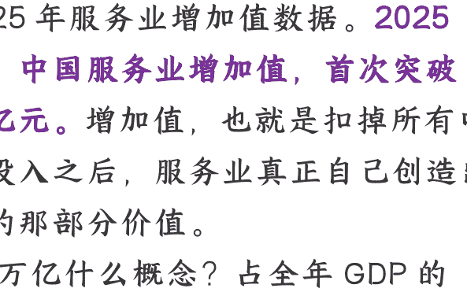

# 服务业突破"80 万亿”背后，普通人的三个机会

2025 年 4 月 28 日

整理：公众号懒人搜索，**懒人专属群**精选

懒人微信：lazyhelper1

最近，很多媒体都在转载一个数字，这就是今年 1 月，国家统计局公布的 2025 年服务业增加值数据。2025 年，中国服务业增加值，首次突破 80 万亿元。增加值，也就是扣掉所有中间投入之后，服务业真正自己创造出来的那部分价值。

80 万亿什么概念？占全年 GDP 的 57.7%，对经济增长的贡献率超过 61%。而且截止到现在，服务业已经连续 11 年，成为中国经济第一大产业。

听到这，有人可能会说，这个现象不是经济学家早就预测过的吗？早在几十年前，就有经济学家说，随着国家发展，劳动力会逐渐从工业流转到服务业。这不是很早的理论吗？值得特别关注吗？

别着急，我们之所以要关注 80 万亿这个数字，不仅仅是因为它大，更是因为，我们的这个"80 万亿”，有它的特别之处，以及，这个特别之处，对我们来说或许意味着一轮新的机会。

要想了解今天咱们中国有什么不一样，我们得先从历史上其他国家的经历说起。

早在 20 世纪 40 年代，澳大利亚经济学家科林·克拉克就写了一本书，叫《经济进步的条件》。他在书里建立了一套影响深远的框架，他把所有人类的经济活动分成三个部门。第一部门是农业，从土地上获取东西。第二部门是工业，把原材料变成产品。第三部门是服务业，不生产实物，但创造价值，包括教育、医疗、金融、零售、咨询、娱乐，全算在里面。

然后他发现了一个规律：**随着一个国家越来越富，劳动力和产值会依次从第一部门往第二部门流，再从第二部门往第三部门流**。从农业到工业，再到服务业，这不是某一个国家的特殊选择，而是经济发展的内在规律。

后来法国经济学家让·富拉斯蒂耶把这个理论进一步发展，写了一本书叫《二十世纪的伟大希望》。他预言，**到 20 世纪结束，所有发达国家都将成为以服务业为主导的经济体，制造业的就业比例会大幅下降，绝大多数人将在服务业工作**。

这个预测后来应验。今天，美国服务业占 GDP 约 77%，英国约 73%，日本约 70%。

但是，在这条规律背后，也隐藏着一个不容忽视的代价，叫“鲍莫尔成本病”。也就是，工业可以用技术持续提升效率，同样的产品，今天造得比昨天快、比昨天便宜。但很多服务业做不到。比如餐厅里的服务员，能服务的顾客始终是有个上限的，新技术的辅助很有限。

这也就意味着，当大量劳动力涌入这类“低门槛”服务业的时候，他们进入的是一个生产率天花板很低、附加值很难提升的行业。这类行业能支付的工资，长期来看也是有上限的。这不是某个工人运气不好，而是这类行业的结构性宿命。

比如，美国。1970 年代开始，美国制造业大规模外移。先是纺织业，然后是电子产品、钢铁、汽车零部件。工厂走了，工人的工作就没了。美国政府当时的思路是：没关系，服务业会来填这个坑。于是，原本在工厂流水线上拿着中等工资的工人，下岗之后，很多去做了餐饮、快递、保洁。但他们收入缩水，保障变差。

再比如，英国。撒切尔夫人执政期间，主动加速了去工业化，把赌注押在金融服务业上。伦敦成了全球金融中心，金融业确实很赚钱，但金融业能雇用的人是有限的。绝大多数普通工人，没有能力进入金融业，只能进入低生产率的服务业。英国的制造业从 1980 年代开始萎缩，至今没有真正恢复元气。

再比如，日本。日本没有像美国和英国那样主动去工业化，但 1990 年泡沫破裂之后，日本制造业陷入停滞，服务业比例被动上升。但日本的服务业效率极低。同样是餐饮业，日本一家餐厅的服务员数量，往往是同类欧美餐厅的两倍。再比如政府行政服务，现在还大量依赖传真和人工盖章，数字化程度在发达国家里垫底。结果就是，服务业比例上去了，但整体经济生产率没有提升。

说到这，你可能发现了，观察服务业与经济的关系，不能只盯着“服务业”这个抽象的概念，而是要观察很多具体因素，尤其是服务业与整个社会经济之间的互动关系。

那么，回到咱们中国，现在国内的服务业增加值超过 80 万亿元，占全年 GDP 的 57.7%。这个规模确实可观，但是，除了“规模大”以外，还有三个关键维度，我们跟历史上的所有案例都不一样。

## 第一，制造业没有空心化。

美国和英国是制造业跑了，服务业来填坑，但中国不是这个逻辑。2025 年，中国制造业增加值在全球的占比仍然超过 28%，是全球最大制造国。而且还在升级，高技术制造业的增速，超过了制造业整体增速。中国的服务业在涨，但制造业没有跌，二者的关系不是一退一进，而是同时兼顾。

## 第二，服务业的“性质”不一样。

历史上那些走弯路的国家，服务业增长靠的主要是消费性服务，比如餐饮、零售、娱乐、个人保洁。这类服务业生产率低，人力密集，正好是鲍莫尔成本病最容易暴发的地方。

但除了消费性服务业之外，还有一类叫做生产性服务业。比如，研发、设计、物流、供应链管理、工业软件、数据服务、金融、专业咨询。**这些服务业不是直接服务于普通消费者**，**而是服务于制造业和实体经济本身**。它们的作用，是让制造业变得更“聪明”、更高效、更有竞争力。

说白了，消费性服务业是把钱“花掉”的地方，生产性服务业是让制造业“赚得更多”的地方。

比如，有一家制造业企业，除了自己造东西之外，还同时在大量投入研发服务与供应链管理。除了制造之外，它还在用生产性服务业的方式，升级整个产业链。这就是生产性服务业和制造业融合的典型形态，服务业不是独立在外面的一块，而是深深嵌在制造业里面，成为它的神经系统。

换句话说，过去谈到服务业，很多人会把它当成工业化完成之后的自然结果，认为它是一个阶段性的“终点”。但是，我们正在经历的这一轮转型，更多地是把服务业变成整个社会经济升级的工具，它是个新发动机，而不是终点。

### 第三个不同，是这次有 AI。

鲍莫尔成本病有一个核心假设：服务业无法用机器提升效率。但这个假设，正在被 AI 打破。比如医生诊断，AI 能让一个医生在有限的时间里处理更多病例。再比如 AI 处理法律文本，可以把原本需要律师团队几周才能完成的调查，压缩到几个小时。再比如，AI 客服，可以同时处理成千上万个对话，而且不会疲劳。

传统服务业里那些让鲍莫尔觉得“效率无法提升”的领域，正在被 AI 一个一个地攻克。

那么，这些转变对于普通人来说，意味着什么呢？关于这个问题，资深政经学者马江博老师专门做过分析。

借用马江博老师的话说，“服务业和服务消费，是未来大部分普通人摸得着、最实际的机会。”

为什么这么说？因为制造业的机会，很多是属于资本和技术的，你要建工厂，要买设备，要有供应链。但服务业不一样，它的核心生产要素，很多时候就是人本身的判断力、创造力、沟通能力。门槛的形态变了，普通人进入的路径也变了。

具体来说，马江博老师认为有三个值得关注的方向。

- 第一个方向，是生产性服务业里正在打开的新空间。国务院办公厅 2025 年 11 月印发的《关于进一步促进民间投资发展的若干措施》，明确提出，

“支持民间资本更多投向工业设计、共性技术服务、检验检测、质量认证、数字化转型等生产性服务业领域”。

这些领域过去准入门槛高，很多被国有机构垄断，现在是主动清理限制，向民间资本和个人开放。这类工作的特点是，专业性强、可积累、越做越值钱，不是那种随时可以被替代的流量型工作。

- 第二个方向，是现代服务业里的就业风口。这个方向“文科生相对多一点”，比如信息服务、金融、现代物流与供应链管理、健康与养老服务、教育培训与人力资源服务。这些领域正处于政策和资本的双重风口。它们踩在两个长期趋势上：一个是数字化，信息服务、供应链管理这类需求，随着经济数字化程度加深会持续扩张；另一个是老龄化，中国 60 岁以上人口已经超过 3 亿，这些需求是结构性的、长期的，不是一阵风。

- 第三个方向，是 AI 带来的“一人公司”机会。马江博老师把它叫做“创造型就业”。一个人，借助 AI 工具，可以完成过去需要一个团队才能做的事，比如写作、设计、编程、咨询、内容生产。这类工作的上限，取决于个人的能力和判断力，而不是你有多少资本。

换句话说，在 80 万亿这个数字背后，不是说中国变成了服务型经济，而是说，我们正在经历一轮独特的产业升级，服务业和制造业不是替代关系，而是共生关系。而这种在新的模式下，“人本身”正在成为最核心的生产要素。

---

在这个 AI 能替你写代码、写文章的时代，基础技能正在迅速贬值。绝大多数人正被淹没在海量的免费垃圾信息里，陷入低效的体力内卷。

当“努力”不再是壁垒，人与人之间唯一的护城河，只剩下“信息过滤”的效率与“认知系统”的维度。

圈子已稳定运行 7 年。我们每天利用 Python 爬虫与大模型算力，过滤全网最顶级的政经内参和搞钱风向标，做你最冷酷的“外部大脑”。

如果你认同这种“重塑认知防线”的极客主义，欢迎围观我的个人情报智库：【懒人专属群】。

https://lazyso.com/insider/

认同信息过滤价值、想省下每天 3 小时无效阅读时间的读者，扫码加我微信（lazyhelper1）

