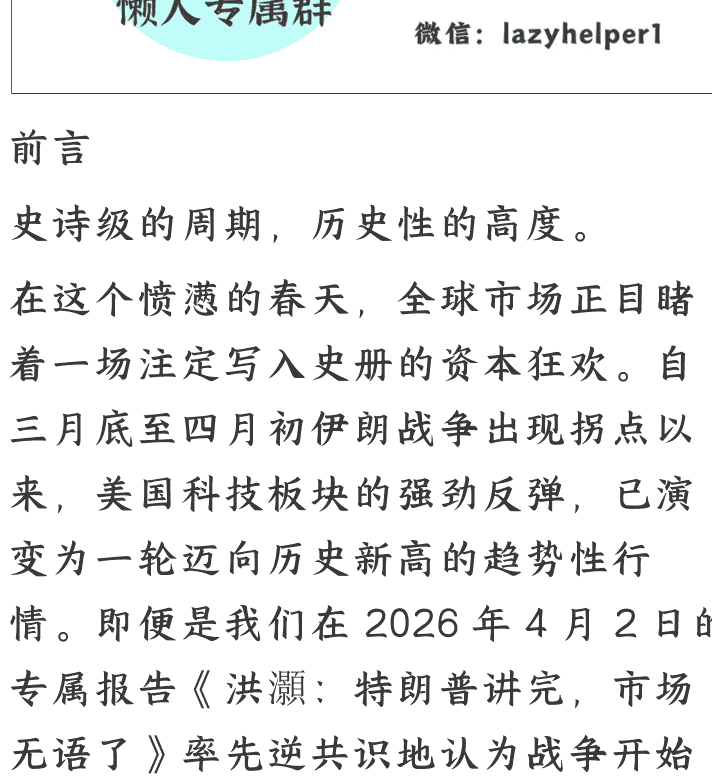
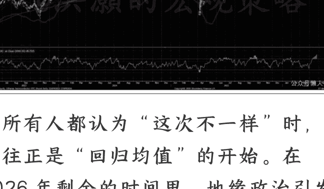
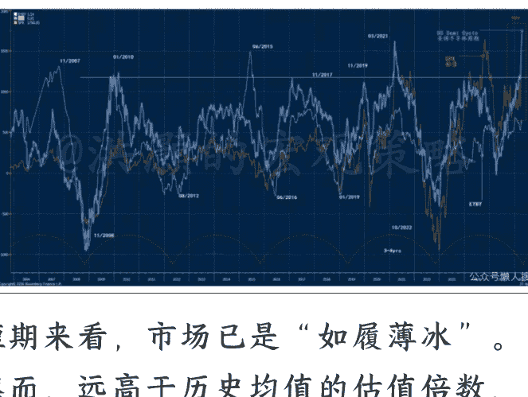

# 半导体超级周期？

20260428 洪灏付费

整理：公众号懒人搜索，
懒人专属群精选

懒人微信：lazyhelper1

## 前言

史诗级的周期，历史性的高度。

在这个愤懑的春天，全球市场正目睹着一场注定写入史册的资本狂欢。自三月底至四月初伊朗战争出现拐点以来，美国科技板块的强劲反弹，已演变为一轮迈向历史新高的趋势性行情。即便是我们在 2026 年 4 月 2 日的专属报告《洪灏：特朗普讲完，市场无语了》率先逆共识地认为战争开始降级，并在随后的两篇专属文章《洪灏：史诗级 TACO》、《洪灏：利好》对于这个观点进一步讨论，市场的这种历史性表现还是超出了所有人的预期。

从 2026 年 3 月 31 日算起，美股市场呈现出极端的割裂态势：科技板块以 18% 的涨幅一骑绝尘，遥遥领先于所有其他行业。而与之形成鲜明对照的是，尽管伊朗战火纷飞、霍尔木兹海峡封锁将油价推高至每桶 100 美元以上，能源板块却逆势下跌了近 5%，成为同期美股中唯一录得负增长的板块。

一言以蔽之，美股的基本面与技术面之间逻辑上出现了很难调和的背离，美国乃至全球市场都陷入了一种近乎癫狂的状态。费城半导体指数在四月份创下了连续 17 个交易日报表的记录，美国半导体指数基金更是实现了连续 18 天的历史性上涨。该指数基金仅在四月份单月就暴涨近 30%，这一涨幅甚至超过了它自 2001 年成立以来、长达 25 年间的任何一个月度回报。此时此刻，市场究竟是“亢龙有悔”，还是“飞龙在天”？当美国半导体指数基金的相对强弱指数（RSI）飙升至接近 90 时，我们所面对的是过去五年、甚至很可能是该基金历史上最为严重的超买状态。这种极端情绪所催生的溢价，已令许多技术指标显得无所适从、力不从心。

回望十二年前，2014 年初夏，美国半导体行业也曾经历一段持续 15 个交易日的连涨。然而，彼时的美国半导体指数虽然也创下历史性连涨纪录，涨幅却只有不及 40%，远逊于当下约 40% 的暴涨。当然，那次连涨终结之后，市场并未出现剧烈崩塌，仅在轻微回调后便迅速收复失地，继续上行。但 2026 年的剧本显然更加惊心动魄—这一次，美国半导体指数在 17 连涨中飙升了约 40%，市场内部的波动烈度已今非昔比。如果说 2014 年的市场是步步为营，那么 2026 年的市场就是旱地拔葱。这种斜率上的根本差异已经暗示：这一次，历史恐怕很难再次简单重复。

那么，经历了历史性的连涨行情、历史性超买之后，半导体板块应该怎么走？

我们可以用估值来比较两个时期的半导体板块表现：2026 年的半导体板块很可能正处在一场“瓦釜雷鸣”般的估值高位之中。2014 年连涨期间，半导体板块的市盈率（P/E）仅为 26.0 倍，而今天这一数字是 58.0 倍，差距超过一倍。市销率（P/S）的扩张更为惊人—2014 年为 3.6 倍，如今已飙升至 12.6 倍。即便是市净率（P/B），也从当时的 3.8 倍跃升至现在的 10.1 倍。虽然当前的远期市盈率（Forward P/E）为 25.8 倍，看起来与 2014 年的 16.5 倍之间的差距没有其他指标那么悬殊，但我们必须清醒地认识到：这种溢价是建立在对 AI 增长极度乐观的假设之上的。估值的这种跃迁表明，市场已不再为盈利增长定价，而很可能开始在为“预支的未来”定价。

对比这两轮牛市的底层动力，我们会发现，两次历史性超买背后的逻辑大相径庭。2014 年的繁荣更像是一次传统的周期性回暖：当时英特尔大幅上调营收预期，是因为企业级 PC 需求超出预期；当时美光科技的利润增长，则源于行业产能自律带来的存储芯片价格上涨。那时的需求端主要靠 iPhone6 引发的智能手机潮、PC 更新以及汽车半导体的渗透来支撑。可以说，2014 年的历史性连涨是供给端节制自律与需求端稳健增长的共振。

而 2026 年的逻辑，则是结构性需求的爆发。AI 基础设施对高带宽内存（HBM）的需求前所未有，SK 海力士甚至表示，未来三年的 HBM 需求都将超过供应。尽管投入了巨额资本，产能依然捉襟见肘。此外，地缘政治的冲击—尤其是中东战火引发的石脑油供应受阻—已经导致半导体生产关键材料光刻胶出现短缺，令本已紧张的供应链雪上加霜。而战事何时结束，目前仍不得而知。

在这一背景下，2026 年的供应约束远比 2014 年严峻。2014 年的主要瓶颈在于半导体代工厂产能的短期错配，订单交付等待期约为 5 个月。而到了 2026 年，我们看到的是从先进制程节点到先进封装，整个供应链的全面告急。这种结构性短缺因伊朗战争升级而进一步恶化，许多公司管理层预计很可能将持续到 2027 年甚至 2028 年。这种“卖断货”的景象，给了投资者无限的想象空间，但同时也掩盖了一个风险：如果战事拖延过久、油价居高不下，经济衰退可能接踵而至，进而对需求形成反噬。

当下的市场情绪，已令一些投资者开始另辟蹊径。例如著名空头大鳄迈克尔·伯里（Michael Burry），他已开始买入 2027 年 1 月到期的半导体看跌期权。他毫不掩饰地表示：“半导体指数终将回归现实。”他的此番操作于 4 月 24 日周五晚间公布，正值美国半导体指数创下 18 天连涨纪录之际—这是伯里对市场狂热投下的一枚冷峻的注脚。

## 图一：半导体指数技术面出现中级调整信号

当所有人都认为“这次不一样”时，往往正是“回归均值”的开始。在 2026 年剩余的时间里，地缘政治引发的成本上升与 AI 红利带来的估值溢价将反复拉锯。然而，在如此极端的超买情势与高估值水位之下，保持一份清醒、懂得何时“持而盈之”，或许是活下去的关键。

2014 年的经验告诉我们，再健康的牛市也需要回调和整固。而 2026 年这种令人窒息的上涨，往往预示着剧烈的调整已渐行渐近。我们独有的半导体周期量化指标，已飙升至历史上前所未见的高度（如图二）。这印证了当前我们所见证的，的确是当之无愧的半导体行业“超级周期”—但这场盛宴，更像是由供应焦虑与技术革命共同支撑起来的。当潮水退去，那些被地缘冲突掩盖的产能过剩风险，以及被 AI 预期推高的估值泡沫，都将面临清算。毕竟，在资本市场，没有长盛不衰的宴席，只有及时离场的智慧。

## 图二：半导体超级周期，达到了史无前例的高点。

短期来看，市场已是“如履薄冰”。然而，远高于历史均值的估值倍数，既折射出公司管理层对未来的信心，也体现出市场对管理层毫无保留的信任。当前，半导体量化周期指标已飙升到历史最高点，已经超过了 2021 年 3 月所见证的那个高点。彼时的高点，曾是中国科技板块因宏观巨变而创下的历史性高点（如图）；而对于美股科技板块而言，在那之后数月内经历了一次 15% 的回调之后仍有约 20% 的涨幅。即便是 2014 年 6 月第一次出现的历史性连涨行情，其后几个月也还有约 15% 的上涨空间—但在三个月后的 2014 年 9 月，也曾出现过一次近 20% 的技术性回调。

在一个技术面重要性超越估值、基本面暂时无法证伪、且流动性条件尚未改变的市场里，半导体的超级周期大概率尚未结束，而短时间里的技术整固，暂时不应该是现阶段预测的重点（或者说，这个预测胜率还不够高）。毕竟，单一技术指标超买的状态已经路人皆知，因此这样的预测并不增加新的认知，然而可能扰乱视听、增加误解。回头看，不管是 2014 年的历史性连涨行情，还是 2021 年当时周期的历史性高点，半导体板块后面在技术调整之后，都还有高点。

—————分割线—————

在这个 AI 能替你写代码、写文章的时代，基础技能正在迅速贬值。绝大多数人正被淹没在海量的免费垃圾信息里，陷入低效的体力内卷。

当“努力”不再是壁垒，人与人之间唯一的护城河，只剩下“信息过滤”的效率与“认知系统”的维度。

圈子已稳定运行 7 年。我们每天利用 Python 爬虫与大模型算力，过滤全网最顶级的政经内参和搞钱风向标，做你最冷酷的“外部大脑”。

如果你认同这种“重塑认知防线”的极客主义，欢迎围观我的个人情报智库：【懒人专属群】。

<https://lazyso.com/insider/>

认同信息过滤价值、想省下每天 3 小时无效阅读时间的读者，扫码加我微信（lazyhelper1）

