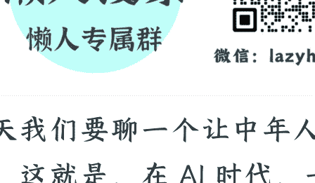

# 大数据告诉你：大器晚成，才是人生常态

2024 年 4 月 29 日
整理：公众号懒人搜索，<u>懒人专属群</u>精选
懒人微信：lazyhelper1

今天我们要聊一个让中年人揪心的话题，这就是，在 AI 时代，一个人"大器晚成"的概率还有多大？

为什么强调 AI 这个技术背景？主要是因为，在它的加持下，时代似乎越来越倾向于“英雄出少年”了。

**OpenAI** 的核心团队平均年龄只有 30 岁出头。2023 年，全球冒出来上百家大模型创业公司，创始人大多是“90 后”。还有人专门统计过，在这一轮 AI 浪潮中，从技术突破到商业落地，平均只用了不到 3 年时间，而在上一轮互联网浪潮中，这个周期要长得多。

而且未来，"10 后”将是 AI 的原生一代，他们从小浸润在 AI 里，对这个新技术的适应度只会越来越高，年轻人成才的概率也会越来越高。

你看，说到这，我们再看一眼开头那个问题，AI 时代，一个人"大器晚成"的概率还有多大？

## 我们再看结论

咱们先说结论，在多数领域，大器晚成都是人生常态。没错，是多数领域。这个规律或许也能迁移到 AI 时代。

注意，这个结论可不是我编的，而是来自前段时间刊登在《科学》期刊上的一项研究。这项研究由德国、奥地利和美国三国的体育科学、认知心理学团队合作完成。

他们结合大量的数据统计和模型评估，复盘了全球 34839 名顶尖人才的成长路径，其中包括诺贝尔奖得主、奥运冠军、世界顶级棋手和著名音乐家。

### 核心结论

总体看下来，这项研究有这么几个核心结论。

### 第一，青少年时期的卓越表现，并不能预测成年后的巅峰成就。

数据显示，那些在青少年时期表现优异的人，和成年后达到世界级水平的人，重合度相当低。

比如，在体育界，青少年时期拿过国际比赛冠军的运动员，成年后能继续站在国际舞台上的，只有不到 20%。也就是说，10 个青少年国际冠军里，只有 2 个能延续到成年组。

- 再比如，在国际象棋领域，14 岁以下的世界前十名，和成年后的世界前十名，重合度只有 10%。90% 的青少年顶尖棋手，在成年后都没能保住顶尖位置。

听到这，有人可能会说，这会不会是因为，层级越高，竞争越激烈。这本来就是一个层层筛选的过程，有人被筛下来不是很正常吗？

### 第二个关键发现

这就要说到，这项研究的第二个关键发现了，叫做，世界级表现者在青少年时期的成长轨迹，明显慢于次顶尖表现者。这个表述稍微有点拗口，说白了，就是那些“慢热”的人，反而在后期表现更好。

比如，在体育领域，那些成年后站在奥运会领奖台上的世界冠军，有 72% 在青少年时期根本算不上国际级选手。未来的世界冠军，在青少年时期，可能反而是那个进步相对慢的人。

再比如，学术界。诺贝尔奖得主在职业生涯早期，普遍拿到的奖学金更少，升教授的时间也更晚。

再比如，在国际象棋领域，那些后来成为世界前三的棋手，在 14 岁时的积分，往往低于那些后来排名稍靠后的棋手。

什么意思？就是一个人的早期表现和最终成就之间，不仅没有强关联，而且在某些情况下甚至呈现出负相关。

### 第三个关键发现

为什么会出现这样的情况呢？这就要说到研究的第三个发现了，这些后来居上者的早期成长路径，有一个共同特点是，他们经历了一个相对漫长的多元化探索期。

比如，世界级运动员在青少年时期，花在本专业上的训练时间，明显少于一般意义上的优秀运动员。数据显示，他们在童年和青春期平均会参与至少 2 项以上其他运动，而且这种跨领域的尝试会持续近 10 年。像网球天王纳达尔，小时候足球踢得也很好，而其他很多奥运冠军，小时候也是“多面手”。

再比如，很多诺贝尔奖得主在科学之外，往往有着更丰富的艺术、手工艺或其他爱好。研究发现，诺贝尔奖得主有艺术背景的概率，是普通科学家的 2.8 倍。而且他们平均选定“终身职业”的时间，普遍比次顶尖同行要晚个 1 到 3 年。

换句话说，世界级表现者通过广泛的早期探索，找到了最适合自己的领域，然后在后期实现了爆发式增长。

那么问题来了，为什么早期专业化反而限制了长期发展？研究团队给出了三个解释理论。

## 理论解释一：搜索与匹配假设

- 第一个理论，叫做“搜索与匹配假设”。简单说，就是人生就像在超市购物，假如你一进门就盯着第一排的商品，你很难知道后面是否还有更适合你的东西。

通过早期的多领域尝试，个体有更大概率找到那个与自己天赋、兴趣最完美匹配的领域。一旦找到了这个“真爱”，后期的爆发力是惊人的。而一些过早专业化的人，往往被困在一个“还不错但不是最好”的领域里，耗尽了自己潜力。

举个例子。假设训练一个孩子写作文。如果只给他看满分作文，而且都是同一种类型的，那他很快就能学会写出高分作文。但问题是，当他走出考场，面对真实世界的写作需求时，他可能完全不知道该怎么办。为什么？因为他学会的，不是“写作”这个通用能力，而是“如何在特定评分标准下拿高分”。

说白了，假如训练方式过于针对眼前的标准，虽然能快速提高分数，却可能压缩未来成长的空间。

### 理论解释二：学习资本增值假设

## 第二个理论，叫做“学习资本增值假设”

也就是说，多样化的经历不仅仅是试错，更是一种资本积累。

同时，早期的适度挫败，能提升一个人的心理韧性，这对他的长期发展更有利。比如，在运动领域，很多孩子小时候表现好，其实因为发育得早。

有些孩子 12 岁就长到了 1 米 7，而有些孩子 12 岁才 1 米 5。那个个子高的孩子早期可能占尽优势，未尝一败。但等到大家都发育彻底，其他人的身高可能就追上来了。这时，那个一度因为身体优势“未尝一败”的孩子，可能会因为身高优势的丧失，同时失去自信。

换句话说，成事除了技巧，还需要强大的心理素质。毕竟，就像足球领域经常说的，足球是圆的，有赢就有输，关键是，你下一次能不能赢回来。

### 理论解释三：风险最小化假设

## 第三个理论，叫做“风险最小化假设”

这个理论涉及一个观点，叫，过早从事专业领域，可能会伴随着副作用。

比如，从生理上说，过度的单一训练会带来损伤。很多天才少年，在成年之前身体就出现了问题。那些练体操的、练芭蕾的孩子，很多人十几岁就伤病缠身，根本撑不到职业生涯的黄金期。

再比如，从心理上说，当爱好变成工作，当工作变成唯一，热情很容易被耗尽。研究发现，很多青少年冠军在成年后选择退役，不是因为实力不够，而是因为职业倦怠。他们从 6 岁开始，每天都在重复同样的训练，到了 18 岁，已经练了 12 年。这种倦怠感是致命的。

换句话说，**那些在早期就有多元化探索的人，他们的人生有更多可能性**，不会把所有希望都寄托在一件事上，这种心态，**反而让他们在竞争中更从容、更持久**。

那么，理解了这些机制之后，我们应该怎么办？

在给出具体建议之前，我们先要理解一组概念：“友好环境”和“邪恶环境”。这个理论框架，来自《纽约时报》畅销书作家，也是受奥巴马、比尔·盖茨等人盛赞的作家，大卫·爱泼斯坦。

### 友好环境与邪恶环境

所谓“友好环境”，指规则固定、*反馈及时*、*因果清晰*的领域。比如考试、考证、考级等。在这些领域，你做对了，马上就能看到结果。你练得越多，进步越明显。在这种环境下，早期专业化确实有效。

但是，真实世界不是这样的。规则随时在变，反馈严重滞后，因果关系模糊。你今天做的事情，可能要十年后才能看到结果。你以为有用的技能，可能明天就被淘汰了。这就是所谓的“邪恶环境”。

而我们所处的当下，这个特点变得更加明显。人工智能正在重构各行各业。那些可以被标准化、程序化的技能，正在快速贬值。而那些需要*创造力*、*跨界整合能力*、*适应变化能力*的工作，价值在飙升。

换句话说，按照大卫·爱泼斯坦的标准，AI 时代，也许是一个更明显的“邪恶环境”。注意，我们要说的重点，并不是否定努力，而是关于“努力的方向”。

那么，面对这个前提，人们应该做点什么呢？

结合《科学》的研究，我们总结了三个建议。

### 第一，重视早期的多元化探索。

尤其是注重“硬知识”背后的“软技能”。

- 比如，学过音乐的人，对节奏和模式的感知能力更强。
- 练过体育的人，抗挫折能力更强。

### 第二，留出足够的“容错空间”。

> 假如每个领域进步得比较慢，不要急着否定自己。

研究已经告诉我们，那些

> 最终登顶的人，往往是“慢热型”

的。人类大脑中负责战略规划和复杂决策的前额叶皮层，要到 25 到 30 岁才完全成熟。很多能力的发展，本来就需要时间。

### 第三，警惕“过早优化”的陷阱。

假如你在某个领域特别顺利，你可能需要思考，你是不是正在用某种暂时的优势碾压同龄人。

> 有益的困难

> 但注意，研究人员并不是说要放弃这个领域，而是建议引入一些“有益的困难”，去尝试一些不擅长的事情。

能是在别人力竭退场的时候，刚刚找到了属于自己的节奏。

最后，还要特别提醒一句，前面我们提到的所有结论，都是科学家经过统计得出的。它们绝对不是什么空洞的心灵鸡汤。也希望这个前提，能够增强你关于大器晚成的信念感。

---

在这个 AI 能替你写代码、写文章的时代，基础技能正在迅速贬值。绝大多数人正被淹没在海量的免费垃圾信息里，陷入低效的体力内卷。

当“努力”不再是壁垒，人与人之间唯一的护城河，只剩下“信息过滤”的效率与“认知系统”的维度。

如果你认同这种“重塑认知防线”的极客主义，欢迎围观我的个人情报智库：

[懒人专属群](https://lazyso.com/insider/)

认同信息过滤价值、想省下每天 3 小时无效阅读时间的读者，扫码加我微信（lazyhelper1）