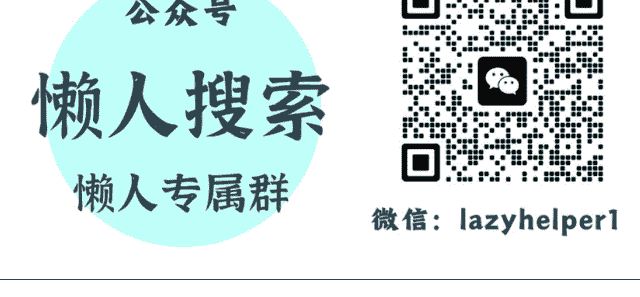
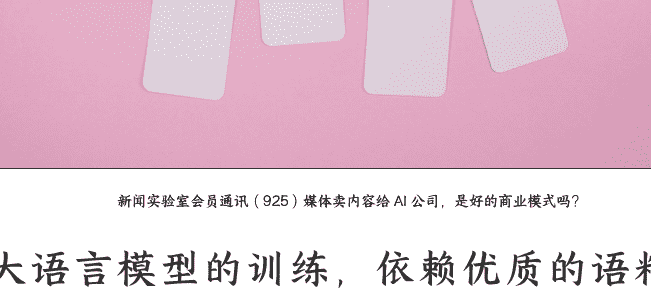
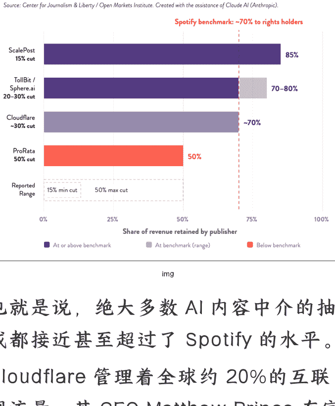
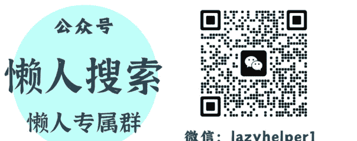

# 媒体卖内容给 AI 公司，是好的商业模式吗？

**2026 年 4 月 29 日** 新闻实验室
整理：公众号**懒人搜索**，**懒人专属群**精选
懒人微信：**lazyhelper1**

如果规则继续由少数科技巨头决定，可能重演搜索和社交媒体时代的故事。

新闻实验室会员通讯（925）：媒体卖内容给 AI 公司，是好的商业模式吗？

大语言模型的训练，依赖优质的语料库。而媒体生产的内容就是重要的训练数据，其中不仅包括历史文章，也包括每一天都在生产的新文章，因为 AI 要能给出准确、及时的答案，就要依靠这些不断更新的新数据。

问题是，这些内容大多是在没有获得同意、也没有得到补偿的情况下，被抓取到了 AI 公司的训练数据之中。

媒体当然越来越不能接受这种状况。

因此，"AI 内容授权（AI content licensing）”成了一个热门话题。所谓"AI 内容授权”，简单来说，就是 AI 公司向内容生产者付费，以换取使用其作品的权利。这既包括用来训练模型的语料，也包括 AI 在回答用户提问时实时调取的资料。

这听起来像是再正常不过的商业逻辑：你用了我的东西，就该付钱。但现实远比这复杂。

Open Markets Institute 旗下的 Center for Journalism & Liberty 刚刚发布了一则 [报告](../2)，详细描绘了这个新兴市场的轮廓，也指出了其中令人担忧的问题。报告认为，今天 AI 内容授权市场形成的方式，与当年搜索引擎和社交媒体崛起时非常相似。而那两次，新闻业都错失了讨价还价的机会，从此深陷对平台的依赖当中。

今天的新闻实验室会员通讯，我们就来了解这份报告的主要发现和观点。

## 大媒体拿到合同，小媒体仍在门外

说起 AI 内容授权，人们最容易想到的是那些登上新闻头条的大额合同：某媒体又和某 AI 巨头签约了。

报告显示，目前真正从 AI 内容授权中拿到钱的，主要是少数大型新闻媒体和娱乐公司。比如，OpenAI 已经与大约 35 家媒体签署协议；微软的 Publisher Content Marketplace initially only invited 8 media companies; Perplexity's media project covers about 20 media companies.

In terms of contract amount, News Corp's five-year agreement with OpenAI is about $250 million, DotDash Meredith (a large company owning 40+ popular media brands like People) gets at least $16 million from OpenAI annually, and Amazon agreed to pay The New York Times about $20 million annually.

These figures sound large, but the problem is that they belong to a small group of institutions at the top of the market. In the US, local newspapers, ethnic minority media, indigenous media, non-English media, and small independent media serving marginalized groups have almost no opportunity to negotiate. They lack strong brand influence and sufficient legal and technical resources to negotiate with OpenAI, Google, Amazon, or Microsoft.

The report author pointed out that these are exactly the media that 'would cause the greatest harm to civil society if they disappeared', but AI companies lack the business incentive to voluntarily compensate them.

The entertainment content industry is also staging a similar drama: companies like Disney are signing deals with AI giants, while independent creators without bargaining chips can only watch helplessly.

### Intermediaries emerge, big companies quietly enter the market

The bilateral transactions between media and AI companies are just the tip of the iceberg. Beneath the surface, an ecosystem of startups emerged, rapidly growing.

自 2024 年以来，这个领域已经从硅谷的几家小公司扩展到十几家。它们大致可以分为两类。

一类充当媒体与 AI 开发者之间的撮合平台，比如 TollBit、Sphere.ai、ScalePost、Created by Humans 和 Defined.AI。

另一类则站在媒体一侧，帮助媒体在自家网站上部署 AI 搜索和个性化体验，代表是 ProRata 和 Miso.ai。

这些中介的服务通常围绕三件事展开：识别和拦截爬虫、搭建按次或按访问计费的内容市场、以及基于归因技术分配收入。

过去三十年的搜索引擎时代，各家网站都会有一个叫 `robots.txt` 的文件，里面规定了搜索爬虫可以抓取什么、不能抓取什么。TollBit 联合创始人兼 COO 将 robots.txt 形容为一种君子协定——只是一种建议或指引，但缺乏强制机制。这正是 TollBit 开发“机器人付费墙”的初衷：把那些试图免费抓取内容的 AI 爬虫真正拦下来，引导它们走向付费接口。

ScalePost 的创始人兼 CEO 则描述了他们如何为媒体提供“相当深入的工具”，让媒体清晰看到机器人到底在意哪些内容、哪些类别、哪些作者。

ProRata 联合创始人说得更直白：“我们的产品本质上是一个归因平台（attribution platform）。我们生成一个答案，用真正的 RAG 归因技术把它拆解开来，然后把钱分给被引用的来源。总得有人付记者的工资。”也就是说，他们帮忙判断 AI 的回答到底用了谁的原始资料，然后计算贡献了原始资料的人应该得到的报酬。

当这些初创公司还在摸索商业模式时，大科技公司已经悄然入场。

亚马逊、微软、谷歌和苹果这样的巨头开始建立自家的内容市场。微软于 2026 年 2 月推出的 Publisher Content Marketplace，就是一个为其自家 AI 产品 Copilot 提供内容的私有双边平台。

表面上看，这与 TollBit、Sphere.ai 这样的中介没什么不同。但报告作者敏锐地指出，真正的危险在于“平台层面的结构性捕获”（structural capture at the platform layer）——媒体一旦围绕某个平台的技术规范来做事，就难以转到另外的平台或中介。而大平台积累的交易级数据，包括价格、使用情况、内容表现，是媒体和平台竞争对手都望尘莫及的。

这与当年 Google 同时控制媒体广告服务器、广告交易所和需求方平台时所享有的结构性优势，几乎是同一个剧本。

在费用方面，报告做了一张对比图：ScalePost 抽成 15%，TollBit 和 Sphere.ai 抽 20% 到 30%，Cloudflare 约 30%，而 ProRata 高达 50%。作为参照，Spotify 大约把 70% 的收入留给版权方。

| 中介公司 | 抽成比例 | 备注 |
| :--- | :--- | :--- |
| ScalePost | 15% | |
| TollBit / Sphere.ai | 20% - 30% | |
| Cloudflare | ~30% | 管理全球约 20% 互联网流量 |
| ProRata | 50% | 参考：Spotify 约 70% 给版权方 |
| Spotify (参考) | - | 约 30% 抽成，70% 留给版权方 |

也就是说，绝大多数 AI 内容中介的抽成都接近甚至超过了 Spotify 的水平。Cloudflare 管理着全球约 20% 的互联网流量。其 CEO Matthew Prince 在宣布一项面向独立媒体和非营利机构的免费计划时说：“我相信新闻业，我相信本地、独立新闻的健康对于一个健康的互联网和健康的社会至关重要。”

这番话听起来振奋人心，但报告作者也提醒：Cloudflare 的市场合作伙伴，目前几乎清一色是大型新闻品牌。

### 新闻的价值，不只是一次点击

除了介绍这些业界动向和模式之外，报告最核心的观点是：不能用"AI 查了多少次新闻网站的内容”来给新闻定价。

在过去的搜索时代，搜索引擎常说自己给媒体带来了流量，所以媒体也从平台那里获得了好处。但在 AI 时代，这套说法越来越站不住脚。生成式 AI 的目标不是把用户送到媒体的网站上，而是把答案留在自己的界面里。报告引用的数据称，AI 界面给媒体带来的外部转介流量只有约 0.04%，而谷歌仍占约 85%。更夸张的是，OpenAI 的爬虫大约每抓取 1700 个页面，才给媒体带来一个真人访客；Anthropic 的比例约为 73000 比 1；Perplexity 约为 369 比 1。

也就是说，AI 系统大量读取新闻内容，却几乎不把读者送回新闻网站。报告估计，这种变化可能造成媒体每年约 20 亿美元的收入损失。

但损失点击还不是全部问题。报告认为，新闻内容对 AI 的价值更深。AI 模型之所以能写出清楚的句子、理解公共事件、总结复杂议题、提供看似可靠的答案，很大程度上依赖长期积累的报道、调查、事实核验和专业写作。新闻不是只在 AI 回答问题时才有用，它早就在模型训练阶段提供了语言能力、事实基础和公共可信度。

这也是报告特别强调不能仅仅根据 RAG 定价的原因。RAG 指的是“检索增强生成”，可以简单理解为：AI 在回答问题时，临时去查找最新或相关资料，再把这些资料整合进答案里。现在很多授权谈判只围绕这一层展开，也就是 AI 实时调用新闻内容时该付多少钱。但报告认为，这样太窄了。因为 AI 模型在训练阶段已经吸收过大量新闻内容，如果只为实时检索付费，而把训练阶段的贡献当作免费赠品，就会严重低估新闻业的价值。

## 谁来定规则：AI 公司，还是公共政策？

现在最大的问题是，AI 内容授权市场还没有清晰规则。报告称，截至 2026 年初，全球已有 100 多起针对 AI 公司的版权诉讼，大多数发生在美国。这些诉讼的争议核心是：AI 公司未经许可抓取和使用内容来训练模型，是否构成版权侵权？

法律答案还没有完全确定，而这种不确定性对大型 AI 公司更有利。它们有资金打官司，也可以一边等待判决，一边继续扩大产品和用户规模。相比之下，媒体承受的是即时压力：流量下降、广告减少、订阅增长困难，所以它们可能更容易接受眼前的授权合同，即使这些合同低估了长期价值。

报告还提醒，不能让 AI 公司自己决定谁有资格拿钱。过去，谷歌和 Facebook 也曾通过新闻项目选择部分媒体合作，提供资金或流量支持。但这种关系更像平台施舍，而不是公平谈判。平台可以选择谁是伙伴，也可以在商业优先级改变时停止支持。

因此，报告建议，AI 内容授权需要公共政策介入。例如，可以建立类似音乐版权集体管理的机制，让新闻机构集体谈判和分配收入；也可以要求 AI 公司披露授权交易的总体信息，减少暗箱操作；还可以设立明确的新闻机构资格标准，由新闻业和公共机构共同决定，而不是由 AI 公司挑选自己喜欢的对象。

报告也提到一些正在出现的替代方案。Really Simple License 试图建立一种机器可读协议，让网站直接告诉 AI 爬虫：哪些内容可以用、如何署名、需要支付多少钱。Sphere.ai 联合创始人 Kyle Buckingham 则认为，地方新闻其实有独特价值，因为很多地方媒体是某个社区或地区唯一的原创信息来源。他说，地方媒体有机会把关于本地的独特内容变现。

这份报告最后的判断并不悲观——AI 内容授权市场确实可能成为新闻业重新议价的机会。但值得警惕的是，如果规则继续由少数科技巨头决定，它也可能重演搜索和社交媒体时代的故事：新闻提供内容，平台获得利润，媒体越来越依赖平台，却越来越难维持自己的生存。

正如报告最后所说：新闻业对 AI 经济的价值，值得受到根本性的重视——不应只是换得平台的一点施舍补偿，而应被看作一种社会不能缺少的公共基础设施。

------ 分割线 -------

在这个 AI 能替你写代码、写文章的时代，基础技能正在迅速贬值。绝大多数人正被淹没在海量的免费垃圾信息里，陷入低效的体力内卷。

当“努力”不再是壁垒，人与人之间唯一的护城河，只剩下“信息过滤”的效率与“认知系统”的维度。

如果你认同这种“重塑认知防线”的极客主义，欢迎围观我的个人情报智库：【懒人专属群】。

https://lazyso.com/insider/

认同信息过滤价值、想省下每天 3 小时无效阅读时间的读者，扫码加我微信（lazyhelper1）

