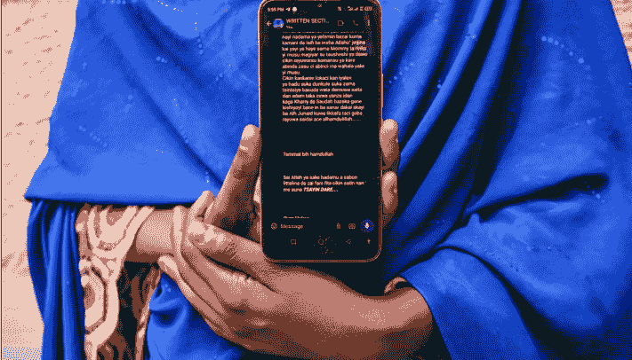
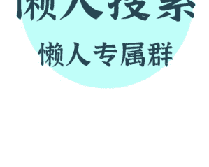

# 尼日利亚的女性情色写作

260429 新闻实验室

整理：公众号懒人搜索，[懒人专属群](http://unused/unused) 精选

懒人微信：lazyhelper1

一个由女性中间人、暗语、分级访问权限、互相掩护构成的“欲望基础设施”。

最近，我在《纽约时报》读到一篇关于尼日利亚女性情色写作的"文章"，又按图索骥对这个话题多做了一些了解，忍不住想要把它介绍给大家，因为它涉及了女性写作、审查与反审查、数字平台等许多我们关心的话题。

## 从被焚烧的小书到加密的 WhatsApp 群组

一种全新的、几乎完全由女性构成的地下文学经济，正在伊斯兰教法严格管辖的尼日利亚北部悄然运行。

《纽约时报》的文章中描写了这样的场景：在尼日利亚北部的卡诺州（Kano），一位笔名为 Oum Hairan 的年轻穆斯林女性每次在 WhatsApp 群组里发布小说新章节时，数千部手机会同时响起提示音。她笔下那位“好色国王”的情节推进到关键处，便戛然而止——读者想要继续，就得向她的账户转账 300 奈拉（约 1.5 元人民币），想要“特级 VIP 体验”则要 1500 奈拉（约 7.5 元人民币）。

这些小说以豪萨语（Hausa，非洲使用最广泛的三大亚非语系语言之一）写作。豪萨语的言情小说在当地被称为 littatafan soyayya（意为“爱情文学”），它并不是新事物。

根据《国家地理》杂志的介绍，这一文类的先驱 Balaraba Ramat Yakubu 是一名早婚、被抛弃、19 岁便离异的穆斯林女性。她后来通过受教育重新掌握了命运，并在 1990 年写出了《罪是一只跟你回家的小狗》（Sin Is a Puppy That Follows You Home），据信是第一部被译为英文的、由女性写作的豪萨语小说。

的题材从传统的灰姑娘爱情故事，到涉及苏丹人口贩卖的政治元素，从穆斯林妻子守则，到暗讽父权的寓言，应有尽有。

当然，这一文类从未被保守的当局所喜。2007 年，时任卡诺州州长 Ibrahim Shekarau（后来担任尼日利亚教育部长）公开焚烧了一批言情小说，宣称它们“助长青少年道德败坏”。此后，伊斯兰道德警察“希斯巴”（Hisbah）与州审查委员会要求所有作者登记注册、书稿送审。这种保守气氛存在于所有的文化领域——比如，2016 年，女演员 Rahama Sadau 仅因在一支 MV 里与男歌手拥抱便被该国电影业**封杀**。

不过，被焚烧的只有纸质书，当新一代年轻女性把她们的作品搬上 WhatsApp，传统审查机器瞬间失灵。上文提到的 Oum Hairan 就是这场转型中的明星作者。今年 31 岁的她以免费章节在上千人的群组里“钓”读者，在悬念最浓时甩下付费墙：普通群、加速更新群、一对一私信投递的“特别女士”级订阅，价格逐级递增。同时，她也在读者群里面带货——广告商每周付出 6500 奈拉（约 33 元人民币）的费用，就能在这些群里兜售情趣内衣、催情药和厨房用具。

由于读者众多，不少作者都因此获得了丰厚的回报。卡诺州一位白天在医院工作、夜晚以笔名 Oum Aphnan 写作的护士说，她写情色小说的收入“远远超过工资”。她的姐妹 Maman Teddy（因喜爱泰迪熊得名）则用稿费购买头巾，并给丈夫充话费。两人最担心的不是希斯巴，而是她们的父亲会发现她们在偷偷写这些小说。

《纽约时报》的记者还造访了卡诺州的审查委员会。委员会主任得意地向记者展示了最新的战利品：一本 19 世纪出版、代代小学生读过的韵文教材《Queen Primer II》，因为其中一句含有" gay”的古老童谣（当然，在句子里面的意思是“快乐”），而被查禁 55000 册。

至于网络上那些真正火热的情色连载，他坦率承认：“有些事你只能睁一只眼闭一只眼，至少你要控制住你还能控制的那一点。”

## “羞耻在眼中”

要理解这些女性写作的分量，必须进入豪萨文化里的一个关键词：kunya。这个词通常译为“羞耻”或“谦逊”，但实际土上的意思要复杂得多。

作家 Elnathan John 在自己的 newsletter 里面写道，他在尼日利亚中北部的卡杜纳（Kaduna）长大，父母是严格的“耶和华见证人”信徒，教他从童年起就惧怕自己的身体。而在家庭之外的街头，他说的是豪萨语，浸润的是豪萨文化。一句他从小听到骨子里的谚语是：kunya, a ido take——“羞耻在眼中”。

也就是说，父母告诉他，上帝在看着你；豪萨文化告诉他，其他人在看着你。

然而，越在公开场合强调耻感的文化，在看不见的地方可能就越放荡。正如 Elnathan John 援引 1954 年由 Mary F. Smith 整理出版的人类学自传《Baba of Karo》所展示的：一些丈夫不在身边的已婚豪萨女性“可能有十个情人，甚至二十个”。她们通过年长妇女传递欲望的暗语，与同室的妻妾结成共谋，为彼此打掩护。

人类学家 P.G. Harris 在 1938 年还记录过一种名为 tsaranchi 的习俗——未婚男女可以在“不插入”的前提下进行相当广泛的亲密接触，“有些女孩在出嫁前会有多达十个情人”。

因此，尼日利亚北部并不是一个真正禁欲的世界，它只是一个严格管理欲望的可见范围的世界。豪萨语里甚至早就有“吻”这个词——sumbata——它安静地躺在 1934 年 Bargery 编纂的《豪萨语—英语词典》里，没有任何道德批注。Elnathan John 写道：“问题从来不是豪萨人不接吻，问题是没有任何体面的人愿意承认。”这一点也解释了《纽约时报》报道里那些令人意外的细节。

Oum Hairan 能够在家乡村庄 Garun Malam 几乎以明星姿态生活，部分原因是她的读者阵容中赫然有州长的妻子、宗教领袖的女儿和政界人物——她们都是被文化要求保持端庄面孔的女性。

2021 年，希斯巴将 Oum Hairan 召去训话时，她反问三位女性官员：你们怎么知道我写的下流？除非你们也在读。对方承认确实读过几本，随后只是“建议”她收敛。她对记者说：“我告诉她们我不能保证停笔，她们就放我走了。”

换个角度看，这一切并不违反 kunyu 的内在逻辑。这些小说是私下传阅的，在女性专属群组中流通，在卧室里、在蚊帐之下被阅读——它们从未进入“眼中”。

也是在 kunyu 的文化下，这些 WhatsApp 小组严格禁止男性进入。一旦有可疑人员，她们就会以高度的警惕将他们踢出群组。

### ***穿越时间的隐秘网络***

Elnathan John 还提到了另一个词：**karuwa**，它最初指的是“不隶属婚姻的女性”——独立谋生、自择伴侣的寡妇、离异者、自由女性。在早期豪萨语词典里，它意义宽泛，甚至可以指男性的放荡者或赤贫者。但语言会随着社会焦虑而收窄。今天，**karuwa** 几乎专门用来羞辱任何“太可见”的女性——笑声太大的妻子、在公共场合牵手的情侣、坐得离男孩太近的女孩。

“karuwa 惩罚的不是性，而是可见性（ visibility）。”他写道。

把这个词的历史叠加到今日卡诺的 WhatsApp 群组上，就能读出一层新的意味。Oum Hairan、Oum Aphnan 和 Maman Teddy 正在做的事情，某种程度上是在重建一个与《Baba of Karo》所描述的十九世纪隐秘网络同构的结构：一个由女性中间人、暗语、分级访问权限、互相掩护构成的“欲望基础设施”。只不过，19 世纪的老妇人变成了群管理员，塞在长袍里的小纸条变成了加密聊天，而货币则从牲畜与可乐果变成了手机银行转账。

Oum Hairan 在每本书的前言都写上一条禁令：禁止未婚的年轻女性阅读——这既是对希斯巴的预防性辩护，也是一种经典的 kunya 式操作：把可见性还回读者，让她们自行承担看见的责任。

《国家地理》摄影师 Glenna Gordon 的镜头曾经捕捉到卡诺城的日常：新娘手上的指甲花图案、年轻女孩嘴唇上的金属粉色口红、火车上一位豪萨女子就着手机电筒的微光阅读言情小说的侧影。她记录下这些日常，是因为记者镜头里的尼日利亚往往是灾难和苦难。但是，如果我们看到了这里活生生的人和他们的日常，我们对世界的认识会不会发生改变？

这可能也是我被《纽约时报》这篇报道吸引的原因吧：它以一种自下而上的视角，关注着人们的日常，记录着韧性与生命力。

在极端组织“博科圣地”焚烧村庄、审查委员会查禁童谣、耶和华见证人与伊斯兰神学家共同把少女训练成沉默者的大背景下，这些由女性写、女性读、女性付费、女性传阅的故事，或许不只是色情产品，也不只是逃避现实的麻醉剂，而是一种表达主体性的集体声音。它们证明，在 kunya 的建筑之下，始终流动着另一种地下水。

正如 Elnathan John 在结尾写的：

“一个吻不需要人群为它盖章，不需要文化给出批条。一个吻，当它是对的，它本身就是法律。”只是在尼日利亚北部，这个法律仍然必须轻声说出——或者，更精确地说，必须通过一部加密的手机，在一个没有男人的群组里，以每章 300 奈拉的价格，一字一句地被写出来。

---

在这个 AI 能替你写代码、写文章的时代，
基础技能正在迅速贬值。绝大多数人正被淹没在海量的免费垃圾信息里，陷入低效的体力内卷。

当“努力”不再是壁垒，人与人之间唯一的护城河，只剩下“信息过滤”的效率与“认知系统”的维度。

圈子已稳定运行 7 年。我们每天利用 Python 爬虫与大模型算力，过滤全网最顶级的政经内参和搞钱风向标，做你最冷酷的“外部大脑”。

如果你认同这种“重塑认知防线”的极客主义，欢迎围观我的个人情报智库：【懒人专属群】。
https://lazyso.com/insider/

认同信息过滤价值、想省下每天 3 小时无效阅读时间的读者，扫码加我微信（lazyhelper1）

