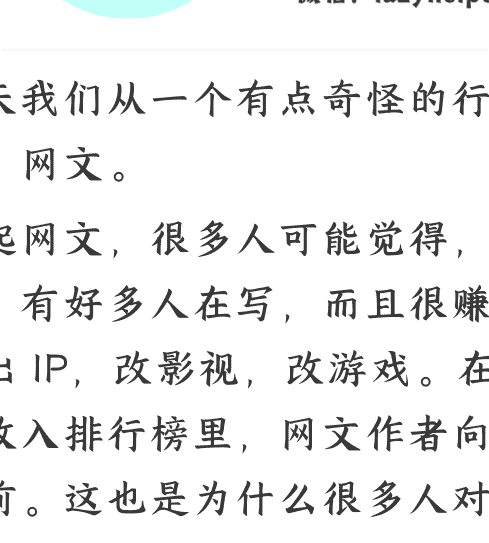

# 当 3200 万人开始写网文：有人成了燃料，有人修炼自己

2024.06.30

整理：公众号懒人搜索，《懒人专属群》精选

懒人微信：lazyhelper1

今天我们从一个有点奇怪的行业说起，网文。

提起网文，很多人可能觉得，这我熟啊。有好多人在写，而且很赚钱，还能出 IP，改影视，改游戏。在中国作家收入排行榜里，网文作者向来排名靠前。这也是为什么很多人对这个行业充满期待。

当然，也有很多人担心，现在 AI 这么发达，万一大家都用 AI 写东西呢？时间长了，网文里充斥着大量 AI 生成的垃圾，到时这个行业岂不是要被“玩死了”？

前面这些，期待也好，担忧也罢，都有道理。但是，就在最近，4 月 13 日，中国社会科学院发布了一份报告，叫《2025 中国网络文学发展研究报告》。看完之后你也也许会发现，网文这个事比我们想象得更加复杂。

报告里的更多内容，即使不说具体数字，估计你也能猜出个大概的趋势。

比如，网文的市场规模确实很大。现在，仅仅是网络文学阅读市场，规模就超过 502 亿元。而与网文关系紧密的短剧市场，规模已经超过 1080 亿元，IP 改编市场，规模已经超过 3676 亿元。注意，这还不算海外市场。而早在几年前，中国网文就已经几乎覆盖全球。

说白了，网文这块蛋糕非常大，而且还在增长。

当然，这个趋势即使不说，很多人也能猜到个大概。但是，报告里的另外几个数字，估计会让很多人感到意外。

首先，你知道中国人有多少写网文吗？10 万？100 万？都不对。报告里给出的数字是，3269 万人。没错，全国网络文学写作者的数量是，3269 万人。

什么概念？差不多中国每 40 个人里面，就有 1 个正在写，或者曾经写过网文。你的同事、朋友、家人里，大概率上就有人写过。

而且很多网文作者都是兼职，来自各行各业。

就拿国内最大的网文平台之一，阅文集团来说。他们的平台作者中，外卖骑手有 6100 多人，网约车和货运司机有 4000 多人，大学教师有 3100 多位，科研工作者有 470 位。

说白了，网文大舞台，想写你就来。
一个人的职业、学历、忙碌程度，跟他写不写网文，几乎没有任何必然联系。

听到这，有人会想，既然大家都去写网文了，我要不要也试试？保不齐我也行呢？
事实上，不好意思，这个群里真正赚到钱的人，比我们想象中还要少，绝大多数人都没可能把写网文发展成一门职业。

根据番茄小说 2024 年 7 月平台稿费报告，当时签约作者超过 60 万，其中月稿费超过 1 万元的有 3030 人，占比 0.5%。

而根据《2019 中国网络文学发展报告》，月收入在 2000 元以下或完全没有收入的作者占比 44.6%，将近一半。像《斗罗大陆》《大奉打更人》这样的作品，是绝对的凤毛麟角。

而且，这个结构在最近两年变得更加极端。据说在网文行业，前 30 位头部作家包揽全行业 90% 以上的收入，平台 85% 以上的流量集中在榜单前 50 部作品。

说到这，我们不难发现一个奇怪的结构。你看，按照通常的想象，对于一个内容平台来说，作者是很珍贵的资产啊。但是，这个逻辑放在网文似乎不太成立。毕竟，3000 多万人参与，赚到钱的只是少数。那么，网文

## 平台和作者之间，到底是一个怎样的关系状态呢？

关于这个问题，之前有位社会学者，储卉娟老师，她研究网络文学产业十多年。她认为，网络文学平台真正的运作逻辑，不是“最好的故事获胜”，而是“最符合算法偏好的故事获胜”。

注意，这句话本来说的是网文平台的运作逻辑。但是，我们也能从中读出，网文平台与作者群体之间的关系模式。

这个模式也许可以这么描述，叫，对于网文平台来说，写作者是进化的原材料，但不一定是进化的受益人。

什么意思？你想想，一个网络文学平台，它真正的核心需求是什么？不是出几个成功作家，而是让整个类型持续演化。不断出现新的叙事公式、新的爽点设计、新的类型组合，用来吸引下一批读者，支撑下一轮 IP 改编。

而这种演化，不是靠专业作家开会讨论出来的。它是靠几千万个写作者反复试错、相互模仿、偶尔突变，一点一点“跑”出来的。

从这个角度看，平台从一个普通写作者身上，真正拿走了什么？不是赌他是否成功，而是他在成功之前写下的那几十万字。这些内容测试了读者口味，筛选出了下一个爆款的方向，让

整个平台的内容生态往前演化了一步。

所以，平台为什么要持续降低写作门槛？为什么新人激励活动和流量扶持计划从来不会停？因为持续的进化需要持续的动力。门槛越低，参与者越多，演化越快，整个产业链的价值也就越大。

搞懂这个逻辑之后，我们自然也就能回应开头提到的那个担忧。就是 AI 内容泛滥，会不会玩死网文行业？也许不会。因为对网文来说，真人写的也好，AI 写的也罢，都是它进化的素材。当然，前提是平台需要对 AI 内容设置门槛，防止内容过于粗制滥造。

事实上，根据阅文集团的数据，他们给作家辅助工具接入 DeepSeek 之后，平台的日活用户非但没有减少，反而增长了很多。说白了，AI 提升了作家的产能，而更多的作品，又吸引了更多的读者。

好，理解了这个系统之后，再回到我们自己。

首先，对大多数人来说，全职去做网文作者，都是个“有点冲动”的选择。根据调查，网文写作的专职作者，多数在 18 个月内离开，最主要的原因是收入长期不达预期。兼职的代价是时间，全职的代价可能是生活。这两件事不一样。

其次，几乎所有成功的作者都会告诉你，这个行业玩的就是“天下武功，唯快不破”。你得时时刻刻研究读者喜欢什么，而且要保持极快的写作频率。你写的速度得能跟上用户读的速度。就像唐家三少说的，自己“受欢迎的原因主要是更新快，高效的社会节奏，让读者讨厌漫长的等待”。

最后，对于多数人来说，与其指望网文赚钱，不如把它当成磨炼“感受力”的手段。

你看，在 AI 爆发之后，我们总说人的最重要的能力之一，在于我们对他人“感受力”。也就是，读懂人的能力，知道人在想什么、在乎什么、会被什么打动。很多人觉得这个能力好像是天生的，或者要靠大量的人生阅历才能慢慢培养出来。

但是，换个角度，发表一点网文或许也能锻炼这个感受力。注意，这里的关键词不是“写”，而是“发表”。因为我们主要想借助的是网文的反馈机制。

传统写作，你写完一篇东西，读者是否买账，往往要等很久才知道。但网文不一样，你发出去，数据几乎是实时的。这一章的追读率掉了，说明读者在这里流失了；这个情节的收藏暴涨，说明你踩中了某个点。这套反馈机制，会逼着你不断追问一个问题：别人到底喜欢什么，为什么喜欢？

因此，对于那些想尝试的朋友来说，或许可以做这么几件事。

- **首先，选择一个适合自己的平台。** 不同平台的规则完全不同。起点、晋江、掌阅、七猫，各有各的读者口味、付费习惯和类型偏好。假如要写，需要找一个至少在风格上符合自己的平台。

- 假如你对某个题材、某个板块，感觉“low"，那么不如不写。毕竟，写作的目的在于“发挥优势”，而不是“自我扭曲”。**就像《庆余年》的作者猫腻说的，自己的写作原则是“尊重读者，讨好自己”**。你看，还有后半句，“讨好自己”。

- **其次，写了就发，追踪数据。** 不要只写不发，**数据是唯一真实的镜子**。留存率低，说明开头没钩住人；追读率低，说明中间节奏断了；自发传播多，说明你打中了某个普遍情绪。每一个数字背后，都是真实读者的真实反应。

- **最后，带着问题去拆爆款。** 不是“这个故事好不好看”，而是“它为什么好看”。爽点在哪里设计的？读者情绪在哪个段落被调动起来？这种主动拆解的习惯，积累到一定程度，你对“人会被什么打动”这件事，也许会有一套越来越精准的直觉。

说白了，网文是一个反馈极其密集的训练场。当然，公众号、抖音、小红书，所有公开的内容平台，都可以作为这个训练场。

最近总有人说，AI 时代鼓励所有人做公众号、做视频号、做自媒体。换个角度，即使抛开商业回报这一层，也许我们人人都需要一块让「感受系统」变得更加锋利的磨刀石。

分割线

在这个 AI 能替你写代码、写文章的时代，基础技能正在迅速贬值。绝大多数人正被淹没在海量的免费垃圾信息里，陷入低效的体力内卷。

当「努力」不再是壁垒，人与人之间唯一的护城河，只剩下「信息过滤」的效率与「认知系统」的维度。

圈子已稳定运行 7 年。我们每天利用 Python 爬虫与大模型算力，过滤全网最顶级的政经内参和搞钱风向标，做你最冷酷的「外部大脑」。

如果你认同这种「重塑认知防线」的极客主义，欢迎围观我的个人情报智库：**【懒人专属群】**。

https://lazyso.com/insider/

认同信息过滤价值、想省下每天 3 小时无效阅读时间的读者，扫码加我微信（lazyhelper）

