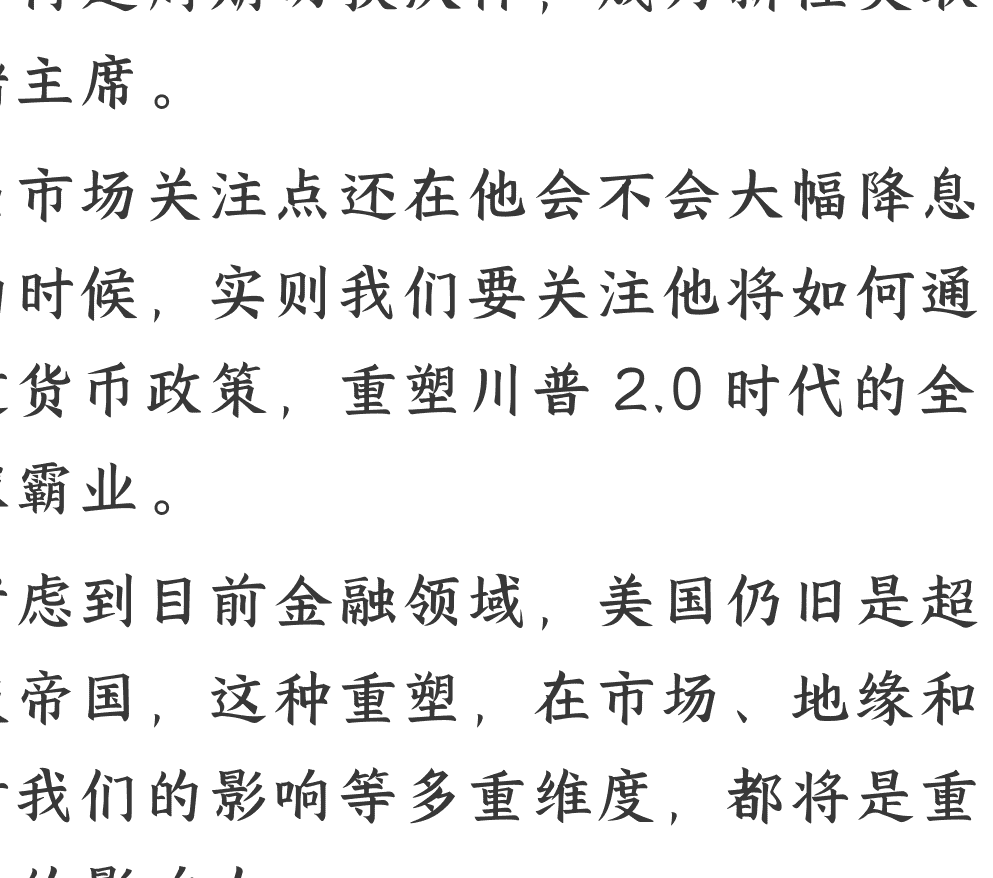

## 合集《当帝国不再无所不能》之——2、全球进入“沃什时代”：真正的风暴，将在市场、中国、地缘三层同时爆发

**260504 A 视野付费**  
整理：公众号懒人搜索，[懒人专属群](https://t.cn/xxxx)精选  
懒人微信：lazyhelper1  

不再是周期切换，沃什成为新任美联储主席。

当市场关注点还在他会不会大幅降息的时候，实则我们要关注他将如何通过货币政策，重塑川普 2.0 时代的全球霸业。

考虑到目前金融领域，美国仍旧是超级帝国，这种重塑，在市场、地缘和对我们的影响等多重维度，都将是重大的影响力。

更为重要的是，中美利差至今还是倒挂，10 年期美债收益率远高于 10 年期中债收益率，我们在金融端的压力依旧空前巨大。

影响着村里的决策，影响着大家的资产表现。

当帝国不再无所不能，其险恶和无底线，反而更加可怕和阴森。

本系列围绕【当帝国不再无所不能！】，将前后分三篇文章：

·第一篇《沃什上任真相：美联储换的不是掌门，……4/26发布》  
·第二篇《全球进入“沃什时代”：真正的风暴，将在市场、中国、地缘三层同时爆发》—即本篇文章  
·第三篇《全球货币秩序重构在即，中国的终极应对走向何方？》—预计于 4/30 日发布

A 森将分别从三个维度，系统性、一次性、独家原创性的给大家讲清楚底层逻辑。

1、详述本次货币政策转向背后的划时代底层逻辑，即，这不是换了个美联储主席，而是不可逆的范式级别的改变。  
2、对金融市场、对中国、对地缘等诸多方面的冲击，到底会是如何演绎？  
3、面对这个全新的情况，中国该怎么办？村里可能会出什么政策？个人又该怎么办？

全球金融市场的游戏规则，即将发生范式级别的改变。唯有先知先觉，才能先破局。因此，理解本系列的核心内容，将是你绕不开的超级干货。

使用 880 微信豆可以阅读整个合集的完整 3 篇文章。

下面开始今天的正文，各位多多支持！

缩表，对于 10 年期美债收益率的高位运行的支撑力度，是明显的。

问题是，10 年期美债收益率，是全球其它国家的国债收益率的锚，是全球融资成本的锚，是决定其它国家货币政策的关键决策因子。

所以，沃什提出的“缩表”，就不仅仅是上一篇提到的“保美元信用”，更具有地缘、市场、大国博弈、科技等诸多重大领域的杠杆效应。

长期关注【A 视野】的老铁都知道，A 森一直强调的一点：老美见到其它实体经济跟老中对抗，已经几乎没有胜算，可是，没有供给侧的强势，又如何保持美元霸权的既寿永昌？

因此，此前 AI 浪潮到来后，老美近乎把所有有关供给侧的希望全部押注在 AI，对赌它可以极大的提升供给侧改革，提升全民劳动生产率，从老中手里将全球供给侧的密钥主导权夺过来。

那么，现在缩表的作用，就是会提高 10 年期美债收益率，也就是拔高社会融资成本。

资；可是，如果你跟 AI 无关，或者你玩的 AI 细分赛道中竞争失败，那么，你就会被高融资成本淘汰。

看，这才是人家要的东西！

国运级供给侧革命好了，底层逻辑剖析到这里，大家应该意识到，此事非同小可。

毕竟，AI 与金融市场、对华博弈、地缘冲突等重大经纬线深度绑定，可以说，是牵一发而动全身。

相信，到了这里，就没有人会轻易看不上沃什的缩表主张，这里面的水是相当深了。

此外，现在确实是相当有利的时间窗口。

截至目前，美元霸权毕竟还在手里。这也就意味着，AI 对赌成功，那么，好处就是老美的，霸权得到极大的稳固；如果对赌失败，成本是全球的。

从这个维度，美联储新任主席，沃什，相当于是重新定义了美国经济和市场的问题，进而重新定义了权责，成本在全球范围重新再分配，以便老美回归相对比较优势的 C 位。

这就像美伊战争，原本老美以为朗子就是打小以来报复，可是，实际上，人家朗子重新定义了权责，打了阿拉伯国家的美军资源，用海峡裹挟全球经济，从而获得了相对比较优势的 C 位。这就是真正的本事！

**请注意，一旦缩表启动**，哪怕只是市场相信沃什要这么干，全球金融市场的定价逻辑就会发生改变。

因为，缩表意味着保美元信用，意味着美联储会有纪律地收回一些过多的流动性。可以想见，全球各地的资金，还是会优先选择回流美国本土。

那么，在海湖庄园协议中的一个关键逻辑在这里起作用了：**老中制造业牛逼**，是老美无节制的放水，在海外养出来的。**如果这些放水都留在美国本土**，老中制造业就无法获得融资和利润，反而老美的制造业和其它实业就会因为放水滞留本土而获得长足发展。

显而易见，沃什的主张，就是海湖庄园协议第一次在美国金融核心地带的全面执行。

放水，必须配合缩表，钱留在美国本土，美国实体经济就牛逼。

放水，没有做好保美元信用，钱就会优先流去老中那里，老中就会更加牛逼。

这也可以看出，美联储的货币政策核心诉求中，充满了对老中的大国博弈的潜台词。

截至目前，10 年期中债收益率在**1.75%**上下，而 10 年期美债收益率大约在**4.25~4.5%**之间。两者已经长期“倒挂”比例，徘徊在 2.6% 附近，对于人民币玩家而言，是一种偏空啊。

进一步看，也是诱导欧日韩等先进制造业国家的产能，优先去老美本土，而不是像德国的制造业那样被老中吸走。满满的算计，溢于言表。

老美很清楚，无论今天美元霸权如何牛逼，无论如何找办法暂时稳定美元体系内生 bug，最终还是要依赖实体经济去化债的。

可是，老中把持这块的能力实在太强，草割不到，还要被虹吸。因此，在金融端，对老中形成一种相对持久的压制，很有必要，哪怕这也会导致老中的企业内卷下打爆其它国家的产能。

还有其它办法吗？当然，结合拜登的宝贵经验，光靠上述这些，依旧不够。这些都是“胡萝卜+大棒”中的“胡萝卜”，离开了“大棒”是不行的。

所以，别看川普在中东吃了大亏，可是，后续他还是要祭出“安全”这张牌，逼各国资金表态。

这也提示我们，沃什的货币政策重大转向，一定是后续会跟罪国日本激进走军事路线，是相得益彰，相互强化，相互协同。没有地缘风险的搅动，光靠金融市场的干预，效果会很差。

此外，后续油价高位运行还会延续一个相对较长的时间。

无论沃什现在如何淡化通胀压力，可是，这不是开玩笑的事情。

本轮能源危机，对于美国而言，量没有问题，但是，价是绑定全球金融市场的计价。因此，就算老美本土不缺能源，可是，涨价是很难避免的。

作为关键性的后手，为了确保沃什的叙事不能兑现，却又要推进沃什身后的金融版海湖庄园协议，那么，罪国日本的出动，就是整个游戏的重要一环。

理解了这点，我们就可以说，即使罪国日本内部有大量有识之士不想这么干，也无卵用。因为，你们的主子，老美需要你们这么干。

而且，后续罪国日本央行再加息，更好。一个加息中的日元，无论幅度多少，就是在生产美元环节，直接跟老中进行正面干扰和阻碍，有利于美元吸掉更多这个片区的资金，回流美国本土。

美债美股，都是钢化泡泡。

但是，如今老中，“利用”老美的各种失误，不断的推进人民币结算。

尤其是，中里中气的巴铁 1.3 万精锐进入沙特空军基地，这对于石油美元体系的震撼，中长期来看，是如何强调都不为过。因为，这就是老中军武正式出海至石油美元体系的最核心地带。

老美虽然重创了欧元，给美元续命不少，但是，人民币体系也趁机获得了巨大的红利，这又是老美不想看到的。

此外，国运级供给革命的构想，也是有着明显短板。

老中的产业政策，极为成功，很有效。

老美是封建制市场经济体，各大家不允许产业政策呈现出直接下场式干预。

我们可以看到，今天，老美 AI 的科技大佬们，甚至都不希望看到美国政府掌握 AI，他们仅仅希望 AI 在自己手里。

那么，如此重大的技术变革前景，还要跟老中博弈，光靠沃什的这个货币政策，最多再加上罪国日本的地缘表演，就可以迅速引爆核弹级的 AI 爆款？就可以 1~2 年内出现引爆美国全民劳动生产率的变革？

如果这么简单，那大家都这么玩，岂不是引爆技术革命是很容易的事情？！

那未来还有康波周期吗？！

人类可以永世繁荣，只要当中表演一把，即可。奶义务~今天，我们最担心的是，沃什的做法，万一失败了，怎么办？

海湖庄园协议的哲学底层逻辑，是“加速主义”。

按照加速主义这套说法，今天西方没有能保持遥遥领先，是因为大众的民主，妨碍了精英的自由，导致政府有限的资源不能加速推进技术变革，反而要圈养一群傻不拉几的民主庸才。

请注意，整个硅谷的精英，几乎全部相信这套哲学！！！民主与自由，不再兼容，要自由，不要民主，渐渐成为这个精英群体的核心诉求。

可以想见，这批人眼中的民主党建制派，是多么的愚蠢和恶心。

沿着这个思路，他们甚至仇视欧洲这个新自由主义的大本营，简直都是庸才。

这里，我们快速总结一下：

加速主义——>海湖庄园协议——>沃什货币政策——>加速末日到来——>弥赛亚（救世主）出现>缔造科技人间天堂—>是的，这里面是充满了福音派保守派的神学思想。因为，美国首先是一个宗教国家，也是一个准神权国家。

按照这个逻辑，应该团结同样相信弥赛亚的俄罗斯，废掉乌克兰，肢解老中，最终获得胜利。

凌乱了吧？

问题是，今天川普这批 MAGA 的核心群体，就是这么个纲领。

如果未来老美宣布“放弃民主”，我们不需要惊讶，都是自然而然的事情。

如果老美不是到处搞地缘冲突，就以老美上面的极端思想，而拥有全球超级霸权，老中的处境危若卵石，绝不是虚言。

其实，我们完全可以这么去看，美联储后续也是玩“定向放水”。

一边，自然是积极支持 AI。  
一边，是给国债融资。  
一边，是补贴战略资源布局。

近期，美国贸易代表格里尔告诉美国盟友，他们必须为从中国以外地区采购关键矿产支付更高价格。

这不过是冰山一角，在涉及所谓国家安全领域，老美一定会强拉他的盟友，加速跟我们脱钩。

这些，都需要美联储直接或者间接的“补贴”。

这也是为何 A 森上一篇就提到，美联储只能是“有限缩表”。

按照现在老美花钱的速度，要不了多久，就是 50 万亿美元级别的国债体量，谁去买？就算你放开美国商业银行体系的监管去买，也就本土融资，也就小几万亿美元是极限了。

这还要考虑准备金体系必须有些闲钱，避免出现重大的金融危机。

因此，这里，A 森不妨大胆研判：

初期，缩表叙事极猛  
中期，缩表实际扭扭捏捏  
后期，重启扩表，彻底不要脸  

那么，这种如此迂回的微操，对于全球市场的各类资产的价格定价，是会产生巨大的宽幅波动的。

当初期叙事极猛的时候，科技类还不错，可是，不少战略资源会有一个阶段被适度做空。

当进入中期扭扭捏捏的时候，战略资源的价格弹性会往上大幅反弹。

当进入后期，那就是完全不要脸，不要讲什么保信用了，大放水，全球承受狂潮。

但是，整个过程，会积累出一场新的危机，也是今天全球市场高度忽视的危机。

试想，如果美欧日韩印都要再工业化，全球范围，就会出现严重的“重复生产”。

这种“重复生产”背后的地缘逻辑是，大家把全球化，逐步变成了“区域化”、“近岸外包”、“战略生产自主化”。

可是，难道不用考虑经济效益？

整个 70 年代，从拉美到欧洲，从日韩到东盟，到处这么玩的。

结果是，当出现难以为继的亏损后，韩国的朴正熙被自家兄弟爆头，拉美的军政府集体崩盘，西德成为欧洲病夫，英国一蹶不振，印度亏的亲娘都不认识..

沃什的货币政策，实则是对这个时代的金融支持，却也注定造成未来更大的实体经济危机，这一次注定会比 70 年代疯狂的多，结果注定也会更加悲催。

这个时候，朗子还把霍尔木兹海峡彻底“收费化”，将极大的放大上面的冲击波。

毕竟，要在如此疯狂的高成本环境下，去搞“重复生产”，后果不堪设想。

经济史一再告诉我们：

如果说庞氏骗局是金融危机（需求侧）的导火索，那么，重复生产就是经济危机（供给侧）之母。

于是，金融市场、对华大国博弈、地缘冲突，未来三重冲击波，将同时爆发。

沃什，或将成为川普在美联储中的魏公公。

一个更加动荡的时代，也就随之而来了。

————分割线————

在这个 AI 能替你写代码、写文章的时代，基础技能正在迅速贬值。绝大多数人正被淹没在海量的免费垃圾信息里，陷入低效的体力内卷。

当“努力”不再是壁垒，人与人之间唯一的护城河，只剩下“信息过滤”的效率与“认知系统”的维度。

圈子已稳定运行 7 年。我们每天利用 Python 爬虫与大模型算力，过滤全网最顶级的政经内参和搞钱风向标，做你最冷酷的“外部大脑”。

如果你认同这种“重塑认知防线”的极客主义，欢迎围观我的个人情报智库：【懒人专属群】。  
https://lazyso.com/insider/

认同信息过滤价值、想省下每天 3 小时无效阅读时间的读者，扫码加我微信（lazyhelper1）  

