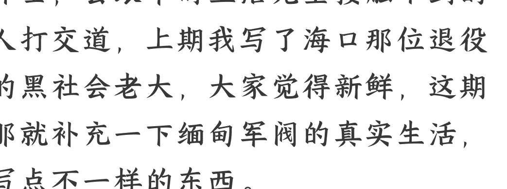

## 缅甸军阀的真实生活

**260506 文/卢克文**  
整理：公众号懒人搜索，[懒人专属群](https://www.laorensearch.com)精选  
懒人微信：lazyhelper1

我常常在全国调研时，遇到各种奇人异士，会跟平时生活完全接触不到的人打交道。上期我写了海口那位退役的黑社会老大，大家觉得新鲜，这期那就补充一下缅甸军阀的真实生活，写点不一样的东西。

2025 年 12 月我在昆明北郊，遇到一位差不多同龄的中年男子，他跟我讲述了自己奇异的人生经历。

他原是在昆明东川矿务局出生长大，矿务局位于昆明北部一片深山之中，分为好多片矿区，每个矿区都有一处封闭的生活社区，有点像我读书实习时深山里的水电站社区。

东川矿务局在 2001 年因资源枯竭破产，一共为国家贡献了 60 万吨铜和 20 万吨白银。正式破产前，矿务局就已经在陆陆续续遣散职工，他父母拿到了一笔赔偿金后，咬牙将他送到昆明市区读书，希望儿子能接受好的教育出人头地。

这是一次极为明智的选择。

他在昆明读书时，班上有一位缅甸来的同学，除了国籍，其他跟中国小孩几乎没有任何区别，大家常常在一起打打闹闹，关系处得不错。平时这位缅甸小孩也从不招惹是非，上学下学也跟同学一样没啥特殊的。

上大学后，就跟这位同学联系不多了。毕业后他做了许多职业，历经各种人生狗血，后来在昆明开了一家很大的酒吧。因为酒吧生意好，各种卖啤酒的就来他这拉生意，拉着拉着，他就认识了一家国际品牌的高管，一来二去混熟了，对方就把昆明官渡区这家品牌的啤酒代理权交给他了，他靠卖啤酒赚了很多钱，酒吧都不开了。

然后突然有一天，他那个缅甸同学托人找到他，原来那哥们现在已经是缅甸的一位小军阀了。同学他爸就是老军阀，为了避乱，才把儿子放在昆明养大——这也是缅甸军阀们的传统操作——现在年纪大了，便把位子传给了儿子，儿子便来找自己昆明的老同学。

他们那缅甸山区啥都缺，物资供应跟不上，山区的缅甸人也是要喝啤酒的，军阀同学就找过来，请他把啤酒卖到军阀地盘上去。

我问他，他同学地盘有多少人，一个月能卖多少啤酒？

他说同学那儿是个小地盘，100 万人，每个月能销售 600 万啤酒，当然远比不上他在官渡区的生意，他早就财富自由了，现在每个月就过去四五天，到那边盘盘账，跟同学聊聊天，账一盘完就回昆明。

我就问他关于缅甸军阀的生活细节。

他说他同学（后面统称小军阀）住在一个大庄园里，大概小几百号人伺候小军阀，庄园里的人有点像是小军阀的家奴，世世代代在这里工作，出了这处庄园在外面也不知道咋生存。小军阀要照顾这些人的衣食住行医疗教育，家奴生下来的孩子，在庄园里长大后成为新的家奴，他们之间没有明确的主奴关系，家奴可以自由离开，但在经济上完全离不开小军阀。

他去小军阀庄园吃饭的时候，跟中国一样是有公筷和私筷的。他有次不小心拿私筷夹了块鸡肉但没吃，小军阀就说你这样不对，他们没吃完的饭菜是要给佣人们吃的，你用私筷夹菜是不尊重他庄园里的人。他以后来庄园，就从来不用私筷夹菜了。

庄园里的小孩调皮捣蛋，小男孩光着身子在那跑来跑去，小军阀会呵斥他们，叫他们好好去读书，不要在这里瞎捣乱，小军阀就像一个大家长，完全把这里的每一个人，看成自己家族里的一分子。

我问他那小军阀他们到底靠什么生存？经济来源是什么？

他说有新闻报道过的那些，确实是见不得光的一些产业，还有玉石、木材、矿产，边贸征税等等，经济收入足够维持这 100 多万人的基础生活。他们那有个很大的问题，身处深山之中，连方便面、餐巾纸、卫生巾、玻璃杯这些东西都无法生产，全靠从中国进口，因此特别依赖中国的边贸生意，只要中国边贸一关，这边所有商品就要涨价五六倍。加上所有军阀都会把老婆孩子放在昆明，又都在昆明置业，所以他们对云南省政府是十分忌惮的。

我说啥啥啥？缅甸军阀怕云南省政府？那怎么有白家明家这种货色？

他说这种人也是缅甸军阀里的异类，真的是不知死活的那种，现在谁 TM 敢惹中国政府啊？这种白痴赚钱赚疯了才跟中国对着干，结果全被拉回去满门抄斩了。通常情况下，缅甸军阀们自己心里头是有逼数的，个个都有底线，相互打仗不敢越境，打仗要是惹出是非来，还要赶紧过来道歉，有时候都不用出动军方，中国这边一个派出所所长打个电话，就可以叫缅甸军阀的小弟过来认错。

我说新闻里军阀们个个都是杀人如麻的土皇帝，现实里这么听话的吗？

他说在他们自己的地盘里面，他们确实是土皇帝，想杀谁杀谁，但只要出了地盘，做事就要知道分寸。以前这边两路军阀相互厮杀，因为影响到了边贸，中国这边派了一辆面包车过来，把车子往中间一放，两路军阀就不敢开枪了，乖乖停战。还有一次，小军阀手下一个旅长（官职可能记错）在中国犯了事，中国那边派了几名武警过来，枪都不带，开车来到小军阀下面的军营，当着所有人的面把旅长抓走了，军队里愣是没人敢吭声。

我说这军阀确实没啥脸面啊。

他说军阀们但凡脑子正常，就知道不要跟中国搞对抗，他们自己成天你杀我、我杀你，这地方教育和医疗条件又极差，为了避祸，也为了正常生活，都把自己的财产和家人用各种办法往昆明送，导致昆明变成了他们的避难所，自己钱和人都在中国，惹中国不是脑子进水了吗？

还有生活物资问题，这地方太 TM 穷了，全是山，他们日常生活极依赖中国，不服不行，不服分分钟就给你来个通货膨胀，惹不起的。

我说那他们只要不干过分的事，我们也不会理他们吧？

他说是的，因为这边属于缅甸境内，中国严格遵守国际法律，除了追缉凶犯啥的，不会越境过来有大规模行动。所以常常看新闻，中缅边境缅甸这边打得热火朝天，子弹满天飞，但流弹也不敢轻易往中国这边跑，中国边民早习惯了他们打打杀杀的生活，别搞太大就正常过日子。

我说听这么一说，做军阀也没啥意思，看起来很威风，其实生活过得挺紧张的，存了点钱自己这也没地方放，还要想办法转移资产，老婆孩子还不能守在身边，找点吃的喝的都不容易，天天待在山里进不了城，也就是管辖面积大一点而已。  
感觉这军阀，做得跟土匪一样……

后来我们复盘，发现只要是个人，他活着就必须教育、医疗、住房、基建、网络、食物、生活物资、金融服务这些，但这些必须依赖一个和平的年代、一个完整的政府，其实能得到这些很不容易。如果国家身处战乱，那你就是做了军阀，也可能随时毙命，还得不到最基本的教育医疗银行服务，活得颠沛流离、人人自危。

如果进行对比，我个人认为，缅甸这样一个普通军阀，其实在各方面，可能还不如中国一个年薪 50 万的中层管理人员。他确实有放肆的一面，可以在自己地盘杀人、可以想干嘛干嘛，但他也丧失了基本的生命权，时刻活在危险当中，也丧失了基本的生产积累权，必须将身家全部转移出去，成天提心吊胆地在山里喂蚊子，还不能享受到正常的高质量城市生活。

和平才是真正的奢侈品，做黑社会和军阀，听起来刺激，但真不是人过的日子。

———分割线———

绝大多数人只盯着眼前的工资，却不知道一次远在中东的冲突、一次降息的决议，就能在一夜之间洗牌普通人的财富。  
看懂宏观，是为了在周期切换时，不被当作代价。

如果你认同这种“抬头看路”的长期主义，欢迎围观我的个人情报智库：【懒人专属群】。

圈子已稳定运行 7 年。我们每天利用 Python 爬虫与大模型算力，过滤全网最顶级的政经内参和搞钱风向标，做你最冷酷的“外部大脑”。

公众号懒人搜索、懒人专属群分享

查阅圈子完整数字资产与上车门槛：  
https://lazyso.com/insider/  
认同价值的。扫码加我微信，备注：【进群】

