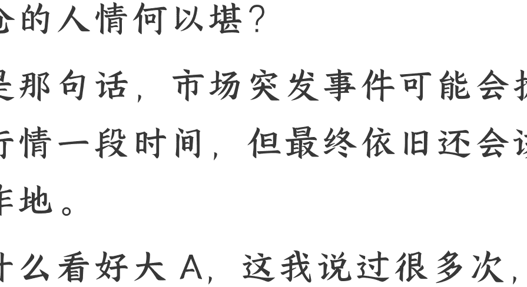

## 五月必看

**260506 局外人的视界**

整理：公众号懒人搜索，[懒人专属群](https://www.zhihu.com/question/45678901)精选

懒人微信：lazyhelperl

前言你们天天催的五月付费来了。四月份的行情让三月底呼吁大家割肉清仓的人情何以堪？还是那句话，市场突发事件可能会扰乱行情一段时间，但最终依旧还会该咋咋地。为什么看好大 A，这我说过很多次，不要一天到晚的听那些“大聪明”的，居然相信信用货币时代还会有持续性的通缩。怎么，印出来的钱，居然变得越来越值钱了？用脚趾头想想都会觉得荒谬。当然了，短期由于局部市场供需关系失衡，或者是债务问题形成结构性的通缩，这也是正常现象。就像 08 年次贷危机，你美帝狂开印钞机，依旧没能很快将地产价格从坑里救起来，但如果你像大聪明们一样，认为次贷危机爆发之后，地产从此就要彻底噶，那么你会被现实锤得面目全非，看看现在美帝的房价，你还能说是通缩吗？就连本子，也从通缩的坑里爬出来了。道理再简单不过了，信用货币从诞生出来的那一刻起，就是为了搞出温和可控的通胀的。恶性通胀会摧毁经济和社会秩序，但温和可控的通胀则是解决债务问题的良药。所以大可不必去看美联储主席到底是谁，什么鲍威尔留任理事，沃什被国会各种刁难，这重要吗？美元之所以重要，那是因为它首先能给美国解决问题，或者你解决不了问题，但起码也要把眼前的难关糊弄过去。你美帝到处都是用钱的地方，偏偏国债余额已经直奔 40 万亿美元，这时候谁来了，都没办法真的紧缩。无非是口头上怎么忽悠罢了，懂王太过于急功近利，直接剥掉了美联储所谓独立性的底裤，为了兜住美元的面子，所以鲍威尔必须留下，不管以什么方式，赘婿沃什无论怎么想进步，都要接受来自国会山的各种刁难。这只是面子，怎么做都是那么回事，你只需要理解世界运行的真正底层逻辑。

今时不同往日，美帝只要敢卡死美元的供应，立刻就会有源源不断的 RMB 通过各种工具改善全球流动性。这背后是强大中国制造顺差年过万亿美元，现在 RMB 几乎能买到你想要的一切，什么石油原材料，又有什么不能人民币结算。于是全球金融就变成了中美争先放水，为的是拿到更多的货币份额。又回到我们一直强调的，关于股市的原理，股市从来不是经济的晴雨表，但一定是流动性的晴雨表。流动性好，市场就不会差到哪里去。就如今这格局，谁敢让流动性不好？想通了这一层逻辑，你是不是对市场的信心就有了？中东战争虽然被懂王宣布终止了，但这一摊子烂事还在继续，依旧会影响到全球能源供应。波斯堵了懂王抢，谁也不敢保证国际水道上的安全，毕竟你老美第一个跳出来得意洋洋的说抢劫很赚钱。经济需要确定性，所以最近这段时间，国内的制造业在强劲复苏。说起来要感谢懂王，把中东给搞乱了，全世界都在担忧因为能源问题影响到供应链，都想规避风险，只有东大能轻松应对，于是下给别的国家的订单都回来东大了。

当然了，你说经济回暖但你感觉不到，那也很正常，经济链条传导需要时间。有两件事可以当做佐证，一是进出口数据，还有一个就是央妈对短期工具的使用。往往实体经济向好的时候，央妈会适度的收紧一下流动性。4 月 27 日央妈开展 4000 亿元 MLF（中期借贷便利）操作，期限为 1 年期。但同期有 6000 亿元 MLF 到期。另外，4 月两个期限品种的买断式逆回购合计净回笼 4000 亿元，中期流动性工具累计净回笼 6000 亿元。有人会问，你说股市是流动性的晴雨表，现在央妈收水了，还在那里看好唱多，这不是害人吗？过去几年，因为地产泡沫破裂的缘故，中国经济一直在结构性通缩里煎熬，前段时间，假洋鬼子霓虹派经济学犸们不是联手鼓吹什么资产负债表坍塌理论吗？当然了，这时候就需要央妈及时出手干预，来控住局势。所以你能看到央妈用各种工具补充流动性，刺激资产价格，包括各位股民一直怀念的 924 行情，也是这么刺激出来的。生病了要吃药，病好了，药就要停，不给你吃药说明你好了。

宏观调控是两手抓的，既要防止紧缩，也要防止过热，最近这段时间，RMB 已经开始成为全球融资性货币了。今年 HK 发行的点心债（在中国内地以外发行的人民币计价债券）发行总额已达到 3000 亿元人民币，是 2025 年同期的两倍多，而 2025 年本身已创下历史纪录。RMB 的盘子已经悄悄的做大，国际化不是一句空话。有个非常有趣的新闻，懂王家族在四月份买了 5000 万美元的国债。想想看，这让市场上其它投资者心里怎么想？美联储为什么一直强调独立性？美债能作为全球无风险收益的锚，除了有美国强横武力支持之外，还有所谓的美元货币决策的独立性在那里立牌坊，投资者喜欢一厢情愿的认为，美债走势是可预测的，有迹可循的，所以大家愿意买。现在懂王入局了，偏偏这位老哥是个最不可预测的人，你让全球投资者怎么想。被逼无奈之下，只好加大购买 RMB 资产做风险对冲呗。央妈在这个时候出手收回流动性，其实也在印证这一趋势。

4 月 28 日的重要会议上明确强调，稳定和增强资本市场信心。这种对大 A 的论述，很少在这么高规格的会议上出现。所以你看，这好日子不就来了吗？当然了，大家要正确认识到我 A 自身的特色，我 A 是服务于实体经济，大家去观察一下历次牛市，哪怕是所谓的结构性牛市，都有非常强的主线在里面，那就是以产业为导向。现在我 A5000 多家企业，再想像以前那样有普涨的牛市，这是非常不现实的，所以某些砖家爱说的，指数涨有可能跟你没毛线关系，这句话没毛病，但你要记住，这是你认知的问题，不是大 A 的问题。

以下是付费部分：我 A 是个强政策市，事实上，全球所有的市场，基本都是政策市，无非是看谁的政策够强，能干预成功呗。这一次有两件事大家可以多琢磨一下，一是在重要会议上提到了我 A，这个我在免费部分不好多说。之前我在很多文章里都说过，关于资产价格上涨，解决地方债问题的话。倒不是说所有的地方都持有可供上市的资产，现在问题是整个资产价格都起不来，老股民都知道，所谓资产价格，是个非常玄妙的问题。

比如说某股一年前 1 元，现在变成了 10 元，企业还是那个企业，资产价格飙升 10 倍。企业原本负债 1 个亿，还是有点压力的，结果市值涨了十倍，再看那一个亿，还能叫个事吗？所谓的地方债问题，解决方案肯定不会是一口气让你还掉几十万亿，真这么干的话，那也是个大问题，立刻就会出现资产荒。记住，负债也是一种资产。欠债从来不是问题，问题是负债的质量，债务如果对应了强大的资产，资产价格诱人，这时候你就能以很低利息去销售这些负债。看看我们十年期国债的利率，为什么那些外国投资者不去抢利率更高的美债，非要买我们的国债呢？从这个角度去理解化债，你就明白了，为什么大 A 必须得涨。其实就是给资产价格定额锚点，大家知道了，哦，原来你几十万亿的地方债背后对应的资产价格惊人，那么债务也就成了一种优良的资产，然后再通过各种营运，加强管理来化解掉风险。债务危机从来根源是信任危机，大家不信你有偿债能力才闹出来的债务危机，但凡人人都知道你有钱，你会闹出债务危机吗？

大家可以看看城投债给出来的时间表，2027 年 6 月底，按照这个时间线，起码在明年六月份之前，我 A 不会出现系统性的问题。至于之后嘛，那只能说走一步看一步。第二个信号是前村长易会满被定罪双开，虽然不兴搞封建迷信，但每次有这种事发生，多少会有一波行情。虽然我相当看好五月份的行情，但考虑到本月懂王访华，接下来，他大概率会做点什么事来虚空造牌。再加上这段时间，市场已经开始有点亢奋了，你以为某队走了，呵呵，其实某队前段时间早就偷偷的杀了个回马枪，高抛低吸反复操作，为的就是控制市场波动。所以只要看到市场有兴奋过度的苗头，必然有大把筹码砸盘，如果这时候再配套一点懂王的骚操作，指数跳水那都是常态。当然了，长线选手可以忽略掉这段波动，但敏感型选手就要注意了，一旦看到指数大幅上涨，记得及时减仓，调整头寸，以免宽幅波动影响心态。

下面就是方向了。
*****啥都不用说了，依旧是 AI。**芯片，本质上都是围绕着 AI 这个大题材在做的。**为什么是光？因为光这个细分板块里，中国已经做到了全球第一，这就是有确定业绩驱动的，不管国内大模型能不能跟美帝正面硬钢，总归光这个细分板块是有绝对优势的，于是资金抱团炒光。这就是大方向下的强逻辑。但问题是光的容量毕竟有限，到了某个价格，就有点难以为继了。还有一个 AI 芯片，英伟达是全球行业老大，国内竞争对手之前没有一个能打的，国内做应用的企业，都是拿来主义，也不管生态，各种用英伟达的体系干自己的活。所以寒武纪之前涨得那是相当的虚，它当时的业绩，对未来的预期，完全没办法匹配得上股价。**4 月份发生了一件大事**，deepseek4.0 发布，哥们直接重新写了底层架构，直接跟英伟达的 CUDA 断了，适配国产芯片，当然了，这里最大受益者是了不起的华为，但问题是华为没有上市，4.0 也适配了寒王。depseek 是国运级别的应用，因为美帝那边的 AI 玩的是闭源，我们是开源，我们开源且便宜，并且适配国内的芯片。在价格面前，少许的技术优势算的了什么？梁文峰在发布 4.0 的时候还非常详细的同步发表了论文，这是真开源，把结果给你了，然后告诉你自己是怎么去构思的，如何得到这个结果。想想看，如果你是美国之外的企业，你想搞 AI，你有点技术基础，你会选择谁？即便是在价格差不多的情况下，deepseek 也会因为开源占优势，在百分之一的价格差之下，这简直都成了降维打击。有人问，为什么 deepseek 发布之后，英伟达没有暴跌。那是因为 AI 泡沫现在是美国经济的支柱产业，美帝是不能也不敢戳破，只要能无限打款，股价就不可能崩掉。回到 deepseek 这个话题上，我们等于是给全世界另一个拥抱 AI 的可能，全开源，真开源，并且平价，全部都是中系的自主可控。AI 赛场上只有中美两个玩家，但想用 AI 的肯定不止中美。我们有电力优势，我们在搞算电协同，我们可以用输出词元的方式输出电力，美帝想搞的算力美元大概率是要搞不成了，换成算力 RMB 倒是大有可为。所以现在 AI 的逻辑变了。**既然逻辑已经这么清晰了，那么好好筛选具体标的就行了，只要逻辑不破，就要敢于那到底。**其实一波行情里，能吃到一只大牛就够你改变人生了。**另一个大方向是关于新能源的。**这个我说两个月。**中东已经彻底乱了，美帝打又不能打，退又不能退，波斯也不能主动求和，全球能源供应随时会出问题。**美帝内部的能源生产商也并没有敞开了去扩张产能**，毕竟扩产只会让产品价格崩掉，现在谁敢对懂王有信心呢？**全球能源随时面临各种断供危机，当然了，这对别人是危，对我们是机会。**传统能源出问题了，新能源提供补充。**所以锂大涨，因为预期对锂的需求大增，新能源车需要锂，储能需要锂。**我记得从去年就一直跟大家说，能源金属会迎来反转**，没想到是以现在这种方式。**新能源板块也不是个个都有好日子过，光伏板的日子好过了，逆变器就未必了。**大家不想被中东的石油卡脖子，一样也不想被东大的新能源卡脖子。所以一些基础产品方向，投入大，周期长的，欧美日韩是不会掺和，但别的那就未必了。电池一哥比起电车一哥来说，差点意思，因为电车一哥实际上在储能、电池上还没发力，仔细琢磨下闪充，这其实是个储能体系，真的是未来可期。**新能源大家注意下细分**，看未来的潜力。还有个潜在的主线那就是央国企资产重估。这个是我在前面说过的，毕竟存在着解决地方债问题的刚需，想想看，为什么银行股涨了那么多？难道真的是因为资金突然开窍了，发现自己终于错伏了？开什么玩笑。地方国资手上拿着很多地方银行的股权，这些资产如何定价？这都算是最优质的资产了，如果按照以前些种全面破净的股价，那就啥都别干了。**大家可以去看看**，到底谁负债最高，负债最高点央企旗下的上市公司是不是最有长线优势？**当然了，现在资金都忙着抱团爆炒科技**，这种长线的票鲜有人光顾，但没关系，长线可期。通胀预期。**这个是我一直在说的板块，到现在，依旧有效。**之前我们侧重在有色上，有色轮着涨了一遍，其中小金属很多都翻了几倍，贵金属因为结构性原因，最近回调得比较厉害，但个人认为现在并没有到顶，大趋势放在那里了，当然了，贵金属价格跟个股价格并不一定会同步。最近我建议把重点放在科技和新能源上，但有些粉丝拿了好久的有色，心里发慌，所以我还是会说一下。**有色是强逻辑板块**，现在这个位置，这个时候根本没有必要割肉，你只管等着，自然会有回报。**还有一个已经触及到底部的猪周期**，生猪价格跌无可跌，国家已经在出手干预了，当然了，想回到前几年因为猪瘟引发的那一波行情，是挺难的，无非就是一个困境反转，并没有持续性的长期行情。倒是可以关注下农资相关的板块，因为石油危机，化肥都涨上天了，这玩意是刚需，偏偏东大还是用煤合成的，根本不受影响，国内稍微涨价，有些企业还是有外销配额的。**中东的乱子没那么快结束**，但人一天三餐都得吃饭，所以，这个方向是可以关注的。军工方向当然有戏，这个是长线趋势的，具体的道理我在很多文章里也说过，全世界重新站队，有巴基斯坦在那里打样，中国军工发展前景一片大好。只不过之前有些个股因为别的概念带动爆炒过，现在要补作业，你一看就说军工不行，这真是冤枉人。**没有爆炒过的军工持有完全没问题**。当市场选出来一个非常明确的强势方向，资金自然会去抱团，谁都拦不住，大家来市场都是为了赚钱，所以别的方向自然就不会有太多的资金关注，买了拿在手上也是难受。所以有粉丝问，为什么很多方向我不说了，说了没得意义啊。**抓重点就行了**。**爱炒港股的朋友要规避下风险了**，不要盲目的炒恒科指数，这玩意坑爹，纯纯接盘侠。个股被炒高的，往指数里一塞，就问你买不买？实在喜欢买港股那就自己选个股吧。祝大家投资大赚。

### 分割线

在这个 AI 能替你写代码、写文章的时代，基础技能正在迅速贬值。绝大多数人正被淹没在海量的免费垃圾信息里，陷入低效的体力内卷。当“努力”不再是壁垒，人与人之间唯一的护城河，只剩下“信息过滤”的效率与“认知系统”的维度。**圈子已稳定运行 7 年**。我们每天利用 Python 爬虫与大模型算力，过滤全网最顶级的政经内参和搞钱风向标，做你最冷酷的“外部大脑”。如果你认同这种“重塑认知防线”的极客主义，欢迎围观我的个人情报智库：【懒人专属群】。https://lazyso.com/insider/**认同信息过滤价值、想省下每天 3 小时无效阅读时间的读者**，扫码加我微信（lazyhelper1）