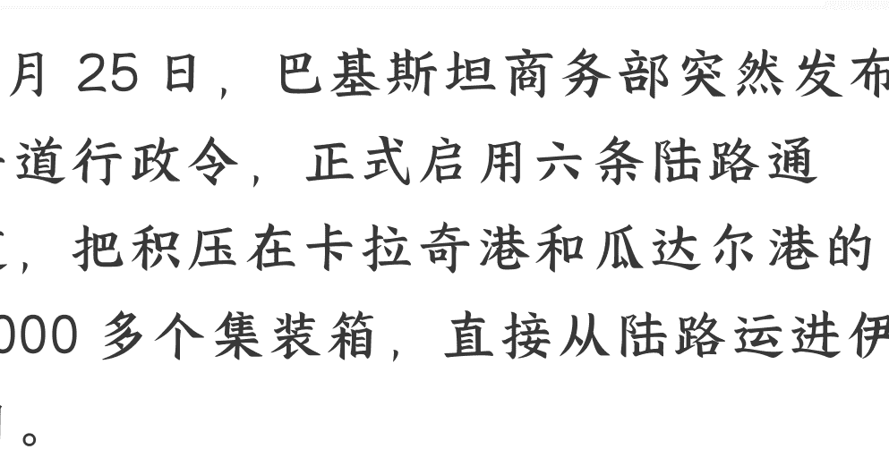

# 封锁了个寂寞：巴基斯坦六条通道改写中东格局？

**260507 文/卢克文工作室嘉宾 风间澈**  
整理：公众号懒人搜索，[懒人专属群](https://t.cn/A6qXvZ8w)精选  
懒人微信：lazyhelper1

4 月 25 日，巴基斯坦商务部突然发布一道行政令，正式启用六条陆路通道，把积压在卡拉奇港和瓜达尔港的 3000 多个集装箱，直接从陆路运进伊朗。

这六条通道，起点是两个港口群——南边的卡拉奇港和卡西姆港，以及西边的瓜达尔港。终点是伊朗边境的两个口岸，一个叫加布德，一个叫塔夫坦。三组路线，功能分得很清楚。

## 第一组，南线快速通道
从瓜达尔港出发，往西走，不到 90 公里就到加布德。这是六条路线里最短最快的一条，卡车两小时就能入境伊朗。以前走海路，得绕半个阿拉伯海进霍尔木兹海峡，再折回伊朗港口，路上漂一天不止。现在霍尔木兹一封，这条路把绕弯和封锁两重麻烦全省掉了。

## 第二组，沿海重载通道
从卡拉奇港或卡西姆港出发，贴着阿拉伯海海岸线一路往西，最终到加布德。这条路地势平坦，适合重型卡车编队拉大宗物资。还有个变体，货物从卡拉奇先用沿海公路或海运支线送到瓜达尔，在瓜达尔集中，再统一从加布德过关，把单件运输成本往下压。

## 第三组，北部传统商路
从卡拉奇或瓜达尔出发，往内陆走，经胡兹达尔、奎达、达尔本丁、诺昆迪，翻过几道山，最终到塔夫坦。这是巴基斯坦和伊朗之间跑了上百年的老商路，沿途补给站和军营都是现成的。缺点也明显，盘山路多，对载重有硬要求。

三组路线，一个逻辑：把两个港口的货，用最快最省的方式送进伊朗。霍尔木兹一封，这些原本趴在港口吃灰的集装箱，有了明确的去向。

但这件事真正让人琢磨的，不是物流图怎么画，而是时间点。

就在这道行政令发布前不到一周，美国还拉着巴基斯坦斡旋自己和伊朗的谈判。巴基斯坦当了中间人，费劲把两边拉到一张桌子上。结果谈崩了。谈判崩了没几天，通道就开了。一边当和事佬，一边递刀子。

更矛盾的是身份。巴基斯坦名义上是美国盟友。美国正在霍尔木兹海峡对伊朗搞海上封锁，航母堵着波斯湾出海口，伊朗港口被压到只剩不到一成运力。这个时候开陆路通道，等于公开在美国的封锁线上撕了一道口子。

而且动作极快。从谈判破裂到通道开通，前后不到一周。一个行政令，就把攒了十年的陆路网激活了。

这三个反常摆在一起，一个疑问就出来了：巴基斯坦不是不知道这要冒多大风险，为什么偏偏在这个节骨眼上豁出去了？

### 一
要读懂这一步棋，得先看明白巴基斯坦的处境。

巴基斯坦的地缘位置其实极好。坐南亚，接中东，通中亚，是连接三个板块的桥梁。但这个位置在过去几十年的全球化时代，没有给它带来任何好处。全球贸易运转的核心是港口加海峡，谁控制了海上节点，谁就抓着命脉。但前提是你得在这些节点上有存在感——得有能停大船的深水港，得有配套的工业链，得有能跟港口联动的物流网。

巴基斯坦有什么？有港口。卡拉奇港是天然深水港，瓜达尔港是中国援建的一流深水港。但港口修好了，周边什么都没有。没有工业区，没有成熟的物流网，连安保都成问题。船来了，卸了货，货往哪走？走不远。

所以瓜达尔港修好十年，一直不温不火，就像一个造在荒地里的五星级酒店。

**更让巴基斯坦憋屈的，是跟印度的对比。**印度在南亚压了巴基斯坦几十年，经济规模拉到十倍差距。凭什么？因为印度拿到了巴基斯坦没拿到的东西。恰巴哈尔港，印度砸了二十多年，要绕开巴基斯坦直通中亚。美国和日本的资金、技术、武器，不断往印度倾斜。巴基斯坦什么都分不到，只能在旁边看着。

这种被边缘化的憋屈，巴基斯坦忍了几十年。

霍尔木兹海峡一声炮响，把这种局面震出了一道裂缝。美国封锁伊朗海上通道，波斯湾走不了船，但伊朗不是岛国，它背面靠着巴基斯坦。海上走不通，陆上就得想办法。伊朗被逼到墙角，那些趴在卡拉奇和瓜达尔的集装箱，突然之间不是死货了——它们可以从陆路进伊朗，再从伊朗往北进中亚，往西进土耳其，甚至绕道往欧洲方向走。

巴基斯坦猛地发现，自己手里攥着的，不是一片鸟不拉屎的俾路支荒原，而是一条能绕过海上封锁的陆路通道。这个翻盘点，它等了太久了。

### 二
**但如果只是为了收点过路费，巴基斯坦没必要一次开六条通道。**一趟一趟慢慢运，慢慢收钱，风险还小。一次全开，动静这么大，等于当着美国的面把门彻底推开。这说明它要的不是短期收入，而是通道稳定运转这个事实本身。

这个事实一旦成立，后续的变化就不是按吨收运费了。

首先是沿途经济。六条路不管走哪条，都穿过俾路支省。

这里是巴基斯坦最穷最乱的省，分离主义武装打了几十年，政府军都镇不住。根源是什么？穷。没活路，年轻人除了扛枪没别的营生。

但如果贸易通道稳定运转起来，卡车编队天天跑，沿途就需要补给站、加油站、修车厂、司机旅馆。这些不需要多高的技术门槛，但能提供稳定的活计。

一个地方如果能靠贸易通道吃上饭，分离主义武装招兵买马的成本就会往上涨。这是用经济手段解决安全问题，比派军队硬打划算得多。

更关键的是身份转变。

一旦这条通道成了伊朗对外出口的唯一生命线，巴基斯坦和伊朗之间的关系就变了。

巴基斯坦不再是那个被印度压着打、在南亚没什么存在感的国家，而是变成了伊朗离不开的贸易枢纽。中亚的货、南亚的货、伊朗的货，都得从你的港口和公路走。你手里掐着别人的供应链，你的分量就完全不一样了。

赚运费是生意，赚话语权是战略。巴基斯坦要的是后者。

当然，这一步棋也不是没风险。

六条路，不管走加布德还是走塔夫坦，全穿过俾路支省。

这里是分离主义武装最活跃的地区之一。南线虽然短，但瓜达尔到加布德这段全程在俾路支省南部，武装分子随便在哪个路口设个卡，车队就得停。

北线更麻烦，路程长，盘山路多，检查站多，每一个检查站都是潜在的被袭目标。运一趟货，安保押运的成本可能比运费还高。通道能不能长期稳定运转，不是行政令说了算的，得看巴基斯坦军队能不能镇住这条线上的枪声。

但巴基斯坦敢把这些路一次性全开了，说明它对局势有自己的判断。

被边缘化了几十年，被印度压着打了几十年，终于等来一个结构性翻盘的机会。这个区域贸易枢纽的角色，它二十年没争来，霍尔木兹一声炮响送上门了。风险有，但错过这个窗口，可能再等二十年也等不到下一次。

### 三
巴基斯坦这一步迈出去，周边不会没有反应。

最紧张的，是印度。印度在恰巴哈尔港砸了二十多年，图的就是绕开巴基斯坦，直接连通伊朗和中亚。现在恰巴哈尔港被封锁，伊朗转头跟巴基斯坦合作，把六条陆路通道全开了。

印度二十年经营一夜清零不说，巴基斯坦反而趁机拿到了区域贸易枢纽地位。

印度看着瓜达尔港活了，看着巴基斯坦把南亚和中亚的过路货攥在手里，这口气很难咽得下去。美国在霍尔木兹的航母再强大，也拦不住陆地上的卡车队。伊朗被封锁的经济有了透气孔，战略韧性就增强了。

对伊朗来说，这是绝境中的一根救命稻草。

阿富汗和中亚国家也在看。通道一稳定，伊朗往北连着阿富汗和土库曼斯坦，往西连着土耳其。中亚的矿产资源、阿富汗的农产品，原来苦于出海口被堵，现在可以走巴基斯坦这条线南下，从瓜达尔港出海。一条南北向的陆路走廊，正在被激活。

最大的输家，是封锁本身。

美国在霍尔木兹海峡摆了重兵，航母、驱逐舰、侦察机，把波斯湾封得严严实实。但巴基斯坦用一纸行政令就证明了：封锁可以堵住一片海，堵不住一条路。一旦有人绕过，封锁的效果就大打折扣。

巴基斯坦这步棋，说到底是被逼出来的机会。不是巴基斯坦突然变强了，是旧格局突然松动了。而它刚好站在那道裂缝上。

六条路，不到一百公里的最短线，两小时车程。这段路一旦跑通，整个中东到南亚的物流地图就得重画。

巴基斯坦已经把自己的路打通了。下一个把路打通的，会是谁？

> ———分割线———

绝大多数人只盯着眼前的工资，却不知道一次远在中东的冲突、一次降息的决议，就能在一夜之间洗牌普通人的财富。

看懂宏观，是为了在周期切换时，不被当作代价。

如果你认同这种“抬头看路”的长期主义，欢迎围观我的个人情报智库：【懒人专属群】。

圈子已稳定运行 7 年。我们每天利用 Python 爬虫与大模型算力，过滤全网最顶级的政经内参和搞钱风向标，做你最冷酷的“外部大脑”。

#### 查阅圈子完整数字资产与上车门槛：
[https://lazyso.com/insider/](https://lazyso.com/insider/) 

认同价值的。扫码加我微信，备注：**【进群】**

