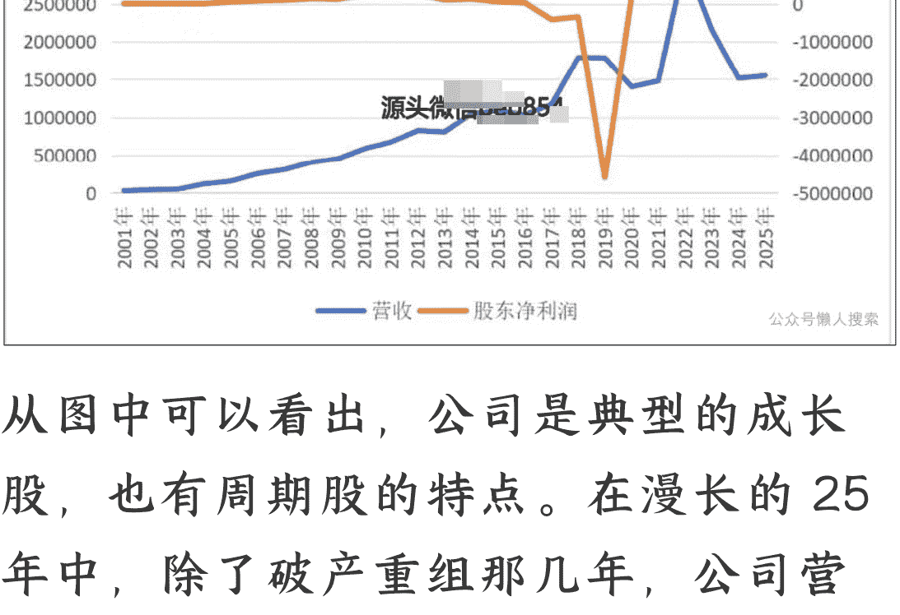
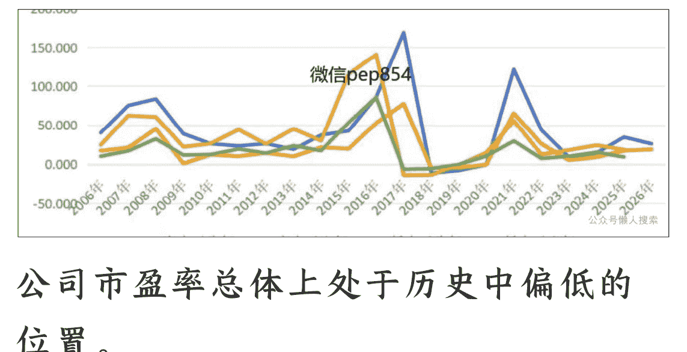
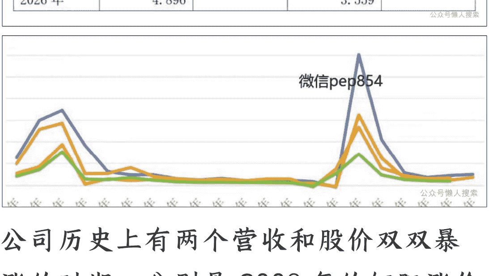
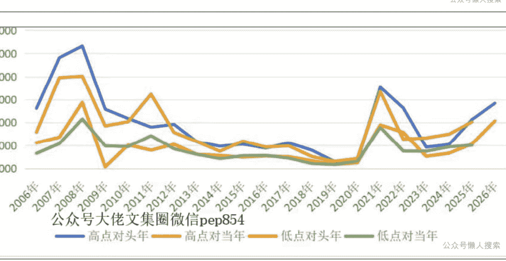
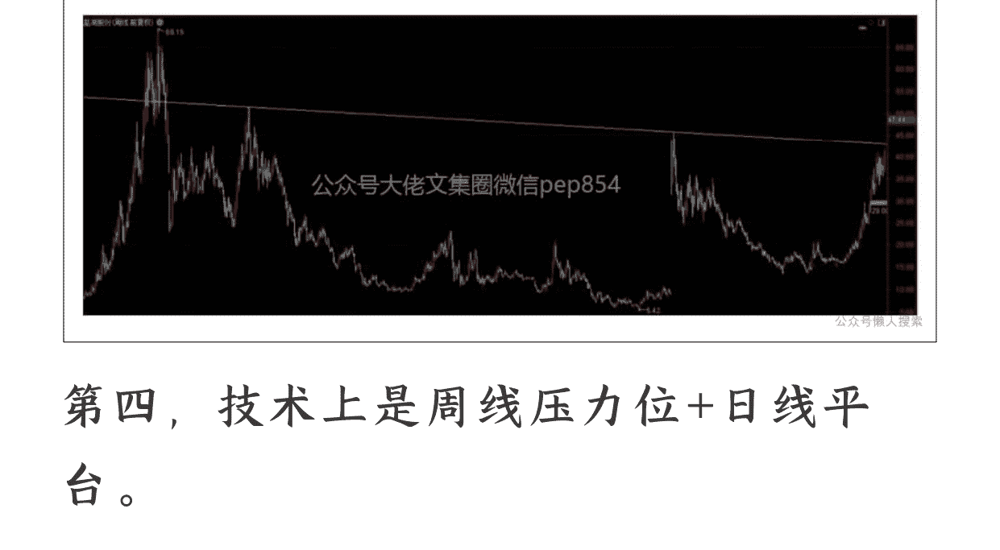

# 公司分析 25：有矿就是豪横，化工与锂资源两领域皆呈戴维斯双击

**260507 安民分析付费**
整理：公众号懒人搜索，懒人专属群精选
懒人微信：lazyhelper1

> 基辛格曾说：“谁控制了石油，就控制了所有国家；谁控制了粮食，就控制了人类。”从管仲开始，这就是人类历史背后的真知。粮食与能源从古至今，一直是国家竞争的底层武器。
> 比如美国把美元和石油捆绑，成为石油美元，从而挽救了当时濒临破产的美元，也挽救了美帝国。这事正是基辛格外交团队干的。所以，他才能说出上面那句闪耀着真理光芒的话。
> 中国古人讲“每天开门七件事，柴米油盐酱醋茶”。柴就是能源，米就是粮食。这句话就是最好的注脚。近年的俄乌冲突、美以伊战争，也是最好的注脚。
> 俄乌冲突让非洲挨饿，欧洲挨冻，欧洲大批企业破产。美以伊战争更是在一个月内就让多个亚太国家限油限气。大如印度，也拉下脸为了化肥在国际上奔走求救，最后以每吨 935 美元和 957 美元的价格全球采购 250 万吨尿素，以 4 月底的汇率计，相当于 6458.63 元/吨。而 4 月底，湖北尿素报价 1800 元/吨，山东华鲁的 1980 元。这就是被卡脖子的效果。它充分说明谁在粮食和能源上受制于人，谁就会被扼住咽喉。而且资源依赖不仅是成本问题，更是事关国运的国家安全命题。

故越是面对严峻复杂的外部环境，越是要坚定居安思危，坚持底线思维，守住资源底线，把生存发展的命脉牢牢掌握在自己手中。

今天分析的这家主板公司，同时做到了两大资源产业的龙头。公司一方面扎根当下，支援农业，一方面绸缪未来，护航新兴产业，以一己之力担纲我国两大资源压舱石。随着研究深入，我们还发现了它作为重资产企业，有着极其丰厚的账上现金、极为稳健的经营方针和极为健康的财务水平。从各个方面都无愧压舱石之名。

相信在这一波资源涨价浪潮中，公司在乘势获益的同时，有望进一步发挥内稳资源底线，外捍资源尊严的战略作用。别的公司戴维斯双击只出现在一条线上，这家公司在两个产业都呈现戴维斯双击效果，非同一般。

我们将结合公司 2025 年年报和 2026 一季报，为大家深度分析这家公司。文章分为八个部分，包括公司业务分析、各财务环节对公司利润的影响、影响公司业绩的因素和排序、公司的基本情况、公司的核心业务优势、公司今年的业绩分析、资产负债表中的几个亮点、公司的市场定位。因为图表数据较多，建议用电脑版微信阅读。

（免责声明：本文是公司分析，只为开拓视野、引导思路，并非择时，变非荐股。股市有风险，入市需谨慎。本文不构成任何投资建议或意见，不对投资者依据本文做出的任何投资或决策承担责任。请大家注意投资风险）

# 一、公司业务分析

这家公司是盐湖股份，代码 000792。

公司原为青海省属国企，后因盲目扩张出问题，被央企五矿集团并购。现为我国规模最大的钾肥生产和供应商，行业领军者。公司还拥有国内最大的盐湖提锂项目，碳酸锂成本国内最低，长期生产目标是年产碳酸锂 20 万吨。

等于公司手握中国粮食生产的紧缺产品钾肥和新能源产业关键资源碳酸锂两大王牌，是盐湖提锂的最大国内供应商。而石油是 20 世纪全球最为重要的能源，锂资源是新能源未来最重要的资源，故而公司战略价值巨大。公司的产业布局，就像华为所言，向上捅破天，向下扎到根。

## 1.钾产品（单位：万元）

| 钾产品 | 2024年 | 2025年 | 增速 | 增量 |
| :--- | :--- | :--- | :--- | :--- |
| 收入 | 1171270.73 | 1202997.49 | 2.71% | 31726.76 |
| 成本 | 546515.15 | 472605.21 | -13.52% | -73909.94 |
| 毛利 | 624755.58 | 730392.28 | 16.91% | 105636.7 |
| 毛利率 | 53.34% | 60.71% | | 7.37% |

**收入个位数增长，增量 3.17 亿元；毛利中速增长，增量 105636.7 万元。收入增速快于成本增速 16.23 个百分点，带动毛利率提高 7.37 个百分点，正面影响毛利 88713.65 万元，占此项业务毛利增量的 83.98%。**

**盐湖股份是全球唯一掌握全部氯化钾加工技术的企业。公司的钾产品几乎全部为氯化钾，这是公司最核心的产品。那么高的毛利率，真的很难得。刚好印证了有矿有的是豪横那句话。**

**我们剔除含有益微生物活菌的生物肥，可以将主流肥料分为有机肥和无机肥两大类。有机肥以人畜粪便、塘泥、高温发酵腐熟肥等为主，特点是温和，适合改良土壤。无机肥则是化肥，以化工、矿物提炼，成分单纯，养分明确，一般分为三种：氮肥（促进植株茎叶生长速度）、磷肥（促进根系生长、提高结果率）、钾肥（强壮茎、抗倒伏、提升果实品质）。这 3 类化肥可以直接充作物所需氮磷钾，特点是浓度高，见效快。中国 14 亿人的口粮，必须用化肥。过去农村常用的草木灰肥田，就是为了补钾，只是效果比化肥差远了。**

公司主产的氯化钾是钾肥中用量最大、最普及、性价比最高的一类，使用方便，可以在田中直接撒施，也可以配制溶液使用。还有一类是硫酸钾，硝酸钾（同时补氮和钾，属复合肥），量不大。我们查阅了各类机构数据，虽然统计方式和口径不同，但综合算下来，氯化钾在钾肥中占比在 80% 以上，是通用大田主力。它是中国农业高产稳产重要且紧缺的肥料。
看毛利率都知道，氯化钾是盐湖股份的现金奶牛，源源不断地向公司输血。它正是公司的底气之所在。

## 2.锂产品（单位：万元）

| 锂产品 | 2024年 | 2025年 | 增速 | 增量 |
| :--- | :--- | :--- | :--- | :--- |
| 收入 | 307466.81 | 291235.72 | -5.28% | -16231.09 |
| 成本 | 151645.73 | 139696.37 | -7.88% | -11949.36 |
| 毛利 | 155821.08 | 151539.35 | -2.75% | -4281.73 |
| 毛利率 | 50.68% | 52.03% | | 1.35% |

**收入个位数下滑，同比减少 1.62 亿元；毛利小幅下滑，同比减少 4281.73 万元。成本下滑速度快于收入下滑速度 2.6 个百分点，带动毛利率提高 1.35 个百分点，正面影响毛利 3944.02 万元。**

公司的锂产品主要为碳酸锂。近年新能源汽车、储能产业火爆，锂资源的战略地位也越来越高。根据各方面数据综合分析，2026 年全球碳酸锂供给和需求基本在 190 万吨 LCE，这个数字包含了锂资源回收。中国是锂资源生产和应用的龙头，但我们生产的锂**资源**，其原矿多数并不产自本土，本土消费量和本土产量的缺口，就是新能源命脉自主的关键，这些我们后面再讲。

## 3、贸易（单位：万元）

| 贸易 | 2024年 | 2025年 | 增速 | 增量 |
| :--- | :--- | :--- | :--- | :--- |
| 收入 | 3511.54 | 1306.17 | -62.80% | -2205.37 |
| 成本 | 1321.76 | 0 | -100.00% | -1321.76 |
| 毛利 | 2189.78 | 1306.17 | -40.35% | -883.61 |
| 毛利率 | 62.36% | 100.00% | | 37.64% |

**收入超高速下滑**，同比减少 2200 万元；毛利超高速下滑，同比减少 883.61 万元。成本下降速度快于收入下降速度 37.2 个百分点，带动毛利率提高 37.64 个百分点，正面影响毛利 491.65 万元。

**此项业务是公司化肥和化工产品等的采购和销售**，体量很小，影响小。

**接下来的三项业务，体量不算大**。公司既没有直接列示，也没有说明它们具体的经营内容，但为了大家能清晰地看到这家公司的细节，心里更有底，我们还是花了些工夫，将其挖出来与大家分享：

## 4、主营其他（单位：万元）

| 主营其他 | 2024年 | 2025年 | 增速 | 增量 |
| :--- | :--- | :--- | :--- | :--- |
| 收入 | 12200.01 | 18744.34 | 53.64% | 6544.33 |
| 成本 | 15793.36 | 21384.33 | 35.40% | 5590.97 |
| 毛利 | -3593.35 | -2639.99 | -26.53% | 953.36 |
| 毛利率 | -29.45% | -14.08% | | 15.37% |

**收入超高速增长**，增量 6500 余万元；毛利大幅减亏，亏损减少 953.36 万元。收入增速快于成本增速 18.24 个百分点，带动毛利率提高 15.37 个百分点，正面影响毛利 2880.9 万元。
这项业务就藏在公司的“主营业务”中，没有业务内容说明，应该是一些零散业务。公司没有单列的原因也很明白，业务还亏着呢，数量又不大，所以单列出来是徒增麻烦。这算是公司的一个小心思，但我们觉得不要紧，因为相比公司的钾、锂业务，其余的小盈亏无伤大雅。

## 5.主营业务（单位：万元）

前面几项是公司的主营业务。2025 年，主营收入小幅增长，增量 1.98 亿元；毛利两位数增长，增量 101424.72 万元。收入增速高于成本增速 12.74 个百分点，带动毛利率增长 6.01 个百分点，正面影响毛利 91083.38 万元，占主营毛利增量的 89.8%。

以下是公司近年来的主营业务情况（单位：万元）:

| 主营业务 | 收入 | 成本 | 毛利 | 毛利率 |
| :--- | :--- | :--- | :--- | :--- |
| 2020 年 | 836590.14 | 387351.47 | 449238.67 | 53.70% |
| 2021 年 | 1456861.73 | 586649.97 | 870211.76 | 59.73% |
| 2022 年 | 3059037.86 | 632175.01 | 2426862.85 | 79.33% |
| 2023 年 | 2137455.58 | 934068.84 | 1203386.74 | 56.30% |
| 2024 年 | 1494449.09 | 715276 | 779173.09 | 52.14% |
| 2025 年 | 1514283.72 | 633685.91 | 880597.81 | 58.15% |

可以看到，公司的毛利率长期维持在 50% 以上，远高于普通的重资产制造业公司。2022 年的毛利率更是达到了 79.33%，这是因为当年碳酸锂价格最高超过 60 万元/吨。公司的收入波动和毛利率波动，主要是受碳酸锂周期影响的结果，因此产品带有较为明显的周期性。

## 6.制造业其他业务（单位：万元）

| 制造业其他 | 2024年 | 2025年 | 增速 | 增量 |
| :--- | :--- | :--- | :--- | :--- |
| 收入 | 3084.11 | 14372.2 | 366.01% | 11288.09 |
| 成本 | 2871.13 | 3603.36 | 25.50% | 732.23 |
| 毛利 | 212.98 | 10768.84 | 4956.27% | 10555.86 |
| 毛利率 | 6.91% | 74.93% | | 68.02% |

收入超高速增长，增量 1.13 亿元；毛利超高速增长，增量 10555.86 万元。收入增速快于成本增速 340.51 个百分点，带动毛利率提高 68.02 个百分点，正面影响毛利 9776.34 万元，占此项业务毛利增量的 92.62%。

我们通过一些比对和计算，把这项业务从公司的“其他业务”中抠了出来，因为它与制造业的关联密切，所以我们命名为“制造业其他业务”。

该业务 2025 年业绩极佳，增长迅速，但公司没有单列出来的原因，一是因为体量不大，二是我们认为此业务仍然是由很多零散的业务组成。作为制造业，收入增长 3.66 倍而成本只增加 25.5%，我们大概能推测，用于生产的厂房设备都是现成的厂房设备，产品可能是公司之前的一些副业，也可能是钾和锂生产过程中的副产品。收入的爆发式增长可能是副产品提炼技术的成熟或下游市场价格大涨。总之，这种收入暴涨成本微动的态势是随价格波动的结果。它到底是什么，我们后面可以持续跟踪。

## 7.非制造业其他业务（单位：万元）

| | 2024年 | 2025年 | 增速 | 增量 |
| :--- | :--- | :--- | :--- | :--- |
| **非制造业其他** | 15878.75 | 21468.45 | 35.20% | 5589.7 |
| *收入* | 10441.08 | 16008.55 | 53.32% | 5567.47 |
| **成本** | 5437.67 | 5459.9 | 0.41% | 22.23 |
| *毛利* | 34.24% | 25.43% | | -8.81% |

收入超高速增长，增量近 5600 万元；
毛利微增，增量 22.23 万元。成本增速快于收入增速 18.12 个百分点，带动毛利率下降 8.81 个百分点，负面影响毛利 1891.96 万元。

这项业务是什么，公司也没有明说。

我们通过各种业务之间的逻辑关系，
把它挖出来呈现给大家，为的是大家对公司有更全面的了解。

## 8.其他业务（单位：万元）

| | 2024年 | 2025年 | 增速 | 增量 |
| :--- | :--- | :--- | :--- | :--- |
| **其他业务** | 18962.86 | 35840.65 | 89.00% | 16877.79 |
| *收入* | 13312.21 | 19611.91 | 47.32% | 6299.7 |
| **成本** | 5650.65 | 16228.74 | 187.20% | 10578.09 |
| *毛利* | 29.80% | 45.28% | | 15.48% |

制造业其他业务和非制造业其他业务，构成公司的其他业务。收入超高速增长，增量 1.69 亿元；
毛利超高速增长，增量 10578.09 万元。

收入增速高于成本增速 41.68 个百分点，带动毛利率增长 15.48 个百分点，正面影响毛利 5548.76 万元，占其他业务毛利增量的 52.46%。

再看历年的其他业务表现（单位：万元）:

| 其他业务 | 收入 | 成本 | 毛利 | 毛利率 |
| :--- | :--- | :--- | :--- | :--- |
| 2020年 | 76740.68 | 62119.98 | 14620.7 | 19.05% |
| 2021年 | 20971.52 | 10478.5 | 10493.02 | 50.03% |
| 2022年 | 14910.13 | 10082.14 | 4827.99 | 32.38% |
| 2023年 | 20394.85 | 14372.91 | 6021.94 | 29.53% |
| 2024年 | 18962.85 | 13312.2 | 5650.65 | 29.80% |
| 2025年 | 35840.66 | 19611.91 | 16228.75 | 45.28% |

相比主营业务，其他业务的毛利率明显较低，也更不稳定。

## 9.全部业务（单位：万元）

| 全部业务 | 2024年 | 2025年 | 增速 | 增量 |
| :--- | :--- | :--- | :--- | :--- |
| 收入 | 1513411.95 | 1550124.37 | 2.43% | 36712.42 |
| 成本 | 728588.21 | 653297.82 | -10.33% | -75290.39 |
| 毛利 | 784823.74 | 896826.55 | 14.27% | 112002.81 |
| 毛利率 | 51.86% | 57.86% | | 6.00% |

收入个位数增长，增量 3.67 亿元；毛利两位数增长，增量 112002.81 万元。收入增速高于成本增速 12.76 个百分点，带动毛利率增长 6 个百分点，正面影响毛利 92964.52 万元，占全部业务毛利增量的 83%。

整体上，公司的营业收入增长不大，但成本控制出色，毛利增长喜人，有 11.2 亿之多。这就与价格周期性上涨高度相关。

# 二、各财务环节对公司利润的影响

## 1.费用环节的影响（单位：万元）

| | 2024年 | 2025年 | 增量 | 影响 |
| :--- | :--- | :--- | :--- | :--- |
| 税金及附加 | 126936.66 | 98445.1 | -28491.56 | 28491.56 |
| 销售费用 | 14048.06 | 14217.79 | 169.73 | -169.73 |
| 管理费用 | 104545.92 | 95482.28 | -9063.64 | 9063.64 |
| 研发费用 | 18893.32 | 8722.7 | -10170.62 | 10170.62 |
| 财务费用 | -14822.52 | -21173.75 | -6351.23 | 6351.23 |
| 合计 | | | | 53907.32 |

2025 年，费用环节一共增加营业利润 53907.32 万元。经过这 5 个环节，公司 2025 年的营业利润同比增加 165910.13 万元。

影响大的是税金及附加、研发费用、管理费用和财务费用。税金及附加形成 28491.56 万元的正面影响，主要是资源税从上期的 11.17 亿降到 2025 年的 8.46 亿。研发费用形成 10170.62 万元的正面影响，主要是随着一些研发项目结束，委托研发费用从 8788.04 万降低到 2162.6 万。财务费用形成了 6351.23 万正面影响，主要是利息费用降低了 1.15 亿元。管理费用也大幅下降，主要是维修费用、环保费用、中介机构服务费、勘探费用、停工损失等费用减少。

## 2.利得和损失的影响（单位：万元）

| | 2024年 | 2025年 | 增量 | 影响 |
| :--- | :--- | :--- | :--- | :--- |
| 其他收益 | 17388.59 | 14130.84 | -3257.75 | -3257.75 |
| 投资收益 | 30123.4 | 22626.65 | -7496.75 | -7496.75 |
| 公允价值变动收益 | 2777.17 | -2756.45 | -5533.62 | -5533.62 |
| 信用减值损失 | 14867.31 | -330.16 | -15197.47 | -15197.47 |
| 资产减值损失 | -9788.96 | -15283.99 | -5495.03 | -5495.03 |
| 资产处置收益 | 114.27 | -305.93 | -420.2 | -420.20 |
| 合计 | | | -37400.82 | |

2025 年，这 6 个环节共计减少营业利润 37400.82 万元。经过这 6 个环节，公司营业利润同比增加了 128509.31 万元。

其中负面影响最大的是信用减值损失，这是因为 2024 年公司收回、转回了 1.49 亿的坏账准备，而 2025 年公

## 一、影响公司业绩的四个环节分析

司计提了 3016.07 万的坏账准备，两者产生的差额较大。

投资收益造成了 7496.75 万元的负面影响，因为公司 2024 年处理了一部分的子公司股权，变现后确认了 1.21 亿元收益，2025 年则没有这个收益。

公允价值变动收益造成了 5533.62 万元负面影响，是因为 2024 年的交易性金融资产获益 2777.17 万元，而 2025 年投资衍生品亏损 2756.45 万元，里外里拉下了 5533.62 万元的差距。公司在 2025 年投资了碳酸锂期货套期保值，目的是如果锂价下跌，可以通过期货市场的盈利对冲现货市场的亏损。这是一次实验性质的操作，仓位非常轻，开仓 1.54 亿，平仓 1.24 亿。按 2025 年碳酸锂价估算，开仓只有两千多吨的水平，而 2025 年公司实际生产碳酸锂 4.65 万吨，销售 4.56 万吨。

资产减值损失造成 5495.03 万元负面影响，主要是固定资产减值损失计提了 8292.55 万元。固定资产的减值，主要是机器设备减值 2817.32 万元，构筑物减值 4159.18 万元。所谓的构筑物不是厂房和办公楼，而是类似烟囱、水塔、沉淀池、蓄水池等土建设施。

## 3.营业外收支、所得税费用和少数股东损益等（单位：万元）

| |2024年|2025年|增量|影响|
|---|---|---|---|---|
|营业外收入|1970.17|1590.29|-379.88|-379.88|
|营业外支出|16946.95|1559.51|-15387.44|15387.44|
|所得税费用|84331.44|-175412.97|-259744.41|259744.41|
|少数股东损益|25084.22|47103.61|22019.39|-22019.39|
|合计|| ||252732.58|

4个环节共增加公司股东净利润 252732.58 万元。经过这 4 个环节，公司 2025 年股东净利润增加 381241.89 万元。

所得税费用正面影响最大，达 259744.41 万元，主要由当期所得税 2.92 亿和递延所得税费用 20.46 亿构成。

递延所得税费用很大，是因为公司前期形成巨大经营性亏损，在 2020 年司法重整。2025 年，公司通过高新技术企业资格复审，亏损弥补期限延长到 2030 年。基于现行税收政策及企业会计准则的要求，公司根据可抵扣暂时性差异和未来可税前弥补的亏损，计提了相应递延所得税资产。也就是这 20.46 亿元是一次性计提的，今年的所得税费用不会像 2025 年一样给股东净利润带来这么大的正面影响，这点大家要注意。另外公司以后将根据经营实现的利润，逐步冲减递延所得税资产、增加所得税费用。

营业外支出造成了 15387.44 万元的正面影响，主要因为公司在 2024 年缴纳了 2021 到 2023 年销售成锂卤水资源税和增值税滞纳金，约 1.55 亿元。

2025 年轻装上阵后，此类罚没、赔偿支出下降到 453.89 万元。

## 三、影响公司 2025 年业绩的因素及排序

影响公司 2025 年业绩的因素一共 21 个，其中正面影响因素 10 个，负面影响因素 11 个（单位：万元）:

| 排序 | 正面影响 | 影响额 | 负面影响 | 影响额 | 合计 |
| --- | --- | --- | --- | --- | --- |
| 1 | 所得税费用 | 259744.41 | 少数股东损益 | -22019.39 | |
| 2 | 钾产品 | 105636.7 | 信用减值损失 | -15197.47 | |
| 3 | 税金及附加 | 28491.56 | 投资收益 | -7496.75 | |
| 4 | 营业外支出 | 15387.44 | 公允价值变动收益 | -5533.62 | |
| 5 | 制造业其他 | 10555.86 | 资产减值损失 | -5495.03 | |
| 6 | 研发费用 | 10170.62 | 锂产品 | -4281.73 | |
| 7 | 管理费用 | 9063.64 | 其他收益 | -3257.75 | |
| 8 | 财务费用 | 6351.23 | 贸易 | -883.61 | |
| 9 | 主营其他 | 953.36 | 资产处置收益 | -420.2 | |
| 10 | 非制造业其他 | 22.23 | 营业外收入 | -379.88 | |
| 11 | | | 销售费用 | -169.73 | |
| 合计 | | 446377.05 | | -65135.16 | 381241.89 |

2025 年，全部业务增加毛利 112002.81 万元，表现不错。其中锂产品减少毛利 4281.73 万元；贸易减少毛利 883.61 万元；两项共减少毛利 5165.34 万。增加毛利的产品有 4 项。钾产品增加毛利 105636.7 万元；主营其他增加毛利 953.36 万元；制造业其他增加毛利 10555.86 万元；非制造业其他增加毛利 22.23 万元。4 项共增加毛利 117168.15 万。

费用一块增加营业利润 53907.32 万；利得和损失共减少营业利润 37400.82 万；营业外收支、所得税费用及少数股东损益增加股东净利润 252732.58 万，终至全年股东净利润增加了 381241.89 万。少量因四舍五入产生的偏差为正常现象。

其中贡献很大的是一次性的所得税费用和业务，都达到 10 亿级别。

以下是公司从 2001 年以来主营收入（蓝色折线，主坐标轴）和股东净利润（橙色折线，副坐标轴）图（单位：万元）:

从图中可以看出，公司是典型的成长股，也有周期股的特点。在漫长的 25 年中，除了破产重组那几年，公司营收和净利润的增长是长期且坚定的。营收的长期增长在图中显而易见，而净利润的增长因为重组，在坐标轴影响下观感不明显，所以我们用复合增长率再表述一次:

| 复合增长率 | 营收 | 股东净利润 |
| --- | --- | --- |
| 2001 至 2025 年 | 17.97% | 21.38% |
| 2020 至 2025 年 | 2.03% | 32.96% |
| 2021 至 2025 年 | 1.20% | 17.29% |

我们选取了三个时间段，一个是 2001 至 2025，在尽可能长的时间里体现复合增长率，在宏观上更有说服力；一个是在 2019 年公司重组后的 2020 年到 2025 年复合增长率；另外考虑到 2020 年是重组后的第一年，净利润未必完全恢复，我们又计算了 2021 年到 2025 年的复合增长率。

可以看到，无论按哪个时间段，公司的净利润增长都是长期可靠的，而且比营收更强。当然，这也是受碳酸锂价格周期性影响的结果。

# 四、公司的基本情况

这一节我们简单讲一下公司资源禀赋、发展路径、产品情况，以便大家对公司有更具体的了解。

## 1.公司的资源禀赋

靠山吃山，靠水吃水。盐湖股份主要靠察尔汗盐湖。

察尔汗盐湖位于青海省柴达木盆地，是中国最大、世界第二大的可溶性钾镁盐矿床，仅次于美国大盐湖。除钾和镁外，还蕴藏大量的钠、锂、硼、溴、碘、铷、铯等矿产资源，各类资源总储量达 600 多亿吨。据青海省人民政府报告，按已探明储量计，氯化钾表内储量为 5.4 亿吨，占全国已探明储量的 97%；氯化镁储量为 16.5 亿吨，氯化锂储量 800 万吨，氯化钠储量 426.2 亿吨，均居全国首位。

察尔汗盐湖面积 5856 平方公里，盐湖股份享有 3700 平方公里盐湖全部的开采权，占比超过 63%。剩下的主要由藏格矿业开采。3700 平方公里是个什么概念呢，洞庭湖也只有 4040 平方公里，盐湖股份的资源面积接近一个洞庭湖。所谓得天独厚，不过如此。

再比较一下。武汉东湖是全国最大的城中湖，分 4 个大的湖泊和一二十个小湖泊。全部湖泊总面积 36 平方公里。3700 是 36 的 103 倍，大小相当于 103 个东湖全部的水域面积。

另外，公司在 2025 年 12 月收购了五矿盐湖 51% 的股权，五矿盐湖拥有青海一里坪盐湖的开采权，其中氯化锂保有资源量为 164.59 万吨，氯化钾保有资源量为 1463.11 万吨。虽然保有资源量不等同于储量，保有资源量只代表理论上资源的蕴含量，储量则代表能具体开发的资源量，所以储量会比资源量小，但盐湖股份无疑巩固了国内盐湖提钾和盐湖提锂的双龙头地位。

## 2.公司的曲折发展

盐湖股份地处高原，背靠盐湖，所以它的发展历程注定和地处低海拔的常规企业大有不同。我们甚至可以说它的很多决策，往根儿上找，都源于这种特殊的地理环境。

公司一直在尝试利用手头资源开发副业。早年公司不具备提炼氯化钾以外产品的能力时，一直在销售卤水卤矿，而且除了氯化钾这个唯一产品外，还有一些其他副业，比如酒店业。

依托察尔汗盐湖丰富的镁资源，经过数年的研发建设后，公司 2010 年具备了量产氢氧化镁的能力。2011 年可量产 PVC（聚氯乙烯，常用于各类管材、电线电缆绝缘材料等），甚至还生产编织袋；2012 年量产了联二脲（塑料橡胶制品发泡剂的原料）、水泥制品、甲醇；2013 年量产了 ADC（塑料橡胶制品发泡剂，联二脲的下游产品）、碳酸锂、尿素、液氨、原煤；2014 年公司提出了“走出钾、抓住镁、发展锂、整合碱、优化氯”的方针，量产了硝酸钾，另外还有些机电设备制造业务，产品线扩展到巅峰。

产品越来越多，但几乎全线亏损，大多数产品连毛利率都是负的。

2015 年，公司单列了氯化钾和水泥业务，将其他业务打包塞进“盐湖资源综合利用化工产品”，此业务毛利仍为负；2016 年碳酸锂业务被分列出，毛利率达 56.85%，而“盐湖资源综合利用化工产品”毛利率仍为负，且越来越低。

随着净利润逐年走低，公司扛不住了。2016 年净利润为正，但扣非净利润已为负，2017 年到 2019 年更是连续亏损，股东净利润分别为 -41.59 亿，-34.47 亿，-458.6 亿。-458.6 亿，是当时 A 股有史以来最大的亏损，而这个天文数字源于公司寄予厚望的金属镁一体化项目失败。

察尔汗盐湖拥有中国第一的镁盐储量，超过 40 亿吨，在世界处于第一梯队。在盐湖提钾的过程中，会产生大量富含氯化镁的老卤副产品。每生产 1 吨钾肥，就会副产约 12 吨水氯镁石，所以对公司而言，提炼镁是充分利用资源的顺势决策。

2008 年，公司引进了挪威海德鲁的技术，启动实施了以年产 10 万吨电解金属镁装置为核心的金属镁一体化项目，但受气候、海拔、原料来源、氯化氢循环途径等因素影响，项目一再延后。公司大量举债追加投资，从原计划的 200 亿元增至 432 亿元，期间还因安全问题多次停工，迟迟无法产生效益。项目拖到 2017 年完工时，大部分设备已转为固定资产，折旧等费用进入经营成本，又因限煤令影响，燃料成本大涨。最终公司被运营成本、债务、营收不及预期等诸多因素彻底拖垮。

总体上是公司科研和产业化跟不上，当地有丰富的镁资源，但产业化提取出了问题，即使引进了挪威的装置，技术仍然跟不上，消化不了。

连年巨亏后，公司于 2019 年破产重整，保留钾、锂优质资产，剥离镁、化工等不良资产，去粗取精，轻装上阵，经过 1 年多的调整，公司破产重组后势头发展良好。这才有我们今天看到的新的盐湖股份。

盐湖股份重组前的问题出在哪里，在于业务铺得太开。但为什么铺这么开？因为公司作为高原企业，始终面临着一对矛盾：丰富的资源与落后的当地产业、资本，特别是技术水平和内地相差很大。而且青海大企业不多，上面要政绩，就很容易给上市公司施加压力。

具体来说，察尔汗盐湖资源太过丰富，这决定了公司的生存发展必须完全扎根于此，核心环节不可能以任何形式转移到内地和沿海。但扎根柴达木，就不得不面对一个现实，公司所处高原，气候恶劣，地广人稀，所以当地既缺资本，又缺产业，技术水平要得到大幅度提高，资源提炼才会有大的进展。资源的雄心和技术实力不足，导致它成为高原上的一座孤岛，只是公司最初未必能够认识到这点。故而公司必然拥有两面性。在 2019 年公司崩溃之前，这两面全部都指向了一个结果，就是扩张。

是什么两面性呢？作为上市企业，盐湖股份天然具有资本扩张的一面，就是资本本能地驱使它扩张业务；而作为地方国企，公司还有要为地方经济助力的一面。也就是通过做大做强，利用本地资源优势，带动本地经济发展。我们看到公司在扩张的巅峰期，钾、镁、锂、原煤、水泥、化工、机电无所不包，这表明公司当时的诉求肯定不止于盈利，很可能还有更远大的构想，比如打造西北高原的化工重镇，比如成为西部大开发的原材料供应龙头，等等。

但随着核心产品氯化钾的售价连年下跌和化工产品同质化竞争日趋激烈，以及公司下重注的金属镁一体化项目水土不服，那些庞杂而远大的构想彻底落空。

我们认为，直到今天，那些曾经拖垮公司的业务，有大部分被剥离，但有少部分可能或多或少地在生产销售。它们可能已经有所好转（比如前面提到的“制造业其他”，收入 1.44 亿，成本 3600 万，毛利 10768.84 万），但再也不复当年的理想。我们前文分析过，公司把好几项业务藏在主营业务和其他业务中，没有单独列出，很可能就是这些老业务的部分残留。不过目前它们无关大局。

为什么我们要花笔墨分析这个呢，因为公司就在几年前还是 ST，总会有读者关心，ST 的帽子才摘了几年，会不会有什么历史遗留问题。而我们开诚布公地讲这些，就是在和大家剖析公司的成败因由，只有看清了怎么输，才能知道怎么赢。这就是公司的核心业务。

# 五、公司的核心业务优势

## 1.先理解失败，再理解成功

盐湖股份原来的主业是钾肥，后来发展出锂盐业务。盐湖钾肥破产重整时，这两项作为核心业务被保留了下来，是得到国资委和中金公司盖章认定的。

这个不难理解。中国 14 亿人的饭碗必须端牢，而中国土壤缺钾，南方红壤、北方石灰性土壤及长江以南部分地区缺钾问题更为突出。我们只要看看中国钾肥进口量就知道。2020 年进口 874 万吨，对外依存度为 55%。2021 年进口 757 万吨，占当年中国肥料进口总量的 83.28%。2022 年，794 万吨。2023 年 1157 万吨。2024 年为 1263 万吨，对外依存度 67%。2025 年 1261.5 万吨，对外依存度约为 68.56%。而 2025 年，公司作为全国最大的钾肥生产企业，年产量只有 490.02 万吨。也就是公司产能还是小了，钾肥的全国产能扩大一倍，国内才能基本实现供需平衡。

至于锂，我们只要理解一点就成。它是新时代的石油。也即英国全球称雄的时候，靠的是煤；美国全球称雄，靠的是石油和天然气；中国走向全球，靠的是新能源，而新能源最核心的资源就是锂，未来看有没有可能加上钠。

明白了上述两点，就知道公司经营钾锂，就是在经营中国的两个战略性产品。

盐湖股份在激进扩张时期，所经营的绝大部分业务，出发点只有一个，就是以盐湖资源为核心，尽可能榨取周边资源，构建多产业融合的循环经济体系，把盐湖资源和生产废料都变成有价值的产品。公司在 2008 年就提出了口号，叫“吃干榨尽”。做镁产品，是因为察尔汗盐湖的镁储量全国第一；做原煤，是为了提供能源与基础煤化工原料；做 PVC 是为了实现氯平衡，消耗氯气实现钾碱联产；做水泥是为了消耗电石渣、粉煤灰等工业废渣。

这套方案看似合理，但只算了部分技术账。理论上能实现大体量的内循环。也算了不能落地的经济账，理论上能实现各类资源的极致利用。但都只计算了局部，结果并不好。因为它忽略了柴达木盆地的客观现实，就是经济不足、人口不够、管理欠佳，部分产品技术有欠缺。大循环中生产的大多数产品都不稀缺，在市场上充分竞争，资源优势会很快被运输成本、管理不善、规模不够等劣势抵消。而谈到管理不善，2017 年 2 月和 6 月的连续安全事故导致公司化工业务不得不中止部分生产，这些都是公司难以为继的因素。可见身处高原腹地的盐湖股份，在当时并不具备同时精细管理多条产线的能力。而进口挪威的生产设施多少年开不了工，则表明公司在某些核心技术方面就有欠缺。

公司之前的失败，在于站位不够高，方案没有落地。公司仅从理想角度出发，自说自话地搞高原上的内循环。

而现在能成功，是因为公司牢牢抓住了两大战略性产品，战略账算得很清楚，清楚地认识到自己只有一张资源牌，于是尽可能把资源优势做到战略上不可替代；这就发挥了公司的优势，导致两项主业，成本优势明显，无惧竞争。这点我们只要看看它在行业低迷时期的毛利率就知道。

### 2. 当下的压舱石

公司的钾产品主要服务于农业，是扎根当下。

农业是个特殊的产业，从生产力角度看，农业带来的生产力提升远不如工业，从经济角度看，它的经济提振效果远不如服务业。所以如果把经济学当作一个数字游戏，农业的性价比很低。

但所有人都知道它的重要性。因为没有农业，真的能饿死人。而且农业过时不候，比如霜降抢种冬小麦、点播油菜，清明整地育早稻秧，翻耕、下种、覆膜、移栽，步步都要紧抓时令。各类作物都有专属生长窗口期，一旦错过节气节点，出苗弱、长势差，后期再管护也难补救收成。所谓一插之迟，便是一季之差。

所以虽然如今绝大多数城里人都不接触农业，但市场不会忘记它。中国人有着强烈的居安思危意识，所以一直高度重视农业的八字方针，水、肥、土、种、密、保、管、工。现在种田，肥主要是化肥。钾肥对外依存度达 68.56%，2025 年氯化钾进口量达 1261.5 万吨。加拿大、俄罗斯、白俄罗斯的钾肥产量居前三，合计占比达到 63%。钾肥生产商高度集中，产能主要集中在加拿大 Nutrien,白俄罗斯 Belaruskali,俄罗斯 Uralkali,美国 Mosaic 和德国 K+S 五家，合计控制全球约 70%的产能，是典型的寡头垄断。

而内资中的资源型钾肥企业，即直接从矿物、卤水等自然资源中生产氯化钾的企业，年产量超过 100 万吨的只有 4 家。分别是盐湖股份，2025 年产 490.02 万吨氯化钾；藏格矿业，2025 年产 103.32 万吨氯化钾；亚钾国际，2025 年产氯化钾 201.15 万吨；东方铁塔，2025 年产量 130.01 万吨。

2025 年全球钾肥消费量 7300 万到 7500 万吨，我国钾肥需求量世界第一，占全球消费量的 25%。据中国无机盐工业协会数据，我国氯化钾表观消费量为 1910.3 万吨。2025 年氯化钾产量 924.5 万吨。其中盐湖股份占比 53.00%。4 家生产百万吨以上氯化钾的企业，只占去年全国消费量的 42.29%。也即产能再扩大 1.4 倍是没有问题的。

2025 年，公司的氯化钾业务收入 102.58 亿，销量为 381.47 万吨，价格约为 2689.03 元/吨。这是纯氯化钾。但公司的钾产品，估计还包括一些其他内容，2025 年体量为 177213.74 万元。

公司钾产品提供了 73.04 亿的毛利，毛利率超过 60%，是妥妥的现金奶牛。作为中国钾肥行业的龙头，在我国对进口钾肥依赖度大的现状下，盐湖股份就是中国保农业生产的压舱石。

## 3.未来的压舱石

锂电池作为新能源汽车、低空经济、人形机器人、储能等新兴产业的底座，其核心原材料锂，更是战略资源。

| 国家 | 储量 | 2025 产量 |
| :--- | :--- | :--- |
| 美国 | 2340.80 | |
| 阿根廷 | 2340.80 | 12.236 |
| 澳大利亚 | 4468.80 | 48.944 |
| 巴西 | 287.28 | 6.384 |
| 加拿大 | 851.20 | 2.979 |
| 智利 | 4894.40 | 29.792 |
| 中国 | 2447.20 | 32.984 |
| 马里 | 196.84 | 5.001 |
| 葡萄牙 | 31.92 | 0.202 |
| 津巴布韦 | 266.00 | 14.896 |
| 其他国家 | 1276.80 | 微信 pep854 |

因为锂产品种类多样，有碳酸锂、氢氧化锂、氯化锂、金属锂、磷酸锂等等，每种产品的锂含量都不一样，所以为了统一计量和比较，国际上习惯把锂产品按锂元素含量折算成等价碳酸锂（LCE）的重量。比如某国生产了 1 吨金属锂，我们可以认为该国生产了 1*5.32=5.32 吨碳酸锂。5.32 是金属锂换算成碳酸锂的系数。

根据表格，中国 2025 年的碳酸锂产量约占全球产量的 18.48%，但很多报告显示，中国的碳酸锂产量远高于 32.98 万吨，超过 140 万吨，其中的出入是统计口径不同导致的。

中国企业这些年在全球各地收购、参股矿山，把开采出的锂原矿（锂辉石、锂云母、透锂长石等等）运回国内，在国内提炼成各种锂产品，再交付下游或出口到日韩。这个过程中，矿石是国外产的，但锂产品是中国产的。很多报告中国年产一百几十万吨碳酸锂的数据就是这么来的，算得没错。而 USGS 计算的是各国出土矿产折合成碳酸锂的产量，只管矿产自哪里，不管锂产品最终在哪里生产。

口径的选取是统计学的游戏，但是我们认为 USGS 的报告其实更有警示意义。在 2025 年全球新生产的 154.28 万吨碳酸锂中（不包含旧电池回收），因为还有盐湖提锂等因素，从而完全采自中国、产自中国的碳酸锂占 21.38%，而中国实际生产的碳酸锂占全球产量的 90.74% 以上（如果算上回收等其他提锂方式，这个比例会下降百分之二十左右。口径不同，统计结果不同，大家注意），中间 70% 左右的差额，全都依赖进口锂矿。

前文的表格显示得很清楚，有强大锂资源潜力的外国，前三强分别是智利、澳大利亚、阿根廷。这三家明显受美国影响更深，所以他们作为锂矿出口国，可靠程度明显不如出口钾肥的俄罗斯、白俄罗斯。尤其在美国频频表露战略收缩意愿的当下，美国会优先在家门口把篱笆扎牢，把南美和五眼联盟看得更死。抓马杜罗，暗中影响巴拿马给中国使绊子，都证明美国对南美是手拿把掐。五眼联盟更不用谈，澳洲的铁矿煤矿恶心中国多少年了。

南美已经有所动作。当地时间 1 月 28 日，智利化工矿业公司表示，公司将与智利国家铜业公司成立合资公司，并将剥离后的阿塔卡马盐湖注入新合资公司。而这将影响天齐锂业对阿塔卡马盐湖的股权占比。它实际上是南美在搞变相的外资投资企业国有化。

2018 年，天齐锂业耗资 40.66 亿美元，以第二大股东身份入股智利化工矿业公司，当时股权占比是 23.77%，目前减持至 22.16%。为了配合智利新规，智利化工矿业公司于 2024 年 5 月与智利国家铜业公司签署《合伙协议》，约定自 2031 年起，智利化工矿业公司不再拥有阿卡塔玛盐湖的控制权和经营管理权力，财务报表与智利国家铜业公司合并。协议一旦正式生效，意味着从 2031 年起，天齐锂业子公司与智利化工矿业公司丧失了原拥有的经营等控制权。

所以，无论是南美还是澳大利亚，未来美国一旦有需要，他们完全有可能煽动一场资源民族主义，说中国资本在锂资源价值还不明显时低价掠夺本国矿山盐湖，现在必须吐出利益。届时增加特许权使用费都算轻的，如果直接强行收归国有，更是难办。按我国的行事思路，武力维权不现实，一般都是谈判仲裁，实在不行就通过贸易制裁还击。这么做也许对方很疼，但中方利益受损也是实打实的。双赢变双输，只有产业空心化的美国得利，因为美国资本可以无阻碍地进入这些傀儡国。

也即未来中美锂资源的全球争夺战必然打响。当然，什么时候打响存在不确定性。但从特朗普抓了马杜罗吃下委内瑞拉的石油产业，打伊朗剑指石油和天然气，我们就知道，未来中美锂资源的全球争夺战不可避免。

因为锂资源背后是电池，它是电动汽车行业的心脏，是 AI 数据中心储能设施的关键，也是人形机器人的心脏，还是飞行汽车的心脏，也是固态电池的上游关键性资源，更是电子设备所用电池的基础原材料等等。它的战略价值在于影响到很多大行业的兴衰。

换句话讲，中国作为产业最强国，锂资源对我们的意义远强于任何其他国家。缺少锂，对一般国家而言不会有多大的影响，但对我们而言，就是强势产业受制于人，未来产业举步维艰。

所以，锂矿的危机虽然还没有爆发，但结合历史经验，我们不得不做好本土挖潜的准备。所以国内盐湖资源、锂辉石资源就是战略储备。

我国盐湖锂资源占锂资源总量的 83% 以上，也就是说，未来我国的自产锂产品迟早会把重心转移到盐湖。

盐湖股份 2025 年生产碳酸锂 4.65 万吨，约占本土供锂产能的 14.1%。2025 年全国盐湖提锂约 14.6 万吨，公司占比 31.85%。2026 年，公司产能将扩大到 9.78 万吨。

### 4. 盐湖的成本优势
盐湖提钾提锂的成本，普遍低于矿山提钾提锂，这是常识。

矿山提钾，往往要深井开采，再通过粉碎 - 浮选法分离氯化钾；矿山提锂，在采矿、磨碎矿石后，一般要经过高温煅烧，再加入硫酸进行酸化反应，之后浸出硫酸锂，经过除杂浓缩，再与纯碱反应得到碳酸锂。

盐湖提钾的工序相对简单很多。第一步是蒸发卤水。察尔汗盐湖地处高原，日照强，风力大，蒸发效率高。接下来就是通过反浮选 - 冷结晶等技术，直接提取氯化钾。而前文讲过，公司是全球唯一掌握全部氯化钾加工技术的企业。

盐湖提锂也是同理。因为盐湖同时包含钾和锂，所以同一份卤水，既能提钾，又能提锂，一鱼两吃。同样是经过日晒风吹蒸发水分后，先提钾，得到高浓度卤水（老卤），利用吸附法制造锂母液，再萃取和膜分离。

下面是盐湖股份和亚钾国际、东方铁塔的毛利率对比。亚钾和铁塔都是 A 股做矿山提钾的公司。矿场在老挝，因为埋藏浅，所以在矿山提钾方案中，二者都算是毛利率很高的：

| | 氯化钾毛利率 | 盐湖提钾 | 矿山提钾 |
| :--- | :---: | :---: | :---: |
| | 盐湖股份 | 亚钾国际 | 东方铁塔 |
| 2008 年 | 78.41% | | |
| 2009 年 | 65.41% | | |
| 2010 年 | 58.54% | | |
| 2011 年 | 73.47% | | |
| 2012 年 | 72.50% | | |
| 2013 年 | 69.09% | | |
| 2014 年 | 68.27% | | |
| 2015 年 | 73.69% | 29.78% | |
| 2016 年 | 70.72% | 36.60% | 43.05% |
| 2017 年 | 64.51% | 43.31% | 52.13% |
| 2018 年 | 71.94% | 48.35% | 56.70% |
| 2019 年 | 71.09% | 55.29% | 43.29% |
| 2020 年 | 55.62% | 43.50% | 24.89% |
| 2021 年 | 68.51% | 64.74% | 42.96% |
| 2022 年 | 79.44% | 72.30% | 65.42% |
| 2023 年 | 51.32% | 58.48% | 45.59% |
| 2024 年 | 53.34% | 49.54% | 40.40% |
| 2025 年 | 60.71% | 59.10% | 54.97% |

平均看下来，盐湖毛利率高于矿山提钾的高毛利选手。再叠加盐湖股份如此之大的产量，获益是很大的。

公司碳酸锂历年的毛利率如下：

| | 碳酸锂毛利率 | 盐湖股份 | 永兴材料 | 天齐锂业 |
| :--- | :---: | :---: | :---: | :---: |
| 2018 年 | | 49.36% | | 65.25% |
| 2019 年 | | 26.85% | 16.99% | 48.54% |
| 2020 年 | | 12.47% | 3.87% | 23.71% |
| 2021 年 | | 70.03% | 56.70% | 61.89% |
| 2022 年 | | 91.96% | 56.70% | 85.85% |
| 2023 年 | | 72.45% | 71.82% | 73.85% |
| 2024 年 | | 50.68% | 36.65% | 35.21% |
| 2025 年 | | 52.03% | 33.40% | 28.59% |

盐湖股份早年提锂的毛利率水平并不突出。主要是 2016 年才将此项业务列为第二项重要主业。实际上只要看看 2024 年 2025 年的毛利率就可以了。
因为 2023 年到 2025 年 6 月下旬，碳酸锂价格大跌。所以，即使在行业低谷，公司的碳酸锂业务毛利率仍然超过 50%。

# 六、公司今年的业绩分析

我们还是紧紧围绕着两个公式分析，即销量*单价=收入，收入 - 成本=毛利。在此基础上我们尽可能应用已知信息，给出一个相对可以参考的业绩。

### 1. 锂产品的业绩
### （1）锂产品的销量
公司 2025 年的碳酸锂产能为 4 万吨/年。2025 年 9 月 28 日，公司新投建的 4 万吨/年锂盐一体化项目完工并顺利投产，2026 年是该项目全面投产的第一年。2025 年 12 月收购了五矿盐湖 51% 的股权，五矿盐湖拥有锂产能包括碳酸锂 1.5 万吨/年、磷酸锂 0.2 万吨/年、氢氧化锂 0.1 万吨/年，三者折合成碳酸锂约为 1.78 万吨/年。
至此，2026 年公司碳酸锂产能是 9.78 万吨/年。

根据 2026 年一季报，公司的碳酸锂产量为 1.95 万吨，比照 9.78 万吨/年的产能并未满产。应该是新建的锂盐项目产能还在爬坡，后面的季度产能会提上来。

以下是公司历年碳酸锂产量、销量、产销率（单位：吨）:

# 因为锂资源下游的相关产业持续火爆，多年来公司的产销比一直维持在一个很高的水平，经常有超过 100% 的情况，平均算下来产销比可达 99.21%。据此再结合 9.78 万吨的产能计算，2026 年就是 9.7 万吨的销量。

我们再结合公司的产量来进一步预估。

在一季度 1.95 万吨产量后，假设每一季度的产能平均地逐季提升，直到第四季度满产。

则二季度产量为 2.115 万吨，三季度产量为 2.28 万吨，四季度产量为 2.445 万吨，全年产量为 8.79 万吨。

销量方面，公司多年的产销率为 99.21%，2025 年的产销率是 97.897%，2022 年是 97.288%。公司扩产 4 万吨，因此取一个比较低的数据，95% 的产销比。则二季度的销量为 20092.5 吨，三季度为 21660 吨，四季度为 23227.5 吨。加上一季度 16800 吨，全年为 81780 吨。

### （2）锂产品的成本
2025 年下半年，公司销售碳酸锂约 24956 吨，经计算，成本为 31075.54 元/吨。因为生产碳酸锂所需要的材料在涨价，因此我们根据去年的成本上涨情况测算，公司每季度吨成本上涨 2%。则 2026 年一季度成本为 31697.05 元/吨，二季度为 32330.99 元/吨，三季度为 32977.61 元/吨，四季度为 33637.16 元/吨。

### （3）锂产品的销售价格
我们根据经计算的公司 2025 年以来各个季度的碳酸锂售价，结合碳酸锂季度期货均价，来确定公司 2026 年每季度的碳酸锂销售均价。一季度均价为 134692.55 元/吨，二季度价格根据 4 月 30 日的 62 天期货均价乘一个参数 1.02，为 144641.99 元/吨，三四季度在二季度基础上每季度均价*1.03，则三季度均价为 148981.25 元/吨，四季度为 153450.69 元/吨。这个数据取值是偏主观的，但是我们考虑了碳酸锂期货的季均价的上涨速率，再考虑到价格波动上行的趋势，而取了一个比较低的值。即根据这里的取值计算，得出的结果比实际值低，那是正常。即我们取值要谨慎。

计算结果表明，2026 年一季度，公司碳酸锂销售收入为 226283.48 万元，二季度为 290621.93 万元，三季度为 322693.39 万元，四季度为 356427.59 万。全年销售收入为 1196026.40 万元。同时考虑到公司产能未必能达到我们预计的情况，这也有可能。所以在价格涨幅方面，我们取了一个较低的值，产销比也取了一个偏低的值。

### （4）产品的毛利
根据以上数据，计算公司各季度锂产品的毛利分别为：一季度 173032.44 万，二季度 225660.89 万，三季度 251263.90 万，四季度 278296.88 万。全年毛利为 928254.11 万。

此时有三个大的因素要考虑：
- 第一，扣 15% 的所得税，则利润为 789016.00 万。
- 第二，2025 年所得税抵扣导致公司利润多出 175412.97 万，这个因素考虑进去，就为 613603.03 万。
- 第三，再考虑五矿盐湖 49% 的股东权益，则降为 548161.04 万元。

### 2. 钾产品业绩
### （1）钾产品的销量
首先我们要知道，公司目前的氯化钾产能上限是 500 万吨/年，且没有新的氯化钾扩产项目，五矿盐湖有 30 万吨产能。2025 年年报显示，公司的氯化钾库存为 117.16 万吨。也就是在产能范围内，公司 2026 年的氯化钾销量上限为 647.16 万吨。

当然公司也具备爆产能的能力，比如 2020 年，在 500 万的设计产能下，全年实际生产 551.75 万吨，销售 644.9 万吨。但这个情况比较特殊，因为那是公司破产重整后的第一年，无论是公司自身还是相关单位，都有很迫切的业绩需求。也就是说特殊情况下，超产 10% 是合理的。我们再看看公司每年一季度的销量在全年中所占的比例。

2026 一季度，公司生产氯化钾 87.73 万吨，销售 132.97 万吨。下面是历年第一季度销量、全年销量、第一季度销量占比，以及上年末库存量（单位：吨）:

| | 氯化钾 | 上年末库存量 | 一季度销量 | 占全年销量比 | 全年销量 |
| :--- | :--- | :---: | :---: | :---: | :---: |
| 2013 年 | | 1047700 | 599100 | 18.27% | 3279600 |
| 2014 年 | | 1033800 | 1001700 | 21.94% | 4566200 |
| 2015 年 | | 873600 | 734900 | 16.57% | 4434000 |
| 2016 年 | | 1454700 | 969600 | 19.71% | 4920100 |
| 2023 年 | | 1568000 | 1248200 | 22.29% | 5599994.77 |
| 2024 年 | | 672400 | 764300 | 16.36% | 4672800 |
| 2025 年 | | 518900 | 891100 | 23.36% | 3814700 |
| 2026 年 | | 1171600 | 1329700 | 微信 pep854 | |

2026 年一季度产量为 877300 吨，加上库存是 2048900 吨，销售了 1329700 吨，一季度末还有库存 719200 吨。

我们再考虑公司氯化钾产量。前三年产量分别是：2023 年，492.6 万吨，2024 年，496 万吨，2025 年，490.02 万吨。这三年低的是 490 万吨，高为 496 万吨，比较平稳。三年平均 492.87 万吨。考虑到五矿盐湖还有 30 万吨的产能，公司股权占比是 51%，因此产能还有 15.3 万吨，算到公司头上真实产量 14.5 万吨是有的。

因此，总产量是 492.87 万吨 +14.5 万吨=507.37 万吨。加上年底的库存，为 624.53 万吨。

再考虑美以伊战争影响这个特殊情况。因为 2025 年中国氯化钾缺口达 57.71%，因此进口量很大。2026 年受美以伊战争影响，氮肥和磷肥带着全球化肥涨价，钾肥也涨价。此时国内钾肥价格必然跟着国际价格走，不然别人不会卖给咱们钾肥。钾肥价格高，就有两方面有爆产量的动因，一是价格高刺激上市公司加量生产；二是价格高，粮食生产挣钱压力大，国家就有动力要求钾肥公司增产，减少进口钾肥，外贸企业在最初抢购之后，就有动力减少进口，加大本国钾肥销量。考虑到这个情况，公司增产 5% 是可能的。因为历史上有超过 10% 的爆量出现。

507.37 万吨加量 5%，就是 532.7385 万吨。加上年库存就是 649.8985 万吨。也就是 650 万吨。这是销量的天花板。

从 2023 年到 2025 年一季度销量占全年销量一季度占全年销量比为 22.29%，按此标准推算，公司 2026 全年氯化钾销量为 596.55 万吨。跟上面计算的 605 万吨比较接近。

所以，在此情况下，逻辑重于数据。这个逻辑就是美以伊战争背景下，国家要求加大产销量，国际产品价格高，进口动力不是那么足。国内价格走高，则公司后面有加大生产和销售抢利润的动力，能爆量（比如 2025 年下半年就生产了 300 万吨）。内在原因就是高价驱动公司加量生产和销售。所以按 550 万吨预估，并不一定高估。

### （2）钾产品的售价
2025 年，公司钾产品销售收入 1202997.49 万元，销量 381.47 万吨，销售价格为 3153.583 元/吨。吨生产成本为 1238.905 元/吨。

2025 年上半年，公司钾产品销售收入 536783.16 万元，销量 177.8 万吨，销售价格为 3019.028 元/吨。吨生产成本为 1209.113 元/吨。

2025 年下半年，公司钾产品销售收入 666214.33 万元，销量 203.67 万吨，销售价格为 3271.048 元/吨。吨生产成本为 1264.914 元/吨。

2026 年一季度，公司钾产品销售收入 536783.16 万元，销量 177.8 万吨，销售价格为 3032.758 元/吨。吨生产成本为 1035.389 元/吨。

然后这里有两点需要讲清楚。公司的钾肥除了氯化钾，还有部分硫酸钾和硝酸钾。2025 年年报显示，钾产品收入 120.30 亿，氯化钾收入 102.58 亿，二者相差 177213.74 万。我们将它们都按氯化钾来计算，且根据公司公布的氯化钾销量来计算价格和吨成本。这跟国际上将碳酸锂、氢氧化锂、氯化锂、磷酸锂和锂金属都折算成碳酸锂当量一个道理。不再多讲。

我们测算 2026 年后三个季度氯化钾价格不再涨，仍为 3032.758 元/吨，吨生产成本以 2025 年下半年的均价 +（2025 年下半年均价 -2025 年上半年均价），则为 1320.715 元/吨，因为这两个均价是可以确定计算出来的比较准确的价格。全年按 550 万吨销量计算。以此计算，则 2026 年，公司氯化钾销售收入为 1668016.69 万元，成本 688453.38 万元，毛利 979563.32 万元，同比增长 34.11%，增加 249171.04 万。因为 2025 年氯化钾毛利为 730392.28 万。

考虑扣 15% 的所得税，就为 832628.82 万。

### 3. 公司 2026 年业绩
2026 年，氯化钾毛利扣所得税后，加上碳酸锂的 548161.04 万，就是 1380789.86 万。

再要考虑费用、利得和损失。费用直接以 2025 年的费用增长 25%，利得和损失一样。这是稍稍往高了估。两项合计 267218.85 万，则全年股东净利润为 1113571.01 万，增长 31.39%。即 111.36 亿。

这里面我们有几个地方是往低了估的。第一，2026 年一季度，有券商测算青海地区碳酸锂均价为 15.2 万/吨，而我们用的是 13.47 万/吨。第二季度价格在 4 月 30 日碳酸锂季度均价基础上加 2%，后面每个季度增加 3%。这就偏低。

第二，2026 年的钾产品，价格跟 2025 年下半年比较是低的，每吨低 238.29 元，这个数据是因为根据一季度业绩来测算的，原因可能是硫酸钾和硝酸钾产量减少，也有可能是其他未知因素的扰动。因为公司有些业务数据没有披露，特别是硫酸钾和硝酸钾，有收入没有成本数据。而吨成本则比 2025 年高 55.80 元/吨，比测算出来的 2026 年一季度高 285.33 元/吨。还有氯化钾销量压了 55 万吨。原因是综合考虑各种因素，稳妥起见。

第三，我们在算所得税和少数股东损益时，是先将 15% 的所得税减掉，先把少数股东损益减去，再扣费用、利得和损失。这样做的结果，就是结论会保守。将费用、利得和损失放到后面计算，将所得税和少数股东损益放到前面扣掉，利润就会被压低。因为 100 亿扣 15% 是减少 15 亿，80 亿扣 15% 是减少 12 亿。正常计算，应该先算费用、利得和损失。我们将顺序颠倒了一下，结论就比较保守。

第四，公司账上未分配利润为 -192,343.19 万元，2026 年可抵扣所得税约为 28,851.49 万元，还有公司的贸易、主营其他、制造业和非制造业其他，我们都没有考虑。这里估计可能有 3 个多亿的利润。

所以，公司 2026 年股东净利润达到 111.36 亿，应该问题不大。不排除超过 120 亿甚至更高。因为两项产品都是戴维斯双击。

# 七、资产负债表中的几个亮点

先看公司破产重组以来的货币资金情况（单位：万元）:

| | 货币资金 |
|---|---|
| 2019 年 | 148,377.37 |
| 2020 年 | 206,970.63 |
| 2021 年 | 534,903.04 |
| 2022 年 | 1,652,396.66 |
| 2023 年 | 1,775,903.62 |
| 2024 年 | 1,562,363.31 |
| 2025 年 | 2,327,281.03 |
| 复合增长率 | 58.21% |

增长率非常恐怖。现在公司账上已经有 232.73 亿元。但是还没完。再看其他流动资产（单位：万元）：

| 其他流动资产 | 2024 年 | 2025 年 |
|---|---|---|
| | 625,499.74 | 954,218.34 |

2024 年、2025 年其他流动资产分别为 625,499.74 万元和 954,218.34 万元。2024 年有 62.55 亿，2025 年有 95.42 亿。经过查询，其他流动资产的构成，基本为一年以内的大额存单及应计利息。2024 年这个数字为 59.93 亿，2025 年为 95.42 亿。也就是说，公司除了账上现金，还有 95 亿的准现金没动。

可以看到，公司的经营相当之保守，我们再看组数据，量化公司的保守程度：

| | 流动比率 | 资产负债率 | 权益乘数 |
|---|---|---|---|
| 2019 年 | 0.31 | 229.01% | -0.78 |
| 2020 年 | 1.40 | 73.82% | 3.82 |
| 2021 年 | 2.11 | 53.89% | 2.17 |
| 2022 年 | 3.39 | 32.31% | 1.48 |
| 2023 年 | 3.23 | 25.25% | 1.34 |
| 2024 年 | 7.33 | 13.52% | 1.16 |
| 2025 年 | 6.81 | 14.15% | 1.16 |

这种高度保守，钱多得烫手的表现，在重资产行业中堪称离谱。保守的原因也很好理解，因为公司 2019 年破产重组，而之所以破产，就是吃了大肆扩张的亏。所以这次公司格外谨慎。

再看公司的未分配利润（单位：万元）：

| | 未分配利润 |
|---|---|
| **2019 年** | -4,506,676.99 |
| **2020 年** | -4,302,726.26 |
| **2021 年** | -3,854,887.59 |
| **2022 年** | -2,297,518.83 |
| **2023 年** | -1,506,157.37 |
| **2024 年** | -1,039,845.72 |
| **2025 年** | -192,343.19 |

**未分配利润为负，就代表公司还没有彻底从破产重组中走出来，要先弥补之前的亏损，直至此项目为正。**

*   **从 2019 年的 -450.67 亿，到 2025 年的 -19.23 亿**，结合前面的结论可知，
    *   2026 年年报，公司就有分红能力。
        *   弥补完亏损，公司自会主动经营、更多回馈股东。

# 八、公司的市场定位

1.  **市盈率（单位，倍）**

| 市盈率 | 高点对头年 | 高点对当年 | 低点对头年 | 低点对当年 |
|---|---|---|---|---|
| 2006 年 | 40.196 | 24.595 | 17.085 | 10.187 |
| 2007 年 | 75.130 | 62.083 | 21.162 | 16.997 |
| 2008 年 | 83.468 | 60.386 | 45.133 | 32.339 |
| 2009 年 | 38.782 | 22.126 | 0.948 | 11.716 |
| 2010 年 | 26.017 | 26.411 | 12.221 | 12.334 |
| 2011 年 | 23.315 | 44.168 | 10.263 | 19.443 |
| 2012 年 | 26.219 | 25.670 | 14.347 | 14.001 |
| 2013 年 | 18.972 | 45.030 | 10.031 | 23.581 |
| 2014 年 | 37.181 | 29.960 | 21.465 | 17.261 |
| 2015 年 | 42.552 | 115.484 | 19.659 | 53.200 |
| 2016 年 | 85.930 | 140.579 | 52.435 | 85.717 |
| 2017 年 | 168.941 | -13.853 | 77.259 | -6.330 |
| 2018 年 | -11.200 | -13.516 | -4.622 | -5.578 |
| 2019 年 | -7.881 | -0.592 | -4.381 | -0.329 |
| 2020 年 | -0.652 | 14.671 | -0.465 | 10.464 |
| 2021 年 | 121.603 | 55.368 | 65.104 | 29.643 |
| 2022 年 | 43.542 | 12.528 | 25.895 | 7.450 |
| 2023 年 | 9.157 | 18.014 | 5.175 | 10.181 |
| 2024 年 | 14.245 | 24.175 | 8.993 | 15.262 |
| 2025 年 | 34.544 | 18.512 | 17.290 | 9.265 |
| 2026 年 | 25.972 | | 18.880 | |

**我们选择每年的高点价格、低点价格、对头年的每股收益、对当年的每股收益计算市盈率，参考送红股与转增的情况。**

**公司市盈率总体上处于历史中偏低的位置。**

2、市净率（单位，倍）

| 市净率 | 高点对头年 | 高点对当年 | 低点对头年 | 低点对当年 |
|---|---|---|---|---|
| 2006 年 | 12.533 | 9.753 | 5.327 | 4.040 |
| 2007 年 | 29.794 | 25.606 | 8.392 | 7.010 |
| 2008 年 | 34.425 | 28.452 | 18.614 | 15.237 |
| 2009 年 | 18.273 | 5.252 | 0.447 | 2.781 |
| 2010 年 | 6.176 | 5.337 | 2.901 | 2.492 |
| 2011 年 | 4.711 | 8.013 | 2.074 | 3.527 |
| 2012 年 | 4.757 | 4.068 | 2.603 | 2.218 |
| 2013 年 | 3.006 | 2.887 | 1.589 | 1.512 |
| 2014 年 | 2.384 | 2.206 | 1.376 | 1.271 |
| 2015 年 | 3.133 | 2.818 | 1.448 | 1.298 |
| 2016 年 | 2.096 | 1.956 | 1.279 | 1.193 |
| 2017 年 | 2.351 | 2.847 | 1.075 | 1.301 |
| 2018 年 | 2.302 | 2.787 | 0.950 | 1.150 |
| 2019 年 | 1.625 | -0.890 | 0.903 | -0.495 |
| 2020 年 | -0.980 | 7.264 | -0.699 | 5.181 |
| 2021 年 | 60.207 | 26.631 | 32.234 | 14.258 |
| 2022 年 | 20.943 | 7.748 | 12.455 | 4.608 |
| 2023 年 | 5.663 | 4.468 | 3.201 | 2.525 |
| 2024 年 | 3.533 | 3.082 | 2.231 | 1.946 |
| 2025 年 | 4.404 | 3.490 | 2.204 | 1.747 |
| 2026 年 | 4.896 | | 3.559 | |

公司历史上有两个营收和股价双双暴涨的时期，分别是 2008 年的钾肥涨价和 2022 年的钾肥、碳酸锂双涨价。除此之外，公司的市净率都稳定偏低，毕竟资产庞大。

### 3. 市销率（单位，倍）

| 市销率 | 高点对头年 | 高点对当年 | 低点对头年 | 低点对当年 |
|---|---|---|---|---|
| 2006 年 | 13.085 | 7.882 | 5.561 | 3.265 |
| 2007 年 | 24.077 | 19.773 | 6.782 | 5.413 |
| 2008 年 | 26.583 | 20.088 | 14.374 | 10.758 |
| 2009 年 | 12.901 | 9.241 | 0.315 | 4.893 |
| 2010 年 | 10.866 | 10.183 | 5.104 | 4.755 |
| 2011 年 | 8.989 | 16.169 | 3.957 | 7.118 |
| 2012 年 | 9.598 | 7.834 | 5.252 | 4.273 |
| 2013 年 | 5.790 | 5.853 | 3.061 | 3.065 |
| 2014 年 | 4.833 | 3.725 | 2.790 | 2.146 |
| 2015 年 | 5.290 | 5.932 | 2.444 | 2.733 |
| 2016 年 | 4.414 | 4.629 | 2.693 | 2.822 |
| 2017 年 | 5.563 | 4.925 | 2.544 | 2.250 |
| 2018 年 | 3.982 | 2.604 | 1.643 | 1.075 |
| 2019 年 | 1.518 | 1.522 | 0.844 | 0.846 |
| 2020 年 | 1.676 | 2.135 | 1.196 | 1.523 |
| 2021 年 | 17.695 | 16.767 | 9.473 | 8.977 |
| 2022 年 | 13.186 | 6.345 | 7.842 | 3.773 |
| 2023 年 | 4.638 | 6.607 | 2.621 | 3.734 |
| 2024 年 | 5.224 | 7.449 | 3.298 | 4.703 |
| 2025 年 | 10.644 | 10.121 | 5.327 | 5.066 |
| 2026 年 | 14.201 | | 10.323 | |

市销率偏高一些。但市销率的参考力度放在盐湖股份上比较有限，因为在公司大搞扩张时，营收随着铺开的摊子而跟上了，只是净利润垮了。所以只看市销率，我们会发现公司最危险的那几年市销率反而比现在低，这是不正常的。我们列出来只是供大家比较全面地参考。

最后提示几点:

第一，牛市顶部，一定要走。因为碳酸锂周期性太强了。

第二，4 月 30 日，日线放了量，且长上影线。原因是股价接近 2021 年前高，那里有很大的放量，有压力。

第三，用前复权看周 K 线，技术上，2010 年 11 月 5 日那周最高 51.58 元到 2021 年 8 月 27 日那周最高点 45.65 元的连线，5 月第一周压力在 41.92 元。后面每周压力位如下。基本上 10 周下降 0.16 元。

| 日期 | 压力 |
|---|---|
| 5 月 8 日 | 41.92 |
| 5 月 15 日 | 41.90 |
| 5 月 22 日 | 41.89 |
| 5 月 29 日 | 41.87 |
| 6 月 5 日 | 41.86 |
| 6 月 12 日 | 41.84 |
| 6 月 19 日 | 41.83 |
| 6 月 26 日 | 41.81 |
| 7 月 3 日 | 41.80 |
| 7 月 10 日 | 41.78 |
| 7 月 17 日 | 41.76 |
| 7 月 24 日 | 41.75 |
| 7 月 31 日 | 41.73 |
| 8 月 7 日 | 41.72 |
| 8 月 14 日 | 41.70 |

第四，技术上是周线压力位 + 日线平台。

日线平台是，3 月 13 日最高 40.9 元，3 月 27 日 39.98 元，4 月 17 日 39.88 元，4 月 30 日收盘 39.29 元，还没有突破。这里按技术操作就是了。因为基本面没有问题。

(免责声明：本文是公司分析，只为开拓视野、引导思路，并非择时，变非荐股。股市有风险，入市需谨慎。本文不构成任何投资建议或意见，不对投资者依据本文做出的任何投资或决策承担责任。请大家注意投资风险)

———分割线———

在这个 AI 能替你写代码、写文章的时代，基础技能正在迅速贬值。绝大多数人正被淹没在海量的免费垃圾信息里，陷入低效的体力内卷。

当“努力”不再是壁垒，人与人之间唯一的护城河，只剩下“信息过滤”的效率与“认知系统”的维度。

如果你认同这种“重塑认知防线”的极客主义，欢迎围观我的个人情报智库：【懒人专属群】。

如果你认同这种“重塑认知防线”的极客主义，欢迎围观我的个人情报智库：【懒人专属群】。

[https://lazyso.com/insider/](https://lazyso.com/insider/)

