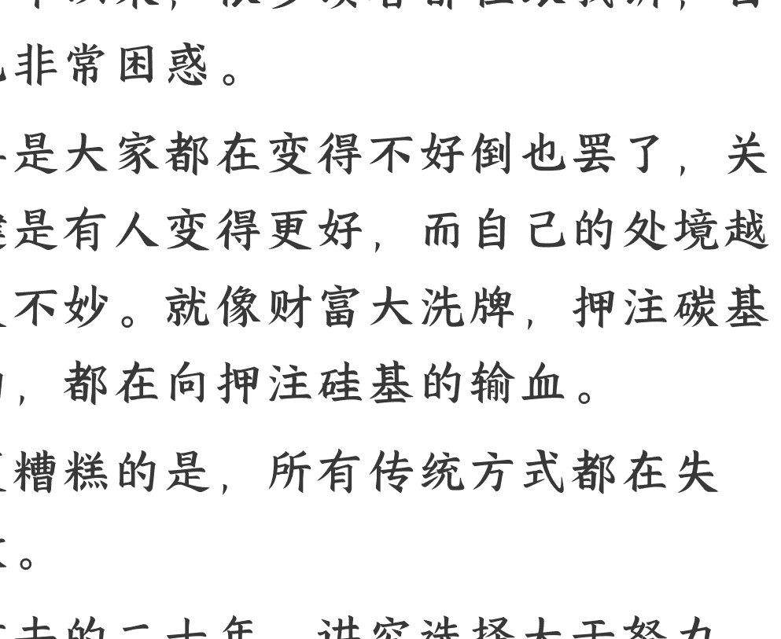

# 财富大洗牌，我该选择，还是努力？

260507 记忆承载付费
整理：公众号懒人搜索，[懒人专属群](https://t.cn/xxxx)精选
懒人微信：lazyhelper1
西风付费文合集和后续更新见群分享

今年以来，很多读者都在跟我讲，自己非常困惑。

要是大家都在变得不好倒也罢了，关键是有人变得更好，而自己的处境越发不妙。就像财富大洗牌，押注碳基的，都在向押注硅基的输血。

更糟糕的是，所有传统方式都在失效。

过去的二十年，讲究选择大于努力，可当下是：

努力吧，像没头的苍蝇，选择吧，又进退失据。

好，我们今天就来详细的探讨大家遇到的困惑。

选择的重点是怎么选择，努力的关键在于怎么努力。

全文两万字，共分五个话题，文中多处有链接，俗称画中画，文中文，阅读时留心莫错过。

本文下面的每一条留言，我都会看到。

以下进入正文：

## 第一个话题，选择不是重点，基于什么选择才是。

首先，提出选择大于努力这句话的人，逻辑还是颇严谨的。

**人家讲的是选择大于努力，人家可没说选择可以覆盖努力。**

我们打牌，45678，678是三张牌，大于45，但如果没有45，光是678，你出不出去。

所以 678 和 45 之间，叫大于，45678 和 45 之间，才叫覆盖。

这一点点细节，被太多人忽视了。

所以他们口口声声讲的不是选择，是赌博。

**我曾经详细地讲过什么是交易系统，什么是赌博。**

赌博和交易系统最大的区别是什么？

是下面这句话。

**赌博是我不变，你注意，我不变，我没有任何变化，我就是那个满脑子浆糊，认知特 LOW 的人，但是，我赌对了，就能发财，这种想法，叫赌博。**

交易系统是我变了。

我根本就不是那个赌徒了，那个赌徒已经从认知深处都死翘翘了，现在是一个全新的人。这个全新的我是开赌场的，钱源源不断流向我，它叫交易系统。

所以交易系统给一个赌徒有用么？没有的。

赌场给到你，你也运营不了，因为你没变。

我很早就打过这个比方，我说你给袁术一个诸葛亮，绝对无法改变他的命运。

因为他一定言不听计不从。

言听计从他就不是袁术了，言听计从就说明袁术已经死了，现在跟诸葛亮对话的是一个全新的人了。

于是你会看到，袁术注定死。

谁来也没用的，他要么被环境杀死，要么被自己主动杀死，横竖都是死。

赌狗就是这个道理，他要么被赌场从经济上杀死，要么，被自己从思想上杀死。

无论如何，曾经的那个他，都得死，死了才能赢。

等他死了，换个人来，或者，思想上被杀死了，他变成全新的人，在这一切发生之后。

你就会发现，钱每天追着你跑，你甩都甩不掉，一睁眼，钱又来了找你了，烦死了。

因为说到底，这一切美好，都只属于那个崭新的你，这就叫杀死旧自己，奔向新生活。

那我们把这个投资上的区别，挪到选择上，是一样的。

很多人一听到选择，第一反应从来都是，要考研还是要上岸？去哪个公司会发财？

**这不叫讨论选择，这叫讨论赌博。**

你看着他们好像在讨论选择，其实跟讨论哪个号码会中奖没有任何区别。

你去找群数学家过来，他会跟你讨论号码么？

不会。

他会跟你讨论背后的概率，这个就叫：**选择不是重点，基于什么才是重点**。

一群民科，跟那里聊了一整天的号码，没有任何营养，纯属浪费时间，你把背后的概率聊清楚，这个或许有所得。

所以选择也是一样的。

你张嘴就试图和我讨论，水硕牛还是学硕牛，我都懒得搭理你。

因为你实际上就是试图和我讨论哪个号码能中奖。

但换一个读者，他用下面的这段表达方式，我就会觉得，有点意思，数学家来了。

他会怎么讲？

他会说，学历分两种，一种奔着学术去的，一种不奔学术去。

**奔学术去，那就按照学术的要求。**

**不奔学术去，那就按照最省时要求。**

**好比如果你只是为了就业，3 年的学硕，1 年的水硕什么香？**

**后者才香。**

**站在工作的视角下，学校呆得越久你越水。**

**你要用什么，就去学什么，而不是像学校里那样，甭管用不用得上，先稀里糊涂学一坨。**

**学位只有一个用处，就是在你搞不定人的情况下，给你背书，砸 HR 用。**

**既然砸 HR 用的，1 年的也能用，3 年的也能用，在一个 35 岁就赶人走的职场环境里，你多耽误两年青春，去给导师当杂工，给他的学术道路水论文，是你二啊？还是你二啊？**

**你看，这个读者这么讲话就有点意思了。**

**说明他不是赌徒，他这个才叫真的在讨论选择问题。**

**再比如，你张嘴就试图和我讨论上岸好不好，这还是一个赌徒话题，没有任何营养。**

**如果我们换一个读者。**

他本人就是个下金蛋的鹅，所以他不想上岸。

理由是，他不想让自己的赚钱能力，被人家给耽误了。

这种表达就是在讨论选择背后的逻辑，别人一听就明白你在说什么。

你原本能稳定的日进斗金，每天都能挣一斤黄金，你去上岸，好嘛，每天耽误你挣一斤黄金，回头工资就 500 块钱。

你有苦说不出，你心里很难受，你觉得自己是在付费上班，是被沾了便宜，还是个大便宜。

我太能理解你了。

就像你有个核心城市核心地段高品质的房子，你买来价格还低，租金还高，别人都抢着要。

你乐不乐意出售？不乐意。

什么东西你乐意出售？

你在非核心城市非核心地段有一批没人要，租不掉的房子，如果有好人，肯接盘，你巴不得呢。

你给他烧高香呢，好人啊，好人啊。

**是不是这个理儿？下不出蛋的鹅，都想高价卖给邻居，坑他一把，下金蛋的鹅，都捂在怀里。**

人也是一样的，你没有独立挣钱能力，上岸挣 500 块，香不香？美不美？

太香了，太美了。

因为这 500 是你沾人家的便宜。

你要是独立出去日进斗金，就不香不美了。

这就叫没粉丝没业绩的，都想跟着俞老师干，能沾一点是一点。

小董同学就不乐意，他太能挣钱了呀，他跟俞老师在一起，哪儿哪儿都心里别扭。

你看，宁可和明白人吵一架，不想和糊涂人说句话。

因为糊涂人他就不理解，地球上不存在选择，只存在基于什么选择。

**基于什么的这个背景才是真正值得讨论的话题，当它聊清楚了，选择的答案早就一目了然。**

而选谁不选谁，根本不值得聊。

**那个千人千面的，基于什么选择的大背景，它梳理清楚了，适合一千个人的一千种答案自己就会浮出水面。**

所以我今天系统性的讲选择与努力，我会讲两个选择类话题，两个努力类话题。

我讲的并不是选什么，而是更底层的东西，基于什么。

基于什么弄清楚了，这个世界对你根本是透明的。

同样，我今天要讲的也不是努力，而是怎么努力。

有些人一辈子事半功倍，有些人一辈子劳而无获，不是后者不努力，是有效努力为零。

> > 人家是 LED，几乎所有能量都变成了光，不发热，只发光。
>
> 你那是点了一堆火，能量全都变成了热，散掉了，就没有转化出多少光。
>
> 最后一辈子辛辛苦苦，劳而无获，正常的很，转化率太低了。

所以我们接下来开始聊两个选择，两个努力。

## 第二个话题，一切选择的底层逻辑：赚 Alpha 的钱？还是 Beta 的钱？

如果我们看表面现象，你会发现有 360 个行业，有些赚钱有些不赚钱，有些今天赚钱的明天不赚钱，有些今天不赚钱的明天赚钱。

有些看起来稳定有些不稳定，有些现在稳定的过了十年安稳日子忽然又不稳定了。

你会发现你方唱罢我登场，乱糟糟各种变化扑面而来。

选不完，真的选不完。

所以，要跳出纷繁复杂的表象，去问问自己。

### 我究竟是要赚 Alpha 的钱？还是 Beta 的钱？

什么意思呢？

拿投资举个例子。

假设市场上大部分企业都赚不到钱，没有办法给到投资人整体的回报。

好比说流动性是趋紧的，在抽水而非放水。

又或者消费萎靡不振，企业整体上运营困难。

可是这个时候，你依然能够赚到钱，怎么赚到的呢？

#### 高卖低买，你等于在赚取其它投资人身上的钱，这就叫赚取 Alpha 的钱。

反过来，市场在放水，一切都很繁荣，甚至有些发热。

这时候你发现投啥赚啥，好像随便哪个大爷大妈都超过了巴菲特，你也一样，也是其中一分子。

那你就是赚 Beta 的钱。

##### 这个 Alpha，Beta 的比方可以针对整个市场，也可以针对某个行业。

你比如 90 年代末我填报志愿时，大人们为啥给我报信电系？

因为当时正值通信设备建设的狂潮，那一年，设备厂商招一个本科生开的月薪是 4000 块，而我们正教授的月薪才 3500。

不可能说每一个应届生的水平都超过了教授，但每个应届生的月薪都高于教授，这是为什么？

这是因为应届生是自由的，可以去参与这场市场狂潮，可以去赚取这个 Beta 的钱，而教授总不至于为了多加个几千块，就放弃自己辛辛苦苦评上的教职。

那么，这个时候就很有意思了。

我们作为低年级学生时，目睹过高年级学生不同的选择。

咱们把高年级学生划两部分，一部分是以赚钱为目的的，一部分是不以赚钱为目的的。

后者就撇开不谈了，我们专门谈前者。

前者里面有些人，目标非常清晰，想赚 Beta 的钱，就得快。

**甭管是整个市场的 Beta，还是某个行业的 Beta，只要是 Beta，它都有窗口期，它就不可能无限存在。**

无限存在就是说你们这个行业永远赚取超额溢价。

你想想看可不可能？

**这不就是我 2023 年讲黄金升贴水套利机制的时候，打过的那个比方。**

我说可不可能地上有块糖，蚂蚁永远搬不光？

行业之间是通的，无非有一个培养周期。

你们行业如果 Beta 的赚钱效应导致全民都知晓，那么接下来几年，学生们就会往这里涌入，直到供需平衡，甚至供应大于需求。

这也就是资本市场里经常开的那个玩笑，当大家都赚钱的时候，游戏就到尾声了。

**都赚 Beta 的钱，那只可能是在加杠杆，赚未来的钱，未来透支完了，就进入到修复资产负债表的化债周期了。**

所以，如果你要赚 Beta 的钱，那你本科一毕业就好去挣那个 4000 块了。

你要让自己尽量在通信设备的繁荣周期里待的时间久，因为一共也就 7,8 年。

也就是说，你 22 岁本科毕业进去，30 岁之前，这个通信设备的建设大周期已经收尾了。

好，我们来想一想。

如果这个时候，就是 90 年代末期，有个师兄，他发现人家通信设备厂商给应届本科生 4000 块，应届硕士生 6000 块。

他想着读个研，还等于加薪了，值得干，结果读研去了。

那么请问，我们不考虑他热爱学习，我们纯粹站在赚钱的角度下，他赚了还是赔了？

赔了。

因为等三年后你读完，通信设备厂商已经没有那么急于抢人了。

一方面是前两年抢多了，囤的人才都还没用上，另一方面是其他行业的人，纷纷在涌入。

所以很多年前，我当时回答读者们关于填报志愿。

那年月就有读者问我，网红机构当时都在推荐土木，土木的薪资高。

我说这就跟我们年轻时的局面一样，90 年代末的通信就是你们前几年的土木。

如果你正好毕业了，你就去赚这个 Beta 的钱，如果你只是看它当下薪水高，你准备去读书，你要本硕读七年。

那七年出来，供需早变了。

如今这年代，有这么长的 Beta 周期么？

上面这些，就叫做赚 Beta 的钱。

那么与之对应的，叫做我去赚 Alpha 的钱。

最经典的就是读医。

假设你这个人的原生家庭相当给力，能够供你念完博士，这期间不会让你陷入什么一把年龄还挣不了钱的生活困境中。

同时假设你这个人自己也非常给力，一路名校本硕博，那个考试能力是杠杠的，发论文能力也是杠杠的，更重要的是，动手能力也是杠杠的。

手术台上那么多神经血管，眉眼都不带眨的，手稳的一匹。

而且身体也非常给力，熬夜，通宵，加班，饮食不规律，面对高压，云淡风轻，就这么干到 40 多岁，非但没有衰退的迹象，反而越干越勇。

甚至到了 60 岁，依然是一员老将，可以动辄连轴转十几个小时，不下手术台，是患者心目中的定海神针。

这就叫赚 Alpha 的钱。

说穿了就叫你真牛，我们服了，大写的服字。

你像我本硕都是读信电的，我有些同学，是真扎实。

模电这种东西，人家是真能学明白的。

所以你不要以为所有人都适合去做芯片设计，不是的，很少有人适合。

包括很多博士，后来都转型了，去做管理，去做市场。

适合做芯片设计的人是很少的，更多的人不适合，做了验证，做了嵌入式软件，甚至于市场工作。

因为自始至终围绕一件事，沉下心来，扎下去，而且他的体能可以支撑他长期那么做，是一种很少见的能力，于是这少数的人，赚的就是 Alpha 的钱。

> 俗称不是别人不想取代你，而是像动手术那样，取代你的成本太高了，活成你那样，我不乐意。
>
> 或者像做芯片设计，验证周期太长了，我不想成天对着流片对着 FPGA 打交道，努力很久都看不到结果。
>
> 说到底，是这个人生，我不想要。

所以我们总结下，赚 Beta 的钱，本质是什么？

是择时。

择时不是预判，我预判谁谁谁是七年后的明星行业，于是我提前七年去学它。

……

你要有这个能力，你不需要学习的，你直接投资这个行业，七年后你就财务自由了，还学什么学？还打什么工？

很多人的脑子是进水的了。

他的反应是说，这个岗位给钱多，年薪百万，要求 12345。

好，我去学习 12345……

等 7 年后你发现，一堆满足 12345 的学生冒出来了，而这个愿意给钱多的岗位的要求也许已经变成了 678910。

……

哭吧哭吧不是罪，押错了方向心好疲惫。

这样魔幻的想法导致的悲剧，已经在千万个家庭和个人身上看到了。

你找个商人来，问他怎么赚钱，他是最小时间成本，最小投入成本，赶 Beta 窗口期的打法。

就是说满足市场需求需要什么，就直接去做什么，多的一概不做，要快，要快，要快。

但数以千万计的学生家庭的打法不是这样，他们是绕路型赚钱法。

他看到当下市场上因为供需不平衡，导致某个岗位的工资高。

然后就刻舟求剑，这个岗位有哪些学历要求，考证要求，他去一一满足，等他花了七年满足，回头发现，这个岗位消失了，或者要求全变了……

过去主要以散户农民养猪为市场主体的时候，有非常明显的猪周期，就是这个原因。

那个农民看到猪肉几十块一斤，他觉得有得赚，就在家里养个几头。

你要知道散户农民的想法是一致的，几乎是同一时间，家家户户都养，于是来年猪肉变成几块钱一斤。

他发现赔本了，连饲料钱都回不来，马上就不养了。

于是来年你看，猪肉价又变成几十块一斤……

由散户主导的市场都是这样，那数以千万计的家庭，规划人生的水平，和养猪是一个档次的。

###### 那么赚 Alpha 的钱，本质是什么？

是丁元英讲给王庙村村民的那句话。

忍别人所不能忍，能别人所不能为，这两道线之间，就是你的生存空间。

这个忍与能，是区分的，人只有在小时候，才会大家一起去高考，长大后就分流了。

####### 我忍不了你的踢球，也许你也忍不了我的织毛衣，我们可以避开冲突的。

我不愿意去做医生，不愿意去做芯片设计，但是我愿意比如捡乌龙指。

这也可以构成一种 Alpha。

######## 知道的人，不愿意，愿意的人，不知道。

于是作为知道且愿意的交集，就可以源源不断地从金融市场里捡到钱。

360 行，包括各种行业的交叉点，都有无尽的 Alpha。

**交叉的意思就是说，成为那个 only one，不要成为那个 best one。**

你要去做任何一个行业里的 best one，都是要付出巨大代价，然后等着命运安排的。

你比如金融市场里巴菲特的生态位就那么一个，索罗斯都夺不走。

你要和他卷 best one，你看看你能否工作到 95 岁再说。

但如果你不和他卷，你们在战场上拼命，我在战场上捡垃圾，捡尸体上的装备。

那你就是在做那个 only。

你们要搏命赚钱，是你们选择的策略，我不去赌涨跌，我不搏命，我就安安静静做个垃圾佬，也是一种生态位。

所以我说，交叉点里有很多很多的 Alpha，**不是只有 best one 才叫 Alpha，only 也可以**。

**说到底，大多数人想要的不是我有最多的钱，而是我钱够用，且我乐意**。

人追着钱跑是很累的，且不说追不追得到，哪怕追得到，这种用出卖人生做自己不想做的事情，过自己不想过的日子的方式赚来的钱，它也不香。

## 第三个话题，不要去追求难度，要追求的是密度。

我们来想一个很简单的问题，比如在高考的时候，大多数人的选择，是把分用尽，还是不把分用尽？

什么意思呢？

我们想象一个场景。

你本来已经想好了，我要留在某个城市，我要去某个专业，去某个学校。但是你多考了 10 分。

你会改变选择么？大多数人都会的。

他会去另一座城市里排名更高的院校，或者去一个也许并不是自己原本想要的专业。

为什么？

仅仅是想要把分花光。

他希望以最后一名的分数被录进去这叫占便宜了，反之，以第一名的身份被录进去就叫吃亏了。

原因很简单，基于一个朴素的观念，那就是我和分越高的人在一起，我越成功……

这句话是真相么？当然不是。

这句话很普遍吗？太普遍了，几乎涵盖一切事情。

国人什么都喜欢抢，不是只有超市里送鸡蛋会抢，一切都抢。

把分用尽了，好开心呀，觉得自己占便宜了。

同理，如果我能够嫁一个条件看起来更好一些的，但未必适合自己的，就嫁呀。

嫁了之后发现，生活并不开心，甚至对方在走下坡路。

这种普遍存在的观念就叫做，不选最适合，只选我能够得到的最高的。

我要和高难度的人在一起，待在高难度的环境里，嫁给高难度的人，去高难度的企业，我的一生才是成功的。

真的是这样么？

不，这是绝大多数人这辈子栽过的，最大的，选择上的坑。

于是才出现了那个普遍的现象，叫做扎堆红海，萝卜雕花。

所有的人都觉得我要进分更高的学校或专业，所有人都觉得我要挤招人标准最严苛的企业，所有人都觉得我要参与那场男女比例 1:200 的相亲会。

我终于进了分最高的学校，我终于挤进了最严苛的企业，我终于打败了 199 个闺蜜，嫁给了那个最挑剔的男人。

请问，我赢了么？

多年后，你也许会发现，沿途每一轮竞争中，都有相当一部分曾经你的手下败将，混得比你好，过得比你幸福。

why?

原因很简单，大家没有最基本的数学模型的概念。

我们想想看，你去旅游，到底是为了看风景呢？还是为了人挤人挤出一道风景线呢？

那换个比方，如果我们去钓鱼，目的到底是鱼呢？还是说我挤倒了旁边那个人？

如果我的目的是鱼，那我的重点就不在于另外 199 个同学，另外 199 个闺蜜，我应该去研究什么？

去研究这个鱼塘里面，到底鱼多呢？还是鱼少呢？

这难道不才是首要问题么？

那个没有鱼的鱼塘，是钓不到鱼的，现实社会不是小时候老师讲的，只要你埋头挖，就一定能打口井，就一定能挖出水。

现实的第一件事，永远是调研目标本身值不值得抢，而不是超市只要排队，就无脑抢。

那么现在问题来了，我怎么知道鱼塘里鱼多还是少呢？

方法很简单：看别人，看那些已经在做事的人，他们的奖励。

这事儿不难的，走出书斋，多接触社会，多聊聊天，多看看师兄师姐们的遭遇。你会发现，有些行业特别卷。什么意思呢？一定要在萝卜上雕出一朵花才能卖得掉。那你就心里有数了，这事儿有没有奖励？有奖励。但是要做得非常非常完美你才能够吃到那根吊在牛鼻子前面的萝卜。

与此同时也有一些事情你会看到好像不怎么样的人拿出一个简陋的版本人家也被市场奖励了。这时候绝大多数人的第一反应是嘲笑。我非常能够理解这种情绪这是人的本能反应。我们都非常崇拜那些经过了艰苦卓绝、经过了长期努力而后获得回报的人。因为你觉得他们德配位。我们都看不起那些德不配位的。

但是，请把思想扭过来，现在我问的不是一个你的价值观问题，我问的是一个算法问题。请你告诉我哪个鱼塘里面的鱼多？显然是你看不起的这个。我讲这番话是非常严密的不是张口就来的我可以给你们举两个现实案例。2008 年的时候我在市场里捡乌龙指可以赚到钱我就演示给我太太看。你看一个品种论斤论两论克三个窗口在卖同一个东西。论两论克的价格都没变化，论斤那个窗口有人敲错了价格一路下穿让我预先挂在那里的九折的单子成交了。我同一时间就去论克的窗口同等额度卖空。这 10% 的利润是不是被我锁住了？而且三个窗口的保证金是互通的我都没法爆仓你论斤的那个跌成翔我都爆不了因为我已经在论克那里实际上相当于出货出掉了。

> 我等于根本没有持仓时间，我就不用承担风险还可以白蹭杠杆还不交隔夜的利息。
> 
> 秦始皇摸电门赢麻了。

我太太看了什么反应？不屑一顾你这叫投资太幼稚了吧这不就是小猫钓鱼么你好歹应该读一些金融领域里的知识让自己渊博起来然后才考虑赚钱而不是用这种低级到有些可笑的方式……

我什么反应？我笑了。很显然她不理解。**一件事要做到极其优秀萝卜都雕成花才能挣钱那就是红海**。我是吃饱了撑的闲得淡疼非得和人卷？反之这件事这么简陋我 08 年的时候对金融一无所知一个外行也能够被奖励而且这个明显是长期稳定盈利的因为根本就没承担风险没押宝涨跌呀。那说明它就是蓝海呀。**它简陋没关系，简陋我就去做好它而不是嘲笑它**。所以我花了很多年慢慢从手动捡程序捡到高频交易到职业化。这就是我看问题的视角越是平庸的人被奖励了越值得做而不是去嘲笑。

2018 年的时候我写这个公众号我老婆也是不屑一顾她还搬出了我爸。她跟我说你老爹评价你在唱莲花落。什么人做网红？都是那种这个哥那个哥的表演吃钉子踩灯泡跳冰窟窿。说难听点这不就是天桥底下耍把式卖艺胸口碎大石的么？你这样硕士毕业的又是做过专家又是做过企业高管又是做了投资人的怎么能去掺和这些人的事儿呢？

我那时候怎么讲的？我说你们不能这么看问题。你觉得这个市场提供的内容质量不佳你应该去提供高质量高水平的内容而不是一味的嘲笑。而我在做的就是这个事情我真的在以一己之力试图抬高这个行业的档次。我不会因为一群初中生被市场奖励了我就看不起市场我只会反过来想问题初中生都能被奖励说明它需要我。**正因为人家没做好我才要做好它难道不是么？**居民都反映这条街上没有一家馆子好吃我就应该做一家好吃的难道不对么？你看到了么？

这是我和别人想法不一样的地方。08 年的时候我还算个年轻人18 年的时候我已经是个妥妥的中年人了但有一件事情上我是没有变化的。我第一件事从来不是排队抢而是分析鱼塘密度。**那个做得差的那个烂得一匹的都被奖励了我才肯介入而不是反过来**。08 年的时候如果我不是金融行业的纯白我不是只会按开仓平仓的按钮就这么随便设计个挂单的模式都能赚到钱。如果是反过来的如果你跟我说要读个金融硕士要读几本大部头要学这学那对不起我就不做这事儿了。18 年的时候如果自媒体行业里面已经有各路专家学者甚至各个企业的 CEO 们都像今天这样涌进来开启自己的 IP 时代我就没兴趣参与了。**我对那些要特别优秀才会被奖励的事情没兴趣，我对要排队的事情没兴趣**。
**我对那些做得不好还被奖励了的事情有兴趣**。

包括三年前我反复很多次跟读者们讲用 AI 去生产爽剧爽文出海海外一群人买。有些读者问我要怎么才能专业精美我说等专业精美黄花菜都凉了不需要管你做得有多烂直接就可以去卖。说难听点不爽的爽剧照样卖粗制滥造就可以卖为啥？因为我当年在海外买过那种早期的 AI 爽剧烂成那样了居然都能卖得掉居然连我这种人都买过。所以我跟你们讲赶紧着都去卖。

当年还有读者质疑问我怎么鼓励大家去做这么烂的行业？我怼他说我倒是想鼓励你去做光刻机你做得出来么………你看今年我就不提 AI 爽剧了因为我看到了人家做得好精美呀要剧情有剧情要画质有画质了这就是我说的消费者思维和商家思维是不一样的。

来来来我来给你们改造下这才是商人的本能。
> > **我要不要钓鱼和鱼塘的密度有关和我看不看得起周围的钓鱼者无关**。
> 
> 我看得起一群博士问题是如果这群博士在一个没有鱼的池塘里用功干嘛我也要一起么？就因为我看得起？你们不觉得大多数人的方式很奇怪么？
> 
> > **你欣赏他优秀你就要跟他一起？**
> 
> 那状元最优秀他报的学校专业就招一个你跟他一起报你不擎等着落榜么所以我善于赚钱我太太不善于因为她不理解：**商业规则不是围绕你的个人想法是围绕你要钓的那个鱼塘本身**。别人没做好你把它做好了才能赚到钱。这叫商家思维。
> 
> > **反之，你个人认可什么你觉得什么牛就做什么这叫消费者思维**。
> 
> 你把金融念到博士结果你的教授都没法靠投资赚钱你这是在干嘛？你这是在增加无效成本呀。不考虑鱼塘的密度上来卷同事你不怕你卷的是屠龙术？

商人从来不喜欢上来卷他们第一件事永远是投石问路。我 08 年的时候就是丢了一个非常简陋的版本出去我需要做好准备么不需要。我就是要用不做准备来验证你这个鱼塘到底值不值得我投入。我随便包了几个包子拿到这条街上都被抢购一空才说明这条街上可以做包子生意。如果都拼到萝卜雕花了那就说明没有发展空间呀是不是这个理儿？你把这个道理挪到工作上假如你看到一个领导明明没有目的为了让团队忙起来而刻意发布任务。假如你看到一群同事都是名校生成天卷看谁的 PPT 里面某一根线更粗或者更细你就该清楚这个池塘里没有鱼的。我当年太清楚了我 08 年在芯片公司一群 C9 的硕博士成天在那里加班修改一个根本没有市场关心的 BUG。我 11 年在甲方成天看着一群人在开会研究讨论根本就没有市场需求的产品这时候我就非常清楚大家在干嘛？在表演。

优秀的人扎堆不一定都会干出优秀的事儿很多时候就是在无效表演。俗称我就想证明我比你牛又没真实的需求场景咋证明只能瓶子排队萝卜雕花你只能在那些无意义的细节上争个高低这就充分证明了这个池塘里没鱼即便有人能钓上来也属于极少数的卷王。俗称他愿意为了几千块的奖金全年干满 365 天一天都不休息那你吃饱了撑的还和他卷？你和他卷就说明你不是真的想赢你只是打小在校园竞争中习惯了习惯了和人家抢抢年底发的那两条带鱼谁的尾巴长。我 08 年在芯片企业做内核的时候想明白的就这点事儿。我的目的到底是什么是挣更多的钱还是说非要用显得自己牛的方式挣很少的钱？我认为大多数人的问题都是没钱而不是赢没赢同事。

赢了他们能干啥证明我能从一个没有鱼的鱼塘里钓出一只蛤蟆呵呵所以你说七成的同事硕博士九成的研发 C9 这没有意义的俗称这种牛和我的生活目标没关系即便你的生活目标不一样你就是想要证明你牛那你照样应该听我的你还是应该像我说的那样去试水去投石问路去验证哪个鱼塘密度高然后快速的钓鱼去干真的能打粮食的事情。等回头你有钱了你可以把同事们都雇来让他们当面雕花你想咋雕就咋雕萝卜排队萝卜开会都行反正你掏钱养大家大家挣你的工资谁还会不配合你？你每个月都可以把自己评成优秀老板月度之星大家集体为你鼓掌老板你真牛你玩得开心就好。

# 第四个话题，管杀不管埋。
通过前面两个话题我把选择的底层逻辑讲得很清楚了但我开头在第一个话题里就说大于不是覆盖脱离努力的选择就像只有战略没有执行的公司是落不了地的。

**刘备的成功不仅仅是隆中对的提出更是关张赵对隆中对的落实**。所以怎么努力怎么劳而有获是非常值得探讨的话题我们从哪儿切入？从一个思考开始。曾经有过读者问我一个人成绩很好口才很好家世也很好是不是一定会成功答案是不知道。你想知道这类问题最好去看看小说比如绝代双骄又比如三体。花无缺什么都好完美无缺武功好谈吐好背靠移花宫一定能赢小鱼儿么不知道。三体什么都比人类强一定能赢人类么不知道。我们很多时候误以为能预判结局**是因为你眼里只有你看到的选项**。咱们来想象一个场景数字圈的那位忽悠巴菲特的 90 后孙大圣让他和花无缺面对面坐在一个面摊上只有一碗面请问他怎么抢到这碗面？又不会武功打一架明摆着输掉你写串密码非说那是你祖传的数字币花无缺也不会搭理对方是古人不认识你那玩意儿买又买不到打又打不过这碗面一定会被花无缺吃到嘴里么大概率不是。

**因为孙大圣会朝面碗里吐一口痰然后面带笑意的把面吃掉任凭花无缺武功高也只得让给他**。这就是真实世界的样子。你以为孙大圣会在已有的选项里面比武功比掏钱？**不他会新增一个选项就像罗辑对三体做的那样**。你以为锁死科技罗辑就认栽了？不他拿太阳当发射器的行为也无非就是朝面碗里吐了一口痰三体悻悻而去。三体为什么不怕程心做执剑人因为笃定你是个体面人你不会吃。为什么畏惧罗辑因为他真会吃嘛。**所以生活不是考试你不要把自己拘束在卷子上已有的选项内**。
**生活是开放式的卷子你完全可以像孙大圣像罗辑新增答案的**。

一切涉及人与人之间的游戏都有两种模式长择与短择。搁在工作上这就叫做挖坑的和填坑的。这个世界上有些工作是你挖的坑要你来填比如建筑我那天在花园里偶然抬头看见一块牌子牌子我多年前就见过但上面的字我没注意到那天留心一看发现牌子上清清楚楚写着哪个单位设计的哪个单位施工的哪个单位审核的具体落实到人。我心想这行业不好糊弄你挖的坑得你填不能说你盖了栋房子修了个桥甩手走了你走不了你的名字刻在上面终身的但不是所有的行业都这样有很多科技行业不牵涉医疗不牵涉建筑不牵涉食品的挖坑的和填坑的是两拨人。

挖坑什么意思呢就是随你许诺领导要什么你就给什么资方要什么你就应什么他说要登月你就给他登月他哪怕要登海王星呢只管给他登一个初入职场的年轻人你想升迁快就不能埋头干。**埋头你是没法升迁的**因为你做的所有事情都是在别人定死的框架下面你的一切加班都成了给人家的升迁添砖加瓦。你自己想想看嘛胡适做了什么写了本中国哲学史大纲内容呢他就没写内容呀中国哲学史大纲这就叫挖了个坑然后等着你去填。**你辛辛苦苦在那里填坑填来填去也不过是人家胡适下面的一个章节**。
**你越努力他的成就越大**。这还是他挖了一个能填的坑的前提下。要是他挖了个登陆海王星的坑干啥你去登啊？所以应对胡适最好的方法从来不是填他的坑而是什么？**而是我也挖一个**。你不是挖了个中国哲学史大纲么我挖个世界哲学史大纲……年轻人不要急着做事要急着起头**你起个头我就起更高的头压你一头**。
**做事从来都不是目的被领导看见被资方看见才是目的**。
**做事只不过是手段而且只是手段之一**。
**被看见才是目的被看见之后不一定要做事的也可以甩锅**。你觉得很毁三观是吧？问题是你不做有的是人这么做。

**当你不肯这么做而别人这么做的时候你就会遇到一个尴尬的事实**。那就是所有人都在那里挖坑都在那里起头早就从中国哲学史纲变成银河系哲学史纲宇宙哲学史纲了。**你不跟着一起起头那最后这些锅可都要你背了你背得动么？**背不动也背不完的。所以你有且仅有一个选项就是跟着去起头当你发现自己的选择唯一时你会有一个困惑出来混难道不要还么我挖的坑要是作茧自缚如之奈何？答案很简单你的思维方式错了。**你之所以有此担忧是因为你把工作看成了长择关系实际上你们是短择关系**。

当你非常年轻的时候比如你 35 岁之前想想看这时你可能独自起头么不可能的这个年龄段对你而言只有一个选择叫做站队伍站哪个高管的队伍有的高管很朴实的他就默默填坑有的高管就像胡适的风格喜欢挖坑。如果是我我就选择跟随后者跟随后者勇于挖坑回头收不了场怎么办很简单把领导卖掉现实和电视剧是一样的就跟多隆对韦小宝的台词是一模一样的。

韦大人你猜对了又是我出卖的你年轻时这么做是没问题的因为你把自己描述成被迫的那个专家而不是主动挖坑的胡适年轻有很多好处的比如你的职位低职位低通过挖坑获取的利益就小天塌了有个子大的顶着你本来也是拉着某个高管的大旗扯的虎皮出事了合该他顶。你顶资方也不信呀你本就不是最大获利方呀俗称这个年龄段你是最适合用专家当作挡箭牌的我是专家呀我是技术人员我很天真的我都不懂的领导让我干嘛我就干嘛是某个高管说要上海王星的我当时也反对来着但是反对无效他威胁我………

我最后是含泪写下的计划为此我痛苦了好久回头继续做你的专家呀这种招数在你年轻时屡试不爽的如果你再是个名校生再有个高学历就更好当挡箭牌了俗称你不是书呆子也许你比多隆还多隆但你要装成书呆子总是装出有技术情结的样子逢人就讲我从小好好读书大学里刻苦用功发了很多论文我很爱惜自己羽毛的我高技术情结的……领导又不知道你内心比那些 15 岁就出道混社会的人还野你自己想想看你是扮作御弟哥哥那样清纯中又带点呆萌更容易被女儿国国主生扑呢还是像欢乐颂里面杨烁那种油腻的表现更容易获得异性的青睐这就叫最高明的猎人都是以猎物的形式出现主打的就是一个反差萌内心油腻的一匹外表如同高冷的圣僧你要让那些想要挖坑的高管觉得你好利用你好拿捏你更要让周围人都觉得你就是这样一个天真的被利用的年轻人那么在挖坑的过程中你和高管都会得到利益尤其是你会得到快速升迁。

这个道理很简单一个人的价值不是他做了什么决定的是他还做什么决定的。**挖坑就是一种许诺向资方许诺我还能做什么**。这种时候资方心心念念上海王星呢预期早就被调得比天都高给你升职加薪算什么**资本市场上越有故事越有想象力的企业估值越高那搁在你身上不也一回事？**接下来的结局无非两种小概率登陆海王星真成了那你也就成了大概率成不了那高管就得灰溜溜走人而你则可以演无辜的被胁迫的专家改换门庭另投新主。
**因为你还年轻还有利用价值装清纯也有人信**。这个游戏可以一直玩吗对不起不可以因为你总会老更因为你的职位会升高当你玩了几局之后你的职位就升高了现在你是那个高管你是那个挖坑过程中最大的受益方而且在别人眼里你也早就无法再伪装学生气了你是个江湖老油条大家都知道。

那么这时候你挖的坑要是捅了篓子你就会被反噬了你的职业生涯就可能因此结束了好我们来总结下这是个出来混迟早要还的游戏么NONONO。**你忽视了最根本的一件事那就是我上来就提醒你的职场到底是短择关系还是长择？**当然是短择。**就算你不挖坑就算你不被反噬难道你能干到老么**待在基层的位置上老了谁要你啊像电影里的徐峥那样老了被毕业出门送外卖他演的不就是一个老老实实填坑人的结局么。
**如果挖坑也是走人填坑也是走人那你根本不需要考虑走不走人这件事没区别了呀**。

第二类默默填坑中途被毕业这类太多了和前者比 99:1，99%都是这样因为很多坑根本填不了说难听点只有很少一部分坑挖的时候是考虑过填埋可能性的更多坑压根儿就填不了如果你待在这类坑里你怎么填也实现不了。第三类一路挖坑最后无着落这种人最大的问题就在于他把升迁当成了目的但职场中无论名片印什么都是假的你都是劳方你不是资方。第四类一路挖坑最后修成金身正果这才是最最正确的努力方式俗称：职场只是游戏的手段根本不是目的别人家的事儿天大那也是别人家的自家的事儿再小那也是你自己的绝大多数公司都是试图做高估值的创始人团队琢磨的是自己能套现多少并不是接盘侠会怎样他们爱咋样咋样因为创始人团队是和自己过日子不是和那群接盘侠过日子。

那么同理把你自已当成一家公司谁最后和你过日子？是你自已不是公司所以说这是一个短择的游戏。**公司跑得比你快你就被毕业了；你跑得比公司快你就跳槽了**。你还想和公司白头偕老啊太幼稚了创始人想的都是做高估值找人接盘他们好去开下一个局你留守那个坑干啥你想当万年坑主啊大多数人都是被自已坑的**因为他们习惯了学生时代只要听到有人提问就下意识的去努力回答**。

他们总是为自己努力回答的样子而感动但实际上在短择关系中你根本不用回答他挖坑你就挖更大的坑死道友不死贫僧。
**第五个话题，短反馈、中反馈还是长反馈？**我估计看到这里的读者三观碎了一地但我说句大实话如果你觉得光靠底线低就能赢那你太幼稚了。**坑是你想挖就能挖的？不努力不付出没点本事别说填坑你不够挖坑你也不够呀**。## 什么勤奋，什么自律，我为什么从来都不强调？

是我默认你本来就有。

## 所以我要强调的东西，从来都是怎么更高效的榨取自己。

你看那群运动员，成天都在研究科学训练，科学在里面起到的作用，就是更高效的榨取自己。

怎么研究人体，怎么研究人脑，才能向内求，把自己每一分每一秒的时间，潜力都榨出来，都逼出来。

这个叫努力。

我们都有一个非常直观的感受，那就是打游戏比读书考试效率高，读书考试比读博效率高。

想没想过为什么？

怎么做前者你就这么亢奋，做后者你的身体就不听使唤，动辄闹着要休息呢？**答案很简单，反馈长度不一样。**

你打游戏，一刀下去99还是999，马上就给你反馈。

你认真学习了半学期，才考了一次，也许还考砸了，因为考的正好你没学到。

你摸鱼半学期，也许考的特别好，因为考的正好是你会的那一点。

人本质上就是猴，不相信你去非洲办厂，你去训练下当地人，你就是得把他当猴训。

每一步你都得预判他的预判，然后设计好，他这么做会被立刻奖励，那么做会被立刻惩罚。

### 重点是立刻。

你去找几个游戏公司的设计师聊聊天，他们会很直白的告诉你：

**设计游戏的过程中，对玩家心理的模拟，就跟马戏团耍猴是一样一样的。**

所以我们玩游戏会很舒服，因为我们是猴子，**被耍的时候我们才会进入舒适区。**

教育的目的不是训练你，是为了选拔。

你寓教于乐，把教育整成游戏，没用的，清华在你们省招100个，符合标准的人增加了，那就只能调高分数线，不会增加名额的。

尤其到了博士阶段，更是如此。

#### 你说读博士为什么难？
**因为没有中间反馈机制了。**

你去做课题，3年后，发现方向偏了，根本无法毕业，欲哭无泪。

第一年能发现么？发现不了。第二年能发现么？发现不了。

这就是为啥读博能逼疯很多人。

打游戏每 10 秒给你一次反馈，读博几年才给一次。

打游戏每分钟你都可以自我调整，这一关打不过去马上就能锁定问题，就能换个姿势。

读博对不起，错一次方向，三年没了。

##### 为什么读博不设计成高中？每半学期给你一次校验？

因为那么做没意义的，当你成为博士生的那一刻，已经没人当你猴子耍了。

你以为你读博是在读书？不，你是在打工，给导师打工。

###### 除了没钱，你的体验和上班一样。

你上班，努力了三年，结果这个产品没有市场，整个研发计划打水漂，于是你的功劳也没有回报。

找谁哭诉？没地哭诉的。因为这才是常态。

你一定要想透彻我上面讲的这些，因为这关系到你面对这个世界上不同事情下的选择。

好比有些人，善于中学时代的考试，不等于他适合读博的，就像有些孩子善于打游戏不等于他善于读书。

短反馈，中反馈，长反馈，是不同的机制。

你想弄清楚自己是哪一类，做个测试就行了。

努力，被羞辱，被羞辱，被羞辱，一直被羞辱，看看自己什么时候崩溃。

是三天呢？还是三个月？还是一年？

如果你发现自己的士气下降极快，那就说明你是短反馈，下降的很慢，说明你是中反馈，纹丝不动，几乎没有下降的迹象，你是长反馈。

多数人都是短反馈，少数人是中反馈，很少人是长反馈。

所以你会看到沉迷于网游的玩家，远比985院校里的学生多；善于中学阶段考试的人，远比适合读博的人多。

这个测试我很小的时候，80年代就做过，我奶奶是高校子弟，她的那些做教授的亲戚们，测过我。

试试看，这孩子适不适合搞学术。

适不适合跟你聪不聪明无关，跟你的反馈机制有关。很多高考状元也是中反馈，不适合读博的。

这套打小就弄清楚了的事情，被我用在了另一件事上。

我 08 年的时候，刚开始进入市场交易，做的不是巴菲特那样的长线，而是捡乌龙指。

很重要的一个原因，就是反馈机制的长短。

####### 长线是一个很长的反馈周期。

一年没涨，第二年跌了，第三年继续跌，第四年涨回来没卖，第五年又跌回去，第十年终于赚大了。

你的性格能否在这么漫长的过程中，拿得住，按耐住不操作？

我的性格不是这样的，我做不到。

第一年我的感受是一年光阴的沉没成本，第二年我的感受是两年的沉没成本加亏损，一直往后，到第五年，我都是被折磨的状态。

我扛不住，我的性格不适合上来就给这么长的反馈机制。

我捡乌龙指，只有两个结果，要么当天没有捡到，我的账户数字不动，当天捡到了，我的账户数字增加。

这比打游戏的体验还好，打游戏你还会掉血呢，我现在不掉血。

######## 我要么沾光要么沾不到，那我就很容易上瘾，很容易坚持。一个中反馈的人去打短反馈的局，这不是随便玩嘛。

等多年后，当我变成大资金，这种模式容纳不下这么多钱了，我已经对市场脱敏了。

俗称我的心态成熟了，眼界成熟了，经验成熟了，格局也成熟了，那我再去 做长线，也就适合了。

**所以人要尊重自己，认识自己，根据自己的实际情况来安排一条适合自己反馈机制的道路。**

这就叫科学。

反之，你生来扛不过那么长的反馈周期，又非要一步到位。

那你尴尬了，进入一个行业，夕阳了，进入一家公司，黄摊了，最后再梭哈一把长线，亏光了。

回头一看，自己已经老了。

**不是你没有努力过，是你没有科学的努力过。**

护城河，只剩下“信息过滤”的效率与“认知系统”的维度。

如果你认同这种“重塑认知防线”的极客主义，欢迎围观我的个人情报智库：【懒人专属群】。
https://lazyso.com/insider/