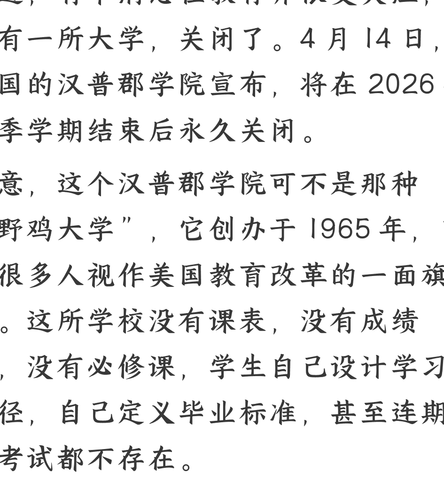

## 大学倒闭潮加速，为什么这些专业还在扩招？

260508
整理：公众号懒人搜索，[懒人专属群](https://www.laorensearch.com)精选
懒人微信：lazyhelper1

最近，有个消息在教育界很受关注，又有一所大学关闭了。4 月 14 日，美国的汉普郡学院宣布，将在 2026 年秋季学期结束后永久关闭。

注意，这个汉普郡学院可不是那种“野鸡大学”，它创办于 1965 年，曾被很多人视作美国教育改革的一面旗帜。这所学校没有课表，没有成绩单，没有必修课，学生自己设计学习路径，自己定义毕业标准，甚至连期末考试都不存在。

这所学校的办学信条是，相信人的内驱力，相信自由比规则更能激发智识。

你看，这可是人家在几十年前就提出的办学理念，即使放到今天也不落伍吧？

但就在最近的一个学年，这所学校招生目标 300 人，可实际呢？只招到了 168 人。而且学校还背上了 2100 万美元的债务。更麻烦的是，负责评估学校资质的认证机构，已经对它发出了撤销认证的警告。没有认证，就意味着学生无法申请联邦助学金。没有助学金，就意味着招不到学生。没有学生交学费，就更还不清债务。

说白了，这是一个无法破解的死局。

而且汉普郡学院不是个例。美国的大学倒闭潮从两年前就已经开始了。2024 年前 9 个月，美国有 28 所大学关闭。2025 年，又有至少 16 所关闭。联邦储备银行预测，未来五年，在最糟糕的情况下，美国每年可能会有 80 所高校消失。

这是高等教育史上从来没有出现过的速度。

很多人看到这个消息的第一反应是 AI“杀死”了大学。AI 来了，很多专业，比如翻译，都可以用 AI 完成，根本不用大学教。

事实上，这里面确实有**AI 的因素**，但并**不完全**是**AI 的“锅”**。

我们可以看看倒闭学校的共同画像。倒闭的学校，多数是私立的小型学校，招生规模在 500 到 2000 人之间，地理位置集中在美国东北部和中西部的小城镇。而这些学校面临的挑战，不只是 AI 的冲击。

首先，是出生率下降。

美国的出生率从 2007 年开始持续走低。到了 2026 年，进入大学年龄的学生数量，比 2008 年少了大约 15%。

你想想，哈佛、斯坦福这些顶尖学校，生源永远不愁。但那些排名在中下游的小型私立学校，本来就靠口碑和地缘关系招生，现在学生总量萎缩了 15%，它们的招生压力是成倍增加的。汉普郡学院最后一年的招生缺口接近一半。这背后是出生人口下降造成的长期困境。

### 其次，是债务模式崩塌。

美国大学的学费在过去三十年间上涨了将近三倍，远超通货膨胀的速度。学生们背负着越来越多的助学贷款，平均债务超过了 3 万美元。很多人都开始琢磨，我花了这么多钱，但这张文凭值这个价吗？

注意，不是所有大学都面临这个问题。顶尖大学的文凭依然值钱，因为它们提供的不只是知识，还有品牌、网络、资源。但普通私立学校能提供什么呢？假如只是"AI 也能学会”的知识，那在学生看来，上学的性价比确实存疑。

### 最后，这类小型私立学校的商业模式，天生就比较脆弱。

这类学校没有州政府的稳定资金支持，也没有大规模的科研经费可以用来补贴教学，更没有足够大的校友捐款基础。它们的运营，几乎全部依赖**学费收入**。一旦生源萎缩，财务就会出问题。财务问题又会影响师资质量和校园设施，进而导致排名下降。而排名下降又会导致更少的学生愿意来。

这个循环一旦启动，就很难逆转。

而 AI 的出现，相当于给这个趋势又添了一把火。它让这些学校的入学性价比进一步下降。毕竟，以前你学成毕业，顶多是跟你的同学竞争，而现在呢，还得跟 AI 竞争，而且未必能赢。

说到这，有人可能会说，照你这么说话，随着 AI 的进化，大学里的知识岂不是越来越没用？

别着急，前面说的大学倒闭只是事实的一部分，并不是全部。**在这些学校倒闭的同时，也有很多学校在新增专业**。

比如，AI 专业。西北大学、南加州大学、得克萨斯大学，这些名校在同一时期开设了 AI 本科专业，申请人数很多，供不应求。

当然，这个趋势并不新鲜。毕竟，AI 这么火，开设 AI 专业也顺理成章。但我想请你注意的，是很多大学，也开设了"**AI 之外**"的新专业。

注意，**这些"AI 之外”的新专业，也许比 AI 专业更能说明问题**。因为它们也许更能帮我们搞清楚一个问题。这就是，哪些能力、哪些知识、哪些专业，在未来的 AI 时代依然是重要的？

这些信息虽然说的是美国的情况，但对我们或许也有一定的参考价值。这两年，美国大学新增的专业主要有这么几个方向。

### 第一，心理健康咨询。

比如，本宁顿学院开设了临床心理健康咨询硕士，克拉克大学开设了心理健康咨询学位，威廉玛丽学院同时推出了人类健康与生理学学士和公共卫生学士。为什么这么多学校同时押注这个方向？

**因为全美心理咨询师的缺口巨大。一边是咨询师极度短缺，一边是越来越多的人在心理层面撑不住。**你想想，在经济压力以及 AI 的冲击下，美国青少年的焦虑和抑郁比例大幅上升。学校需要心理咨询师，社区需要，企业也需要。但合格的咨询师培养周期长，至少需要硕士学位加上大量临床实习。供给远远跟不上需求。

这些毕业生的去向非常明确，社区心理健康中心、学校心理咨询室、企业的员工援助计划。市场需求是真实的，而且缺口巨大。

### 第二，计算社会科学。最近，匹兹堡大学、圣地亚哥大学等都开设了这个专业。

**所谓计算社会科学，就是用数据科学的方法研究人类的社会行为**。比如，社交媒体如何改变人的自我认知，群体情绪如何在网络中传播，社会极化是如何形成的。

换句话说，计算社会科学和传统社会学的区别在于，传统社会学靠问卷和访谈，获取样本的成本相对高。而计算社会科学用的是社交媒体数据、手机定位数据、在线行为数据，样本量是百万级甚至千万级。它也许能看到传统方法看不到的东西。

这些毕业生的去向，包括政府的政策研究部门、科技公司的用户研究团队、非营利组织的社会影响评估部门。他们做的事，是用数据理解人。

除了前面说的心理健康咨询与计算社会科学，美国高校新开的专业还有很多。

比如，生态疗愈，核心是用自然环境治疗心理健康问题。再比如，蓝色经济，也就是围绕海洋展开的经济活动，海洋旅游、可持续渔业、海洋能源。

再比如，数字媒体影响力，主要研究的是互联网的影响力机制，说得通俗一点，比如怎么成为网红，网红怎么赚钱，都在研究范围内。得克萨斯大学圣安东尼奥分校，在 2024 年开设了全美第一个这个方向的本科学位。

而且把这些专业放在一起看，会发现一个微妙的重合。他们的研究对象，大都直接指向人。心理健康研究的是人，计算社会科学观察的是人，数字媒体影响力的核心还是人。而这些学科，也都高度依赖人的判断力、感受力、连接能力等等。

去年，教育专家沈祖芸老师做过一轮全球性的调研。根据沈祖芸老师的观察，现在高等教育的目标，明显更侧重培养那些“人之为人”的能力。

比如，在没有指令的情况下，定义方向的能力。

什么叫定义方向？举个例子，一家公司要不要进入一个新市场，AI 可以给你提供这个市场的所有数据。人口结构、消费能力、竞争对手、政策环境。但最终要不要进，这个判断必须由人来做，也需要人来承担代价。

你看，计算社会科学训练的就是这个。学生要学会在海量数据里识别模式，但更重要的是，要学会判断这个模式背后的社会机制是什么，该不该干预，怎么干预。

再比如，在没有数据时，做出决策的能力。

一个心理咨询师面对一个崩溃的来访者，需要的不只是说出正确的话，而是让对方感受到“你真的理解我”。这种理解，来自共同的人类经验，来自真实的共情。而心理健康咨询训练的就是这个。一个合格的咨询师，需要的不只是掌握咨询技术，更重要的是能够建立真实的治疗关系，让来访者感受到被理解、被接纳。

再比如，构建深度信任的能力。生态疗愈就是一个典型的例子。它把心理学、生态学、户外教育融合在一起，结合出新的治疗方式。而获取他人的信任，是整个过程最重要的前提基础。

从这个角度看，大学的课程表，不只是一份关于学习的计划表，它更是一份对未来的“判断书”。它是在预测，接下来的世界，什么是真正稀缺的。所以这一轮大学倒闭潮，不是说高等教育要完了。它更像是一次强制性的价值重估。这场“重估”的核心逻辑，是看学校能否培养那些“人之为”的独特竞争力。就像沈祖芸老师说的，教育的本质，从来不是传递知识，而是唤醒人性中那些最独特、最不可替代的部分。

在这个 AI 能替你写代码、写文章的时代，基础技能正在迅速贬值。绝大多数人正被淹没在海量的免费垃圾信息里，陷入低效的体力内卷。

当“努力”不再是壁垒，人与人之间唯一的护城河，只剩下“信息过滤”的效率与“认知系统”的维度。

如果你认同这种“重塑认知防线”的极客主义，欢迎围观我的个人情报智库：【懒人专属群】。

如果你认同这种“重塑认知防线”的极客主义，欢迎围观我的个人情报智库：【懒人专属群】。

https://lazyso.com/insider/

认同信息过滤价值、想省下每天 3 小时无效阅读时间的读者，扫码加我微信（lazyhelper1）

