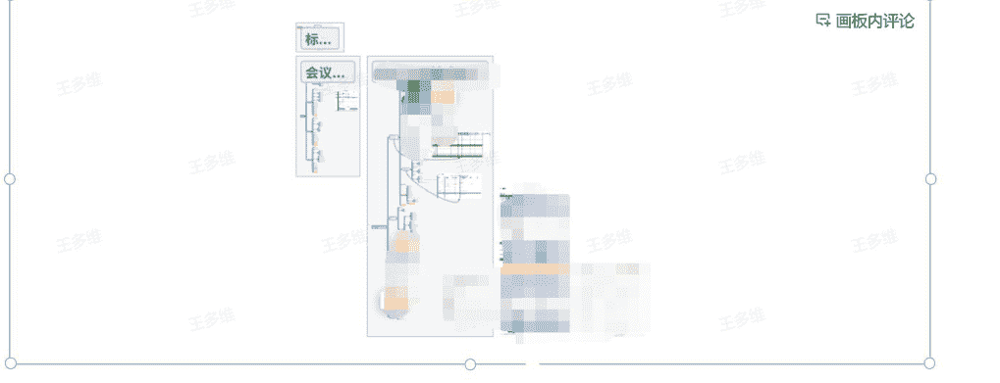
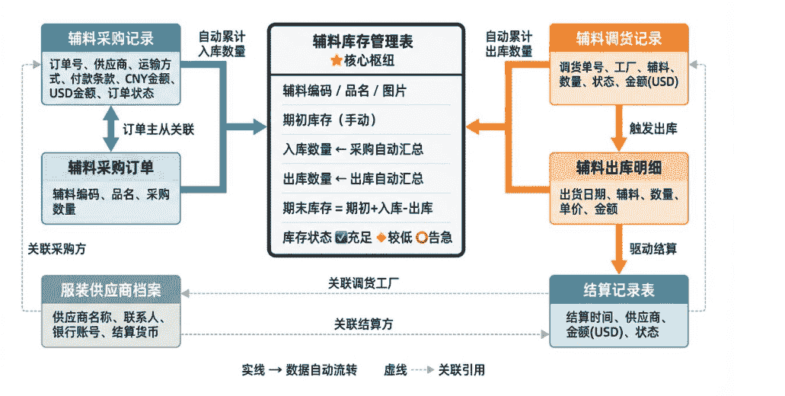
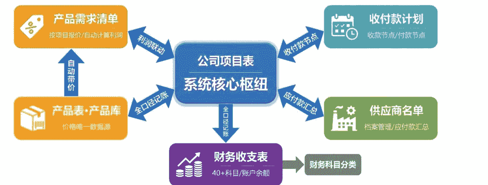

# 11w粉博主转型切入企业数智化细分赛道，1个月揽10w+合同

**260508副业SC精华**  
公众号懒人搜索，[懒人专属群](https://www.laorensearch.com)独享  
懒人微信：lazyhelperl

大家好，我是多维，生财四年级学生，小红书虚拟行业的航海教练。

主业是国企小职工，副业是小红书11万粉博主，之前的业务线有小红书运营、虚拟资料，今年增加了一个多维表格系统搭建，并且受到了亦仁发布的「企业AI学习与服务」这个超级标的启发完善增值服务，切入企业数智化转型服务赛道，最近1个月拿到了10万+的服务合同，以及一单10w+的长期合作意向，顺利了完成了转型。

今天给大家分享我在瓶颈期又又又一次找到机会，挖掘自身优势，从0经验到1个月快速拿下共计10w+服务合同的经验，主要包含以下几个部分：

## 一、如何在AI洪流中找到自己能握住的手术刀，精准切入？

## 二、如何最小化启动，用成功交付建立信心快速破局？

## 三、如何设计增值服务，谈成10w+长期合作意向？

## 四、如何优化商业模式，把蛋糕做大，让利润奔跑？

### 零 · 前言

2025 年之前，我主要依靠小红书博主推广和知识付费运营，曾经半年涨粉6万，靠接广和虚拟资料变现6位数，副业收入更是实现了10倍速的增长。

但今年年初，由于平台流量越来越不稳定加上虚拟行业的准入门槛增高，很多虚拟资料商品都被冻结或者下架，再加上龙虾热掀起了新一轮的AI应用趋势，我也开始着手去找我的新赛道，拥抱变化。

**超级标 16：企业AI学习与服务**  
https://t.zsxq.com/x6ifW

小微企业数智化转型服务，顺利的谈成了 10 余单，共计 10 万多的服务合同，实现了第一桶金，还谈成了一单 10w+的长期合作意向。

### 一、AI 洪流中找到自己能握住的手术刀，精准切入

年初，整个互联网圈都在聊龙虾、聊 AGENT、聊各种 AI 应用。朋友圈、短视频、付费社群，到处都是"我用 AI 月入 5 位数""AI 编程 30 天入门""AI 绘画接单攻略"这类内容。

说句实话，我也心动过。我研究了两周 AI 的各类技术，甚至花了几百块买课。但越研究越清醒——这些东西不是我的机会。所以我放弃了 ai 编程，ai 绘画，这些很热的项目，很简单，我自己用不到这些场景，也没有这个技术沉淀，并且这几个变现周期和天花板都不是很高。

### 靠自己的优势选择小切口

我开始去盘点我的核心优势：

+   1. 我主业就是做软件系统，对企业管理流程很熟悉；
2. 我做了几年职场效率工具的内容，对内容产出和产品设计非常擅长；
3. 我是飞书和飞书多维表格的重度使用用户，对飞书的生态了解深入；
4. 我在网上已经积累了一批信任我的粉丝，他们里面就有很多线上创业者和小团队负责人，并且这一部分人群中，已经有些人来向我咨询如何用多维表格管理自己的项目和业务。

这些信号加在一起，我大概确定了自己的机会，放弃火热的 AI 风口，放弃了去追小龙虾，agent 技术，skill 技术。我最终选择了一个非常小的切入点：

帮小微企业和团队设计和搭建基于飞书多维表格的管理系统

#### 为什么做多维表格管理系统的定制设计

##### 需求真实且高频

相比于龙虾的落地实操，实实在在的梳理业务 sop，打通数据流转通道，降低重复工作，提高员工效率，才是真实和高频的需求。

每一个团队，不管是三个人的创业公司，还是二十个人的工作室，都有项目管理、客户管理、内容排期这些需求。之前的靠 excel 表格的方法，老板想看个数据要等助理整理两天。在和一些公司领导层聊过之后，我意识到，这不是小众痛点，这是几乎所有小团队都存在的问题。

但用多维表格把客户、员工、业务管理起来，做成可视化的看板，就能快速解决老板看不清、管不到、摸不着、没数据的问题。

### 数字化是智能化转型的必经之路

我之前的计划是 AI 赛道的大蛋糕我一时半会吃不上，不如先去做点边角料的事情，喝点汤。但是看了亦仁的 ai 企业服务的超级标，我才认识到，我要做的不是边角料，反而是每个企业的刚需。

#### 一、结论先行

企业 AI 学习与服务市场，已经不是一个泛泛的“培训概念”，而是在企业 AI 渗透过程中自然长出来的新市场。

如果只看狭义的“企业 AI 学习”——也就是企业为 AI 认知提升、岗位能力训练、团队培训、内训、训练营、陪跑等付费——这个市场已经可以按百亿到千亿级潜在空间来理解。

如果进一步把 AI 落地咨询、工作流设计、知识库建设、Agent 部署、工具接入等算进去，这个市场的本质就不再只是培训，而是下一代 AI 企业服务市场的前端入口。

更准确地说：

企业 AI 学习是起点，企业 AI 服务才是终局。

每个企业在做 AI 转型的时候，都不得不倒逼自身去梳理企业的流程，沉淀企业的数据，企业不可能脱离数字化去做智能化。现在老板们被 AI 逼着自己反推自己的工作流和数字化，恰恰就必须要经历这一步，表面上是 saas 服务，但其实是智能化转型的必经之路。

#### 跟我的人设天然契合

我是一个效率工具博主，分享“如何搭建飞书工作流的”的内容，天然就吸引精准客户。来看我笔记的人，不是来娱乐的，是来解决问题的。这批人里面，有相当比例就是有管理痛点的小团队负责人。他们来的时候，已经带着需求了，我不需要说服他们需要这个服务。

#### 技术门槛适中

很多人都在去搞开发、都在去搞大模型算法、都在去研究高深的技术，我的经验告诉我，企业落地使用，追求的是稳定和即时性，而这个就是飞书多维表格能带给企业的，这个过程业务工作流梳理的工作和上手搭建和部署落地的技术门槛都没有那么难。能隔绝一部分无门槛的新手，也不用投入很多的精力在技术升级上。

## 二、如何最小化启动，用成功交付建立信心快速破局？

想清楚了以上4点，我脑子里已经有了个大概的雏形，那怎么开始引流？怎么成交？怎么开始交付呢？我决定按照我的老路子，最小化启动，暴力开局，快速迭代。

#### 内容调整后，快速做出70万播放的爆款笔记

相比于之前的职场晋升和副业的思维干货，我增加了飞书+AI工作流、多维表格语音录入的干货视频，并同步到抖音账号。因为自己本身就是博主，内容上面没有太大的问题。

很快小红书和抖音都有了几十万播放的爆款，抖音也从0涨粉到1200。我在主页上标记了我是飞书多维表格搭建师，后台有很多人开始询问。为了方便，我还在小红书上上架了1元免费咨询的商品链接，方便大家找我。其中有一篇讲AI工作流的笔记，分别在小红书和抖音上拿到了 45 万和 25 万的播放，加起来一共 70 万。

有爆款，有流量，但事情却没有那么简单，怎么报价？怎么谈单？怎么谈需求？服务边界怎么定？很多人来免费咨询后不下单怎么办？如果做完之后客户跑了我怎么保障自己的利益？这些问题我一个都没有答案。

所以，前期有流量，但也浪费了很多，我意识到我不能先找到答案再去解决问题，而是得在解决问题过程中寻找答案。

### 尝试低价接单试水，跑通流程

我从后台很多需求里，找到了一个需求描述明确的客户，因为需求表述清楚，又明确说了代建代做，肯定是有付费意愿的。所以我大胆往前推进，果断拉了腾讯会议，开始认真梳理对方的需求。

在这个过程中，我发现定制需求，不能被客户牵着鼻子走，这个客户说要把自己的excel表格复现到多维表格上，但真正的需求是把混乱的流程结构化，当我给他重新梳理需求，发现卡点问题后，他明显感觉对我更信任了。再加上报价的时候说清楚了交付的内容和售后的服务，以及价格比较低，所以第一单也是稳稳的拿下了。

拿下这个单之后，我就开始上手交付，我用2天做完了第一个模板，然后不断地跟他对需求，调整修改，还根据他的场景帮他设计了一些自动化同步数据和自动添加数据，这个服务超出了他的预期，让客户很满意。我也有了很大的信心。

#### 这次谈单我也总结了三个认知:

**第一个认知：谈单的第一步，不是讲方案，是问"要不要做"。**

没有诚意的客户，你讲再多方案都是浪费时间。

**第二个认知：老板的痛点不是技术，是他自己的管理困境。**

老板的问题不是某个表该怎么处理，它背后的问题是不知道怎么处理信息流转和权限分配。你帮他把这个问题说出来，比展示任何技术都管用。

**第三个认知：报价的时候，不要只说价格，要说价格背后的价值。**

给出价格之后，要非常清晰的说出：三个关联表 + 业务流程梳理 + 两次深度沟通 + 后续优化这类具体的方案。才能体现出价格的优势。

就这样跑通整个环节，对接几单后，我又发现了问题，我自己又发内容，又谈单，又设计，又交付，一个月做不了几单，到头来还是白忙活一场，一个核心问题，正摆在我面前：我该怎么放大？

**趁热打铁，组建团队，尝试放大**

一个典型的项目周期是7-14天，同时我只能跟进2-3个项目。当后台同时躺着将近10个待沟通的客户，而手头还有两个项目在交付时，我意识到：我的时间，已经变成了这个生意最大的瓶颈。

这时候摆在我面前的有两条路:

第一条路：涨价，筛选客户，做小而美的个人工作室。  
第二条路：组建团队，放大产能，把蛋糕做大。

我选了第二条。原因很简单：小微企业数智化转型这个赛道，现在不是内卷的时候，是跑马圈地的时候。如果我不快速吃掉能吃掉的市场，等更多人反应过来，我的先发优势就没了。

### 我要组建什么样的团队？

我没有一上来就想着招全职员工，成本太大，我也没办法保证全职员工的效果，毕竟这个行业还没那么成熟。我的思路是：用最小的成本，撬动最大的产能。

我盘点了项目交付的全流程，把它拆成了三块：

看清这个分工之后，我的组队策略就清晰了：

我守住“谈单”这个关键点，把“搭建”和“培训”的工作交给团队在做，当时想如果能找到志同道合的，相互补位的合伙人更好！

解决了后顾之忧，我就可以无脑的往前冲了。

完善服务 SOP，开始爆单

团队跑起来之后，第一个月我就定了很多单，涉及到电商、保险、留学、知识付费等行业。最近 1 个月咨询的用户数量就有 30 个人，基本上每天都在和用户对接需求。

这些体量加起来是我之前的 8 倍还多，如果没有团队，我根本不敢接——周期太长，中间来个新客户我就顾不过来了。单量多了，团队也搭建了，我们也把经验梳理成了有价值的 SOP。

# 5. 意向信息收集

客户通过小红书和抖音进入私域表达意向之后，我们会让他们填写信息采集表，或者让他们简单说明规模和业务场景，做初步判断，也是做筛选。

# 6. 约会议，免费提供一次咨询

确认有意向后，邀约腾讯会议，现场梳理需求，评估难易程度。会议不收费，但会 让客户专注需求，明确意向，又能筛选一部分用户。

# 7. 谈单过程

采取破冰、需求挖掘、方案呈现、报价收尾的四个环节，特别是报价环节，我会提供提供方案再报价的方式和一口价的方式，这两种方式，满足客户的需求。在这个过程中不断的优化自己的细节，比如设计报价单，方案呈现的时候给出框架说明。

| 序号 | 大类 | 模块 | 内容 |
| :--- | :--- | :--- | :--- |
| 1 | 需求分析 | 业务梳理 | |
| | | 方案设计 | |
| 2 | 多维表搭建 | 核心表搭建 | |
| | | 看板搭建 | |
| | | 素材流转与权限设置 | |
| | | 自动化流程设计 | |
| | | 数据流转关联 | |
| 3 | 全流程测试与优化 | 全流程测试与优化 | |
| 4 | 售后与培训 | 操作培训 | |
| | | 多维表格优化 | |

**备注：** 会优先选择飞书最优惠的方案进行设计，避免后续高成本支出；设计交付周期为 14 天左右，保证最快上线。

## 多维表系统结构图

为了能让客户直观的感受到设计的结果，我们把之前做的项目整理成了案例，每个案例都讲清楚了需求分析和我们设计的逻辑。这样客户看到后，就能感受到，我们并不是纸上谈兵，反而对一些行业，我们有很多沉淀和积累。

## 辅料采购管理系统 · 数据流与逻辑关系

## 系统数据流与逻辑关系关图

报价→合同→收款→付款→财务 全链路贯通

- 01 AI 智能化部署案例 ·汽车软件研发企业
- 02 外贸企业数字化管理系统·案例展示
- 03 装修设计公司数字化管理系统·案例展示
- 04 执法单位考勤管理系统·案例展示
- 05 服装品牌辅料采购管理系统·案例展示

## 交付阶段

通过需求确认、方案提交、功能落地和部署培训的环节，让客户安心交给我来做，并且所有的环节都是不满足要求不支付尾款，只有全部交付完成，才会支付尾款，符合 B 端客户的交易习惯和需求。

## 售后阶段

除了承诺免费微调细节和调试 bug 之外，我们还会定期回访，有些客户觉得好用，就会把其他的业务模块也一起升级。

## 如何设计增值服务，谈成 10w+ 长期合作意向？

SOP 跑通、团队到位之后，接单和交付不再是问题。但我很快发现了一个新的瓶颈：大部分客户只看到做一张表的成本，所以客单价一直很低，但看不到背后信息和数据混乱的本质。所以我单独明确了几项增值服务。

### 增值服务 1：需求调研和流程优化诊断

客户想搭建表只是表象，更深层次的原因是客户需要解决管理混乱、流程混乱的问题，而这些并不是简单做个表格就能解决的，所以我把需求调研和流程优化策略作为服务内容之一，从单纯的搭建几张表的技术人员，变成既懂技术又懂业务的专家。

这样一来，客户认识到了自己的问题并不是一张表，而是管理上的思路，那客户就会为这套方案买单。

### 增值服务 2：AI 智能体搭建与流程自动化

在看到亦仁分享的「企业 AI 学习与服务」超级标后，亦仁很清楚的提到了知识库、工作流和智能体的需求非常大，我意识到，小微企业对数字化和智能化转型的需求、动机和落地效率都比大企业要高很多。

#### 3. 平台 + 服务模式

这一模式更接近真正的企业服务公司打法，通常会同时提供:

> - 课程库
> - 场景模板
> - 知识库
> - 工作流
> - Agent 模板
> - 后台工具
> - 顾问服务

它启动更重，但长期价值更大，因为收入来源不再只是课程，而是:

## 八、普通人和小团队的现实切入路径

企业服务并不天然只属于大公司。AI 的一个重要变化是：很多原本需要大团队、大交付体系才能做的事情，现在被明显拆小了。

比较现实的切法主要有五类。

### 1. 企业 AI 培训

适合已经有较强 AI 使用经验，或者能清晰讲透某些岗位 AI 用法的人。

可从老板课、部门内训、岗位技能训练开始，先服务成长型公司。

### 2. 行业 AI 顾问

企业更愿意购买“行业解决方案”，而不是泛泛的 AI 通讯。

如果对某个行业有理解，例如电商、教育、财税、内容、营销、客服等，就更容易切入。

### 3. AI 工作流搭建

很多企业当前最需要的不是复杂系统，而是几个能跑起来的流程。

例如内容生成流程、客服辅助流程、销售跟进流程、数据汇总流程。

这个方向未来需求会持续增长。

### 4. 企业知识库与内部 AI 助手

知识管理、制度查询、案例调用、FAQ 问答，本来是企业长期痛点。

AI 的加入，让这类需求更容易产品化和服务化。

### 5. AI 工具选型与集成服务

很多企业不是没有意愿，而是不知道怎么选工具、怎么组合、怎么接到现有流程里。

谁能帮企业完成“选型 + 配置 + 接入 + 训练”，谁就具备商业价值。

而且 AI 时代的智能化转型的前提和基础是数字化转型，飞书多维表格是数字化转型的数据引擎，智能体是智能化引擎，所以我在表格设计的基础上，着重去研究多智能体协同和 skill 开发，企业知识库搭建和管理的应用。

这里也有个感慨，刚开始并没有想到能吃上这部分的红利，但随着服务的深入，对市场更加了解，反而倒逼着我去学习和实践这些知识。

这样，客户得到的不只是一张表，而是一个能自己干活的系统。

这个定位的转变，让我从一个“工具服务商”变成了“数智化转型服务商”。也因此顺利谈成了一家传统企业的数智化转型服务，预期合同价格超过 6 位数，涵盖会议管理、人员管理、业务管理、财务管理**等很多板块的内容。客户感知到的价值完全不同，预算也自然打开了。**

## 四、如何优化商业模式，把蛋糕做大，让利润奔跑？

通过前期的测试，SOP 跑通了，客单价也上来了，但我很快意识到，这个规模还不够。全国市场那么大，如果只是当前的接单定制模式，我们团队一年服务的企业数量撑死不会超过 100 家。

亦仁也在超级标里提到，全国 6000 多万家中小企业，哪怕目标用户只占 1%，也有 60 万家。我不可能一个人吃完。甚至我这个团队，也吃不完一个城市的需求。

因为这个行业当前处在跑马圈地的阶段，现在的主要矛盾不是分出去的利润多导致我没有利润了，而是愿意跟我分，能跟我分利润的人太少。

如果想把这个规模扩大，显然，当前的商业模式是不行的。于是，我重新设计了商业模式，原则就是把蛋糕做大，吸引同行者，和同行一块分钱。

梳理业务链条，设计业务对接标准

我把整个业务从头到尾拆成了五个环节：

拆完之后，我就很清楚了，前端流量和客户成交，短期还是我的主战场；策略生成，是我最需要培养接班人的环节。落地搭建和售后服务，已经可以脱离我运转，但还是急需人手。

所以我要做的就是设计好客户成交之后面向策略师和搭建师的业务流转标准，以及确定和客户对接和交付的标准，能够形成稳定的 SOP。这样才能不断的扩大团队，复制这个模式。

上面这个规划，落地的前提是：有足够多、足够靠谱的人。
我目前的团队配置是这样的：

### 搭建培训业务：B 端服务，C 端培养

为了培养更多更好的搭建师，再加上之前很多粉丝都想跟我学飞书多维表格的使用，我意外地踩中了另一条业务线。最开始，我只是为了满足粉丝的需求，整理了一套《多维表格搭建课程》，教新人怎么快速上手。

后来想到这一点，我干脆把多维表格上系统课程做的专业和深入，增加系统设计和产品设计的内容，既能满足大家的学习需求，又能从这里面培养团队的额搭建师，开发了《多维表格提效和商业变现训练营》

一下子打通了这个培养流程，完成了闭环。

- B 端：我为企业提供数智化转型服务，收费从几千到几万
- C 端：我培训想学多维表格的人，收费几百到几千
- 闭环：C 端学员学得好，可以成为 B 端项目的搭建师，赚回学费，甚至成为长期合作伙伴。

**把蛋糕做大：同行不是对手，是合作伙伴**

但这个培养的周期还是比较长的，短时间的需求很多，我们团队一样接不过来，再加上，就算有了团队，有些项目，行业我们不太熟；有些项目，体量太小不划算，体量太大我们还吃不下；有些项目，客户预算有限，但确实有需求。以前我的思路是：能接的接，不能接的拒掉。但我转念一想：拒掉的不是客户，是信任我的人。信任本身就有价值。

这时候有其他团队找上我，给我谈合作，刚开始我是拒绝的，但后来一想，目前市场这么大，同行不一定是对手，也有可能是合作伙伴，所以我很开放的和其他团队谈合作。

1. 优势互补、资源互补、经验互补
2. 质量相互把关，不能有损信誉
3. 签订合同，保证利益

就这样，我开始让我的业务流动起来，逐渐找到自己擅长的领域。在这个合作的过程中，我发现，我的 C 端培训业务也能给其他团队输送搭建师人才，而这部分也是我作为一个知识博主的优势。

就这样，我把基于飞书生态的中小企业数智化转型业务发展起来，顺利的跑通 1 个多月。

后面我会继续把蛋糕做大，把规模做大，服务更多的企业，大家可以期待下我后续的分享。

———分割线————

看完这篇 SOP，你觉得你懂了。但 90% 的人一到实操就会卡在第一步。
工具和教程只是最低级的壁垒，真正的壁垒是“立刻动手”和“圈层信息差”。

如果你想看全网最新的变现玩法，并且和一群执行力极强的极客一起下场拿结果，欢迎围观我的核心私域：【懒人专属群】。

我们不聊虚的，只做商业闭环的拆解与 AI 效率的压榨。系统内已沉淀 1000+ 跑通的套利实战局。

👉 查阅圈子完整数字资产与上车门槛：
https://lazyso.com/insider/

认同价值、准备好下场干活的，扫码加我微信（lazyhelperl）

**备注：**【实操上车】，不闲聊