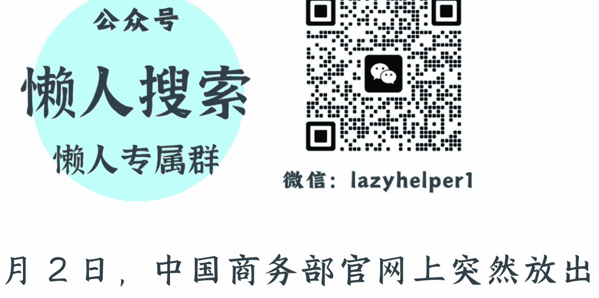

## 商务部发布对美国制裁阻断禁令，背后有什么玄机？

**260508** 文/卢克文工作室嘉宾 **概略北方**
整理：公众号懒人搜索，[懒人专属群](https://t.cn/A6qXvYzK)精选
懒人微信：**lazyhelper1**

5月2日，中国商务部官网上突然放出了一份"**2026年第21号公告**"，题目是《关于美国对5家中国企业实施涉伊朗石油制裁措施的阻断禁令》。
虽然这个事很快就被淹没在过节的快乐中，并没有引发舆论关注，但是在业界，却不亚于扔下了一枚重磅炸弹。

因为这份阻断禁令，意味着中美博弈八年之后，中国第一次动用反制裁的杀招了！

**为什么说阻断禁令是个杀招？**

我们经常看到美国人制裁这个制裁那个，大部分人觉得，无非是没法跟美国人做生意，似乎没什么大不了。
但事实不是如此，美国制裁的毒辣之处，在于"**次级制裁**"和"**连坐机制**"。

美国对企业的制裁，主要集中在臭名昭著的“特别指定国民清单”，也就是业内谈之色变的SDN清单。

一家企业一旦被列入SDN清单，会发生什么？第一，企业在美国境内的资产会被全部冻结。第二，任何“美国人”（包括美国公民、美国企业、拥有美国绿卡的人，甚至身在美国境内的人）都绝对禁止与这家企业进行任何形式的交易。

如果仅仅是这两项，很多企业根本不怕。我在美国没业务没资产，你能把我怎么样？你不跟我做生意就不做呗。

但别急，第三招来了——次级制裁。美国财政部规定，哪怕你是一家非美国企业，只要你敢跟SDN清单上的企业做生意，哪怕你们的交易中没有使用美元，没有经过美国领土，美国依然可以认定你违反制裁，把你也拉进清单，下令所有人停止与你的所有合作，没人给你贷款，没人让你用SWIFT。

这一招太狠了，在全球化的今天，跨国银行、保险公司、大型跨国贸易商，谁敢彻底脱离美元体系？谁敢承担被踢出SWIFT的风险？

所以，过去几十年里，只要美国财政部一发话，金融机构都会打起十二分精神，对你的业务进行合规审查。

哪怕你的业务只是擦边，不违反禁令，但他们为了规避风险，还是宁可错杀一千，绝不漏网一个，这就叫“过度合规”。

这样一来，美国根本不用自己动手，只要发一张纸，全世界的金融机构都会自发地充当美国的打手。

这就是长臂管辖的厉害之处，通过制造恐慌，逼迫第三方选边站。

第三方几乎没办法抵抗。

举个例子，假设你是一个跨国金融机构的老板，有一天，一个某国企业被美国列入了 SDN 清单，而他恰好是你的客户。

你该怎么办？

从感情上讲，你很同情这家企业，觉得美国人简直是流氓。

但问题在于，你会为了支持这家企业，而承担被美国制裁的风险？

绝不会。

你大概率第一时间停止和这家企业的合作。

你这么做，别人也没法说你是汉奸，因为你在海外可能有几十亿上百亿资产，如果你帮这家企业转了仅仅 100 块钱，就被美国没收了几百个亿，甚至连美元清算资格都剥夺，那这个损失谁来负责？这么大的责任谁担得起？

在过去很长一段时间里，面对这种流氓打法，我们是很吃亏的。

因为我们一直坚持不懈不干涉内政和尊重国际法的原则，不愿意像美国那样滥用权力。

但你跟流氓讲道理，流氓只会觉得你好欺负，所以必须给流氓一点颜色看看。

于是，2021年，《阻断外国法律与措施不当域外适用办法》出台了。

这部规定明确，外国法律或行政令不得对中国境内主体产生强制约束效力，任何人不得在中国境内执行这类域外制裁。这就为阻断美国制裁手段在中国的延伸提供了依据。

不过呢？

办法出台后，沉寂了整整五年，从没正式动用过，直到5月，针对美国制裁5家中国炼化企业的无理行径，这把封存了五年的尚方宝剑，终于出鞘了。

商务部的公告，首先确认“美国对上述企业的制裁措施存在不当域外适用情形”，也就是说，美国对这5家中国企业的制裁，在中国没有任何法律效力。

同时，商务部还规定，任何人、任何组织在中国境内，不得承认、不得执行、不得遵守美国的这道制裁令。

这十二个字一出，形势彻底扭转了。

前面提到了，金融机构和供应链面临的是美国的单方面压力，我不听美国的，美国要罚我。

现在呢？一根筋变成两头堵了！

你怕美国的处罚，难道不怕中国的处罚？美国的剑利，中国的剑也未尝不利。

在过去，你配合美国制裁，中国没法把你怎么样，但现在你配合美国制裁，起码在中国境内是属于违法行为。

举个例子，一个外资银行的中国分行，看到美国把恒力石化列入SDN清单，在过去会马上冻结恒力行化的账户。

现在呢？如果他们这么做，直接违法，恒力石化拿着商务部的公告，转头就可以走进法院，要求全额赔偿因断供造成的巨额商业损失。

要么，你乖乖恢复恒力石化的服务；

要么，中国法院依据中国的《[阻断办法](https://github.com/zhongzhuo1976/blocking-regulations)》和《[反外国不当域外管辖条例](https://www.gov.cn/zwgk/2024-03/25/content_6938888.htm)》，判决恒力石化胜诉。如果你拒不赔偿，中国法院有权直接强制执行你在华的资产、营业款项甚至股权。

这就叫魔法打败魔法。

当配合美国制裁的成本，远远大于无视美国制裁的成本时，美国的这套长臂管辖，就在中国法域内被事实上废掉了。

有人可能会说，这不是让企业受夹板气吗？

恰恰相反，这是给了企业一个拒绝受美国遥控的完美“借口”。

举个例子就知道了，不是所有人都喜欢喝酒，但过去没办法只能喝，可是醉驾入刑之后呢？不想喝的就有理由了，不是我不喝啊，是我还要开车呢，你也不想看我入刑吧。

同样的道理，中国的阻断禁令一出台，内心不想服从美国的金融机构就有借口了：真不是我们不配合，主要是中国商务部下了死命令。如果我配合你了，我在中国就违法了，我的资产就保不住了，这真金白银的损失，你能给报销不？

这样一来，很多事就有转圜的余地了，一些跨国金融机构，也没法搞“过度合规”了，中国的反制裁也就事实上达到效果了。

当然，阻断禁令虽然发布了，大快人心，但要想让它真正发挥出威力，还有很长的路要走。

第一，它的适用环境是受限的。

阻断禁令的效力目前只在“中国境内”。也就是说，它对在中国境内有实体业务的跨国银行分支机构、外资企业管用，它可以强制这些国内主体继续给被制裁企业提供服務。

但是，如果是一家完全在海外、在中国没有任何资产的境外机构，这道禁令是威慑不到人家的。

第二，它还缺个祭旗的。

法律的威严是打出来的，办法是出了，效果怎么样还要看落实。

接下来，有没有被制裁的中国企业真的敢于依据这道禁令，把配合制裁的跨国金融机构和上下游企业告上法庭？有关部门有没有决心，抓几个出头鸟，开出天价罚单？

第三，司法的决断力。

这是最敏感的一点，如果在诉讼中，被制裁的中国企业把某家知名外资巨头告上了法庭，那么我们的地方法院，有没有足够的魄力，敢于顶着外媒所谓“破坏中国营商环境”“把外资吓跑”的大帽子，坚决判决外资企业败诉并强制执行？

如果因为顾忌外资情绪而和稀泥，那阻断禁令的公信力就会大打折扣。

所以，发布禁令只是第一步，后面考验的是整个国家机器的执行意志。

但无论如何，第一步，我们终于迈出去了。

看到这，估计很多人会有点奇怪，《阻断外国法律与措施不当域外适用办法》都出来五年了，为啥现在才用？

中国被美国制裁的企业有上千家，从造手机的到造卫星的，从搞 AI 的到搞芯片的，他们被制裁的时候为啥不动用这个办法？而4月美国搞了中国5家炼化企业，却迎来了强势反击？

答案很简单，因为这次这5家炼化企业，情况非常特殊。

我们看看这五家企业，恒力石化、鲁清石化、金诚石化、鑫海化工、胜星化工，除了恒力石化是巨无霸之外，另外四家，全部都是集中在山东和河北的“地方独立炼油厂”，也就是业内俗称的“地炼”或者“茶壶炼厂”。

这种地炼相比国营炼油厂，污染大、技术落后，早些年已经关停了一大批了，可为啥地炼还能生存？

因为地炼有一个国营炼油厂永远比不上的好处：扛制裁。

我们可以思考一个问题，伊朗都被制裁这么多年了，为啥还能源源不断卖油？这就不能不说到一个国家——马来西亚。

马来西亚石油年产仅2000-3000万吨，但仅仅是对华出口，就达到了6000多万吨，这多出来的石油是哪来的？

这在国际能源圈里不是啥秘密，每年都有大量伊朗影子船队驶入马来西亚纳闽等地附近的公海，然后用管子把伊朗油输到马来西亚船上，然后再混入一部分马来西亚原油，调成“马国混合原油”，出具马来西亚原产地证、提单、报关单，合法出口。

这个过程中，伊朗卖了油，马来西亚赚了过路费，某国得到了便宜油（伊朗油打折卖），反正报关单上是马来西亚油，你凭什么说我买了伊朗油？那么问题来了，这些油交给谁来买呢？

肯定不能是三桶油，三桶油在海外有着极其庞大的油田资产，如果美国硬要制裁，损失还是太大。

看来看去，地炼企业最合适。

第一，它们是纯粹的民营企业，很多连上市都没上，在海外一毛钱资产没有。美国人想冻结它们的海外账户？抱歉，查无此户。

第二，它们根本不怕制裁。你美国不让美国企业跟我做生意？我的上下游全在国内，谁稀罕去美国做生意？

第三，它们甚至不需要美元，甚至连打钱都不用，直接把机电产品、日用百货运过去，就能冲抵油钱，说不定还能再赚一笔。

这一套行云流水的操作，不仅帮中国稳住了能源大盘，更是极大地反哺了中国的工业。

民营大炼化+地炼的总产能，占到了中国炼化总产能的三分之一，石油进口成本低，所以这些廉价原油进入地炼厂后，被源源不断加工成乙烯、丙烯等基础化工原料，再输送到珠三角、长三角的工厂里。

这套操作，帮我们降低了通胀。

但美国人能容忍？肯定不能，所以今年4月，他们不仅制裁了小地炼，甚至直接把恒力石化这种巨头也拉入了SDN清单。

这说明美国已经不顾一切，企图用长臂管辖来直接切断伊朗的石油贸易通道，同时也打击中国的能源安全。如果这些企业因为制裁而瘫痪，中国制造业就会出现成本缺口，甚至影响中国三分之一的石化产品供应。

所以，民营地炼企业，中国必须保。

于是，沉寂了5年的阻断禁令出台了。

毫无疑问，这次阻断禁令的出台，将成为中美博弈的又一个里程碑事件，说明中国正式从“被动防御阶段”，跨越到了“规则对抗阶段”。

回顾过去的这八年，无论中兴还是华为，中国总体策略还是被动防御。

毕竟那时候我们在底层芯片、在核心软件上还有太多受制于人的地方，我们只能以空间换时间，拼命搞国产替代，所以并没有去挑战美国制定的那套霸权体系。

但现在，情况完全变了。

当我们在产业链上已经实现了空前的自给自足，当我们人民币结算份额已经有了底气，我们就不可能再永远处于被动挨打的境地了。中国不再仅仅是抗议，而是学着美国，开始动用法律和规则的武器，进行反击。

更关键的是时间，美国人习惯了在谈判前夕，先挥舞大棒，制裁你几家企业，给你施加极限压力，然后再坐下来跟你谈条件。

特朗普以为，自己通过虚空造牌，就能获得对华筹码，但中国用一个阻断禁令直接把牌摔在了特朗普的脸上，你要来谈就好好谈，你想虚空造牌？中国人不吃这一套！

有本事你就对不遵守你美国制裁令的中国所有企业都制裁，到时候你拿着美元也买不到廉价商品了，通胀马上飞天，中期选举也别想了，你敢不敢赌一把？

如果你不敢赌，等于向全世界宣告：美国的SDN清单，在中国境内是一张废纸。

既然中国可以不理睬美国的制裁，那俄罗斯、欧洲、中东各国就会立刻效仿，到那时，美国的全球制裁大网也就不灵了。

而这，才是阻断禁令背后，真正的玄机。

# ——————分割线——————

绝大多数人只盯着眼前的工资，却不知道一次远在中东的冲突、一次降息的决议，就能在一夜之间洗牌普通人的财富。

看懂宏观，是为了在周期切换时，不被当作代价。

如果你认同这种“抬头看路”的长期主义，欢迎围观我的个人情报智库：【懒人专属群】。

圈子已稳定运行 7 年。我们每天利用 Python 爬虫与大模型算力，过滤全网最顶级的政经内参和搞钱风向标，做你最冷酷的“外部大脑”。

查阅圈子完整数字资产与上车门槛：
https://lazyso.com/insider/
认同价值的。扫码加我微信，备注：【进群】

