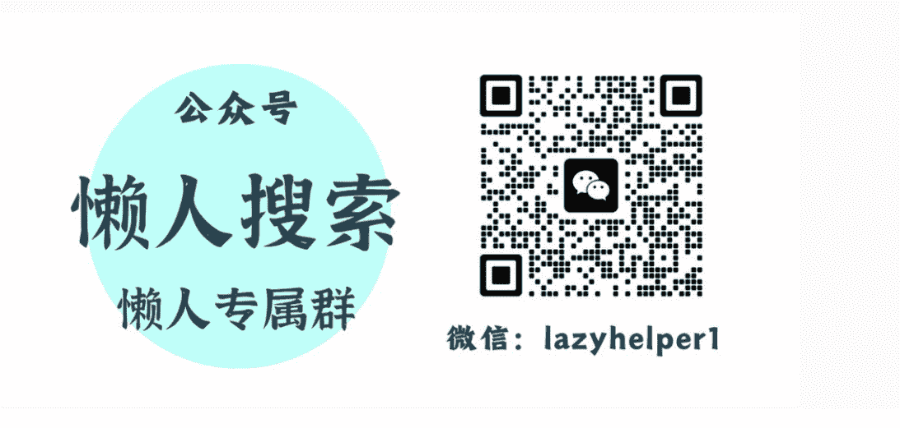

# 做了 12 年电商，我靠 4 次关键转型一路走到了现在

**260509 副业 SC 精华**  
整理：公众号懒人搜索，[懒人专属群](https://www.laorensearch.com) 精选  
懒人微信：lazyhelper1

偶然的机会，和七天老师聊到了一些过往经历。聊完之后，七天老师说，我这些年穿越过不少周期，这类经历在平台里也挺值得分享，可以写出来给大家做个参考。

说实话，一开始我挺犹豫的。一方面是不知该怎么写，另一方面也是因为大家写得都太好了，担心自己写不好。

但既然来到生财这样一个爱分享、愿意互助的平台，我也想试着把自己的经历摊开聊一聊。所以最后还是把这篇复盘写了出来。

这篇帖子写得很辛苦，也让我更能体会那些愿意认真写长文、写精华帖的圈友们，是真的在用心分享。希望这篇复盘，能给同样在创业、转型、寻找下一条路的朋友一点参考。

做电商 12 年，我经历过淘宝分销、京东、自营店、男鞋、童鞋、抖音，现在转向 AI。中间有两次非常重要的转折，一次是男鞋的自营做到类目头部并在阿里授奖，还有一次是用几万块的启动资金撬动合作店铺的几千万营收。写这篇复盘的时候，我发现一个问题，这 12 年真正让我一路走到今天的，不是抓住了某一个爆款机会，而是我总能在旧模式失效前，提前切到下一条路。

很多人聊电商，会先想到运营、选品、投流，这些当然重要，但如果把时间线拉长，只盯着这些动作是远远不够的，把时间线拉长来看其实更重要的是：在旧模式失效前，能不能提前看见变化，并且敢切到下一条路。

这篇帖子，我就结合自己的经历，聊聊对我影响最大的 4 次关键转型：从上班转向电商、从分销转向自营、从单线经营转向合作扩张，再到从传统电商转向 AI。也聊聊这些转型是怎么发生的，以及每一次转型背后，我是怎么做判断的。

## 一、我最早的认知是在大学建立的

我上大学的时候，成绩非常好。虽然高考分数不高，算是勉强进了我的母校，但进学校之后，我学习非常努力，比其它同学要多努力 N 倍。结果也给了我很好的正反馈，第一学期考试就拿到了专业第一，也有可能是全系第一，因为很多人知道了我的名字。

但是到了第二学期，我突然开始有些迷茫。因为我觉得，从小学、中学、高中学了十来年，到了大学还要啃书本，好像有点荒谬，也有些不理解，为什么要只啃书本？

我不断地问自己，我这样啃书本要啃到什么时候？能啃出什么东西？对我以后走上社会赚钱有没有帮助？

经过了很长很长时间的思考，才把心中的这些疑惑解开。我后来慢慢意识到，我要的不应该是书本上的字面知识，而是自身能力的提升，**能力才是硬实力**。于是学习这一块，我就松懈了一些。

以前我的学习努力指数是 10 分，现在只有 6 分，剩下的 4 分，我去参加各种比赛。比如校内的简历设计大赛、演讲比赛、羽毛球比赛，后来还参加过一些省级、国家级比赛。尤其是最后参加的这个国家级比赛，因为这个比赛，老师带我们到常州、温州、武汉的华中科技大等地方学习，这期间的经历让我受益终身。

因为比赛，毕业后我获得了一份非常好的 offer，待遇超过很多同学，放到现在也是相当大一部分比例的毕业生拿不到的。

现在回头看，我觉得我很多认知并不是后天突然开窍，而是很早就埋下了一些种子：**我开始不满足于只做表面的努力，而是会去想，一件事情真正决定结果的到底是什么。**

## 二、第一次关键转型：从安稳工作转向创业

上面说的 offer，就是天津的一家公司给的，我在那里干了两年多。那家公司各方面都很好，好的让人有种在养老的感觉，实在是太安逸了。这和我想要的差距太大，所以我当时就想换一个能实现我理想抱负的方向发展。

于是我就在下班时间开展副业，搞过话费充值、搞过淘宝培训、也经营过女装。

有一次我做充话费充值刷信誉的时候，经过一个人指点了一下，我进行了调整，订单咔咔地来，当时还在上班，手机不停地响，当时那个兴奋劲，现在回想起来都历历在目。信誉搞定了就开始卖女装，随便搞搞都有人来买，那种感觉太爽了。

深入实践下来，我的感觉很明确：电商绝对是一个很大的机会。

但在天津做电商绝对不是个好的选择，当时我就跟我女朋友，也就是现在的老婆商量，往杭州发展。毕竟是电商之都，而且也有亲戚在那边，天时地利人和都有了。但是我没有贸然把工作辞掉，两个人一起去杭州。我先让她过去学习一段时间，成熟了我再过去。

到了杭州她进入的是一家代运营公司，也是比较有名气的，学得也比较顺利，经手的店铺运营得也不错。我感觉时机成熟了，于是就毅然决然地辞职去了杭州。当时很多同事都不理解，这么好的待遇怎么就辞职了，志不在此，自然不留于此。

到了杭州之后，我本来是打算自己做的。有一天我正好去四季青找货源，刚下车，一位亲戚给我打电话，说他那边有一个电商项目，是做某某品牌的，问我要不要过去了解一下。我一听是大品牌，瞬间来了精神，因为我知道品牌的产品一定比我在四季青找的杂牌要好做得多，更何况又那么知名。

我一想，我本来就打算做电商，而且人也已经在杭州了，他在温州又不远，去看看也没什么关系，于是第二天买了票直接就过去了。

到了那边之后，我才知道他们做的是淘宝分销：手上有品牌，然后去找淘宝分销商来卖鞋子，有点类似中间商了。我听完他的介绍，当时就很兴奋。分销商卖出去一双鞋子我就能赚几十块钱，卖十双我就能赚几百块，一百双，一千双，一万双……发财了哈哈哈。

还有一个兴奋的原因是，我在天津的时候，和淘宝商学院有过合作，也做过淘宝方面的招人和辅导，我是有这个底子的，甚至可以说这个项目就是为我量身定做的。

### 第一次真正意识到“周期”这件事

叫我过去的那个亲戚跟我说，这个事情两个人一起干，肯定比一个人干好。因为这个业务分成两个环节：

- **第一，招商：** 要一个个私聊淘宝商家，让他们来做分销；
- **第二，维护：** 要让这些商家持续做这个品牌，不换品牌，同时还要提供一些服务，比如帮他们做图，指导店铺运营等，还有情绪管理，必须服务到位。

他的提议是：我负责招商，他负责维护。

我当时一听，觉得这方案挺好，因为我懂这个项目，我能意识到他这个方案是可以让利益最大化的。在商学院的那段经历让我做这个项目做得非常顺，既然顺而且项目没问题、能赚钱，那就想办法扩大规模，我又喊了一个高中同学过来一起做。

虽然他做得不算好，但我还是一直让他留下来，因为我知道，团队接下来的发展，单靠我们两个肯定不够。但做着做着，我发现一个很关键的问题：招商越来越难了。

当我发现这个问题之后，我就知道，得转型了。包括当时团队的带头人，也就是品牌负责人，他自己也不想继续做了，那我就果断转，而且必须转。

从那个时候开始，我真正意识到：**没有什么东西能一直按老方式做下去，一个阶段结束了，就必须往下一个阶段走**。

## 四、第二次关键转型：从分销转向自营

后来我们就切了一个新品牌，而且脱离了原来的大部队，三个人单独成立了一个新团队。没过多久，原来的大部队就彻底解散了。

除了换品牌，我们还换了新渠道——既然淘宝不好做了，那就切京东。结果京东做得火得一塌糊涂，那个品牌本身也有一些知名度，但京东这个市场几乎没有人去开拓。于是我就带着团队杀进去了，最后这个品牌在京东上彻底被我搞火起来了。

切换到京东就相当于淘宝分销的平移版，只是平台不同罢了，但依然是有生命周期的，而且品牌方看我们做得好，就亲自下场搞了，我们的优势荡然无存。

于是我又不得不往前看一步。我就在想：**既然这个品牌这么好，为什么我不自己干？**

说干就干。当时京东和淘宝都搞店了，但京东不管是后台还是链接，怎么看都不顺眼，怎么操作都不顺手，于是乎就 all in 淘宝，京东注销不玩了，集中精力攻破一个渠道。

虽然我懂淘宝，也知道运营逻辑，但我从来没有真正从零完整实操过一个店铺，心里有点发虚，而且也担心经营不好无法给团队交代。所以我就想着招人，结果一面试，发现面试的人打嘴炮，面试完就一肚子火，心想，我有这个钱，让他们来糟蹋，还不如我自己去玩。

说干就干，硬着头皮上，当时做这个决定是需要很大勇气的。干，不能盲目地干，一定是先要系统性地学习，有人带着干，这样踏实。这跟我的性格也有关系，接触新东西都必须要先学习再上手。

所以我就开始到处找课程，最后锁定了一个万堂书院的讲师。他讲课特别好，也非常有亲和力，关键是他有真实数据，而且一直在一线操盘。很多讲课型的讲师我是不太喜欢的，纯口嗨，所以最终锁定了他的培训班。

这个培训班最终给我带来学费的几千倍收益，是我特别感恩的一个机构。现在回头看，我真正的第二次关键转型，不是从淘宝切到京东这么简单，而是从分销思维转向自己下场做店，开始走向自营。

### 自营真正的转折点，不是投流，而是找到核心问题

加入培训班之后，他教了一套方法，叫“低价引流”，主要是围绕直通车，用很低的成本获取流量。于是我就开始学习、研究。研究一段时间之后，我发现一个关键点：

真正决定这套方法能不能跑通的，不只是投放技巧，而是一张好的产品图。只有图片点击率高，你才能把点击单价打下来，才能以更低的成本获取流量。

我意识到这个问题之后，就不再停留在术的层面了，而是转头去解决图片问题。一开始我是找摄影机构帮我们拍，但沟通下来我发现效率极低，无法大量试错，而且很难拍到我想要的效果。既然外面的摄影机构满足不了我，那我就自己建立 mini 版的自用摄影机构。

于是我做了一个是我整个电商生涯里最正确的决定之一：我让我上面提到的高中同学从零开始学摄影。

这件事情一般人真不一定有魄力做。因为他完全没有基础，既要从零开始学摄影，还要学 PS 修图等。而且店铺刚开，时间非常紧张，谁也不知道他什么时候能学出来，也不知道他拍出来的图什么时候能真正用上，时间和人力成本都是非常高的。

但我当时的判断很明确：这是核心问题。这个问题不解决，店铺不可能做好。

所以我一咬牙拍板让他学。买了一个尼康相机，大几千块钱，买回来就让他不停地练，不停地拍，PS 也同步去学。我那哥们儿自己也确实有股韧劲，在三个月左右的时间，他真的拍出了一张好图。

然后，店铺直接就起飞了。

真的就是起飞了。没有那么多花里胡哨的东西，一张好图出来之后，第一款产品直接爆，接着第二款产品也起飞。再后来出了一张“神级图片”，光那一张图片给我们带来的收益估计要占总收益的一半，非常夸张。

我们整个店铺被带到了一个前所未有的高度。在男鞋类目，直接冲到了头部。为此淘宝还在杭州给我们颁了个奖。正好也是那一年，我迎来了第一个孩子。我的大女儿给我带来了非常好的运气。我老婆怀大女儿的那段时间，也是我事业的一个巅峰。感谢我老婆，也感谢我女儿给我带来的好运。

回过头看，这件事情能做到如此成功，运气占一部分，本质上是我在那个阶段做对了一件关键的事：**我没有停留在表面的运营动作上，而是找到了真正决定结果的核心问题，然后去解决它**。

## 六、认知提升能直接改变赚钱结果

当时那个社群的理念和现在的生财有术非常像，鼓励大家要有利他精神，要赋能其他学员。我被影响了，也积极在群内回答其他学员的问题。我表现得很积极，而且我做出来的数据又很漂亮，所以就跟创始人申请做群里的学委，创始人很爽快地同意了。

当然，我也看到了这里面的机会。当你持续输出价值、建立信任之后，很多合作自然就会找上门来。这里跟咱们生财又很像了，分享，然后再赚取单独赋能的收益，有异曲同工之处。

有了学委的头衔之后，他们就开始找我代操作他们的直通车。包括创始人自己也都给我推荐店铺，还有一些温州本地商家也来找我做。代运营这一块也给我带来了非常可观的收入。所以我前面说，这个培训班给我带来了几千倍收益，真的一点都不夸张。

这也是我后来越来越相信的一点：**好的认知，不只是让你看懂一件事，它会直接改变你的结果。**

## 七、男鞋触顶后，我开始开辟新赛道

那个品牌是我们团队一手扶持起来的。看我们做得好，品牌方也开始在各个渠道铺开，慢慢挤压了我们的空间。虽然我们还是处在业务巅峰期，但我知道，又该转型了，或者至少该开辟第二条路线了。

于是我把方向瞄准了童鞋赛道。原因也很现实：

1. 我自己有孩子了，会想围绕孩子做一些周边产品；
2. 当时放开生育政策，我觉得童鞋的需求会越来越大；
3. 在温州本地，做童鞋也是最优选择。

所以切童鞋也算顺势而为。

我在电商群里认识了一个温州做童鞋的学员，现在也是我非常好的朋友。他非常有利他精神，经常给我推荐款式，而且眼光非常毒，他推荐的款我都能推起来，基本上都是小爆款。

但问题也很快出现了：一旦我把很多精力转移到童鞋上，男鞋就会下滑。而童鞋的利润又比男鞋小很多，真正的大头利润还在男鞋。

男鞋一掉，我就慌了。所以中途我有舍弃过一次童鞋，重新回去把男鞋做好。这件事后来让我越来越清楚：一个人的精力真的非常有限。很多时候，你不是看不懂机会，而是抓不住那么多机会。

## 八、看到机会，不等于一定能抓住机会

把男鞋再次捡起之后，我没有立刻又把童鞋拾起来，原因是我又看到了新机会。

当时抖音非常火，我对热点方向其实是很敏感的。包括书单号、家居号等等这些机会，我当时基本都有关注，也有尝试过。因为在那个阶段，我很明确地感觉到：**短视频一定会是一个非常大的机会**。

这个判断并不是后来才有的。早在 2015 年快手刚火的时候，我就已经察觉到了，短视频这个赛道以后一定会很重要。那时候我还让我哥去拍短视频，我跟我哥说，这个做好了在杭州可以买一套房。现在回头看，这个判断是对的。

后来我自己也亲自下场做过，包括拍视频、直播带货这些，而且一度也拿到过一些成绩。只是很可惜，最后没有真正持续做下去，中间还是断掉了。

所以这段经历对我来说，一个很深的感受就是：**很多时候，认知够了，不代表能力也够。你能看见机会是一回事，你能不能真正把它抓住，是另一回事**。

现在回头看，我的判断绝对是对的，只是那个阶段的我，能力还没有完全跟上，所以没有把这个机会吃透。

## 九、第三次关键转型：从单打独斗走向合作扩张

既然我有判断趋势的能力，但没法一个人把所有机会都吃下来，那我就得想别的办法。

于是我又重新切回童鞋，但这这一次我不再单打独斗了。我一定要找一个在这方面更擅长的人合作。也就是前面说到的那个做童鞋的哥们儿，我看中的是他选款的能力和已有的供应链。

我的判断是：我有运营能力，他有选款和供应链能力，我有的是他缺的，我缺的是他有的，正好形成一种互补，唯有合作才能把事做成。

所以我们就一拍即合，定了合作模式。我的运营规划也很明确，就是铺店铺：先把一个天猫店做好，再开下一个，再开下一个。实际上我们后面也确实是按这个模式走出来了，用 10 万块钱撬动了几千万级别的营收。

这些年我见过太多电商人掉队，甚至我非常熟悉的、非常厉害的人，现在也已经不做了。我能做到现在，不全是运气，和我的认知，以及穿越周期的能力，关系非常大。

现在回头看，这其实是我的第三次关键转型：不是简单地换类目，而是从单线经营走向第二曲线，也从单打独斗走向合作扩张。

## 十、第四次关键转型：从传统电商转向 AI

再后来，ChatGPT 的出现，又让我看到了可能是新机会的出现。

当时在国内，我应该算比较早开始使用这类 AI 工具的人。那时候我还专门发过一条朋友圈，非常看好 AI 的前景。但问题也随之而来：我到底是应该全力去做 AI，还是先保住现有的童鞋业务？

我知道 AI 一定是有前景的方向，但如果那个时候我直接把童鞋放掉，去全力做 AI，那我们的童鞋业务一定会受到非常大的影响。

于是我当时做了一个决定：**大力培养我的合伙人，让他去全面接手店铺这块**。

说干就干，开个会讨论下职责任务确定，我就制定了培养计划，路径跟我之前开始做店是一样的，先让他出去学习，每天带着他一起分析店铺。结果这一招确实有效。现在他已经出师，所以我把所有关于店铺运营的事情都交给了他，我自己则腾出身来，把时间精力全都放到 AI 上。

所以到了现在这个阶段，我已经非常明确：**我接下来最重要的事，就是一往无前地干 AI**。这也是我这 12 年里，第四次也是当下最重要的一次关键转型。

## 十一、生财为什么是我现在最重要的支点

我现在这个阶段，光靠自己闷头做是不够的。应该是既要持续学习新的东西，也要持续和外界保持连接，去获取信息、验证判断、提升认知。

而生财有术，正好可以提供这样一个环境。我对自己在生财有术的发展路线，想得也比较清楚：**先来学习，学有所成之后，再在这个平台上分享、赋能别人**。

在帮助别人的同时，也进一步提升自己、放大自己的业务机会。我觉得这是一个双向受益的事情。这两天，我在朋友圈分享了一些 AI 方面的常识和知识后，已经陆续有人来咨询我 AI 方面的业务了，有朋友圈好友，也有约线下见面沟通的。这给了我极大的信心。

我甚至给自己立了一个 flag：在生财有术，我一定要赚到学费百倍的收益。我相信，我一定能做到。

## 十二、这 4 次转型背后，其实都是同一个逻辑

这些年为什么很多人掉队了，我还在，我觉得核心就四个字：居安思危。

什么叫居安思危？不是等你不行了再想办法，不是等这个项目彻底死掉了再去找出路，而是你在还过得去、还赚钱、还看起来挺稳的时候，就已经开始想：手头上的这个事不能做了，接下来我还能做什么。因为这个快节奏的互联网时代，更新迭代的速度太快了，不得不这样想。

分销有分销的周期，平台有平台的周期，类目有类目的周期，渠道有渠道的周期，连人的能力和精力本身，也都是如此。你如果满足于当下那一点点成绩里，等你真正反应过来的时候，往往已经晚了。

我一路走过来，其实也没有什么特别异于常人的东西。无非就是：
- 分销难了，我知道不能再守着分销；
- 京东招商到头了，我知道该往自营走；
- 男鞋被挤压了，我知道要找第二条路；
- 看到了抖音，看到了 AI，我就知道新的周期已经来了。

能不能每一次都完美抓住，那是另一回事，但至少我没有一直站在原地等。这个很重要，这个可能比很多技巧都重要。

**穿越周期，不是靠某一次爆发，而是靠你总能比别人更早一点意识到：原来的路，快走到头了。**然后就是你愿不愿意接受这一点，愿不愿意再重新出发接受新的东西，这才是真正拉开差距的地方。

另外，我觉得还要永远保持两样东西：
1. 对市场的敏感度；
2. 对信息的好奇心。

当然，看见机会，不代表你一定抓得住。但在我看来，最重要的一步永远是：**有看见的能力，有行动的决心**。

### 总结

回头看，这 12 年真正决定我能不能一路走下来的，其实就是这 4 次关键转型。可这 4 次背后，本质上又是同一件事：**旧的路快到头了，就提前去找下一条路**。

所以我后来越来越相信，穿越周期，不是靠等，也不是靠所有条件都成熟了再动，而是靠你能不能比别人更早一点看见变化进而去尝试它。

亦仁在生财十周年直播里说过一句话，我印象很深：“看见才相信，不是相信才看见。”

这句话，刚好也印证了我这 12 年的经历。很多时候，等到所有人都相信了，机会往往已经没有最开始那么大了。

———分割线———

如果你想看全网最新的变现玩法，并且和一群执行力极强的极客一起下场拿结果，欢迎围观我的核心私域：【懒人专属群】。

我们不聊虚的，只做商业闭环的拆解与 AI 效率的压榨。系统内已沉淀 1000+ 跑通的套利实战局。

👉 查阅圈子完整数字资产与上车门槛：

如果你想看全网最新的变现玩法，并且和一群执行力极强的极客一起下场拿结果，欢迎围观我的核心私域：【懒人专属群】。

我们不聊虚的，只做商业闭环的拆解与 AI 效率的压榨。系统内已沉淀 1000+ 跑通的套利实战局。

👉 查阅圈子完整数字资产与上车门槛：
https://lazyso.com/insider/

认同价值、准备好下场干活的，扫码加我微信（lazyhelper1）

备注：【实操上车】，不闲聊