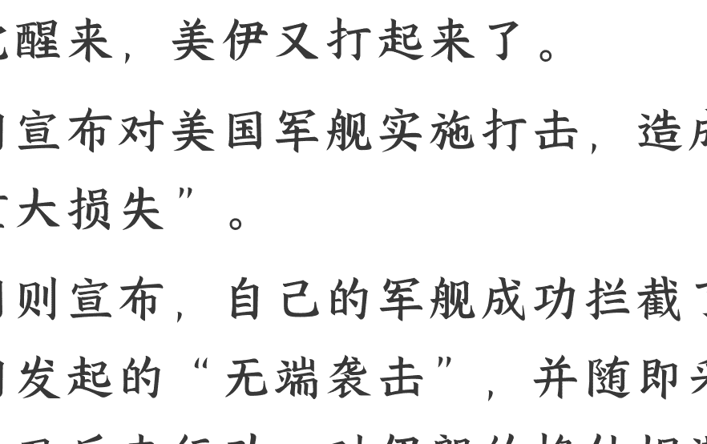

## 美国再次轰炸伊朗，怎么又打起来了？

260509 文/卢克文工作室嘉宾 概略北方
整理：公众号懒人搜索，[懒人专属群](https://www.zhihu.com/question/38471777)精选
懒人微信：lazyhelper1

一觉醒来，美伊又打起来了。

伊朗宣布对美国军舰实施打击，造成“重大损失”。

美国则宣布，自己的军舰成功拦截了伊朗发起的“无端袭击”，并随即采取自卫反击行动，对伊朗的格什姆港和阿巴斯港实施了轰炸。

咋评价呢？唉，累了，毁灭吧，就这样吧。

那为什么美伊又打起来了呢？既然开打了，停火协议是不是就作废了，美伊战争会重新爆发呢？

首先，我们需要从头梳理一下，这次冲突是怎么发生的。

自从 4 月 8 日美伊停火之后，台面下的博弈一直没停，双方在巴基斯坦谈来谈去，但始终谈不拢。

谈判桌上谈不拢，那就只能在现实中找筹码了。

伊朗方面，直接把管控范围向南延伸到了阿联酋的富查伊拉，向西拉到了乌姆盖万。

原来吧？只有在海峡里面才受伊朗管控，但现在呢？波斯湾里面也不安全了。

而美国呢？也丝毫不怂，以封锁反封锁，把军舰开到了阿曼湾的东端，对伊朗的所有港口实施封堵。任何试图进出伊朗港口的船只，无论油轮还是货船，统统拦截，人扣下，油拍卖掉。

从 4 月 13 日到 4 月 30 日，美国拦截/逼回了 42 艘伊朗货轮/油轮。

特朗普甚至得意地说：“这是一门非常赚钱的生意，我们就像海盗一样。”

但这招管用吗？没用。

因为美国的封锁，只针对伊朗，可伊朗的封锁，是针对全世界。

布伦特原油已经逼近 120 美元了，拖得越久，美国盟友越跳脚，美国国内的通胀压力也越大。

更关键在于，根据美国 1973 年通过的《战争权力决议案》，总统没有经过国会授权发动的军事行动，只能持续 60 天。

按这么来算，战争应该在 5 月 1 日结束。

但特朗普能容忍一个没有赢的战争结束吗？不可能的！如果美国就这么灰头土脸地撤了，那啥也别说了，特朗普的中期选举就别指望了。

那咋办？耍赖。

特朗普宣布，对伊朗的“史诗怒火”军事行动已经结束，那么 60 天的限制，就限制不住他了！反过来说，“史诗怒火”结束了，那是不是可以再开一个"XX 怒火”，再打 60 天呢？理论上来说，是可以的。

但问题是，60 天能让伊朗屈服吗？似乎很难。

思来想去，特朗普突然想到了一个新点子。

战争打到现在，推翻伊朗政权的目标是铁定达不到了，那美国的首要目标是什么？不是达成和平协议，是打通霍尔木兹海峡！只要霍尔木兹海峡开了，油价降了，操作的余地不就大多了吗？

有没有协议，反而不重要。

赫格塞思排长马上心领神会，搞了个“自由行动”计划。

计划的核心，就是由美军直接武装护送商船，强行硬闯霍尔木兹海峡，并且宣称已经完成了扫雷，海峡重新开放。鼓励波斯湾里面被困的船只，你们自由了，出去吧！我给你护航。

5 月 4 日当天，双方在海峡里大打出手。美军击沉了六艘试图拦截美国军舰的伊朗武装快艇（为啥用快艇？因为大船没了）。作为报复，伊朗向阿联酋发射了 15 枚导弹和 4 架无人机，炸了富查伊拉的一处石油设施，阿布扎比和迪拜上空甚至拉响了防空警报。

这是停火以来，规模最大的一次冲突。

这个时候，沙特坐不住了。为啥？特朗普在搞自由行动之前，没有和沙特通气。

从军事角度来说，自由行动想执行下去，光靠那几艘驱逐舰是不行的，还要依赖于驻海湾国家的空军基地的战斗机提供空中掩护，否则面对伊朗的饱和攻击，就是送菜。

可是吧，如果沙特和科威特境内的美军战机起飞作战，不是又相当于海湾国家介入冲突了吗？

伊朗不止一次地警告，海湾国家再敢让美军使用其领空对伊朗进行轰炸，那伊朗就打这些海湾国家的石油设施。

沙特外长费萨尔，赶紧找伊朗外长阿拉格齐通了电话，电话里说了啥没人知道，但大家只知道通完电话，沙特就直接宣布，不允许美军使用它的苏尔坦亲王空军基地，紧接着科威特也发声禁用。

为此，特朗普亲自打电话给小萨勒曼，但小萨勒曼没松口。看来沙特琢磨出来了，霍尔木兹海峡危机，也可以化危为机，只要不让美军使用基地，美军在霍尔木兹海峡就拿伊朗没办法，自己就不会遭到伊朗报复。

同时，自己可以通过延布港出口石油，而刚刚退出欧佩克的阿联酋就没法卖油，借此敲打一门心思跟着美国人走的阿联酋。

既然沙特和科威特不开放领空，那“自由行动”计划就没有在军事上成功的可能，于是特朗普只能宣布计划暂时中止。

当然，特朗普的理由还是冠冕堂皇的，说什么在巴基斯坦的斡旋下，双方在谈判上取得了“巨大进展”，协议达成的几率非常大，所以暂停自由行动云云。但是谁不知道自由行动暂停的真正原因，是沙特和科威特？

那么问题来了，为啥 5 月 6 日自由行动都停止了，5 月 7 日双方又打起来了呢？

答案很简单，因为特朗普并没有放弃打通霍尔木兹海峡的计划，也许伊朗只是色厉内荏，也许不用海湾国家的军事基地，也一样能打通海峡呢？试一试有什么关系？

如果伊朗没有拦截，那就证明了霍尔木兹海峡的封锁是吓唬人，那就把军舰停在霍尔木兹海峡里，安排被困油轮通行。

如果伊朗真的动真格拦截了，那就以此为借口把伊朗海岸线的军事基地清洗一波。

于是，特拉克斯顿号、拉斐尔·佩拉尔塔号和梅森号三艘伯克级导弹驱逐舰，小心翼翼地驶入了海峡，开始了火力侦察和武装碰瓷行动。

结果我们都看到了，发生的是第二套剧本，伊朗的导弹、无人机以及武装快艇蜂拥而至，美军拼命拦截，虽然结果双方说得完全不一样，伊朗说给美军造成了损失，美军说没有损失，但现实是，这三艘驱逐舰已经掉头撤出了海峡。

不过美军的目的已经达到了，顺理成章地袭击了伊朗在格什姆岛和阿巴斯港的海岸雷达、导弹发射阵地。

大家可以翻翻地图，格什姆岛是波斯湾最大岛屿，扼守海峡北入口，阿巴斯港是伊朗最大的海军基地和商业港口，轰炸这两个地方，可以有效削弱伊朗封锁海峡的能力。

如果伊朗的实力不再足以封锁海峡，那就必然要在谈判中软化态度。

轰炸之后，特朗普意味深长地说了这么一段话：“如果他们不迅速签署协议，将来我们会以更猛烈、更残酷的方式对他们进行打击。”

很显然，特朗普折腾这么大动静，还是要争夺霍尔木兹海峡主导权，进而以自己想要的方式，签署和平协议，仅此而已。

当然，特朗普搞出这次冲突，也不完全为了伊朗。

大家想一想，特朗普 5 月最关键的议程是什么？是出访啊！

这次访问本来是 3 月底，但是因为战争，被推迟到了 5 月。

按照特朗普的计划，伊朗战争应该是一场短平快的战争，美国天兵一到，伊朗就会像叙利亚那样土崩瓦解，他带着两场胜利的余威，趾高气扬地过来，再玩一次“从实力地位出发”。

这不是特朗普第一次这么干了，上次元首会晤的时候，美国就在当天轰炸了叙利亚，特朗普还曾得意洋洋地炫耀。但他低估了伊朗的韧性，中东战局僵持不下，这时候过来访问，他还怎么提条件？

所以只能推迟。

可是就算推迟到 5 月，特朗普就能在伊朗占到便宜吗？不能。

说白了，特朗普想用轰炸和军舰证明，自己仍然是战局的主动方，自己想什么时候打就什么时候打，想打哪里就打哪里，伊朗只能被动挨打，除了继续封锁海峡，无法做出任何其他反制。

这种战略主动的态势，可以作为他用来交换的筹码。

所以，无论是军舰冲突，还是阿巴斯港的袭击，本质上，都是美国在大国博弈前夜，拼命争取筹码罢了。

那么，这次冲突会不会导致美伊停火协议破裂，进而再次开战呢？

从现在情况来看，可能性不大。

看看双方的态度就知道了。

5 月 7 日冲突后，美军中央司令部虽然声称摧毁了所有来袭目标，但紧接着又加了一句话：“中央司令部无意寻求局势升级，但将始终保持战备部署，随时准备保卫美军部队。”

特朗普本人的表态更有意思，“这只是轻轻地敲打敲打，停火还在持续，依然有效。”

不得不说啊，美国真的不是当年的美国了。

当年美国在北部湾，仅仅是被几艘越南鱼雷艇接近了一下，国会就马上通过《东京湾决议》（当时北部湾叫东京湾），授权总统全面军事介入，美军对北越实施持续轰炸。

现在呢？世界第一军事强国，被几十枚导弹和无人机围攻了一天，然后却忙不迭地对外宣布“我不想升级”“停火依然有效”，这本身就暴露了其软弱本质。

为啥美国现在成这样了？

一方面是美国真的打不动一场全面战争了。

根据美国战略与国际问题研究中心的数据，截至 4 月份，美军精确打击导弹及防空拦截弹消耗比例高达 45% 至 50%，正面临“无弹可用”的潜在风险，而完全恢复库存预计需要数年时间。

另一方面，美国发现伊朗的韧性仍然很强。

5 月 7 日，CIA 向特朗普提交了一份分析报告，指出伊朗的移动发射车库存已恢复至战前的约 75%，导弹库存相当于战前的约 70%。伊朗已经能够恢复并重开几乎所有地下储存设施，修复部分受损导弹，甚至完成组装一些在战前接近完工的新导弹。

翻译过来就是说，伊朗战力仍在，如果再打下去，美国还可能遭遇更惨重的损失。

所以，特朗普现在的做法是，一方面通过这种低烈度的轰炸凸显自己的力量，另一方面又要小心翼翼控制这种轰炸不会引发新的全面冲突。

对伊朗来说，同样也有点打不下去了。

伊朗军事上的反击的确很漂亮，但这解决不了伊朗经济的问题。

目前，伊朗官方通胀率高达 68.9%，而实际体感通胀远高于此，食品价格一年内上涨超 200%，食用油涨幅达 219%，面包谷物上涨 140%，里亚尔黑市汇率一度达 160 万兑 1 美元，为了打仗，伊朗央行甚至发行了面值 1000 万里亚尔的纸币，这其实就相当于在掠夺民财了。

根据 IMF 的预测，2026 年伊朗经济将萎缩 6.1%。

现在伊朗还能靠着全民同仇敌忾，来保持政权稳定，但如果战争长期化，民众对战争麻木后，伊朗如何解决民生问题？

伊朗也想结束战争，现在的强硬，只是想珍惜巨大代价换来的战略主动，捞取更多好处罢了。

所以，美国和伊朗，其实都在玩走钢丝的游戏。

事已至此，下一步会如何？

更大的可能是，双方博弈进入一个不战不和的新阶段，在谈判陷入僵局的背景下，维持这种小规模的冲突，谈谈打打，打打谈谈，美军会不断试探，而伊朗一边果断反击，另一边也会留有余地，避免升级。

**也许，5 月 7 日的这场冲突，就是这个新阶段的开始。**

———分割线————

**绝大多数人只盯着眼前的工资，却不知道一次远在中东的冲突、一次降息的决议，就能在一夜之间洗牌普通人的财富。**

**看懂宏观，是为了在周期切换时，不被当作代价。**

如果你认同这种“抬头看路”的长期主义，欢迎围观我的个人情报智库：【懒人专属群】。

圈子已稳定运行 7 年。我们每天利用 Python 爬虫与大模型算力，过滤全网最顶级的政经内参和搞钱风向标，做你最冷酷的“外部大脑”。

查阅圈子完整数字资产与上车门槛：<https://lazyso.com/insider/>认同价值的。扫码加我微信，备注：【进群】

