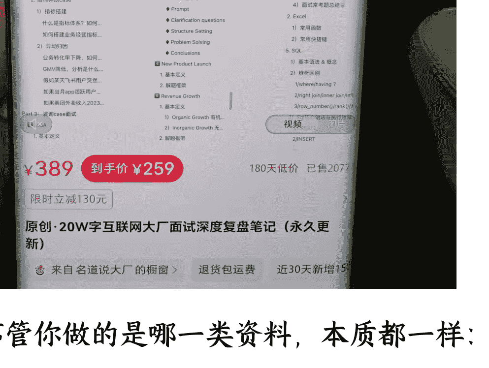
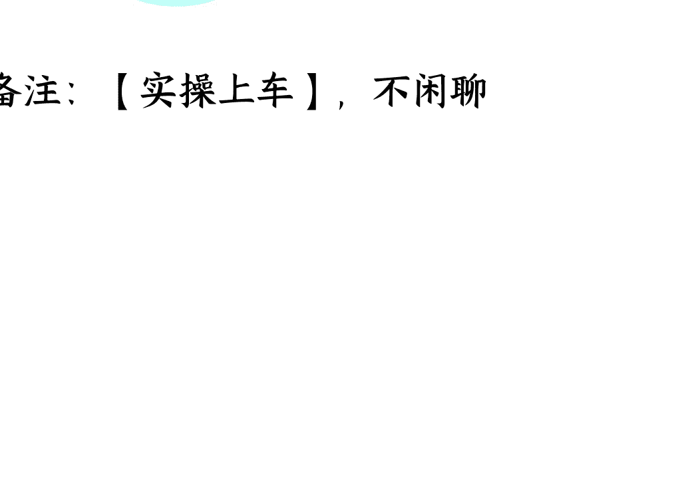

# 从航海交白卷到稳定月入 2W，我在小红书 PPT 赛道的心得与经验

**公众号懒人搜索，懒人专属群分享**

**懒人微信：** lazyhelper1

大家好，我是 shu.p.舒蓬，一个从线下活动行业转型做小红书虚拟资料的人。

我今天分享的不是那种“暴击型”的数据，而是更像“平 A 型”的输出——不夸张，但稳定，而且是可以持续打出来的。

先简单说一下我的情况：

这是我在春节前成都线下组局时，当场给自己立下的一个目标；现在回头看，这个目标已经在一步步兑现了。

后面接触到小红书虚拟资料，一开始只是当副业试试，但真正做起来之后，有一个很明显的感受：钱开始每天一点点回到自己手里。哪怕一开始不多，但这种“每天都有进账”的感觉，和以前完全不一样。

目前我的情况是：1 个店铺 + 4 个账号，没有投流，纯自然流。
月收入大概在 2W 左右，日常工作日 600-900，偶尔破千。

我不是那种追求单日爆发的人，我更在意的是：这件事能不能稳定、能不能长期做。我会尽量顺着平台的机制去做内容，而不是去对抗规则，本质上是想把这个项目当成一个长期经营的事情来做。

## 一、我不是一开始就跑通的

我先说个反直觉的点：我 25 年 6 月第一次参加航海，是交了“白卷”的，1 分钱没赚到。当时的状态就是：不知道选什么赛道，也找不到对标账号，完全是迷茫的。

后来跟着圈友开始做教务资料，其实那时候我内心并不看好这个方向，只是把它当成一个“练手项目”。到了 8 月底、9 月初，开始陆续有点结果，赚了小几千块，当时觉得还不错。但很快现实又给了一巴掌——开学季一过，流量下滑，我的收入掉到每个月 3000 左右，而且这种状态持续了好几个月。那段时间其实挺容易放弃的。

但我后面想清楚一件事：不是这个方向不行，而是我没有认真做。到了 26 年，我开始把精力慢慢收回来，认真投入到这个项目里。

## 二、真正拉开差距的，不是运营，是内容

我在成都也经常参加一些线下活动，也做过航海志愿者，我发现一个很有意思的现象：很多人都在研究这些问题：
- 一天发几条笔记
- 什么时候发
- 要不要挂商品
- 要不要做矩阵
- 要不要办执照

但很少有人认真问一句：“我的内容本身，够不够好？”

我自己踩过一个坑——一开始我是直接去闲鱼、淘宝买现成课件来卖。结果很明显：
- 要么流量起不来
- 要么被判重复
- 甚至还被原创投诉

侵权投诉通知
01-28
你好，收到相关人投诉，你于【2026-01-05 19:43】发布的笔记涉嫌抄袭，笔记已下架处理。如对处理结果存疑，可点击下方【查看详情】了解更多信息。

侵权投诉通知
01-23
你好，收到相关人投诉，你于【2026-01-21 18:26】发布的笔记涉嫌抄袭，笔记已下架处理。如对处理结果存疑，可点击下方【查看详情】了解更多信息。

侵权投诉通知
01-03
你好，收到相关版权方投诉，你于【2026-01-01 17:52】发布的笔记传播未经授权的盗版违规内容，涉嫌著作权侵权，笔记已下架处理。如对处理结果存疑，可点击下方【查看详情】了解更…

后来我才意识到：
✈️ 小红书拼的不是信息，而是表达方式
✈️ 内容本身，占 80%；运营技巧，只占 20%

### 三、我的关键转折：从“堆信息”到“做内容设计”

真正让我开始跑起来，是在今年开学节点。当时我做了一个改变：不再只是整理课件，而是开始“设计内容”。

举个简单例子：
以前讲历史，就是按教材讲时间、事件、结果。但学生其实很容易走神。后来我换了一种方式：不是直接讲发生了什么，而是换成——
> “如果你站在那个时代，你会看到什么？听到什么？”

把内容做成一种有画面感的情境。这样一来：
- 学生更容易代入
- 老师讲课也更轻松
- 内容本身更有吸引力

我把这种表达方式同步用在小红书笔记里，点击和转化明显提升。那一波开学，我用这套思路做的原创课件，单个课件能跑上百单。

这时候我才真正确定一件事：
> 👉 不是赛道的问题
> 👉 是你有没有把内容做到“有感觉”

### 四、我怎么用 AI，把内容能力放大

这里我讲一下我的完整流程，这一块我尽量说细一点，新手可以直接照着做：

#### 第一步：找到原始内容（不要瞎编）

我一般会去淘宝/闲鱼买教材电子版，或者其他基础材料的电子版。核心原则：一定要用“原始内容”，不要直接用别人整理好的资料。然后我会把教材拆分成：一节课 = 一个文件。这样做的好处是：后面喂给 AI 的时候不会混乱。例如：这是一本语文教材，我们拿到的原始资料是整本书，我们需要拆分额外每一节课为一个 dpf 文件。

#### 第二步：用 AI 拆课件结构（这是整个流程的核心）

我会把一节课的内容丢给 GPT 或 Gemini，让它帮我完成一件事：
👉 把一节课拆成“每一页 PPT 的标题 + 内容”

但这里有一个非常关键的点：**一定要通过多轮对话不断打磨**。我自己的流程大致是这样：
- 第 1 轮：让 AI 给出一个基础初稿
- 第 2 轮：我手动删掉废话、调整结构
- 第 3 轮：加入自己的想法（比如生活化表达、个性化表达）
- 第 4 轮：再让 AI 优化成最终版本

有时候甚至会多轮来回调整。这一环节，是我每天花时间最多的地方。因为这一层做得好不好，直接决定了后面内容的质量。本质上，这一步做的不是“整理内容”，而是：**内容设计**。很多人会卡在这里，是因为想一步到位，但我的经验是：慢一点打磨，反而更容易跑出效果。

举个具体例子：
- 街边有哪些商铺
- 人们在做什么
- 有没有热闹的市集
- 有没有类似今天的‘夜生活’

这样一来，内容本身就从“信息”，变成了“场景”。再进一步，我会做一件事：再补上逐字稿 + 教案，形成一个完整的教学产品。这样一套下来，就不再是一个“课件”，而是一个：**可以直接拿来上课的成品内容包**。这个过程，本质上就是：从“教材复述”→ “内容设计” → “产品化表达”而转化提升，基本都发生在这个过程中。

另外，我还有一个习惯：每次对话优化完之后，我都会让 AI 帮我总结一版“提示词”。随着不断迭代，这些提示词会越来越贴合自己的风格。我现在**的提示词，已经累计接近 3000 字**。所以后面再生成课件内容时，整体质量会明显更稳定。

#### 第三步：固定输出格式（非常重要）

最后我会让 AI 统一输出成这种格式：
标题：XXXX
内容：XXXX
只保留 PPT 要展示的文字，不要解释、不要多余内容。因为后面要直接丢给 AI 做图。

#### 第四步：用 AI 生成 PPT 画面

我现在用的是：中转 API + Banana 模型（也可以用 notebooklm 平替）。这里有个关键点，我们要提前给 ai 找到样图。找样图的地方推荐三个网站：
1、花瓣网
2、（推荐）小红书，在我眼中它本身也是一个图库
3、百度图片

找图的时候建议大家不要用强 IP 的，比如疯狂动物城、哪吒等等，可以用其他作品的手绘作品或者无版权图片。

**这里很多人会吐槽一句：**“这种 PPT 不能编辑，有什么用？”但我后来想通了：我们不要自我放大劣势，而忽略了优势：
**1、它的优势不是“可编辑”，而是“好看”**
**2、那我就不卖素材，我卖“成品内容”**

比如：**沉浸式课堂**
- 故事型课件
- 分享展示类内容

这些场景，本来就不需要频繁改。思路一转，反而顺了。

#### 第五步：用飞书多维表格快速写出小红书的图文笔记

我在写小红书图文笔记这一块，会用飞书多维表格去做结构化生成。前期把提示词和模板搭好之后，后面只需要输入几个关键词，就可以快速生成一篇完整的笔记内容，大幅提升内容产出效率。

## 五、我不赌爆款，是靠多 SKU 把收入做稳的

### 1、为什么我一开始就做多 SKU

我一开始做这个项目的时候，就有一个比较明确的判断：只卖单品，很难把收入做稳。比如这种商品属于单 SKU，就算流量突然很高了，这个品能卖到的钱也是有限的，而且流量风口一过就没有了。

**如果要选一个伙伴去野外探险，你会选择谁？**
- **选项 A**：成绩全优，但遇到突发状况容易慌乱，不善于与人合作，体力一般。
- **选项 B**：成绩中游，但有主见，遇到困难能坚持，并且乐于助人。

**评价一个人，标准从来不止一个**
- **与人相处的品格**：成绩差≠人品差；分数低≠能力低。
- **创造美好的热情**：学习知识的能力很重要，但它只是孩子成长的一部分。这些结合在一起，才构成了一个完整的人，决定了孩子未来人生的广度与温度。
- **面对挫折的勇气**
- **理解他人的善良**

**成绩单之外，我们看到了……**
- **创造之手**：板报、模型的灵魂设计师。
- **领导之才**：球场上的指挥官，困境中的定心丸。
- **责任之心**：每天最早到，默默为大家放下凳子。
- **善良之光**：总能第一时间察觉并温暖他人的心。

**这些闪光的品质，是孩子未来人生更宝贵的“压舱石”。**

---

**我们最希望孩子成为什么样的人？**
- **善良、有爱心**：健康、快乐。
- **正直、有担当**：坚韧、有勇气。
- **自主、有热爱**。

**这些目标，远非一张成绩单可以衡量。**

---

**¥12.9** 
到手价 **¥6.99** 已售 35  限时立减 5.91 元  **中小学期末家长会 ppt | 分数之外，看见孩子的光芒 | ppt+讲稿 秒发**

- **付款后自动发货**
- **不支持无理由退换**

**商品评价 18**
- **店铺** 
- **客服** 
- **购物车 (1)**  **加入购物车 | 立即购买**

因为小红书的流量是有波动的，有时候某一条笔记跑起来，某个商品会突然出单很多；但一旦流量下去，收入也会跟着明显下滑。**如果整个店铺只靠一个 SKU，本质上还是在“赌爆款”。**但我之前做线下活动，经历过那种收入忽高忽低、现金流不稳定的阶段，所以在重新做项目时，我会特别在意一件事：能不能不靠运气，也能持续有钱进来。所以我从一开始就没有把目标放在“做一个爆品”上，而是更倾向于去设计一个更稳的收入结构。

多 SKU 不是为了看起来产品多，而是为了降低波动，让收入从“偶尔爆一下”，变成“每天都有进账”。

### 2、我的 SKU 结构是怎么设计的

很多人一开始就会犯一个问题：SKU 之间是割裂的，没有形成联动。比如：SKU1 卖班会主题，SKU2 卖语文复习资料。这种是“各卖各的”，很难形成流量放大。我自己的做法是：所有 SKU 围绕同一类内容展开，让它们彼此承接、相互放大。虽然不可能每个 SKU 都成为爆款，但：20 个 SKU 里，跑出 3-4 个爆款是完全正常的。

在具体设计上，我并不是简单地多挂几个商品，而是给每一类 SKU 做了明确分工。同一套内容，我一般会拆成三层：
- a、单课（低价）：负责引流
- b、模块（中间价）：负责过渡
- c、全册（高客单）：负责主要利润

**这样设计的核心，不是价格差异本身，而是让不同阶段的用户，都能找到一个“合适的入口”。**
- a、想低成本试试的，有单课可以选
- b、已经有一定信任的，可以直接买模块或整套
- c、想一次性省事的，会直接选择全册

本质上，这不是在卖三个产品，而是在用不同 SKU 去承接不同决策阶段的用户。

### 3、用户是怎么一步步买单的

从实际成交来看，用户的购买路径大致有两种：
第一种是“先试再加购”：先买一节低价单课试一下内容质量；觉得好用之后，再补全模块或直接买全册。
第二种是“直接决策型”：看了笔记和展示内容后，直接选择全册；更看重效率，不想反复选择。

多 SKU 的作用就在这里体现出来：它不是为了让用户多选，而是为了降低决策门槛。
- 想谨慎的，有低价入口
- 想省事的，有直接方案

这样不同类型的用户都不会被挡在门外，整体转化会更顺畅。这个也是我的转换率基本上在 15% 到 20% 左右。

### 4、做多 SKU 后的结果

当 SKU 结构跑通之后，最直观的变化有三个：
第一，客单价提升了。因为有全册和组合的存在，用户在对比时，更容易选择“看起来更划算”的高客单选项。
第二，收入更稳定。不再完全依赖某一个单品或某一条笔记的爆发，即使单个 SKU 波动，整体也不会明显掉下来。
第三，做内容更有方向。知道哪些内容适合做引流，哪些适合做主推，选题和生产也会更有节奏，而不是盲目去试。

整体下来，我的感受是：多 SKU 本质上解决的不是“卖得更多”，而是“赚得更稳”。

## 六、当我不知道做什么内容时，我用预售来“反向选题”

### 1、我为什么不先做内容

一开始我也踩过一个坑，就是先把一整套内容做完，再拿去卖。结果经常会出现一种情况：做的时候觉得这个内容不错，但发出去之后，几乎没人买。慢慢我意识到一个问题：我以为的需求，不一定是真实需求。所以后面我调整了一个思路：不再先做完整内容，而是先通过简单的产品形式，看市场有没有反馈。

### 2、我怎么用预售测试

具体操作其实很简单：我会先准备一批基础内容，然后拆成 4-5 个单独的小 SKU 去卖，可以测试下市场的需求，根本不需要完成所有的工作。这一步的目的，不是赚钱，而是看：
- 哪一类内容有人买
- 哪一类点击高但转化低
- 哪一类基本没人动

通过这一轮测试，其实就能大概判断出：哪些方向是有需求的。在这个基础上，我再去做下一步：把表现不错的内容，组合成一个合集 SKU，并标注“预售 / 更新中”。

这一步本质上是在做一件事：用真实成交，来验证这个方向值不值得继续做。

### 3、这个方法带来了什么变化

这套方法跑下来之后，我最大的感受有三个：
第一，不再瞎做内容。每一套内容，基本都有前置验证，而不是靠感觉去赌。
第二，执行力反而更强。因为一旦有人下单，反而更容易逼自己把内容做出来。
第三，选题越来越准。做多几轮之后，会慢慢形成一种判断：什么类型更容易被接受，什么内容更容易转化。

整体来说，这一套方法的本质是：不再用“做内容”去试错，而是用“成交数据”去反推内容方向。

## 七、我在运营上做对的几件小事

前面几部分更多是在讲核心打法，这一部分是一些看似细节，但会直接影响转化和稳定性的执行动作。

### 坚持原创，而不是搬运

我一开始是搬运课件的，结果很惨：
- 流量不稳定
- 容易被举报
- 平台不给推荐

**比如：**用奶茶、外卖、游戏这些场景去类比知识点。这种内容在小红书更容易跑出来。

### 先跑通模型，再考虑矩阵

**我最多做过 8 个账号，但效果很差：**
👉 **问题是：精力被分散** → 内容质量下降 → 流量下降
后来我直接砍到 4 个号，反而更好。
**我的建议是：先用 1-2 个账号跑通模型，再考虑放大。**

### 提前经营好评和评论

**很多人是“等评价”，我是“要评价”。**
👉 **我的做法：**
- 用户下单后主动问使用情况
- 满意的引导好评
- 偶尔给一点补充资料（提升体验）

比如可以在阿奇索里面设置的，自动发货的时候会给到对方推送消息。

--- 感谢您的耐心等待~以下是您的订单
P7917264
分享多谢关照~有空再来逛逛哦~ ----
12h内【15字评价 + 配图】可领取全册
同样也是优质资料，很多会搭配一起用，上课更顺～
评价后截图发我，这边马上给您补发～

这样做的益处：
- 快速积累评价
- 提高转化率
因为新用户会看评价，这是非常关键的一环。
前期不养成习惯索要好评的话，如果顾客恶意给那么两三个差评，店铺的好评率数据会不太好看，会影响一定的成交的

关于恶意退款用户的处理
这一块我处理得比较简单：

如果遇到明显情绪比较重、反复抱怨的用户，我一般会选择直接退款，不做过多沟通。

原因很现实：小红书店铺对回复时效是有考核的（比如 3 分钟响应），如果在单个用户上消耗太多时间，反而会影响整体运营效率。

而且从经验来看，这类用户即使继续沟通，转化为好评的概率也比较低。

所以我的策略是：把时间优先放在内容优化和正常用户上，而不是高消耗沟通。

> **作品完成后，建议同步做版权登记**

当你的内容开始跑起来之后，我建议尽早去做版权登记。

原因很简单：

**虚拟资料本质是内容，一旦有销量，就一定会被同行盯上，尤其是搬运和二次分发的问题。**

**在操作上其实不复杂：**

最简单的方式，可以直接在淘宝找人代办，几十块钱就可以完成一份基础登记。

如果有条件，也可以走本地官方渠道，有些地区是支持免费登记的（比如四川这边就有相关渠道 https://register.sc-copyright.cn/）。

我在这里按照顺序填写一个表，大家可以根据步骤抄作业

## 账户登陆
- **用户名称**：[输入框]
- **登录密码**：[输入框]
- **登录按钮**
- **注册新用户** | **找回密码**

### 作品登记
#### 作品信息
- **作品名称**：[输入框]
- **创作说明**：[输入框]
- **作品类型**：[下拉菜单]
- **作品性质**：[下拉菜单]
- **创作完成日期**：[选择器]
- **发表地点**：[输入框]

### 作品登记
#### 作品信息
- **作品名称**：[输入框]
- **创作说明**：[输入框]
- **作品类型**：文字 [下拉菜单]
- **作品性质**：原创 [下拉菜单]
- **创作完成日期**：2026-04-10 [选择器]

#### **作品名称**：直接填写作品内容即可
#### **创作说明**：本作品为作者基于……的教学课件，采用……设计方式，将…………进行结构化整理与表达，包含 PPT 课件内容及配套讲解文本，用于课堂教学使用。
（如果这里不会写可以直接问 ai）

#### **著作权人**
- *姓名或名称*：舒蓬
- *著作权人类别*：自然人
- *国籍*：中国
- *城市*：成都
- *证件号码*：[输入框]
- *证件类型*：居民身份证
- *省份*：四川
- *署名情况*：本名

## 权利保证书模板

## 权利保证书

本人舒蓬，身份证号 [图片] 声明：
本人提交登记的 [图片] 这里写作品名 [图片]
为本人独立创作完成的作品，未侵犯任何第三方合法权益。如因作品权属问题产生纠纷，由本人承担全部法律责任。
特此声明。

名字这里盖手印
声明人：舒蓬
日期：2026 年 4 月 17 日

## 版权登记的实际作用主要有三个：

### 1、提前做“防护”

可以把证书展示在商品页，提高内容的可信度，同时也能降低被随意搬运的概率

### 2、方便平台维权

如果遇到被搬运的情况，在小红书或其他平台（抖音、视频号等）进行投诉时，会更容易通过

### 3、作为长期资产沉淀

当内容积累多了，本质上是在做一套可复用的知识资产，版权登记也是其中一部分
我的理解是：前期可以先不做，但一旦某个内容开始稳定出单，就值得补上这一步。

## 八、总结：给新人的 3 个建议

### 1、一定要做原创，不要搬运

搬运短期可能有流量，但很难稳定，更容易被平台淘汰。

### 2、不要一上来就铺矩阵

先把一个店铺跑通，比你做多个店铺更重要。

### 3、多平台开花，鸡蛋不要放在一个篮子里

这是一个轻资产，但本质上是：拼内容能力的长期项目。

当你的内容是自己的之后，其实可以很自然地做延伸：

- 同步到小红书
- 再复制到抖音、公众号等渠道

28 / 31

本质上是在放大一套内容，而不是重复做很多份内容

所以从长期来看：真正属于我们的，不是某个平台的技巧，而是我们持续产出内容的能力

## 九、我对这个方向的判断

我自己的判断是：这个方向短期内依然有空间。

但要看清一件事：我们做的，本质不是某一个具体产品，而是“内容产品”

比如这个爆款，肯定是不断迭代更新出来的

不管你做的是哪一类资料，本质都一样：

- 有没有被重新组织
- 有没有清晰的表达结构
- 用户拿到之后，能不能直接用

所以我现在的思路是：不是去复制别人，而是做“内容组合”

- 内容 + 使用场景
- 内容 + 讲解逻辑
- 内容 + 工具/形式升级

当内容开始组合之后：使用场景会被放大，客单价也更容易提升

以上就是我这次的分享。

如果你现在也在做小红书虚拟资料，卡在“有点结果，但不稳定”的阶段，

建议你回去认真想一件事：你的内容，是随便做的，还是被设计过的？

这两者，决定了是：靠运气出单还是长期稳定放大的生意？

> ———分割线———

看完这篇 SOP，你觉得你懂了。但 90% 的人一到实操就会卡在第一步。

工具和教程只是最低级的壁垒，真正的壁垒是“立刻动手”和“圈层信息差”。

如果你想看全网最新的变现玩法，并且和一群执行力极强的极客一起下场拿结果，欢迎围观我的核心私域：【懒人专属群】。

我们不聊虚的，只做商业闭环的拆解与 AI 效率的压榨。系统内已沉淀 1000+ 跑通的套利实战局。

👉 查阅圈子完整数字资产与上车门槛：
https://lazyso.com/insider/

认同价值、准备好下场干活的，扫码加我微信（lazyhelper1）

备注：【实操上车】，不闲聊