# 谷歌广告投放保姆级教程（基础篇）

## 背景

大家好，我是你们的老朋友前行，现在一直深耕于 AI 出海网站。这篇文章主要与大家分享：新手如何快速创建一条谷歌投放广告。告的每一步操作都截图，跟着做，新手也能快速创建一条谷歌广告。说句题外话，之所以分享这个主题，是我最近两周打算通过谷歌广告来快速验证想法，但作为投放新手的我，完全不知如何入手，在生财有术里面也没有搜到相关的基础教程。所以我是从零开始，去到处搜索相关信息来完成这个投放任务。现在已经成功创建了广告投放。因此，我觉得有必要把这些基础的创建流程分享给各位大家，以帮助大家少走弯路，快速建立起一条谷歌投放广告来验证需求。

谷歌广告投放主要包括：创建账号，设置转化目标、设置转化追踪代码、关键字、创建广告等。接下来我按照这个步骤，手把手教新手快速创建。

## 一、谷歌 ads 账号创建

目前新创建账号是有赠券金领取的，这个赠券金是用来抵扣后面的广告费用，而不是直接抵扣你一开始的广告花费。打开 <https://ads.google.com/intl/zh-CN_cn/home/>，往下滑，你会看到如下界面，总共有三档赠券金可以领取，各自有领取门槛，60 天内完成即可领取。

如果没有开通过 Ads 账号，会让你先创建。一般来讲，一个 Ads 账号，只投一个网站是最好的，不要多个网站混在一个 Ads 账号里投放，不然目标会乱掉。并且一个 Google 账号可以创建多个 Ads 账号，目前每个 Ads 账号都能领赠券金。

> **显示这样，表示你这个谷歌账号没有开通过Ads**
>
> > 您没有任何 Google Ads 账号。您是否希望创建一个新账？
> > - 新建 Google Ads 账号
> > - 切换 Google 账号

显示上图那样，说明你没有创建过 Ads 账号，点击新建即可。创建并且登录好后，就会进入以下界面，不要点击“制作首个广告系列”，点击其他地方，这个弹窗会退出。

#### 接下来按照以下步骤进行

##### 第一步：填写商家信息
不填商家名称，只填要投放的网址，然后点击下一步。

##### 第二步：跳过更多信息设置
**第二步：什么都不选，直接跳过**

添加更多信息以节省设置时间

##### 第三步：选择账号类型（重要）
这里特别注意，选项在最下面，要选择仅开设账号。广告系列的目标我们后续再设置。**

##### 第四步：设置账单与地区信息（关键步骤）
这个一定要重视，这里选择账单邮寄地址是中国、时区是北京时间（跟流量统计平台时区一致）、币种选择港币。因为选择港币不需要额外缴纳税，选择人民币需要。如果你没有可以支付港币的银行卡，那就只能选择人民币。

###### 确认您的账号设置和付款设置

这些信息将用于创建您的账号。您以后将无法更改这些设置，因此请谨慎选择。

| 项目 | 内容/说明 |
| :--- | :--- |
| **账单邮寄地址所在国家/地区** | 中国 |
| **时区** | (GMT+08:00) 中国时间 |
| **币种** | 港元 (HKD HK$) |

> > 很多朋友都有港卡，这里就以港币为例  > > 支出满 ¥18,000.00，即可获得 ¥9,000.00 - 成功完成结算设置后，即可享受此优惠。仅限新广告客户。请在 2026年5月14日之前达到支出要求。[查看条款及条件]

####### 第五步：填写支付资料

注意，后面实名认证，需要上传护照或者身份证，这里需要填写真实信息。**真名和真实地址信息，一次认证，后续可以复用**。填写中文姓名和中文地址是没问题的。

| 项目 | 内容/说明 |
| :--- | :--- |
| **账号类型** | 个人 |
| **名称和地址** | 中国 广东省深圳市 [已模糊处理] 邮政编码：518000 |

付款选项，首次选择手动支付，风控风险更小，选择自动支付可能不通过。付款方式的话，可以绑定香港银行信用卡或者招商银行全币种信用卡，当时我试了中国银行香港卡的储蓄卡是不能绑定的。虽然我这里选择的是自动付款，但是你首次绑定港卡，建议选择手动支付，更容易被支付成功。

如果您选择自动付款，只有在您实际产生费用后才需要为此服务付费。系统会在每个月的第天自动扣款，或者在每次您的余额达到支付最低限额时扣款。详细了解。这里我绑定的是香港汇丰的消费卡。您的银行卡记录中会出现一笔 HK$100.00 的临时扣款授权，此记录通常会在周内移除。

选择人工付款，如果之前选择的是港币，不知道还能不能用支付宝，之前如果选择人民币是可以的。各位圈友可以自己试下。

######## 付款方式说明
您可以使用付款账号的余额支付此服务的费用。每次产生费用后，我们会从您的预付款余额中扣除相应款项。如果该付款账号中的余额用尽，服务将会停止。为账号充值后，服务会自动恢复。指定付款金额（例如：10000.00）。账单邮寄地址与法定地址相同。

######## 添加支付宝 Alipay
系统会将您重定向到支付宝Alipay以验证您的账号。继续操作即表示您同意支付宝Alipay服务条款。本广告计划条款(以下称“这些条款”，其对应英文为"Advertising Program Terms")由谷歌广告（上海）有限公司(以下称“谷歌”)与签署这些条款或以电子方式接受这些条款的实体(以下称“客户”)订立。这些条款约束客户对谷歌广告计划和服务(以下统称“计划”)的参与。

######## 免密支付安全验证
使用装有支付宝客户端的设备，登录本人支付宝账户扫码验证。显示支付宝账号了，就是绑定成功了。您的银行卡记录中会出现一笔 ¥100.00 的临时扣款授权，此记录通常会在一周内移除。

## 至此，Ads 账号注册完成。

若要开始投放广告，您需要完成广告客户验证这有助于 Google Ads 验证每位广告客户，为用户提供更高的透明度、更大的选择余地和更多的控制权。[详细了解我们采取这项措施的原因](https://support.google.com/ads/answer/1029485)

**新账号，还需要补充商家信息，选择非代理机构，选择自己付款。**
接下来进入了 Ads 网页里，如果你看到网页语言不是中文的，可以在设置里改成中文的，方便查看信息。到此，Ads 账号创建全部完成，在创建广告系列之前，还需要做一个重要步骤，就是把你的谷歌 Ads 和 GA4 和 Tag Manager 关联起来。

## 二、转化目标设置

在正式开始之前，我们先理清一些概念。**首先谷歌 Ads 是有自己的代码的**，是用来统计通过点击搜索广告进入网站后的用户行为，特别是我们关注的转化行为，如果没有配置好，这个广告作用大大降低，因为谷歌没法通过数据学习来给你推荐精准的用户。投广告前期最大的目的就是积累数据，让谷歌广告了解你的网站需要什么样的用户，以及知道什么样的用户会在你的网站付费。

### 1、添加 Google Ads 代码
首先是添加 Google Ads 代码，点击左栏的 **工具** ，再点 **数据管理器** ，在 Google 代码下方有一个如下图的标签，点击右侧的 **管理** ，弹窗如下界面，会出现 AW 开头的 ID，这个 ID 就是用来关联你的网站与这个 Ads 账号。

### 2、转化追踪设置
点击左侧 **目标** ，选择 **摘要** ，新建转化操作。勾选 **网站上发生的转化**，如果数据源不是我们刚才设置的 Google 代码，可以点击蓝色字 **修改数据源** 进行修改。如果需要修改数据源，按照以下步骤：

第一步，输入你的网站网址，点击扫描，会出现两个选项，一般选择 Google 代码，也就是 Ads 给你的统计代码，会比较准确，第二个是 GA4 数据源，可能会有漏的。图中的第三个选项忽略，是我的另一个网站。图中有尚未添加的提示，是因为我截图时还没有在网站上添加上 Google 代码。如果你上一步已经把 Google 代码添加到网站就不会出现这个提示。选择好之后，点击保存并继续。

第二步，我们一般选择购买或者订阅，因为我们投广告的最终目的是用户付费。选好后点击 **保存并继续**。第三步，点击创建转化，选择刚才创建好的 **数据源** 。第四步，设置转化目标：选择手动添加代码，操作优化设置为 **主要操作** ，转化名称可以改名字的，一般按照默认的购买就行。

这里需要说明一下：这次添加代码是为了追踪用户的特定行为，比如我们现在的设置就是追踪用户在网站上购买的行为，而且是只从谷歌广告进入网站并进行了购买的用户行为才会被追踪记录，其他行为都不会（自然流量产生的购买行为不会被记录到这里）。这里的价值选择第二个，为每次转化使用不同的价值，然后填写一个兜底的价值，选择这个的话，正常情况会传递你网站真实的购买或者订阅价值，这里的默认值是用来兜底的。统计方式选择每一次，因为我们要追踪每一次的用户购买行为，以便让谷歌广告系统优化智能出价。

还要注意 **增强型转化** 是不是勾选上了，默认是勾选的，如果没有勾选要勾选上。点击完成，再点击 **保存并继续**。第五步，设置转化追踪代码：我使用的是 Google 代码进行设置，选中后，点击 **查看事件代码段** ，把这个代码复制给 codex 等 ai 编程工具，让它添加。添加完后，你核对代码段里 sent to 后面的 id 是否正确，这个直接关系追踪数据的准确性。其实这一步也可以使用 Google 跟踪代码管理器，不过我没有使用，不是很熟悉，感兴趣的圈友可以了解。都做好后，点击完成。

第 6 步，测试转化追踪代码是否可用：如下图，我们刚才配置的转化目标状态显示 **无效** ，这是因为网站上可能还没添加上代码段或者刚配置好还没有更新。我们可以点击后面的问题排查来查看原因。输入你的网址，点击连接，记得要用 Chrome，不要用 ai 浏览器，不然可能被拦截。你也可以先在本地测试没问题后再部署上线，这个是支持本地连接测试的。点击连接后，会打开一个窗口进入你的网站，你就根据你要测试的转化目标去操作，比如你测试的是购买，那就要真的触发一次购买，用支付网关的沙盒模式测试就行。如果测试的是注册，那就直接注册一个新账户触发这次测试。总之你想测试什么就去操作什么，然后按照指引点击完成，就会回到 Ads 后台界面。

第七步，继续添加其他转化目标，但我们仍然选择的转化目标是购买。大部分操作都是跟之前一样的，唯一有区别是转化目标设置那里。这次的操作优化设置，需要选择 **次要操作** ，这个转化目标是不需要用于优化智能出价的，只是我们自己要通过这个数据来优化落地页或者其他目标。统计方式，也只统计一次即可。

接下来，再创建注册为转化目标，操作跟上一步是一样的。一般来说，转化目标为购买（主要）、试用、注册、加入购物车（用户点击了购买或订阅按钮，最终没有支付成功）。至此，转化目标和转化设置全部完成，接下来就是创建广告了。

## 三、创建第一条谷歌投放广告

正式创建投放广告之前，我们再理清以下概念：
- **Ads账号**：“广告后台总公司”，**设置：**
    - 谁能登录管理；
    - 绑定哪个付款方式；
    - 使用哪个时区、币种；
    - 整个账户的转化追踪、账单、权限等基础设置；
    - 下面可以创建多个广告系列

- **广告系列**：一个“投放项目”，设置：
    - 投放目标：购买、注册、获取潜在客户、网站访问等；
    - 投放类型：搜索广告、展示广告、视频广告、效果最大化广告等；
    - 每日预算；
    - 投放地区；
    - 投放语言；
    - 出价策略；
    - 主要优化目标

这里最重要的是：**预算通常在广告系列层级控制**。比如你给“美国市场 - 搜索广告 - 购买转化”每天 $50，那这个广告系列下面的广告组会一起竞争这 $50 的预算。

- **广告组**：一个“关键词/主题小组”，放一组主题相近的关键词；放和这些关键词匹配的广告文案；让用户搜索某类词时，看到更相关的广告。**广告组就是把相似搜索意图的关键词放在一起，然后配对应的广告**。
- **广告**：用户最终看到的“文案/素材”，设置：标题、描述、显示网址、落地页链接。• 附加信息，比如站内链接、宣传信息、结构化摘要等  
广告就是摆在用户面前的销售话术  

#### 四者之间的关系:  

- 账号  
  - 广告系列  
    - 广告组  
      - 广告  

##### 1、关键字研究  

在开始创建广告前，你需要先知道投哪些关键字，谷歌广告后台有个工具非常好用，那就是关键字规划工具。  

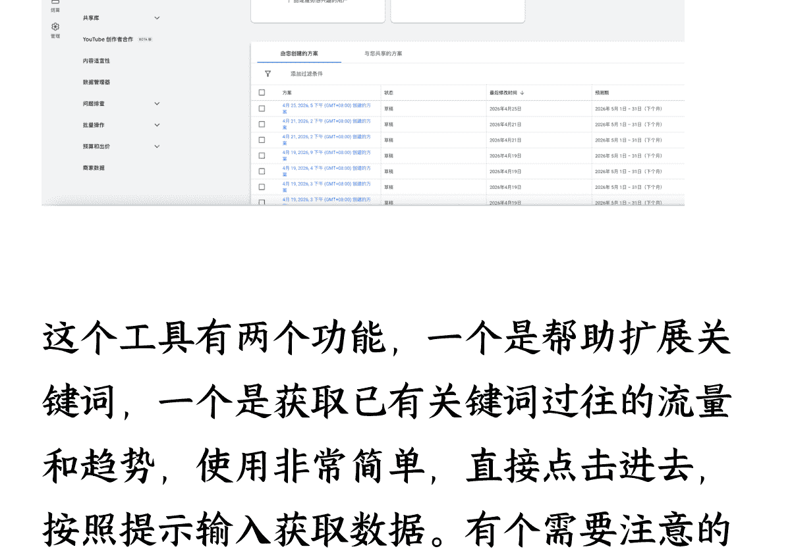  

这个工具有两个功能，一个是帮助扩展关键词，一个是获取已有关键词过往的流量和趋势，使用非常简单，直接点击进去，按照提示输入获取数据。有个需要注意的是，记得把地区选择成你想投放的地区。  

###### 发现新关键字  

| | |
|---|---|
| 首先输入关键字 | 首先指定网站网址 |

输入与您的业务最相关的产品或服务  

  

尽量不要太过于具体，也不要太过笼统。例如，对于食品配送业务来说，最好使用“送餐”，而不是“餐食” [了解详情]  

语言：简体中文（默认） 位置：所有位置  

输入网站网址以过滤不相关的关键字  

  

---

获取结果  

| | |
|---|---|
| **由您创建的方案** | **与您共享的方案** |

添加过滤条件  

  

列 | 列  

- [ ] 方案  
- [ ] 状态  
- 最后修改时间 ↓  
- 预测期  

4月25, 2026, 下午 (GMT+08:00) 创建的方 | 草稿 | 2026年4月25日 | 2026年5月1日 - 31日（下个月）  

- [ ] 方案  
- [ ] 状态  
- 最后修改时间 ↓  
- 预测期  

4月21, 2026, 下午 (GMT+08:00) 创建的方 | 草稿 | 2026年4月21日 | 2026年5月1日 - 31日（下个月）  

###### 关键字规划工具  

获取搜索量和预测数据  

---|---

输入或粘贴关键字，每行一个字词或词组，或以英文半角逗号分隔  

  

开始  

###### 结果示例  

这里都有给出每个词最低和最高出价，后面的出价可以参考这个  

还有一点，如果你没有投过广告，月均搜索量不是一个具体数值而是一个范围，投几天就能出现具体的数值。  

| | 关键字（按相关性排序） | 平均每月搜索量 | 三个月变化 | 年同比变化 | 竞争程度 | 广告展示次数份 | 页首出价（低位区间） | 页首出价（高位区间） | 账号状态 |
|---|---|---|---|---|---|---|---|---|---|
| [ ] | image | 5,000,000 |  | 0% | 0% | 低 | - | ¥0.47 | ¥10.36 |
| [ ] | yandex images | 450,000 |  | 0% | -18% | 低 | - | ¥1.41 | ¥9.75 |
| [ ] | foto search | 2,900 |  | -17% | -17% | 低 | - | ¥1.50 | ¥6.67 |
| [ ] | foto google search | 260 |  | +52% | +129% | 低 | - | - | - |
| [ ] | check foto | 260 |  | -19% | -19% | 低 | - | ¥1.29 | ¥6.11 |
| [ ] | foto reverse | 210 |  | +24% | -19% | 低 | - | ¥1.54 | ¥5.33 |
| [ ] | foto search engine | 8,100 |  | 0% | -33% | 低 | - | ¥2.19 | ¥11.18 |
| [ ] | foto search google | 260 |  | +23% | +129% | 低 | - | ¥1.54 | ¥8.73 |
| [ ] | google image argentina | 390 |  | -19% | 0% | 低 | - | - | - |
| [ ] | google image creation | 720 |  | 0% | +50% | 中 | - | ¥1.30 | ¥19.66 |  

**除了关键字规划工具，你还可以配合 semrush 上的数据，以及和 ai 讨论决定最终的关键词和出价。**  

## 2、创建广告  

第一步，点击左侧栏上面的 **创建**  

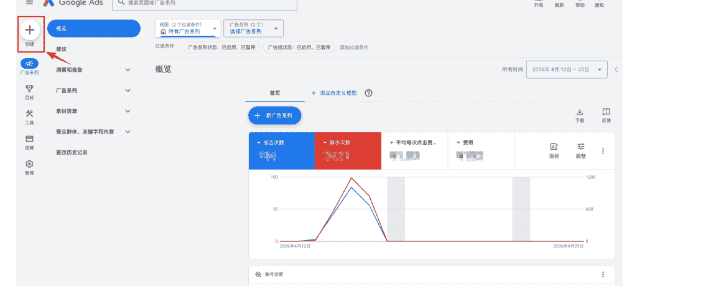  

账号还没有任何广告，选择 广告系列，  
广告系列目标选择 网站流量，转化目标  
选择账号默认的目标（这个是之前设置好的），然后点继续  

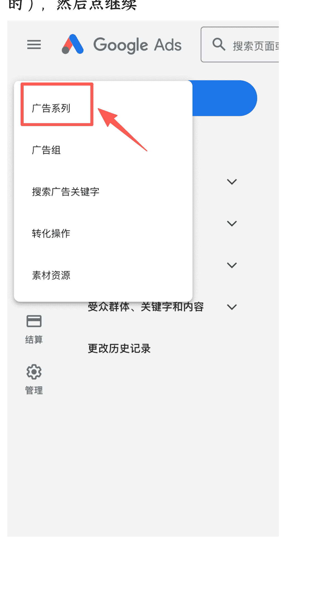  

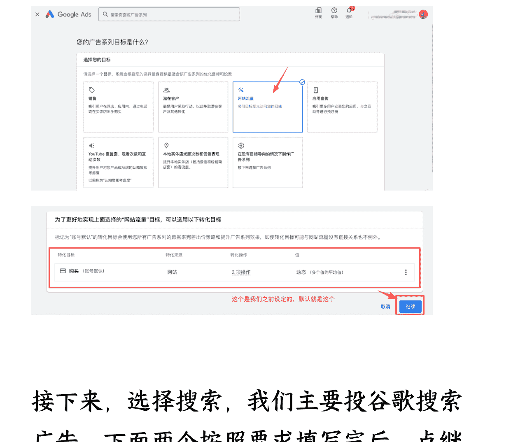  

接下来，选择搜索，我们主要投谷歌搜索广告。下面两个按照要求填写完后，点继续。  

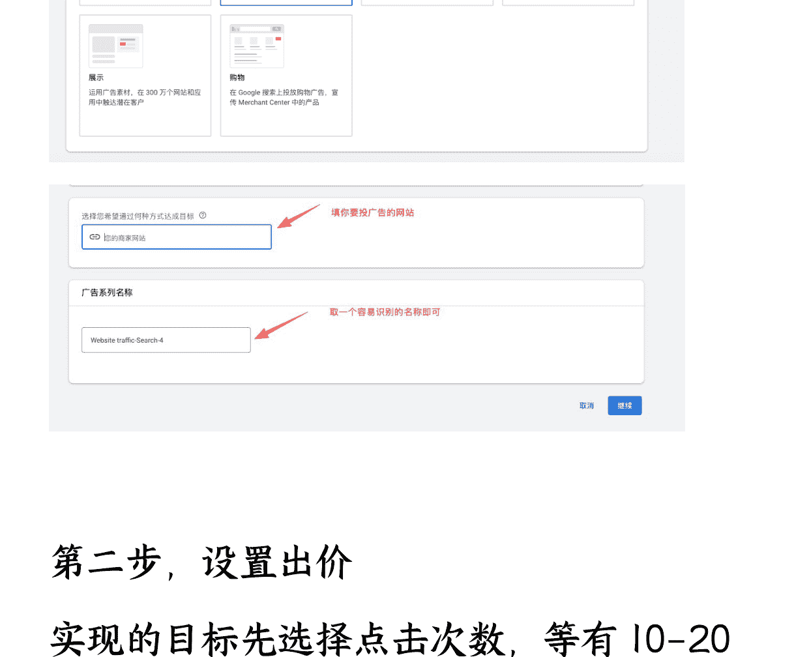  

## 第二步，设置出价  
实现的目标先选择点击次数，等有 10-20 个转化再换为转化次数  
勾选每次点击的出价上限，设置你能够接受的价格，当然这里要参考 Ads 里的关键字规划工具的数据，不然出价太低，可能不会有展示。  

第三步，广告系列的设置，这里面包含几项  
投放网络 都不要勾选，勾选了代表你的广告还会出现在谷歌合作伙伴上，比如 YouTube 等，这些流量就不是精准流量，很快就会耗光你的预算。  
地理位置，你可以根据你的目标用户的位置选择，或者前期先选所有国家和地区，后面再修改。记得是选择所在地。  

语言按照你的网站语言选择，如果是多语言就不要混在一起，要建立多个广告系列。其他的按照下图选择，基本是默认选项。然后点下一步。  

## 公众号懒人搜索，懒人专属分享  

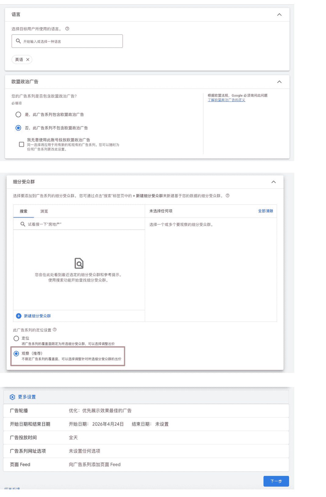  

第四步，来到了 AI Max，先不要开启，然后点下一步  

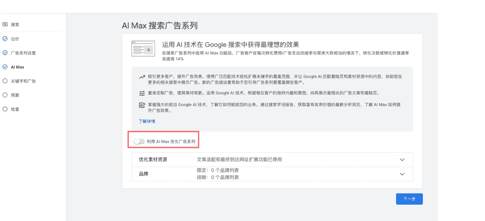  

第五步，关键字和广告，这些关键字就是你要投的关键词，我们已经在之前关键字规划中筛选好了，直接添加上，但要注意匹配类型。  

29 / 36  

匹配类型有三种：广泛匹配、词组匹配、完全匹配；我们一般选择词组匹配、完全匹配就好，会相对精准，广泛匹配太发散了，容易带来泛流量。  

我们一个个解释是什么意思，你想了解更多，也可以点击页面上的了解详情。  

**广泛匹配**：用户搜索内容与关键字相关（可能不包含关键字的直接含义），都可以触发广告展示。非常发散，泛流量比较多。  

要使用广泛匹配，只需输入关键字即可。  

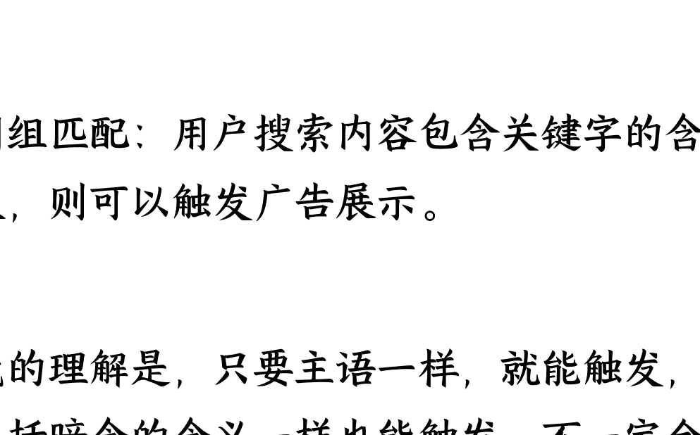  

**词组匹配**：用户搜索内容包含关键字的含义，则可以触发广告展示。  

我的理解是，只要主语一样，就能触发，包括暗含的含义一样也能触发，不一定会包含关键字。比较精准，同一个主语可以有不同的定语修饰，相当于可以有不同的场景。  

要使用词组匹配，请在关键字前后加上英文引号，例如 "网球鞋"。  

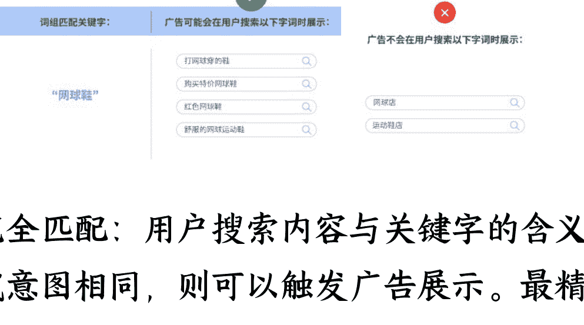  

**完全匹配**：用户搜索内容与关键字的含义或意图相同，则可以触发广告展示。最精准的流量，流量最小。  
要使用完全匹配，请用方括号将关键字括起来，例如 [红鞋]  

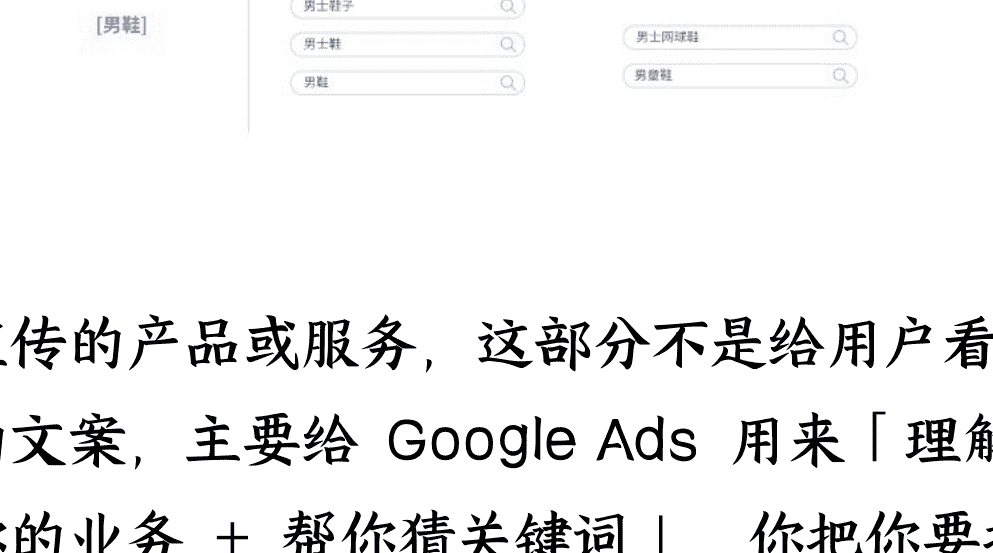  

宣传的产品或服务，这部分不是给用户看的文案，主要给 Google Ads 用来「理解你的业务 + 帮你猜关键词」，你把你要推广的目的写上即可，如果是面向英语国家就用英文写，这个影响不大  

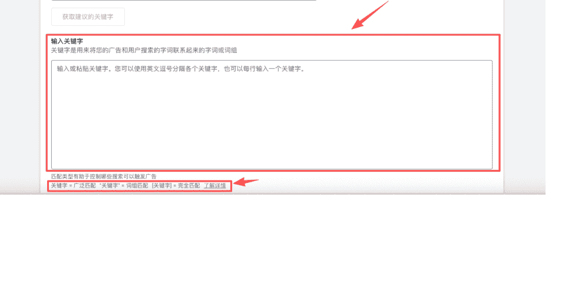  

第六步，广告的设置，AI Max 不需要填写，前期没有开启。  

这部分跟着提示做就行了，最终得出的广告效力到达良好就差不多了，只要跟着提示做基本能达到。  

我是用了 ai 浏览器，然后让 ai 帮忙想出标题和描述，我觉得可以就填上了。  

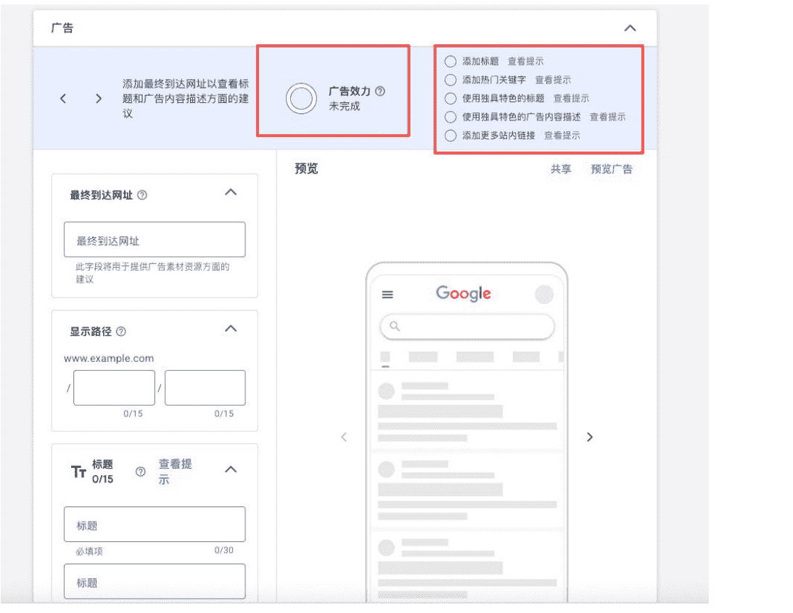  

第七步，每日预算，根据之前每次点击的费用，以及每天大概想要拿到多少个点击，算出一个每日平均预算，或者你就直接填一个可以接受的预算。达到预算，广告会自动停止投放。  

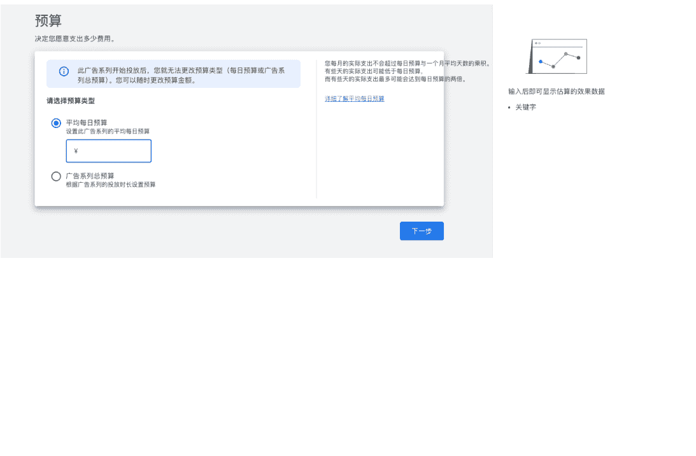  

第 8 步，检查，前面的步骤都完成了，系统还会再做一次检查，检查完没有问题就可以发布了。  

到此，你已经成功发布第一条谷歌投放广告了，后续就是如何优化的问题了。  

### 3、一些小经验  

① 每次投广告之前，都要设定一个目标，AI SaaS 网站付费转化率 0.5% - 2%，前期可以定 1000 个点击至少有一个付费，如果达不到，那就要考虑是不是网站功能不能满足用户需求了，建议重新去找需求。  

② 谷歌广告现在是智能出价系统，前期需要通过转化数据来告诉系统，哪些用户会付费，学习期至少一周，在这之前，最好不要调整广告相关的设置，除非广告完全没有展示或者预算烧得飞快才考虑重新设置，不然会一直处于学习期。  

③ 学习期，需要做的事就是否定关键词，每天观察投放数据，把点击率高，花费多，但一直不出单的关键词否定掉，减少花费，同样一些一直有点击都不出单的地区和人群也可以否掉。一开始创建广告时建议把这些词直接添加到否定关键字里，而且是用广泛匹配：free、download、app、near me 等，也可以和 ai 讨论，添加更多的否定词，目的是拒绝白嫖档以及不能使用到我们网站功能的用户  

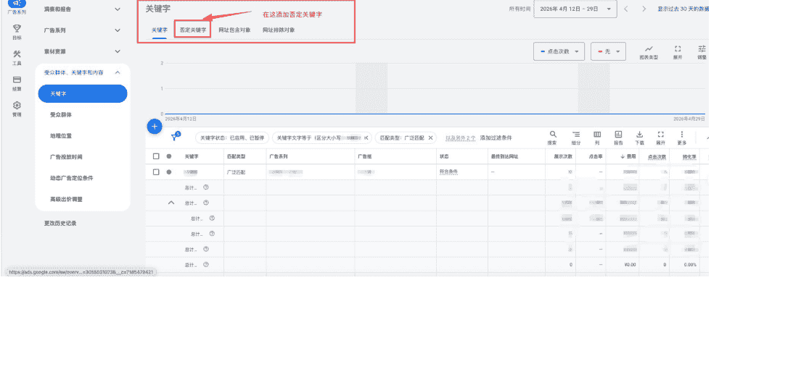  

④ 在这个网站 https://adstransparency.google.com 能看到所有网站投放的广告素材，自然也可以看到竞争对手的，那你就可以去看看竞争对手如何投放的，然后进行学习  

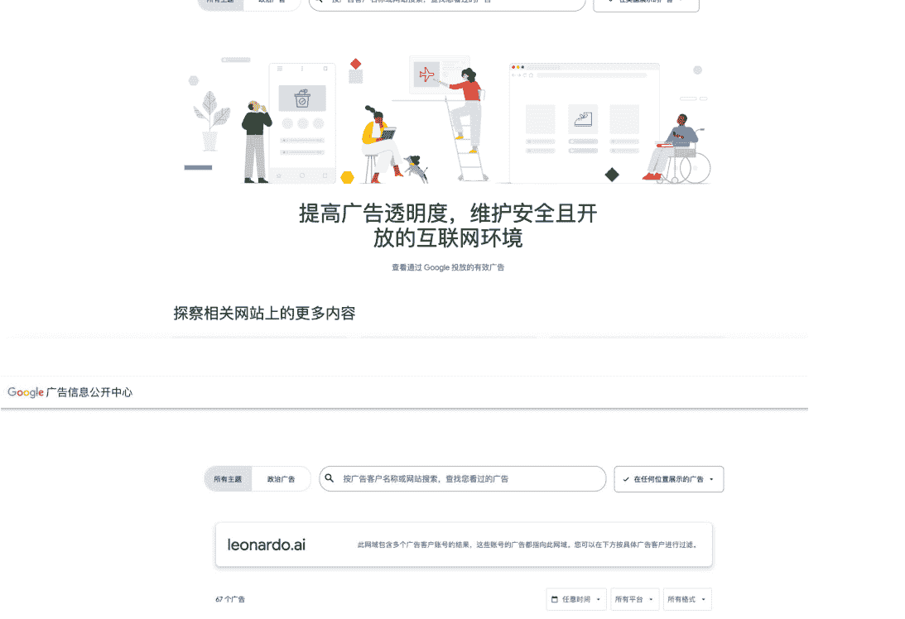  

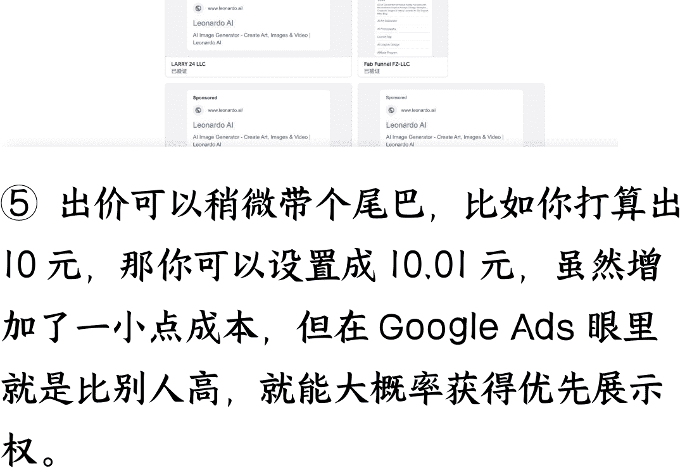  

⑤ 出价可以稍微带个尾巴，比如你打算出 10 元，那你可以设置成 10.01 元，虽然增加了一小点成本，但在 Google Ads 眼里就是比别人高，就能大概率获得优先展示权。  

## 四、结语  

这篇文章主要给大家分享了如何创建第一条谷歌投放广告，基本把步骤都截图了，这也是我这 2 周来摸索出来的经验，相信可以给大家一些帮助。  

投放只是第一步，后续如何根据数据优化才是最重要的，这部分我还在探索中，如果点赞多，后面摸索出一些经验我再继续分享。我目前的想法是把投放的数据喂给 ai，让 ai 一起帮忙优化，也欢迎大家交流想法。  

这里，我小小打个广告：这次分享是源于要给一个股票相关的网站：https://aistock.tools 做投流，摸索出来的一些经验。大家可以去试用下网站，如果想获得更多积分，可以联系鱼丸找我，我给大家免费提供一些，谢谢大家。  

最后，感谢大家的阅读，也祝大家多上站，多赚美金，早日实现月入万刀！！！  

———分割线———  

看完这篇 SOP，你觉得你懂了。但 90% 的人一到实操就会卡在第一步。  

工具和教程只是最低级的壁垒，真正的壁垒是“立刻动手”和“圈层信息差”。  

如果你想看全网最新的变现玩法，并且和一群执行力极强的极客一起下场拿结果，欢迎围观我的核心私域：【懒人专属群】。  

我们不聊虚的，只做商业闭环的拆解与 AI 效率的压榨。系统内已沉淀 1000+ 跑通的套利实战局。  

👉 查阅圈子完整数字资产与上车门槛：  
https://lazyso.com/insider/  

认同价值、准备好下场干活的，扫码加我微信（lazyhelper1）  

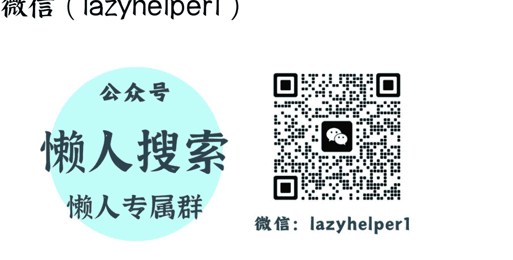  

**备注：【实操上车】，不闲聊**  

公众号懒人搜索、懒人专属群分享