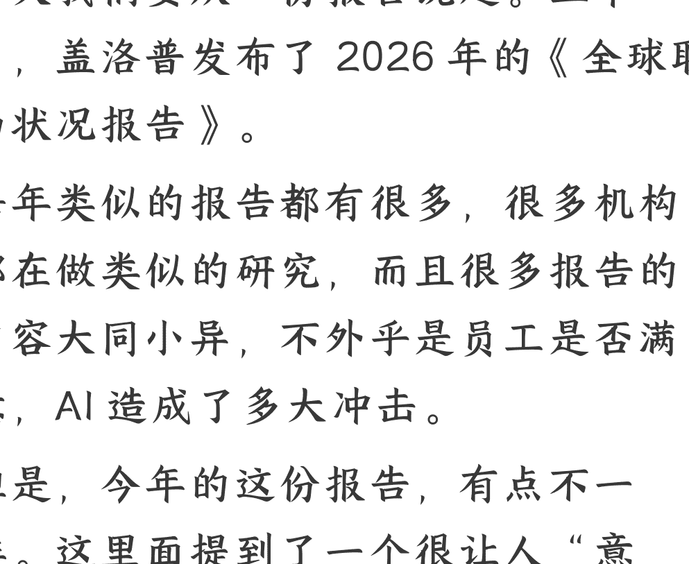

# 全球职场报告：“低敬业时代”正在加速到来

**整理：公众号懒人搜索，[懒人专属群](https://t.cn/xxxx)精选  
懒人微信：**lazyhelper1**

今天我们要从一份报告说起。上个月，盖洛普发布了 2026 年的《全球职场状况报告》。每年类似的报告都有很多，很多机构都在做类似的研究，而且很多报告的内容大同小异，不外乎是员工是否满意，AI 造成了多大冲击。但是，今年的这份报告，有点不一样。这里面提到了一个很让人“意外”的趋势。具体是什么，我们后面细说。

咱们先从这份报告的总体结论说起。根据盖洛普的调查，过去一年，全球只有 20%的员工属于“真正敬业”的人。这是 2020 年以来的最低点。这里的“真正敬业”，指的是你不是迫于职场压力被动加班，而是你愿意主动为工作投入。这样的人，只有 20%。

剩下那 80%的人呢？一部分在混，一部分在熬，还有一部分属于最危险的状态，盖洛普把这个状态叫“主动不敬业”。也就是，他们不只自己不投入，还在主动破坏周围人的士气。要知道，“不敬业”的人只是麻木，只是在混日子，并不主动坑别人。但“主动不敬业”的人，会传递负面情绪，散布抱怨，拉着周围人一起摆烂。这类“主动不敬业”的人，大概占所有员工的 16%。

同时，盖洛普估算，这种全球性的“工作低投入”，每年造成全球生产力损失约 10 万亿美元。注意，这不是说企业白发了 10 万亿美元工资，而是说，假如那 80%不敬业的员工都能像那 20%敬业的员工一样工作，那么全球能多创造 10 万亿美元的 GDP。它衡量的是机会成本，也就是“本来”能赚到，但“实际”没赚到的钱。

10 万亿美元是什么概念？相当于全球 GDP 的 9%。要知道，全球所有国家的国防开支加起来，大约也只占全球 GDP 的 2%。也就是说，低敬业度造成的机会成本，是全球军费的 4 倍多。但是，假如你了解一点背景，就会发现，敬业度下降这个趋势去年就已经开始了，并不让人意外。真正让人意外的，是盖洛普的另外一个发现。**这一轮崩塌，不是从员工开始的，而是管理者**。

你看，通常我们谈“员工不投入”，矛头会指向员工，比如有人说年轻人躺平、不努力、整天想着摸鱼。这几乎成了一个默认的叙事，被老板讲、被媒体讲、被各种管理课讲。但盖洛普 2026 年的数据告诉你，并不是这样。他们把员工和管理者的数据分开来看，得出了一个关键结论：普通员工的敬业度这几年基本持平，甚至有轻微的回升。但管理者的敬业度正在快速崩塌。

具体数字是，管理者的敬业度从 2022 年的 31%，跌到了 2025 年的 22%。4 年间，下降了整整 9 个百分点。要知道，根据很多机构的调研，管理者的敬业度一直高于普通员工。原因很简单：当你成为管理者，你获得的不只是更高的薪水，还有更多的掌控感。你在决定方向，你在影响团队，你能看到自己的决定产生实际效果。这种“我很重要”的感觉，让管理者天然比员工更愿意多付出。

但过去一年，管理者的敬业度急速下降，已经和普通员工几乎没有差距。那么，为什么管理者会垮掉呢？根据盖洛普的调研，这很可能是因为全世界的公司都开始趋向“组织扁平化”。过去这几年，全球大量企业在削减成本，裁员潮一波接一波。而裁员的方式通常是先裁管理层，中层管理者是最先被“优化”的对象。**于是，留下来的管理者，要带更大的团队，承担更多职责，但获得的支持和资源没有增加，反而在减少**。

**你可以想象这样一个场景**：原来你带 8 个人，每周能和每个人单独谈一次工作进展，你了解每个人的状态，也有精力去推动每个人成长。**现在团队变成了 20 个人，你的时间没有增加，但要顾及的人和事翻了两倍**。于是，你把大部分时间花在救火上。管理者变成了事务处理机器，而不是团队的精神支柱。**意义感在这个过程里慢慢流失了**。

更麻烦的是，管理者的敬业度会直接传导给他的整个团队。**根据盖洛普的调研**，一个团队的投入程度 70%取决于直接管理者。管理者如果自己都在疲于奔命，他的团队几乎不可能真正投入。**这不只是说管理者的情绪会“传染”给员工，而是有一个很具体的逻辑机制**。你看，以前管理者在做的是什么？**分配资源、认可成绩、提供反馈、帮每个人找到意义感、阻隔来自上层的压力**。当管理者自己先垮了，这些事就没人做了。于是，相应的代价就会直接传导到员工层。

说到这，报告里还有另外一个发现，也和管理者有关。过去两年，全球企业在 AI 上砸了巨额投入，数千亿美元级别的 AI 工具采购、培训项目、系统升级。所有人都在说 AI 会改变工作，但盖洛普在美国做了一个专项调查，专门调查那些已经在企业里部署了 AI 工具的员工，问他们 AI 有没有真正改变工作方式？

结果是：在这些已经引入 AI 的企业里，只有 12%的员工“强烈认同”AI 真正改变了工作的完成方式。盖洛普还调查了那些已经投入 AI 的企业，发现 95%的企业没有观察到利润增长，89%的高管承认劳动生产率没有提升。换句话说，钱花出去了，工具买回来了，但业绩没有变化，效率没有提高。那么，这到底是为什么呢？

盖洛普的报告说，问题的关键依然管理者。他们的研究发现，一个员工是否真正使用 AI，最强的影响因素不是技术本身是否好用，而是他的直接管理者有没有在积极推动团队用 AI。这个差异有多大？数据显示，管理者积极推动 AI 的团队，员工认为 AI“真正改变了工作方式”的可能性，是管理者不推动的团队的 9.3 倍。管理者如果自己对 AI 无感，他的团队几乎不会主动去拥抱 AI。

盖洛普的 CEO 在报告里说：“企业在 AI 上投入巨资，但成果并未体现在盈利上。盖洛普的数据指向了一个企业界长期忽视的答案：管理者。”说到这，有人可能会好奇，就是你一直在说“敬业度”。但一个员工是否敬业，这是他的内心想法，这怎么能通过调研获得呢？

关于这个问题，盖洛普有一套问卷，包括 12 个问题，业内叫"Q12"。这 12 道题不问你喜不喜欢你的工作，而是问这么几个问题。包括，你知道自己的工作职责吗？你有做好工作所需的工具和资源吗？你每天都能做自己最擅长的事吗？过去七天里，你有没有因为做得好而被认可？你的主管在乎你这个人吗？有没有人在鼓励你成长？等等。

你发现没有，这些问题里有很多都直接和“你的管理者做了什么”有关。换句话说，在盖洛普的标准里，一个是否敬业跟他是否被认可、被在乎、被鼓励有着很密切的关系。相反，关于“你对薪资是否满意”这样的问题，反而没有出现在盖洛普的“敬业度”问卷里。注意，这不是说薪资不重要。薪资当然是工作里最不可或缺的部分。只不过与薪资关联最紧密的是一个人对工作的满意度。

满意度和敬业度有什么区别？简单说，满意度指的是“痛苦有没有被移除”。也就是因为待遇变好了，你的那些担忧、对生活的不满意，能用钱解决的痛苦都能被陆陆续续地解决。而敬业度关联的是“意义有没有被建立”，也就是你是不是发自内心地喜欢这份工作。其中最关键的变量是有没有一个人在你的日常工作里让你感到“你的努力是被看见的，你的工作是有意义的，你是在成长的”。这个人通常是你的直接管理者。

好，关于盖洛普报告的部分我们先说到这。最后，跳出这份报告你会发现，“管理者”这个身份过去一年的处境正在发生微妙的变化。比如我们之前讲过盛大 CEO 陈天桥的观点。他认为未来 AI 员工普及，别说是管理者就连整个“管理学”都将迎来黄昏。你看公司为什么需要“管理”，因为人不是机器人会懒会有私心会犯错误。因此需要制度需要管理。但 AI 员工不存在这些问题问题消失了自然也就不需要解决方案。

再比如被称为“硅谷创业教父”的保罗·格雷厄姆前两年就一直在说，“职业经理人”根本不会让公司变好，创始人应该自己上前线。你看矛头也指向了“管理者”。但是**从盖洛普的报告里我们也许还能读出管理者的另外一层属性**。除了日常的事务、管理、协调之外他们还承担着一个关键功能我们可以管它叫"**意义基础设施**"。

一个好的管理者可能就是一个组织里的意义基础设施。即使他可能不生产具体的产品但假如能把另外一件事做好他就依然是重要的。这个事就是让每个人感到“我做的事是有意义的”。认可你看见你给你反馈这些事看起来很“日常”但它们是一个人能不能真正投入工作的底层支撑。一旦这个意义基础设施出了问题就会直接影响员工的整体敬业度。

学校组织变革专家沈祖芸老师有个观点原本说的是学校放在公司这个场景或许也适用。**说的是管理者需要培养的两项核心能力**，一是塑造员工的意义感让他的价值被看见；二是放大这个意义感让他的价值被认可。

# 分割线

在这个 AI 能替你写代码、写文章的时代基础技能正在迅速贬值。绝大多数人正被淹没在海量的免费垃圾信息里陷入低效的体力内卷。当“努力”不再是壁垒人与人之间唯一的护城河只剩下“信息过滤”的效率与“认知系统”的维度。圈子已稳定运行 7 年。我们每天利用 Python 爬虫与大模型算力过滤全网最顶级的政经内参和搞钱风向标做你最冷酷的“外部大脑”。

如果你认同这种“重塑认知防线”的极客主义欢迎围观我的个人情报智库：【懒人专属群】。https://lazyso.com/insider/

认同信息过滤价值、想省下每天 3 小时无效阅读时间的读者扫码加我微信（lazyhelper1）