## 2026 最新 X 创作实战复盘：4 个月 1.8 万关注 +1182 创作者分成，我踩过的坑和走对的路

**260512 副业 SC 精华**

公众号懒人搜索，[懒人专属群](https://mp.weixin.qq.com/s/1234567890) 独享

懒人微信：lazyhelper1

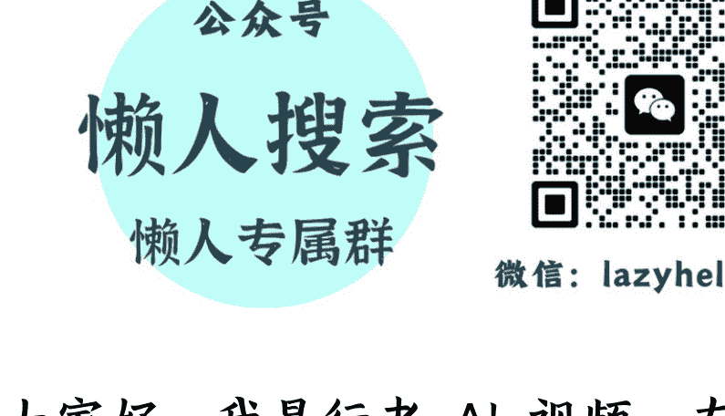

大家好，我是行者 AI 视频，专注于 AI 视频和个人 IP。

视频作品拿过北京国际电影节 AIGC 奖，上过央视网展播，AI 新榜公众号排名最高第 4。

2025 年 12 月开始在 X 自媒体上起号，取得了一些小成绩，今天把我在 X 上取号、爆款选题、内容创作流程，以及开通创作者收益的真实经历，全部分享给你。

2026 年 4 月，我把后台数据截图发到朋友圈时，收到的第一条回复是：

> 卧槽，你作弊了吧？

## 4 个月，涨粉 1.8 万，总曝光 1270 万，创作者分成 1182 美元。

很多人只看到数字，却不知道——4 个月前，我只有 73 个粉丝。

那时候我每天刷新数据，0 互动、0 转发、0 推荐。内容发出去像石沉大海，我甚至开始怀疑：是不是自己不适合做 X？是不是 AI 视频这条路在 X 上根本走不通？

我几乎要放弃了。

直到 12 月 8 日，我发了那条用海螺 AI 做的《疯狂动物城》赛车视频教程。

那一天，我手机震动到手软。

64K 曝光、293 点赞、277 个新粉丝……
那一刻我差点哭出来。因为我终于明白：原来好内容在 X 上真的能被看见。

从 73 粉到 1.8 万，从每天几十阅读到单条 83 万曝光，我踩过的坑、走过的弯路、半夜崩溃的时刻，今天全部说给你听。

如果你也正在 X 上迷茫、数据起不来、或者刚开通分成不知道怎么继续——这篇文章值得你看完。

# 一、X 平台的小成绩

2025 年 12 月开始在 X 平台起号，4 个月时间从 0 做到 1.8 万粉丝，总曝光 12.7M，60 天开通创作者分成，首月收益 296 美元。

这篇文章其实 3 个月前就想写，但拖了很久，有些数据我懒得更新了，就保留了当时的真实记录。

X 平台的算法推荐机制比国内任何平台都要公平。好内容真的更容易出圈，几百粉小号也有机会获得百万级曝光。但前提是，你得知道怎么玩。

如果你正在考虑入场 X，或者已经起号但还在摸索阶段，这篇文章会给你一个清晰的路径。

# 二、为什么 X 平台值得做？

# 1.1 X 平台的流量机制：对创作者极度友好

我们做内容的，需要多平台矩阵抗风险。

公众号你写得再好，没有推荐流量的话，数据就是起得慢；小红书算法捉摸不定，动不动就限流。

那 X 呢？我一直觉得，X 是目前对创作者最友好的平台。

不是说它容易涨粉，而是它的算法真的看内容。你发个短图文，只要东西好，哪怕只有 100 个粉丝，也有可能被推到百万级曝光。这种事情，在别的平台想都不敢想。

X 的推荐算法是完全公开的，每周四更新，全由 AI 做流量分发与惩罚。最近的更新对低质量的内容打击更为明显。

# ### 1.2 前沿信息获取

做自媒体久了，你会发现国内很多 AI 内容、热点资讯，其实都是搬运加工自推特。

大厂的新品发布、AI 工具更新，永远是推特最快。

推特就是 AI 领域的信息源头。下面这张图是网传的信息流转图，可以看到到国内的平台，已经过了几手了。

# ### 1.3 创作者收益：真金白银的分成

马斯克推出的创作者分成，说实话，真的是“低保”——100 万阅读大概 100 美刀。

但架不住推特爆量概率高啊！

开通分成后，我现在每个月大概几百美刀。不多，但够买杯咖啡、吃顿好的。

最重要的是，这证明了你的内容是有价值的。

# ### 1.4 X VS 公众号：机会点在哪里？

# ### 1.5 这个机会适合什么人？

X 平台特别适合：

1. 已经有内容创作经验的人：你在其他平台积累的内容能力可以直接迁移
2. AI 领域从业者/爱好者：X 是 AI 领域的主战场，用户对 AI 内容需求旺盛
3. 想要多平台布局的创作者：X 可以作为信息源头，反哺国内平台
4. 有一定英文阅读能力的人：虽然中文内容也能做，但能看懂英文资讯会有优势

不适合：

5. 完全没有内容创作经验的纯新手（建议先在国内平台练手）
6. 只想靠搬运、蹭热点快速涨粉的人（X 算法会识别低质量内容）
7. 期望短期暴富的人（创作者分成是“低保”，不是“暴富”）

# 三、我是怎么跑通 0-1 的

# 2.1 冷启动阶段：迷茫的第一个月（11 月 -12 月初）

**11 月 17 日，我正式开始运营 X 账号。**

说实话，那段时间我每天都像在黑夜里摸索。

我关注了很多博主，看到他们疯狂互动、蹭热点，可我发出去的帖子却没人看。到 12 月初，我只有**73 个粉丝**。

**我开始焦虑、自我否定，甚至半夜三点还在刷数据**，心里一遍遍问自己：**我是不是真的不适合做这个？是不是 AI 视频这条路在 X 上根本走不通？**

我几乎要放弃了。

# **这个阶段我卡在哪里？**

- **没有明确定位**，今天发这个，明天发那个
- **不知道对标谁**，研究了归藏、神娃、宝玉几个大 V，但他们太强了，方向也不一样，不是我该对标的
- **没有找到自己的差异化优势**

# 2.2 转折点：第一条爆帖（12 月 8 日）

12 月 8 日，我发了一条用海螺 AI 做的《疯狂动物城》赛车视频教程。

那一刻我几乎已经不抱希望了。

结果……它爆了。

64K 曝光、293 点赞、277 个新粉丝。

原帖链接：
https://x.com/joshesye/status/1998023856129511727

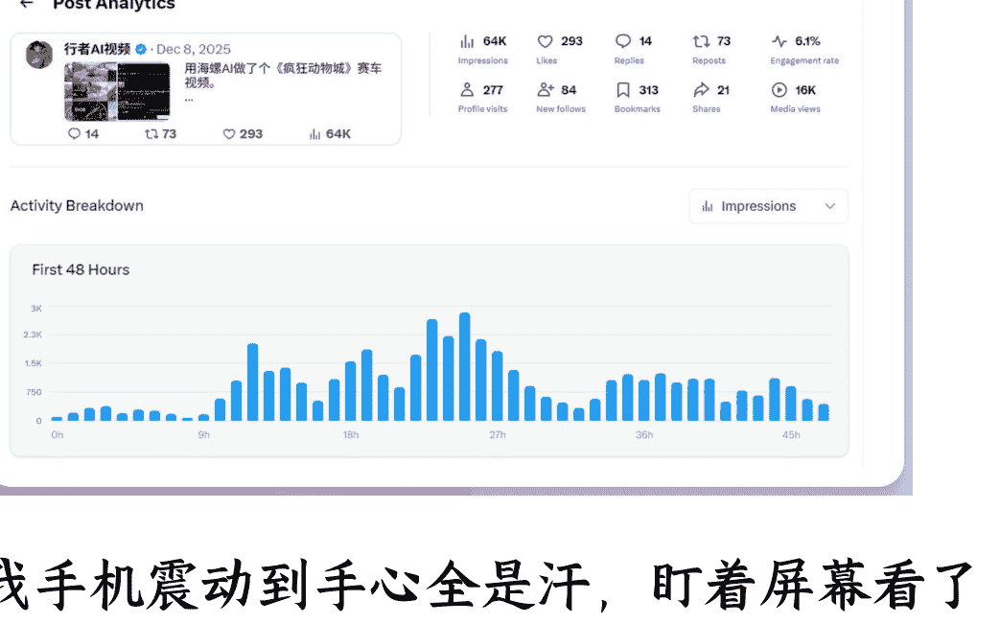

我手机震动到手心全是汗，盯着屏幕看了整整十分钟。

那一刻我差点哭出来。因为我终于明白：原来在 X 上，好内容真的能被算法看见。

从 73 粉到 500 粉，只用了这一条帖子。

那一晚我睡得特别香，因为我终于看到了希望。

# 为什么这条帖子能爆？

- **视频内容**：视频的曝光权重比图片和纯文字都高
- **教程干货**：不是单纯晒作品，而是分享了完整的制作流程
- **热点结合**：疯狂动物城是热门 IP，AI 视频是热门赛道
- **神娃加热**：神佬在群里帮我转发了一波，帮我放大

这条帖子让我的粉丝从 100 涨到了 500。在 X 平台，大家通常把 500 粉当作完成冷启动的标准。

# ### 2.3 快速增长期：7 天破 1000 粉（12 月 8 日 -12 月 15 日）

第一条帖子爆了之后，我找到了定位：在 AI 视频领域分享硬核教程 + 优质作品。

12 月 14 日，我发了好莱坞片场视频教程，这条帖子又爆了：83 万曝光，1.8K 收藏。

**原帖链接：**

https://x.com/joshesye/status/2000193701591875608?s=20

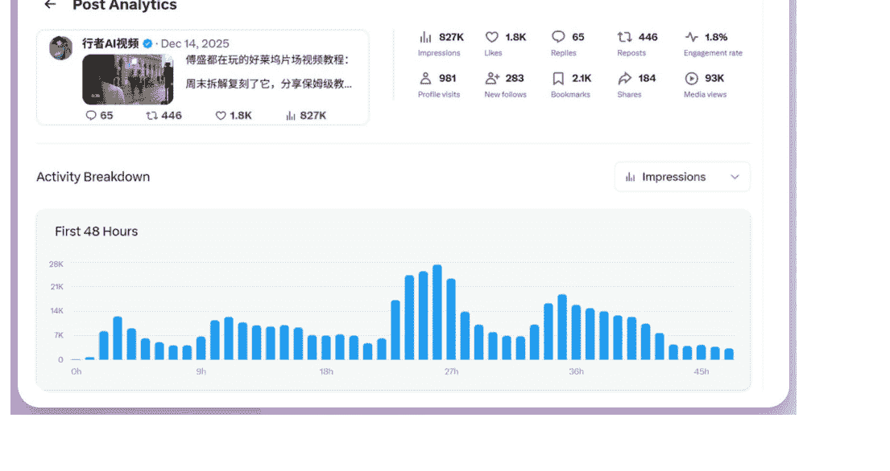

**这个阶段我做对了什么？**

- **明确定位：** AI 视频领域，教程干货分享，垂直度高
- **坚持出摊：**连续肝了多条优质原创视频
- **保持一致性：**每条帖子都围绕 AI 视频工具（海螺 AI、Nano Banana Pro、可灵等）
- **原创为主：**每个帖子都是自己拆解、复盘、分享教程

**12 月 15 日，7 天达成 1000 粉。12 月 18 日，10 天达成 2000 粉。**

# ## 2.4 稳定增长期：18 天破 4000 粉（12 月 8 日 -12 月 25 日）

12 月 25 日，圣诞节，我的粉丝达到了 4428。扣除冷启动时间，用了 18 天。

我开始总结自己的起号方法论：

- **内容组合：**硬核干货（60%）+ 热点（30%）+ 人设（活人感 10%）
- **发帖频率：**每天 2-3 条，坚持出摊

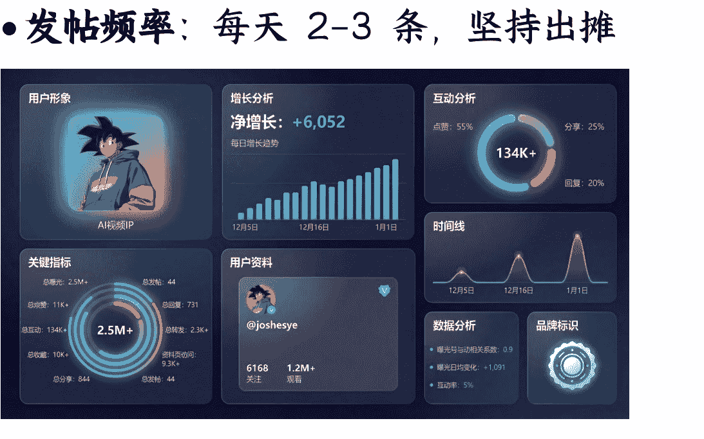

# ## 2.5 突破万粉：抓住 Seedance 风口（1 月 -2 月）

春节期间，两个大热点是 OpenClaw 和 Seedance2。作为视频玩家，在 Seedance 2.0 发布后我赚到了流量红利。

OpenClaw 我 2 月份开始玩，但更限于个人使用。我用心写过两篇 OpenClaw 文章，但数据很差。

原因是：OpenClaw 是编程工具，我的粉丝画像是 AI 视频创作者，不匹配。另外，确实帖子写的深度不够。

热点不能只是蹭，要结合自己的定位。

春节后，我推特一周涨粉 3000，就是 Seedance + 视频来的。

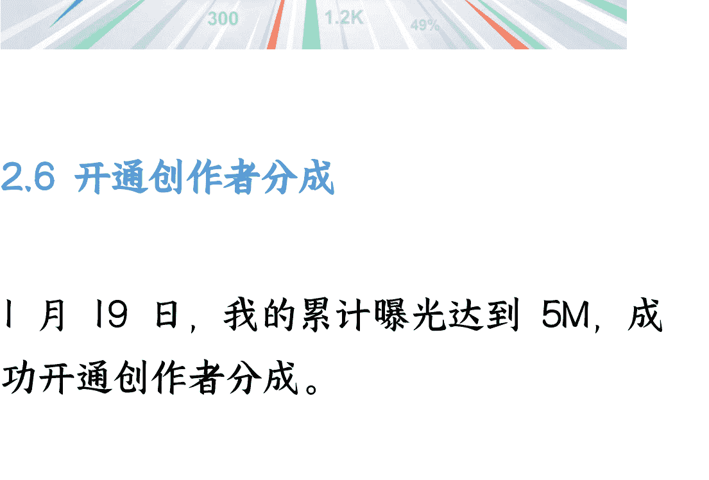

# 2.6 开通创作者分成

1 月 19 日，我的累计曝光达到 5M，成功开通创作者分成。

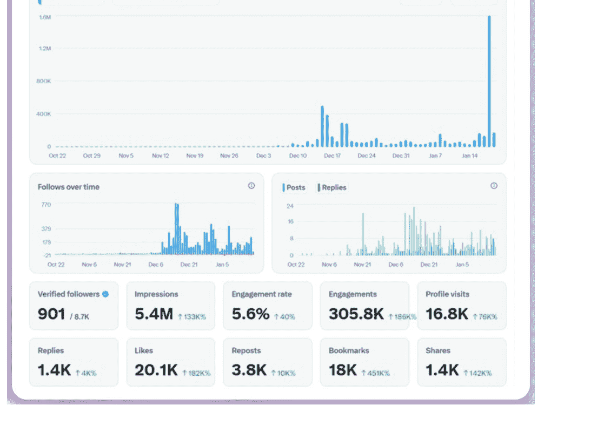

2 月 15 日，我收到了第一笔创作者分成：296.01 美元。

那一刻我盯着创作者分成页面看了很久。

虽然只是“低保”，但这是我第一次通过 X 内容拿到真金白银的回报。

那种感觉……像是一个人走了很久的黑夜，终于看到了一点光。

其实，创作者分成，真的是低保。但是每个月另一次“工资”，感觉还是不错的。

# 四、方法论：如何复制我的起号路径

# # 3.1 起号六步法

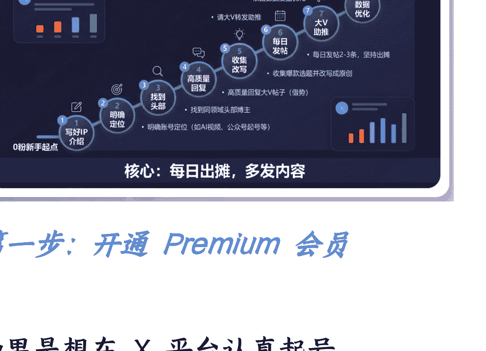

**第一步：开通 Premium 会员**

如果是想在 X 平台认真起号。

有一件事，我建议你一定要做：开通 Premium 会员。

不是说非会员不能做，而是会员能让你节省很多时间：

- 发帖非会员限 280 字，Premium 会员不限字数
- 有蓝 V 标识，曝光更好，有更好的流量推荐
- 还有创作者分成门槛

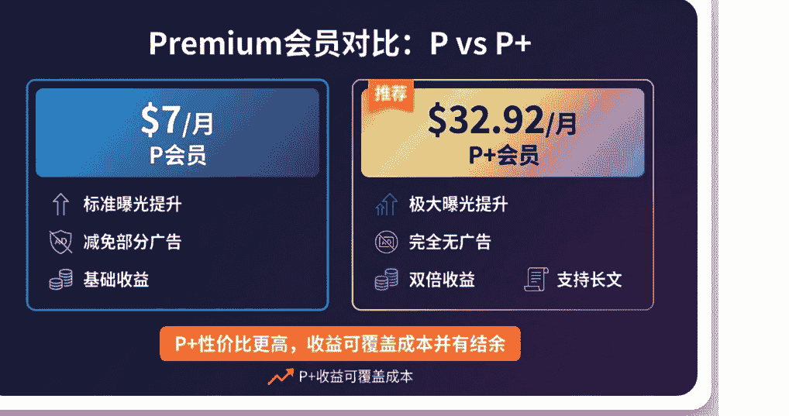

**认真起号的创作者，都开通 P 会员。8 美元一个月，说实话，这笔投资值得。**

**第二步：打磨 IP 介绍（置顶帖）**

一定要写一篇你的 IP 文，置顶！

别人看你的帖子会顺便看你的主页。你的置顶帖，就是你的“名片”。

**置顶帖要写什么？**

- **你是谁（身份定位）**
- **你的背书（成就、奖项、专业技能等）**
- **你分享什么（AI 视频/工具/教程）**

我的置顶帖，就是把我拿过的奖（放奖状更有信服力），在 AI 绘画/AI 视频领域这些点，都写了上去。

**行者 AI 视频** @joshesye · Nov 22, 2025
“中年废了”vs"AI 新榜第四/北影节获奖”，AI+ 个人 IP 是普通人逆天改命的最优解

2019 年，我也曾觉得自己“废了”。
创业失败，背着每月一万多的房贷，眼看着房价腰斩。
那是中年危机最真实的模样：焦虑、失眠，头发在大把大把地变白。
我不敢停下，却又不知道该往哪走。
直到 2024 年，Sora 横空出世。

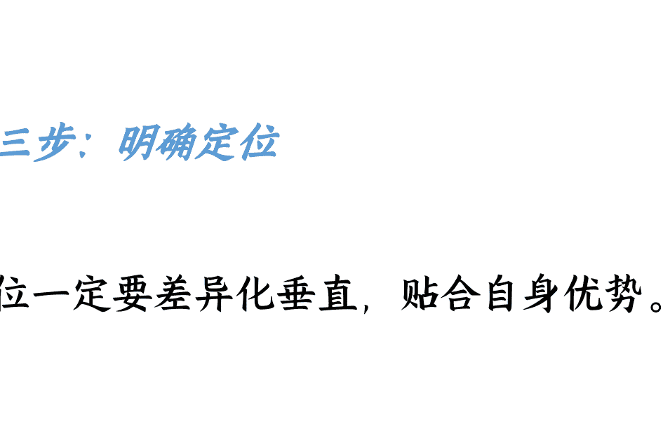

**提醒：推特发帖后 | 小时内可修改，之后只能删不能改，IP 文一定要提炼好！**

**第三步：明确定位**

定位一定要差异化垂直，贴合自身优势。

推特 AI 领域大部分是程序员、AI 编程赛道的玩家特别多。新手再进入这个赛道，比较难出圈。

但如果你找到垂直细分赛道，比如公众号起号、小红书副业相关内容，也能更好的获得关注。

比如我走过的弯路：一开始我也没把视频的优势放大，到 12 月初，只有 73 个粉丝。

给新手的建议：找到你的细分领域，你在国内平台的优势是什么，在 X 上就做什么。

# ### 第四步：找到同领域大 V

关注同领域博主，多找几个对标，这个就是对标思维了。

前期其实也不要关注太多博主，精选那些有关注价值的。

X BoostClub 有个博主排行榜，大家可以去找，再根据自己的领域筛选关注的对象。

```
https://regrowth.so/watchlists/x-boostclub-a044a9436ec34d399abef5042600a7d2
```

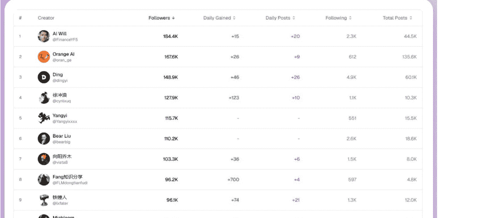

再把你关注的人加星标，只看通知栏（X 的信息流真的看不过来）。

# ### 第五步：高质量回复

推特本质是社交平台，很多大佬都是当朋友圈发的。

那前期没有数据怎么办？可以去大 V 帖子下面互动！

但这里的互动，不是无效评论。而是：总结大 V 内容 + 个人观点。

这样做的目的有三个：

- 高质量的回复，会让大 V 注意到你
- 帖子爆的话，你也能获得关注
- 锻炼你的内容提炼能力

# # 第六步：借力大 V 转发

这是起号阶段最有效果的方法了。

怎么操作？

- 打磨好帖子内容
- 主动链接大佬，让大 V 帮你转发
- 大 V 转发能帮你入池

但是有个卡点是，如果你本身并没有 IP 力，也就是大 V 是不会关注到你的。

有几个小技巧分享：

1. 很多 X 博主都有微信交流群，进群后在群里多发言，混个脸熟
2. 找到你自己的核心优势，在 X 上发一些专业贴，有自己的独特亮点
3. 脸皮厚一点，找你圈内认识的出海博主，大胆一点链接上

我自己的案例：疯狂动物城的帖子，在进推荐后，神娃放大了。

后面我帮神佬转发过一篇优质帖子，带来 56 万曝光（原帖 110 万）。

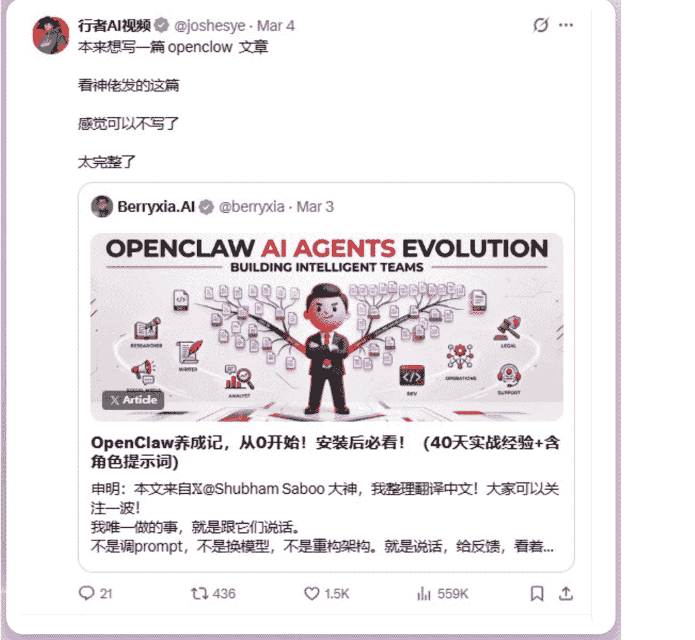

# ### 3.2 选题与内容

什么样的帖子容易爆？

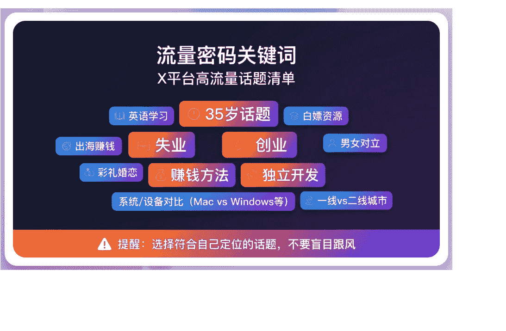

X 平台容易爆的选题：

- 英语学习、出海赚钱、开银行卡
- 35 岁话题、失业、创业
- 白嫖资源、赚钱方法
- 独立开发、系统/设备对比
- ……

# 我总结的 5 类高效选题方向:

- **最新资讯 + 个人理解：**转发优质内容并添加评论，实时动态 + 独特见解
- **阶段性复盘晒数据：**如 10 天 2100 粉，复盘成长路 + 公开透明
- **成绩单放大展示：**突出成果 + 增强权威，建立可信度
- **热点结合定位：**借势传播，观点补充 + 价值深化
- **工具/博主合集整理：**实用推荐 + 垂直沉淀，提供价值

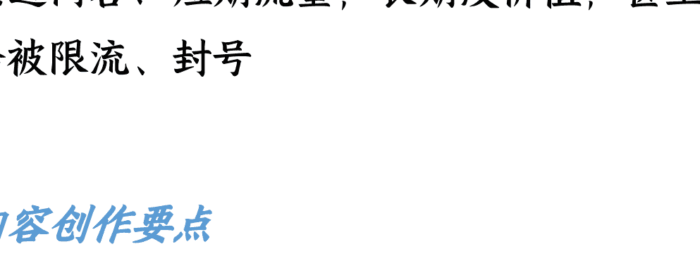

# 什么选题不要碰？

擦边内容：短期流量，长期没价值，甚至会被限流、封号

# 内容创作要点

# 内容标准:

- 原创为主，不要太多引用，每天 2-3 条，坚持输出
- 账号一致性：不要今天发这个，明天发那个
- 视频 > 图片 > 文字：视频的曝光权重最高

# 选题技巧:

- 最新资讯 + 自己的理解
- 复盘：1 个月涨粉 XX，多长时间开通创作者分成
- 晒成绩：放大图
- 合集：Skills 合集、AI 工具合集

# 我的一些优质文章:

| 类型 | 内容 | 数据 |
| --- | --- | --- |
| 合集 | Nano Pro 提示词网址合集 | 480K |
| 干货贴 | 香港众安银行开卡 + 开通 Stripe 账户 | 45K |
| 教程 | 好莱坞片场视频教程 | 823K |
| 教程 | 豆包 + Seedance 2.0 做 AI | 349K |

| |短剧，保姆级教程来了| |
| --- | --- | --- |
| 热点 | 腾讯今天悄悄上了个大招：发布 ClawHub 国内镜像 | 103K |

# ### 3.3 算法机制：如何让你的内容被推荐？

X 的推荐算法是完全公开的，每周四更新，全由 AI（基于 Grok 大模型）做流量分发与惩罚。

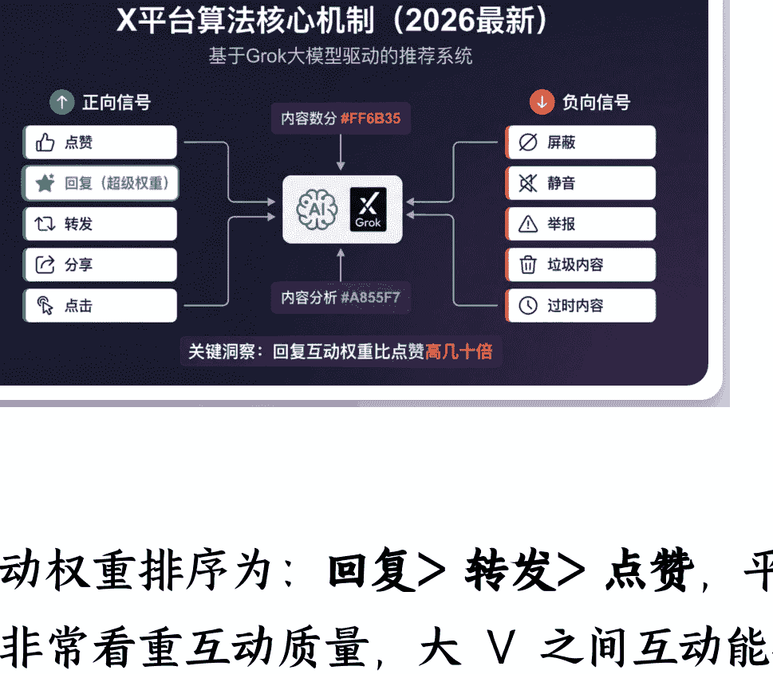

互动权重排序为：回复>转发>点赞，平台非常看重互动质量，大 V 之间互动能提升双方账号权重与收益。

这就是为什么我说，推特本质是社交平台。

# ### 3.4 创作者分成：如何产生收益？

# # 开通条件

- 订阅 X Premium（或 P+）
- 过去 3 个月内，累计帖子曝光达到至少 500 万
- 至少 500 个关注者
- 设置 Stripe 账户来接收付款
- 遵守 X 的创作者变现标准和平台规则

达到门槛后，你可以在 X app 的变现（Monetization）设置中申请加入。

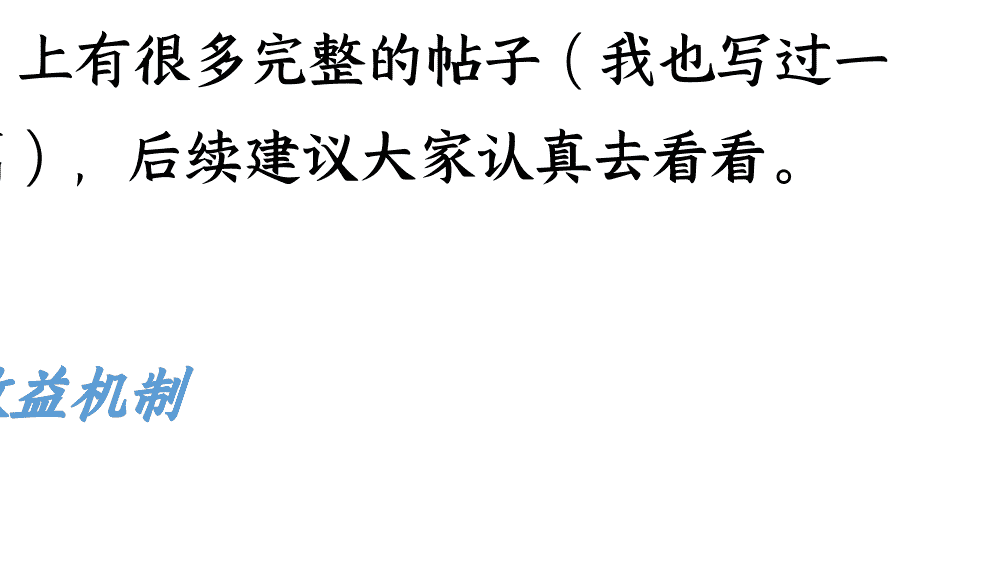

X 上有很多完整的帖子（我也写过一篇），后续建议大家认真去看看。

# # 收益机制

收入取决于 Premium 用户的互动量——
互动越多，赚得越多。

优质内容 + 活跃互动能带来不错收入（每月几百到几千美元不等，视规模而定）。

我的收益情况:

- 开通分成后，累计收益 1182 美刀
- 第一笔分成：296.01 美元
- 其实创作者分成是真的是低保，广告、商单收入更高

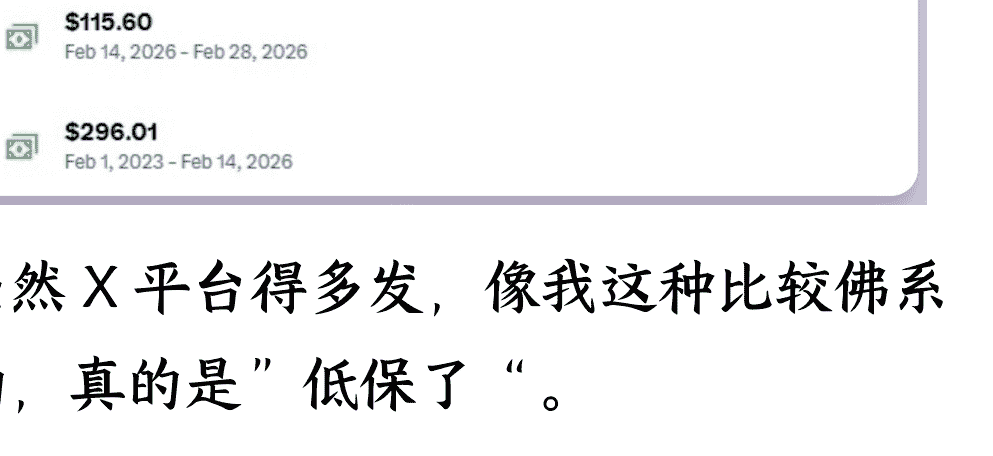

当然 X 平台得多发，像我这种比较佛系的，真的是”低保了“。

# ### 3.5 避坑指南：4 种会被限流的情况

在讲怎么做之前，先讲怎么不被封号、不被限流，这是最基础的。

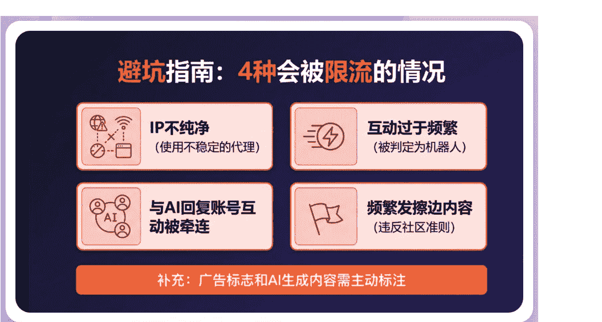

# 封号/限流原因:

- IP 不纯净：魔法有问题，使用不稳定的代理
- 互动过于频繁：发大量低质量互动，被判定为机器人
- 被举报：发擦边内容，违反社区准则
- 与 AI 回复账号/垃圾号互动：被牵连

# 限流处理:

- 停发内容几天
- 可以申诉
- 使用限流检测工具定期检测账号状态

# 内容标注规范（重要！）:

# 注意:

## 发任何合作帖前都主动开 Paid Partnership
## 用 AI 生成的内容（尤其是涉及新闻、冲突、敏感话题）主动加 Made with AI 标签

**实用工具：**

**限流检测工具：**[https://x-shadowban-checker.fia-s.com/](https://x-shadowban-checker.fia-s.com/)

**推特起爆贴监控系统：**[https://sopilot.net/zh/hot-tweets](https://sopilot.net/zh/hot-tweets)

## 五、底层逻辑：为什么我能拿到这个结果？

### 4.1 我不是纯新手，我是内容创作者

很多人看到我 90 天 1.8 万粉，觉得很快。但其实，我不是纯新手。

我来 X，不是从 0 开始学内容创作，而是把已有的内容能力迁移到新平台。

但即便如此，我还是在 73 粉的时候崩溃过、怀疑过、差点想弃坑。

这让我明白：有经验不代表不会踩坑，关键是能不能从坑里爬起来。

### 4.2 X 本质还是内容平台，核心是优质的原创内容

我在 X 上想了很久，才明白了这点。

X 的玩法虽然和公众号有所差别，但是本质都是一样的。

内容输出才是我们的底层因素，更多的应该是思考，我输出的内容是不是有价值的，有温度的。

X 我也是以海螺 AI 那条起号。硬核干货教程 + 优质的生图/视频是我的核心。

### 4.3 真正的护城河不是账号，是 IP

最终我们也是希望除了涨粉还能挣到钱。那么就得让你的账号有价值。

品牌希望的是什么？我海螺 AI 和商汤的帖子数据还是可以。

**记住，你运营的是 IP，不是账号。优质的内容不缺，IP 才是你的护城河。**

### 4.4 起号成功公式

* P 会员（基础）+ 明确定位 + 优质内容
* + 大 V 转发（入池）= 突破 0-1

**核心要素总结：**

1. **开 P 会员（8 美刀/月）**
2. **写好置顶帖（IP 介绍）**
3. **找到差异化定位**
4. **每天 2-3 条原创内容**
5. **高质量回复大 V 贴**
6. **主动链接大 V，借力转发入池**
7. **坚持到 500 粉，进入流量池**

## 六、常见问题

### Q1：公众号可以给推特引流吗？

不建议。

公众号粉丝大多没条件出海，且敏感词容易限流。

反过来，推特→公众号可行。可以把推特的前沿内容深度化后发公众号。

### Q2: 发 AI 资讯为什么没流量？

资讯类内容在起号阶段很难启动。

建议先完成 0-1（500 粉），再发资讯。

### Q3: P 会员必须开吗？

如果要运营号 X 平台，必须。

非会员限 280 字，且没有蓝 V 标识，曝光差很多。

8 美刀一个月，这笔投资值得。

### Q4: 怎么找大 V 转发？

1. **进 X 增长交流群，可以互助**
2. **主动链接，内容够好，大佬愿意转**

### Q5：双币信用卡可以开 P 会员吗？

国内双币信用卡即可。或者用 Google Pay、Apple Pay。

### Q6：如何开通创作者分成？

**条件：**

1. **订阅 X Premium**
2. **过去 3 个月内，累计曝光至少 500 万**
3. **至少 500 个关注者**
4. **设置 Stripe 账户（需要港卡）**

**收益：**

1. **100 万阅读大概 100 美刀**
2. **取决于 Premium 用户的互动量**

### Q7：如何避免限流和封号？

**避免：**

1. **IP 不纯净（使用稳定的魔法）**
2. **互动过于频繁（不要发“沙发”“前排”）**
3. **发擦边内容**
4. **与 AI 回复账号/垃圾号互动**

**标注规范：**

1. **付费合作必须标"Paid Partnership"**
2. **AI 生成内容建议标"Made with AI"**

### Q8：新手最容易犯的错误是什么？

1. **没有明确定位：今天发这个，明天发那个**
2. **无效转发：没有自己的内容，只转发别人的**
3. **低质量互动：你的内容输出都是要有质量的**
4. **盲目蹭热点：没有结合自己的定位**
5. **没有写好置顶帖：别人看完你的帖子，不知道为什么要关注你**

## 七、写在最后

这篇复盘，我断断续续写了半个月。

写完的时候，我又重新走了一遍这 4 个月的路。

从 73 粉的自我怀疑，到 1.8 万粉的深夜截图；

从 0 互动的绝望，到 1182 美元到账的惊喜；

从差点删号的崩溃，到现在每天还能稳定收到“低保”……

我最大的感悟其实只有一句：

X 平台对真正有内容能力的人，真的很公平。

但前提是，你得先熬过那个最黑暗、数据完全不动、差点删号的阶段。

如果你现在正站在 73 粉的那个位置，请相信我——

坚持下去，找对方向，好内容真的会发光。

花开有时，静待芬芳。

而我，已经在前面等你了。

---

看完这篇 SOP，你觉得你懂了。但 90%的人一到实操就会卡在第一步。
工具和教程只是最低级的壁垒，真正的壁垒是“立刻动手”和“圈层信息差”。

如果你想看全网最新的变现玩法，并且和一群执行力极强的极客一起下场拿结果，欢迎围观我的核心私域：【懒人专属群】。

我们不聊虚的，只做商业闭环的拆解与 AI 效率的压榨。系统内已沉淀 1000+ 跑通的套利实战局。

👉 **查阅圈子完整数字资产与上车门槛：**
https://lazyso.com/insider/

认同价值、准备好下场干活的，扫码加我微信（lazyhelperl）