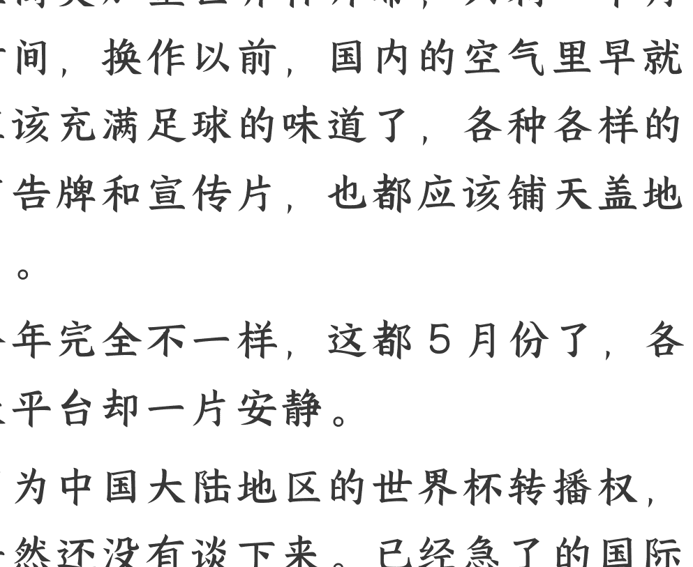

## 国际足联降价一半，央视会不会购买转播权？

**260512 文/卢克文工作室嘉宾 概略北方**  
整理：公众号懒人搜索，[懒人专属群](https://t.cn/xxxx)精选  
懒人微信：lazyhelper1

距离美加墨世界杯开幕，只剩一个月时间，换作以前，国内的空气里早就应该充满足球的味道了，各种各样的广告牌和宣传片，也都应该铺天盖地了。

今年完全不一样，这都 5 月份了，各大平台却一片安静。

因为中国大陆地区的世界杯转播权，居然还没有谈下来。已经急了的国际足联，提出价格降低一半，从 3 亿美元，降到 1.5 亿美元。

那么，央视会不会购买？

央视和国际足联关于转播权的谈判，从去年 11 月就开始了，到现在已经半年了。这么久都没谈下来，可见谈判之艰难。

那么，谈判到底卡在哪了呢？

从表面上看，是钱。

国际足联一开始的要价，高达 2.5 亿至 3 亿美元。而央视，也就是代表中国进行谈判的唯一合法买家，给出的心理价位只有 6000 万到 8000 万美元。

说实话，买卖双方出价不同，这种事太正常了，你去买衣服还要讨价还价一番，可为啥就是谈不下来呢？

原因很简单，就是因为双方都认为自己的出价是合理的。

国际足联认为，转播费从来都是逐次上涨的，哪有降的道理？

过去二十年央视购买世界杯转播权的成交价，是一个上涨曲线，2010 年和 2014 年两届世界杯打包，央视花了 1.15 亿美元，到了 2018 年俄罗斯世界杯和 2022 年卡塔尔世界杯，两个打包在一起卖，央视总共花了差不多 3 亿—4 亿美元。

按这个涨价曲线，这次要 2.5 亿至 3 亿美元似乎也合理。

更充分的理由是，这次世界杯扩军了，参赛队伍从 32 支增加到了 48 支，比赛场次也从 64 场增加到了 104 场。

转播内容增加了将近 60%，量大管饱，价格自然水涨船高，天经地义嘛。

更何况，在 2022 年卡塔尔世界杯期间，中国观众贡献了全球 49.8% 的数字平台观看时长。中国有 14 亿人，你们中国人这么有钱，这么爱看球，出个 3 亿美元买转播权算什么？

但央视显然不这么看。

卖版权不是卖白菜，没有量大卖的就贵的道理。世界杯的魅力在于什么？在于强强对战，在于悬念，在于那些世界级球星的各种神来之脚。

你扩军到 48 支球队，里面有多少是鱼腩球队？他们的对战，能有多好看？真的有人愿意看海地对战库拉索？有时候，浓缩的才是精华，你现在在一锅肉汤里面兑了半锅水，喝起来还有啥滋味？

更要命的是时差。

这届世界杯是在北美举办，中国有时差，大概是 12 到 15 个小时。这就意味着，将近 60% 的比赛，是在北京时间的早上 6 点到 10 点打。

这个时间段，恰好是中国人起床、上班通勤、开早会、送孩子上学的时间，谁有工夫大清早坐在电视机前看球？

而且，那些真正吸引人的揭幕战、决赛，以及淘汰赛阶段的关键比赛，很多都被安排在了北京时间的凌晨 3 点，知不知道凌晨 3 点爬起来是多么痛苦的一件事？

当然，最最最关键的是，你们扩军是扩军了，可也没把中国队弄进去。

你信不信，你们要是给中国队弄一个直通名额，别说 3 亿了，6 亿中国也愿意出，你就是把比赛时间安排在凌晨 4 点，照样有人爬起来看，不管是真球迷还是伪球迷。

要说国际足联也是蠢，只要想办法给中国队弄进去，然后开价 30 亿，央视就被架在火上烤了，不掏也要掏了。中国队不参赛，又搞了一堆鱼腩进去，安排的还是阴间时间，有多少中国人愿意看？就这种比赛，你还想卖高价？想啥呢？

咋说呢？国际足联还是太傲慢了，一方面是那种白种人高高在上的微妙心态，另一方面也是出于自己把持着“体育娱乐权”的傲慢。

他们总以为中国老百姓还处于七八十年代，文化消费品稀薄得很，能给中国个转播，就是恩赐了，自然不会把你当回事。

举个例子，你打开国际足联的网站就会发现，这个网站的语言选项，没有中文，相反，亚洲国家的日语、韩语、印尼语通通安排到位。

而坐拥十几亿人口、全球规模第一、贡献了全世界近一半世界杯观看时长的中国球迷群体，却被直接无视，你能说这是技术问题么？说白了，就是骨子里的轻视。

他们声称把中国和美国、英国一样划在最高等级的"Tier I"市场。但这种所谓的“第一梯队”，仅仅体现在他们向你收钱的时候，因为你是第一梯队，所以你就该出这个价，转头却连一个中文网页都懒得做。

在过去，他们这一套可能还有人买账。

毕竟当年移动互联网的烧钱大战咱们都记忆犹新，只要能拿到独家内容，就能把全国的用户圈在自己的 APP 里，只要垄断了用户规模和日活数据，就能在资本市场上讲出几百亿甚至上千亿估值的故事。

想当年，中国各大平台都杀红了眼，你几亿拿下英超版权，我几亿买下 NBA 转播，他们根本不在乎买版权花的那点钱，花一亿，回头几倍、几十倍的市盈率就挣回来了。

现在呢？时代变了。

过去平台愿意花十几亿去买版权，因为那时移动互联网还有增量，大家要靠顶级体育 IP 来拉新用户，只要能拉来新用户，财报就好看，股价就能涨。

现在网民数量见顶，该下载抖音、快手、腾讯视频的人，早就下载了，就算你播了世界杯，又能拉来几个新用户呢？

而且现在的年轻人，还有几个愿意看整场直播？

大部分都是第二天早上起来，在短视频平台上刷几条 3 分钟的集锦，评论区玩玩梗，就完事了。你花几十亿买版权，可用户只看几分钟，这笔账怎么算都是亏的。国际足联显然没有意识到这种变化。

不仅死咬着 3 亿不放，甚至还赤裸裸地搞起了双标，说中国人口多，看球的人口多，所以要高价。

但你看看印度呢？印度和中国人口数量差不多，他们也没进世界杯，拿下的转播权是多少钱？2026 年和 2030 年两届世界杯打包，只要 3500 万美元，就这印度还嫌贵呢，还在往下砍价呢！

现在国际足联转头向中国要 3 亿，这已经不是简单的漫天要价了，这就是明显把中国当韭菜了！

我可以和你做生意，可以花钱买转播权，但这一切都有一个前提，平等尊重。

眼看你就是在宰我，我为啥要伸着脖子让你宰？

我就算把谈判桌子掀了，你又能把我怎么样呢？

你能不让中国队参加世界杯么？你能在世界杯对中国队吹黑哨么？你能恶意不转播中国队镜头么？

都不能啊！因为中国队本来就进不去啊！

光脚的不怕穿鞋的，大不了这生意不做了。

时间越往后拖，央视就会越强硬，为啥？因为时间。

世界杯转播是一门生意，那就要按照生意的逻辑来。

央视花几个亿把转播权买回来，要想盈利，主要靠广告和版权分销。

但问题在于，这都不是仓促就能搞定的。

要卖广告，就要先搞个世界杯广告资源推介会，把赛事分成无数个资源包，有人做独家冠名，有人做半场休息 15 秒贴片，有人做进球后的角标等等。

**版权分销，央视是转播权独家**，它买回来后，才能把版权分销给咪咕、抖音或者爱优腾。

那这里面的合同怎么规定？转播场次、短视频集锦的权益、延时播放的权益怎么明确？怎么防止盗播？怎么做信号加密？怎么进行多路并发信号的压力测试？服务器能不能扛得住？**这都需要央视和分销平台进行多轮的磋商和联合技术测试**。

现在只剩几十天，这么复杂的工作能不能搞定？如果搞不定，平台就会倾向放弃网络转播世界杯。世界杯转播是一门生意，如果广告商和分播平台不花钱买广告和分播，央视不就赔钱了吗？**注定赔钱的生意，央视为啥还要做呢？**

这就是哪怕国际足联把价格降到了 1.5 亿美元，**央视仍然不买账的原因**。看到现在，大家其实也就明白了，这次世界杯转播权风波，其实就是国际足联的官僚们自己玩崩了。

在之前，国际足联死拖着不降价，其实也是看准了央视分销需要时间，想用来逼央视就范，当这个时间点跨过一定阈值的时候，**央视反而不急**了，反正也来不及，我为啥还要迁就你的报价呢？

现在着急的是国际足联了，没人能承受失去中国市场的责任。

这绝不是少赚上亿美元转播费的事，它动摇的是国际足联在亚洲的基本盘。

为啥呢？说个冷知识，国际足联，基本上都是靠中国广告商养着的。

2022 年卡塔尔世界杯期间，中国企业的赞助总金额达到了惊人的 13.95 亿，超过了美国，成为全球最大的单一赞助来源国。

到了 2026 年，情况依然如此，多个中国企业早就给国际足联交了赞助费。

他们图啥呢？图的就是一个“世界杯官方赞助商”的头衔，通过在央视的转播画面里露出场边广告牌，向消费者证明品牌实力，从而拉动销量。

如果央视和国际足联真的谈崩了，中国大陆没有转播了怎么办？

那不就相当于他们买场边广告牌的錢，都打水漂了吗？他们提前做好的宣传物料，印着世界杯 logo 的包装盒，不都成了废纸了？这对那些投广告的企业当然是灾难，对国际足联也是灾难。

如果央视这次真的不播，那下次，还有多少中国企业去给国际足联交赞助费？国际足联为了几亿美元的转播费，丢掉了十几亿的赞助费，谁能负这个责？

**所以，国际足联秘书长马蒂亚斯·格拉夫斯特伦和媒体版权总监让 - 克里斯托夫·珀蒂也急了，火急火燎地飞到了北京，与央视进行面对面的紧急磋商。**

但有点晚了。

熟悉老中作风的都知道，老中第一次的开价往往最合理，如果你不干，那对不起，这个开价你也拿不到了。

如果一开始就便宜一点，便宜到 1.5 亿，那央视咬咬牙也就认了。

现在舆情已经发酵了，转播权这事已经上升到民族尊严和国家主动权的地步了，这时候就算央视想松口，恐怕也松不了口了。

**央视虽然是个企业，但从根本上来说，它还是要讲政治的。除非国际足联再继续降价，否则协议还是达不成。**

当然，在各路广告商的游说之下，协议达成还是有希望的，假设国际足联能以 1.5 亿美元把 2026 年和 2030 年的版权捆绑在一起，倒不是不行。这样面子给了国际足联，央视享受低价的里子，中国赞助商长舒一口气，三方都有个圆满的交代。

不过呢？如果协议达不成，也没什么大不了的。

你真以为没了正版转播，中国人就看不了世界杯了吗？

开什么玩笑？现在是网络时代了好么？

没有版权，就相当于到处都是版权，过去央视转播，小平台不敢播，生怕央视打官司，但现在呢？你信不信，到时候只要比赛一开，各种神通广大的网站平台，都会以各种神奇的姿势转播球赛的。

虽然盗版不对，但能怪谁呢？要怪只能怪国际足联的傲慢和贪婪了。

这件事从另一个侧面，也说明了中国的进步。

在过去，我们总是必须为西方主导的赛事买单，无论是奥运会申办权还是转播权，只能伸着脖子挨宰，否则我们好像就脱离了国际社会，就显得我们不够现代、不够开放。

现在，咱们也开始用理性去衡量每一笔交易的真实价值了。当你不再仰望西方，你才真正拥有了平等谈判的资格。如果西方人还用傲慢的嘴脸，逼中国人缴纳智商税，对不起，中国人不吃这一套。

你们的世界杯游戏，我们再也不玩了。

## 分割线

绝大多数人只盯着眼前的工资，却不知道一次远在中东的冲突、一次降息的决议，就能在一夜之间洗牌普通人的财富。

看懂宏观，是为了在周期切换时，不被当作代价。

如果你认同这种“抬头看路”的长期主义，欢迎围观我的个人情报智库：【懒人专属群】。

圈子已稳定运行 7 年。我们每天利用 Python 爬虫与大模型算力，过滤全网最顶级的政经内参和搞钱风向标，做你最冷酷的“外部大脑”。

查阅圈子完整数字资产与上车门槛：
https://lazyso.com/insider/
认同价值的。扫码加我微信，备注：【进群】

