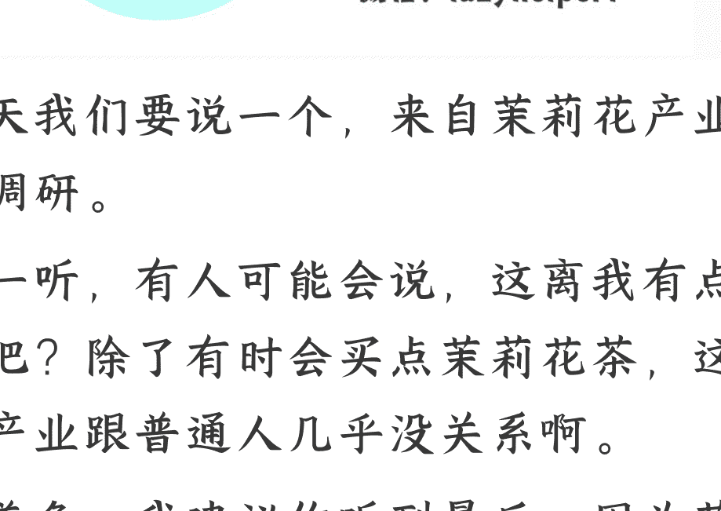
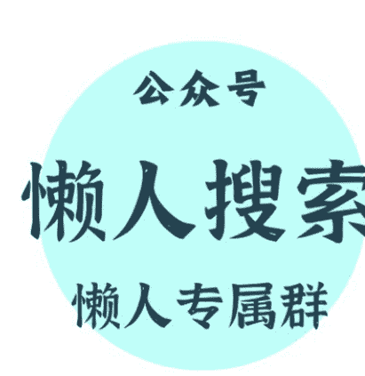

## 七万家茶企，比不过一个立顿？怎么破？

260513

整理：公众号懒人搜索，[懒人专属群](https://mp.weixin.qq.com/s/7X8y9z) 精选

懒人微信：lazyhelperl

**今天我们要说一个，来自茉莉花产业的调研。**

乍一听，有人可能会说，这离我有点远吧？除了有时会买点茉莉花茶，这个产业跟普通人几乎没关系啊。

别着急，建议你听到最后。因为茉莉花产业里，有一套非常特别的逻辑。在这我斗胆起个名字，姑且叫它"**钥匙型产业**"。**什么意思？**你看，钥匙为什么有价值？**不是因为它本身精美，而是因为它能够开启一把锁，能打开一扇门**。门后的东西越值钱，钥匙就越值钱。

而所谓"**钥匙型产业**"，也就是，这个产业的**核心价值，不在于它本身的大小，而在于，它能够解锁另外一个，或者多个规模更大的产业。**

这么说可能有点抽象。前段时间，资深零售咨询专家，黄碧云老师，专门去国内最大的茉莉花产业基地，广西横州做了调研。

图片注释：广西横州中华茉莉园 黄碧云拍摄

要想详细了解，我们得先从一个困境说起。这个困境是关于“中国茶企”的。

在很多年前，坊间一直流传一个说法，叫，“中国 7 万家茶企，干不过 1 个立顿”。这个说法最早脱胎于新华社的一篇报道。报道里提到，2008 年，中国大概有 7 万家茶叶企业，近 1000 个县都有茶叶生产和销售，总销售额加在一起大约 300 亿元人民币。而联合利华旗下一个“立顿”品牌，一家的年收入就接近 230 亿元人民币。

7 万家加在一起，才勉强比立顿一家多出三分之一。虽然算不上“打不过”，但至少是在同一个“量级”。但问题是，我们可是 7 万家茶企啊，对面才一个品牌。

后来也有人对这个数字有过质疑，认为是统计口径不同造成的。但"7 万家茶企打不过 1 个立顿”的说法，还是流传开了。

那么，为什么会这样呢？是品质问题？品牌运营问题？都不完全是。关键的卡点，藏在一个更底层的逻辑里：中国茶叶是非标产品。

你看，茶叶的品质，取决于土壤、海拔、气候、采摘时节、炒制师傅的手法，每一个变量都在影响最终的味道。龙井今年和去年不一样，这座山的和那座山的不一样。换句话说，这种“每一批都是冒险”的特性，让很多茶企很难建立品牌信任。消费者不知道下次打开包装，喝到的还是不是同样的味道。

结果就是，没有标准化，就没有品牌资产，就永远困在小散乱的农业逻辑里。

很多茶叶的口味未必不如立顿，但立顿的优势在于，每一包都一样。这种稳定性，是成为品牌的关键基础。

而且更麻烦的地方在于，对很多茶企来说，他们也面临一个两难的处境。假如努力往标准化上靠拢，一来难度很大，首先就没有统一标准。二来，这个“非标准”的味道，很多茶企业放不下，这毕竟是他们“独特性”的一部分。

换句话说，茶企面对的问题是，怎么在“标准化”和“非标准化”之间自由切换。既能用口味稳定的标准品来撑起规模，也能用非标准的产品维持独特性。

那么，你用什么来解锁这个“标准与非标准”之间的自由切换呢？这就要说到，我们今天的主角，茉莉花了。

茉莉花都做了什么呢？

首先，它解锁了口味的标准化。你有没有发现，各个品牌的茉莉花茶饮料，口味出奇地接近？甚至喝不出什么差别？

因为茉莉花茶的制作，有一道核心工序叫“窨制”。新鲜的茉莉花苞，在夜里慢慢开放，释放香气，香气渗入旁边铺开的绿茶叶片，这就算完成了一次窨制，也叫“一窨”。重复这个过程，就是二窨、三窨。高档茶能做到八窨以上，一斤茶可能要配上差不多等重的鲜花，反复窨七八次，耗时将近一个月。

在这个过程里会发生了一个关键的转化，茉莉花的香气，把不同来源绿茶之间的品质差异屏蔽了。

你看，云南绿茶口感厚重，浙江绿茶清淡，福建绿茶带矿物感。但经过茉莉花香气的覆盖和渗透，消费者感知到的主要是茉莉花香，茶底之间的差异，退到了背景里。

简单说，一个饮料品牌可以根据市场行情，灵活切换绿茶来源，而最终呈现给消费者的产品口感保持基本稳定。

注意，到这一步，一个连锁反应就启动了。饮料企业输出稳定的口味，稳定的口味带来规模化的销量。而茶叶饮料的需求，又带动了饮料企业对茶叶原料的需求，整个茶叶原料市场都迎来了增长。而解锁这一切的关键之一，就是茉莉花。

其次，茉莉花还解锁了“库存”。整个中国原叶茶市场里积压的滞销产品，有了一条新的出路。铁观音卖不掉？转成茉莉花茶底。福鼎白茶前几年被过度炒作，价格崩了，库存积压？转成茉莉花茶底。夏季绿茶品质偏低，卖不上价？还是转成茉莉花茶底。

最后，茉莉花还解锁了一个新的品牌市场。过去十年，中国新茶饮市场爆发式增长。蜜雪冰城、霸王茶姬、古茗、喜茶，这些品牌需要稳定的茶底供应。而茉莉花茶，恰恰满足了这个需求，口感稳定、香气明显、成本可控。

今天，以茉莉花为原料的茉莉花茶，成了中国无糖茶市场里最大的单品类。

换句话说，茉莉花产业本身不算很大，全球产量也就十几万吨。但它像一把钥匙，解锁了一个千亿级的茶叶市场。这也是为什么我们管它叫“钥匙型产业”。

但是，说到这，又引出另外一个问题。茉莉花本身毕竟是个农产品，你怎么确保它自己产量稳定，能够跟得上整个茶叶产业的需求呢？况且即使需求跟上了，这里面还有一个问题，就是万一大家发现茉莉花需求大，都开始种植，导致供应过剩，价格崩盘怎么办？

你看，栀子花，比茉莉花更香，而且采后可以冷冻保存，运输方便，听起来各项指标都比茉莉花强。

两三年前，栀子花突然大火，很多新茶饮品牌推出了栀子花系列。后来资本进来，大批农户跟风种植，香精冒充鲜花的劣质产品也大批涌入。消费者踩雷几次，对整个品类失去信心，需求断崖下跌。而此时扩产的农户已经没有退路，大量滞销。一阵风来，一阵风散。今天你基本看不到栀子花系列产品了。

这种从稀缺到涨价，从涨价到一拥而上，引发产能过剩导致价格崩盘的循环，几乎是所有农业品的“天敌”。茉莉花产业怎么避免这个问题？

关于这个问题，我们可以看看广西横州的做法。现在业内有个说法，全球 10 朵茉莉花，有 6 朵来自横州。这主要是因为横州有着特殊的地理禀赋。横州的地貌叫红土小丘陵。这种土排水快，不蓄水，而茉莉花最怕涝，这种环境对茉莉种植非常友好。加上横州地质疏松，地形连片，不像云南的茉莉花分布在险峻山地，横州的种植区可以大片相连，既便于统一管理，也便于工厂就近取货。

图片注释：横州农户茉莉花交易现场
黄碧云拍摄

那么，当地既然有这么多人种植茉莉花，你怎么避免极端情况呢？比如产能过剩，或者价格崩盘。

针对这个问题，**横州研发了一套叫做“数字茉莉”的系统**，这套系统也是整个横州茉莉产业最关键的护城河之一。

具体来说，这个“数字茉莉”系统有三个核心功能。

### 第一，信息透明。

比如，价格透明。每天下午四点到六点，横州的鲜花交易市场开市，农户把当天采的花送来过秤，秤是政府统一配置的，重量和价格实时上传到系统。农户拿出手机扫一下码，钱秒到账。所有人都能在小程序上看到当天的实时成交价和成交量。市场完全透明，没有人能单边压价，也没有人能哄抬。

再比如，产能透明。横州的茉莉花产业，用卫星遥感监测全市 12.5 万亩种植基地。AI 相机实时测产，预估当日产量。政府随时知道种了多少、产了多少。同时，这套系统会用大数据分析历史交易，预测价格走势，发布“交易指导价”。在花期来临前，提前通知加工厂扩大收购能力，避免鲜花积压。减产时，提醒工厂提前储备原料。

### 第二，按需种植。

也就是，当地不是“先种植，再考虑怎么卖出去”，而是，企业先通过平台提前下单，农户根据企业订单量按需种植。

### 第三，横州政府还为茉莉花种植提供了“兜底保障”。

包括，金融支持、农业保险、财政补贴，三重兜底。具体的运作机制我们在这就不展开了。简单说，就是通过“数字茉莉”的交易记录，相关部门能够及时了解行业的具体信息，然后根据实际情况，给予政策层面的支持。这个支持力度有多大呢？仅仅是 2023 年，横州市财政投入茉莉花产业的发展经费，就超过 5000 万元。

换句话说，横州不是让农户“自己判断市场”，农户只需要按标准种好花，其他的，系统来兜底。而且这个产业的回报也非常清晰，横州茉莉花产业的税收，2024 年已经超过 1 亿元，2025 年达到 1.45 亿元。

说到这，我们再回到开头那个词，“钥匙型产业”。茉莉花市场为什么崛起？因为它成了解锁更大的“茶饮”市场的钥匙。

**换句话说，一个产业实现价值的方式，从来都有两条路。要么是自我演化，直接面对消费者。要么是成为钥匙，去解锁另一个更大的产业。**而且千万不要小看后者，要知道，中国的产业规模基数极大，占据其中一个细分领域，这本身可能就是一个超大机会。

在这个 AI 能替你写代码、写文章的时代，基础技能正在迅速贬值。绝大多数人正被淹没在海量的免费垃圾信息里，陷入低效的体力内卷。

当“努力”不再是壁垒，人与人之间唯一的护城河，只剩下“信息过滤”的效率与“认知系统”的维度。

如果你认同这种“重塑认知防线”的极客主义，欢迎围观我的个人情报智库：【懒人专属群】。

如果你认同这种“重塑认知防线”的极客主义，欢迎围观我的个人情报智库：【懒人专属群】。

https://lazyso.com/insider/

