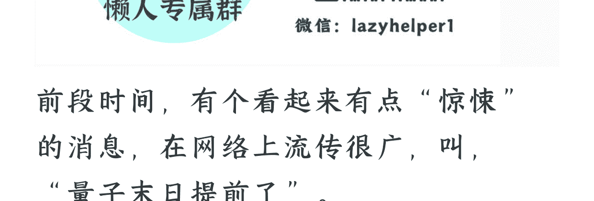

# 所谓“量子末日提前”，到底是怎么回事？

**整理：**公众号懒人搜索，[懒人专属群](https://www.zhihu.com/question/39877777)精选  
**懒人微信：** lazyhelper1  

前段时间，有个看起来有点“惊悚”的消息在网络上流传很广，叫，“量子末日提前了”。你看这个用词，“末日”，乍一看这一定是什么不得了的事情，就像《终结者》里的“天网觉醒”一样。那么，实际情况到底什么样呢？今天，我们就展开说说。我们先从这个消息的来源说起。“量子末日提前”的说法，脱胎于 2026 年 3 月，谷歌在官网上发布的一份声明。谷歌的安全工程副总裁海瑟·阿德金斯写了这么一句话，叫“作为量子领域的先行者，我们有责任率先示范，并公布一个雄心勃勃的时间表。”这个时间表里说，谷歌要在 2029 年之前完成全面的加密体系升级。

## 为什么要在 2029 年之前升级加密体系？

那么，为什么要在 2029 年之前升级加密体系呢？因为谷歌认为，在 2029 年之前，Q-Day 会到来。

### Q-Day：什么是“量子日”？

**Q-Day**，这是网络安全圈里的一个词，其中 **Q** 指的就是量子，因此直译过来，就叫“量子日”。它指的是，量子计算机强大到足以破解现有所有加密体系的那一天。而现存的银行密码、军事通信、政府机密，几乎都建立在同一套加密算法上。**Q-Day**，就是这套算法被量子计算机彻底攻破的那一天。

你可以把 **Q-Day** 当成是一个量子计算机的能力节点。但“量子日”这个翻译太寻常了，后来就有人把它翻译成了“量子末日”。之前业界给出的 **Q-Day** 时间，大概是在 2030 年到 2040 年之间。而谷歌发布的声明里，把这个日期提前到了 2029 年。因为他们判断，依照量子计算机发展的速度，这一天会提前到来。

听到这，有人可能会说：这也够吓人的啊。万一将来量子计算机能破解所有密码，那么个人存在银行里的钱怎么办？那些机密的信息怎么办？其实，关于量子计算机的发展确实值得注意。只不过，这个值得注意的点跟很多人想的可能不太一样。

## 量子计算机到底是什么？

要想读懂其中的关键，我们得先从量子计算机到底是什么说起。很多人可能觉得，量子计算机就是传统计算机的加强版，它更快、更强、更厉害：传统计算机几年才能完成的计算，它几分钟就能搞定。但事实上，不好意思，这是个误解。简单说，量子计算机并不是“加强版的计算机”，而是“另一种”计算机。

那么为什么很多人会有这个误解呢？这个事能追溯到 7 年前的一个新闻。**2019**年，谷歌在《自然》杂志发表了一篇论文，这篇论文还带火了一个词，叫“量子霸权”。论文说了什么呢？谷歌宣布，他们用一台 **53**个量子比特的量子处理器（叫“悬铃木”），在 **200秒**内完成了一项计算任务。而同样的任务，全球最强的超级计算机需要大约 **1万年**才能算完。

你看，这听起来好像是量子计算机全面碾压经典计算机，对不对？但是，假如仔细观察，你会发现谷歌让量子计算机执行的任务叫做“随机电路采样”。具体的技术细节我们就不展开了。我们只需要知道：第一，这道题几乎是专门为量子计算机设计的，是量子计算机最擅长的那类题目；而经典计算机在这类任务上确实不擅长。第二，这个题目几乎不指向任何现实应用。

它就像是一道为了证明“我很聪明”而设计的“脑筋急转弯”。这就好比我证明了一把手术刀在切除阑尾这件事上比一把菜刀快得多：这是事实，但它不代表手术刀能替代菜刀做其他事情。手术刀和菜刀都是切割工具，但它们擅长的场景完全不同；拿错工具只会帮倒忙。

换句话说，至少从目前的情况看，量子计算机是高度专用的工具。它擅长的是某一类特殊的数学问题，比如：
- 和概率分布有关的计算
- 分子层面的量子模拟
- 超大数字的质因数分解

这些问题有一个共同的特点：经典计算机处理它们时，需要“穷举”所有可能性，计算量随着问题规模呈指数级增长，很快就超出了经典计算机的能力范围；而量子计算机可以利用“量子叠加”和“量子干涉”，同时探索多条计算路径，大幅缩减需要检验的可能性数量，从而实现加速。

但除了这些特定场景，量子计算机做不到的事情非常多：它不会让你的手机运行更快，不会替代现有的 AI 算力，也不会帮你更快地刷网页、看视频或打游戏。大多数人觉得计算机“应该能做的事”，量子计算机要么做不了，要么做起来很慢。

## “攻克现有加密体系”是量子计算机的强项吗？

而在量子计算机擅长的事情里，恰好就包括“攻克现有加密体系”。现在互联网的绝大多数加密体系依赖的是两类叫做“椭圆曲线加密”和"RSA 加密”的算法。这类算法之所以安全，是因为用经典计算机来破解它需要的计算量大到不可接受：说个数字你感受一下，假如要用经典计算机破解比特币的加密体系，需要的时间要远超宇宙的年龄。

但量子计算机最擅长的就是“大数分解”这一类问题。根据谷歌 2026 年 3 月发布的白皮书，理论上，假如拥有不到 **50 万个**物理量子比特，就可以在 **9分钟**内攻破比特币背后的加密体系。其中的专业名词我们先放在一边，你重点感受一下这个差距："9 分钟”和“远超宇宙年龄”。

听到这，有人可能更焦虑了。别着急，我们需要知道两个信息：

#### 第一，谷歌说的量子计算机需要大概 50 万个物理量子比特
而目前量子比特数量最多的芯片是 IBM 在 **2023**年发布的（拥有 **1121个**量子比特）。但是注意，量子计算机不是“量子比特越多越厉害”，这里面还牵扯到可靠性、稳定性、量子纠错能力等等。

#### 第二，人类为“量子威胁”做准备的时间比很多人想象中更早
而目前最强大的量子芯片是谷歌在 **2024年12月**发布的Willow 芯片（拥有 **105个**量子比特）。但谷歌这个芯片真正的突破不在于量子比特的数量，而是它实现了“规模越大，性能越好”这个进化逻辑。目前咱们中国的“祖冲之三号”也是 **105**个量子比特，而且也实现了类似的逻辑。换句话说，今天在“可用的量子比特”这个维度上，最先进的水平是 **105**个，距离 **50 万**还有很大的差距。

听到这，有人可能会说：虽然现在差距大，但你架不住这个东西发展快啊！而且现在还有 AI 的加持，保不齐哪天就突破那个临界点了？这就要说到第二个关键信息了：**人类为“量子威胁”做准备的时间，比很多人想象中更早。**要知道，人们不是最近才意识到 **Q-Day** 的。早在 **1994年**，美国数学家肖尔（Shor）就设计出了量子计算机的破解算法，也就是大家所说的“肖尔算法”。当时人们就已经意识到量子计算机早晚能破解这些密码，只不过是哪天实现的问题。

而从很早之前开始，人们就已经开始为那天做准备：量子计算机在破解加密的同时，量子通信也在创造一种新的、理论上完全无法破解的加密方式。**量子通信**（也叫 **QKD**），利用的是量子力学的一个基本原理：“你一看，它就变”。简单来说：**你无法在不干扰量子态的情况下偷听量子信息；任何窃听行为都会改变量子信号的状态，在信道上留下可被检测到的痕迹**。

换句话说：用量子通信传递的密钥一旦被窃听，对方立刻就能发现，然后丢弃这组密钥重新生成。整个过程不是“加密得很好很难破”，而是从物理原理上保证：“一旦我的信息被看到，我立马就知道，并且马上就改”。**这也意味着，量子计算机有破解密码的能力，而量子通信有“阻挡破解”的能力；关键就看到底谁跑得更快。**

而从目前的情况看：
- 全世界所有顶尖的相关机构都在提速量子通信的落地速度。
- 全世界的主要金融机构几乎全在布局量子安全。

这里还有个细节值得注意：安全领域有个词叫"**先收集后解密**"（英文缩写 **HNDL**，即 *Harvest Now, Decrypt Later*）。意思是：虽然今天的量子计算机还无法破解现有加密，但这并不妨碍有人现在就开始搜集你的加密数据——先存起来，等将来量子计算机足够强大了再拿出来解密。你看，实际的威胁不来自“量子计算机强大以后”，而是“眼下就有人搜集你的数据”。**这也是为什么科研机构也好、金融公司也罢都要提前布局量子安全的原因。**

因为一些“暗黑力量”已经开始行动了，防御的起点也必须提前。因此从这个角度看：我们不能说 **Q-Day** 百分之一万地完全不构成威胁；但至少它的风险程度比很多人想象中要低得多。

# 总结与重点

好，我们今天从 **Q-Day**一路说到量子通信，最后划个重点：**量子计算的意义不是“我们有了更快的计算机”**。它的意义是：有一类问题人类过去认为永远算不出来、或者要算到宇宙热寂才能算完，而量子计算机正在把这类问题从"**永远做不到”变成“可以做到**。"

至于它会带来哪些实际的影响现在也许还很难说。就像科幻大师阿瑟·克拉克说的：**足够先进的技术初看与魔法无异；它所带来的东西更非凡人所能预料。**

---
## 在这个 AI 能替你写代码、写文章的时代，基础技能正在迅速贬值

绝大多数人正被淹没在海量的免费垃圾信息里，陷入低效的体力内卷。当“努力”不再是壁垒，人与人之间唯一的护城河只剩下"**信息过滤**"的效率与"**认知系统**"的维度。

### 圈子已稳定运行 7 年
我们每天利用 Python 爬虫与大模型算力，过滤全网最顶级的政经内参和搞钱风向标，做你最冷酷的“外部大脑”。如果你认同这种“重塑认知防线”的极客主义，欢迎围观我的个人情报智库：【懒人专属群】。

- **加入方式：** [https://lazyso.com/insider/](https://lazyso.com/insider/)
- **微信联系：** lazyhelper1（扫码加我）