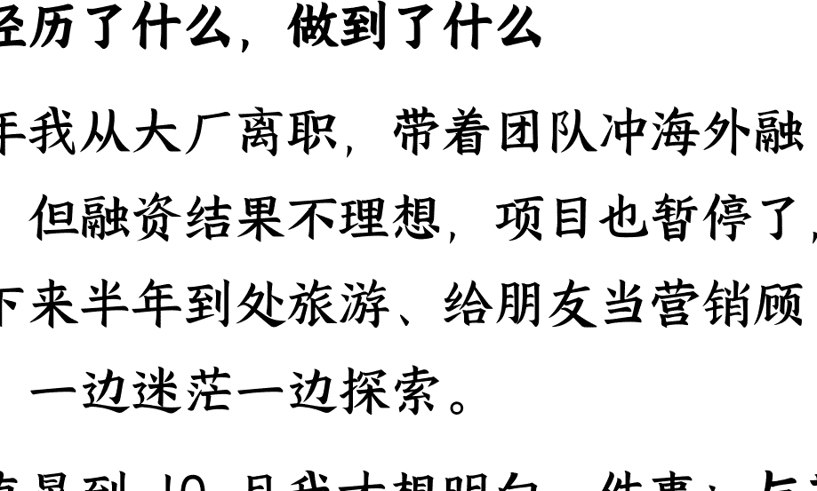
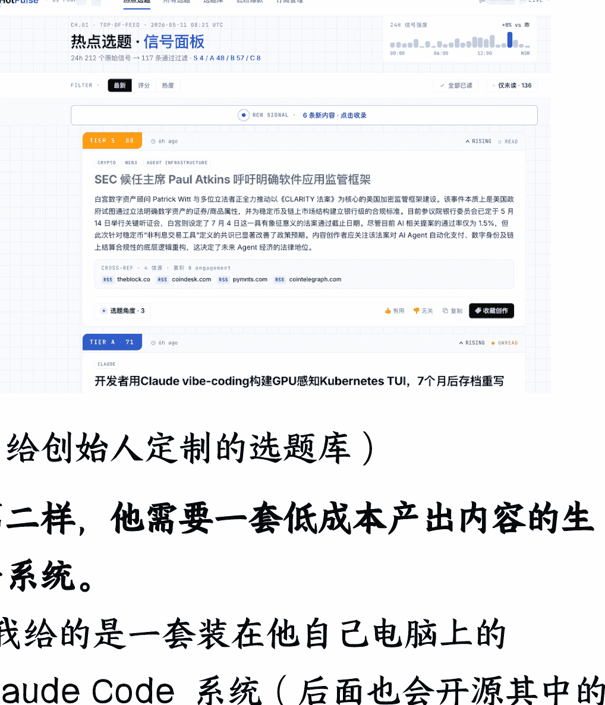
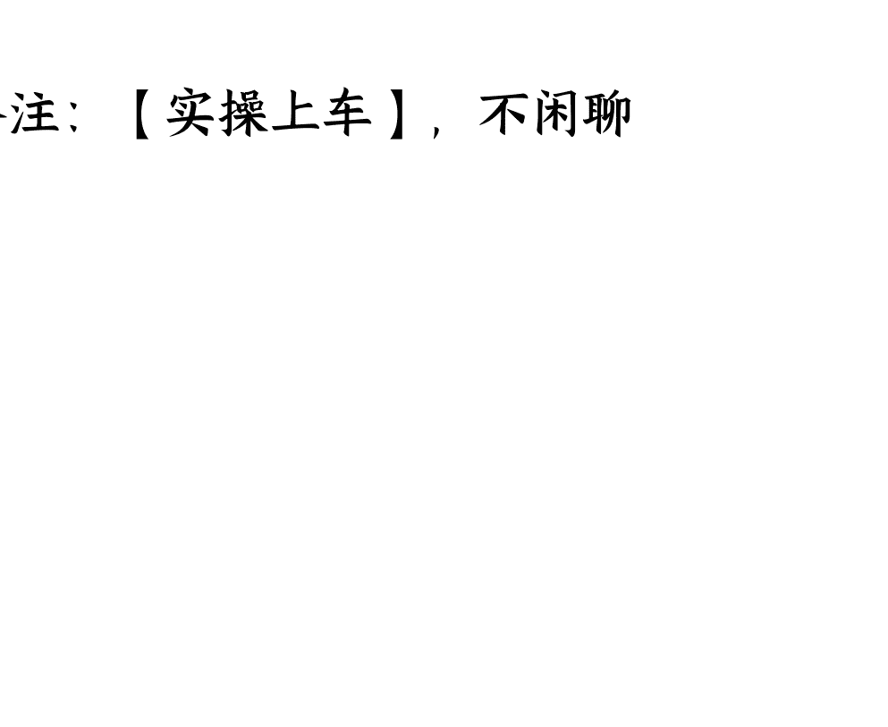

## 大厂离职后，3 个月跑通 B 端十几万客单的完整复盘

**260514 副业 SC 精华**

公众号懒人搜索，[懒人专属群](https://mp.weixin.qq.com/s/69425fXJqQw87YvZg0y3QA) 独享

懒人微信：lazyhelperl



大家好，我是 Viola，前大厂 Web3 业务负责人。23 岁拿过 500 万融资，在大厂也作为联合创始人人为分拆业务融过数千万，过去几年在海外跑过不少 AI+Web3 项目。

### 我经历了什么，做到了什么

去年我从大厂离职，带着团队冲海外融资，但融资结果不理想，项目也暂停了，接下来半年到处旅游、给朋友当营销顾问，一边迷茫一边探索。

一直晃到 10 月我才想明白一件事：与其再去赌一件我还没做成的事，不如回头看看——我过去几年一直在帮人做、做得也挺顺手的那件事是什么。答案特别简单：帮创始人把自己讲清楚。

想清楚之后 3 个月，我拿下了几位付费客户，客单价十几万，最近几条旗舰内容也都跑出了十几万、甚至 20 万 + 的传播数。业务刚起步，但从怎么定位、怎么定服务、到怎么交付，这条线算是跑通了。

这段经历我最大的两个感受：

- To B 服务比 To C 产品好做很多。To C 是三座大山同时压你——获客贵、转化慢、留存难。To B 只要能帮老板算清 ROI，决策链就很短。早期个体创业，别一上来就做产品，先用服务跑案例，会理性得多。
- 创始人 IP 不是做流量，是做杠杆。创始人要的不是粉丝总数多，是对的人能看到你——投资人、关键客户、潜在用户。所以它的重点不是套爆款模板，是先有一套稳定的系统，爆款其实是顺带的事。

#### 这篇帖子能给你什么

- 一条真实的 To B 服务验证路径：我怎么选方向、怎么谈下第一个十几万的客户、服务清单怎么一步步长出来、交付到底交什么、为什么十几万这个价格能成立
- 一套我开源出来的深度写作系统
- **Compound**：我给自己和客户交付用的同一套方法，Claude Code Skills，可以直接装来用
- 一次换反馈和换链接的机会：业务还在从 0 到 1，特别想认识同样在做 B 端服务、或者有创始人 IP 需求的朋友

### A. 我为什么做这个方向

去年初我从大厂离职出来创业，带着团队和项目走海外融资路线。努力了半年，没融到。

那段时间非常沮丧。我一直带团队，没法资本化的时候不知道自己该做什么。后面几个月一直在探索，包括给朋友当营销顾问、到处旅游，但内心其实很焦虑。每天就是和 AI 聊，探索天赋、剖析内心，还找了醒醒做盖洛普解读。她说我最擅长领兵打仗，我也认可，但本人当时也没有兵，所以内耗严重，整个人卡住了。

一直到 10 月，我突然觉得应该回头看看自己的经历——跟我背景相似的人，有什么困惑是我能解决的？然后想到了：也许我可以帮 AI 或海外创始人解决增长和影响力的问题。

为什么是这个方向？两个原因：

- 第一，我经历过作为创始人的痛苦。我在 23 岁拿过 500 万融资，在大厂也作为联合创始人帮分拆业务融过数千万，过去几年在海外也做过不少项目。创始人不同阶段的痛点、卡点在哪里，我挺清楚。自己出来融资那阵也更加确认了一件事——小创业者真正能撬动局面的杠杆，就是让市场先听见你。
- 第二，AI 时代最重要的不是做得好，是足够不同。塞思·戈丁有个经典理念叫「紫牛」：几年前，我和家人驾车穿越法国，被高速公路旁牧场上数百头奶牛深深吸引。不到二十分钟，我们就开始无视那些牛了。一头紫牛？那可就有意思了。现在 AI 让生产杠杆暴增，大家会看到越来越多的产品和内容。刚开始新奇，很快就 boring 了。要让你脱颖而出，不一定要"更好"，只需要与众不同。

这就是为什么我觉得创始人 IP 将会前所未有的重要——未来所有科技项目的创始人都要亲自下场，直面用户。

此外，我选择 To B 也是觉得更好启动。To C 产品面对的是注意力战争——你要跟所有 App 抢用户的时间，获客成本高、转化慢、留存难，三座山同时压着你。To B 不一样，企业付费的逻辑很简单：你帮我赚到的钱或省下的成本，比我付给你的钱多，就值得买。ROI 算得清楚，决策反而更快。

所以我现在走的路线是：先用 B 端服务积累真实案例，验证方法论，等想透了再考虑产品化。

### B. 这个需求为什么成立

#### 创始人 IP 不等于网红 IP

徐沪生说过一句话我很认同：创始人做 IP，最大的坑就是学上一代娱乐网红的套路。

因为这两个底层逻辑完全不同：网红追求绝对流量，然后把流量卖给广告主；创始人要的是自己的产品和服务能触达精准用户。

创始人的优势也不是娱乐能力，是专业积累。AI 公司的创始人最懂 AI，Web3 项目的创始人最懂链上叙事。离开了专业，创始人就是 nobody。

所以创始人做内容，核心是如何展示个人深度、专业度和个人魅力。

#### 创始人的痛点是什么

创业时脑子里装的东西密度极高——每天处理的信息量、决策的复杂度、对行业的洞察，都远远超过大多数内容创作者。但他们写出来的东西反而没什么人看。

主要原因有三个：

- **太忙**：公司业务繁杂，花 1 小时写深度推文，时间成本太高
- **怕丢人**：怕发了没人看，怕同行觉得 low
- **不知道怎么把内容变成商业价值**：写得好、有人看、还能对产品感兴趣，这三件事很难同时做到

而且不同创始人的需求完全不同——有人目的是融资，有人是 C 端社区转化，有人要触达 B 端开发者。不可能用一个统一的服务模板套所有人，这也是为什么市面上大多数 IP 服务对创始人来说不够用。

#### 我的切入点

我基本经历过项目从 0 到 1 再到增长的各个阶段，很清楚不同阶段营销需求和客户痛点。

所以我的切入点是定制化的「创作操作系统」+ 咨询 + 营销服务：

- 从你的定位和阶段性商业目标出发，明确 IP 的定位和营销策略
- 在这个基础上搭建一个可复制、可生长、能不断迭代的系统
- 辅助做旗舰内容，并传播给精准用户（投资人、关键客户、潜在付费用户等）

### C. 我是怎么验证客户和交付的

这一节我觉得最值得讲，因为项目从 0 到 1 的过程里，藏着很多事后才想明白的判断。

#### 1. 第一位客户为什么会买单

有了想法之后，我没急着开发系统，而是先做了一件事：列一份服务清单，定一个我自己觉得划算的价格，然后找一个真实的人去谈。

我找了一位认识很久的创始人朋友，因为我认可他在做的产品，觉得他是长期主义者。谈之前我做了一件关键的事——把他过去所有的推特翻了一遍，给他做了一个内容诊断：哪些内容他表达是到位的、哪些点他明明有深度却没讲出来、他的关注者和他真实客户画像的错位在哪、他如果想融下一轮该讲什么故事。

聊了不到一个小时，他当场就付了钱。

事后复盘，这单能成其实是三件事叠在一起：

- 他认识我很多年，不需要从零建立信任
- 我不是去“卖服务”，是直接给他看我已经看到的问题——创始人最吃这一套，你得先证明你真的懂他的业务

但我很清楚一件事：前几单能成，大部分是靠老朋友的信任。信任能让你拿到第一单，只有结果才能让你拿到第十单。所以从第一单开始，我就把“能不能复制”看得比“能不能成交”还重要。

#### 2. 服务清单是怎么“长”出来的

先讲一句实话：这份清单不是我一开始就想清楚的，是真正做了几单之后，一点点补全的。

我最早定价的时候脑子里只有两件事——帮他梳理战略，帮他写几篇旗舰内容。真正开始交付才发现，客户对于结果确定性的追求更高。

第一样，他需要有人帮他想清楚“该讲什么”。

大部分创始人不是不会写，是不知道该写什么。我会先帮他过一遍现阶段真正的商业目标——现在是要融资、要拿 B 端客户、还是要做 C 端社区？对不同用户的叙事怎么定，目标不一样，内容策略完全不一样。这一步不做清楚，后面写多少都是浪费。



(给创始人定制的选题库)

第二样，他需要一套低成本产出内容的生产系统。

我给的是套装在他自己电脑上的 Claude Code 系统（后面也会开源其中的一部分功能），里面装着他的个人定位、经历素材、文风档案、选题引擎、深化工具、标题生成。交付完，他自己或者他助理就能跑。

第三样，他需要看到明确效果。

所以整个交付期里，我会和他一起产出 3-5 篇旗舰长文或推特线程，而且会负责把这些内容真正推到他想让对方看到的人手里——投资人、KOL、潜在客户。这一块是结果交付，也是客户最在意的地方。

### 3、交付过程中到底交付了什么

先澄清一点：客户付钱后感受到的是一整套**专门为他定制的创始人创作系统，包括战略诊断、行业专属知识库、分发网络、IP 资产沉淀这些模块，以及我本人的 lvl 陪跑。**

在这个前提下，交付过程大概可以分成三件事。先说一句：下面讲的节奏是我跟我这类客户跑出来的样本，不是 SOP——你如果服务的是不同阶段、不同赛道的创始人，节奏会完全不一样。

- **第一件事：先搞清楚他到底是谁。** 几次深度访谈，聊他真正想做成什么、过去哪些时刻让他走到今天、他想在行业里成为什么样的角色。这一步下来产出的东西，会让创始人突然意识到自己身上一堆可以讲的东西。
- **第二件事：搭一套能跑的东西。** 把定制好的系统装到他本地，然后手把手和他一起产出第一批旗舰内容。我管结构、深化、打磨、标题判断；他管观点和真实素材。这个阶段客户最直接的感受是"写作这件事好像不那么重了"——过去写一篇深度长文要拖两天，现在几十分钟就能出初稿。
- **第三件事：让内容真的被对的人看到。** 把内容精准推给他想让对方看到的那些人——投资人、KOL、目标客户名单。每篇内容发完我们会一起做一次复盘，把"这里每次都要改"的规律反哺回系统里。越往后，客户自己跑这套东西的效率就越高。

#### 4. 真实发生过的一些结果

最近帮客户在海外拿到了一些不错的数据。但说实话，单篇爆款从来不是我们的目标，数据只是结果，策略对了自然会来。

11:09 AM · Apr 9, 2026 · **206.5K** Views

💬 37 ↻️ 47 ❤️ 135 🔖 138 ⬆

Relevant ▼ View quotes >

11:24 AM · Apr 9, 2026 · **99.4K** Views

💬 8 ↻️ 73 ❤️ 313 🔖 510 ⬆

Relevant ▼ View quo

#### 5. 为什么这个价格成立

答案其实挺实在的：你花这笔钱买到的，远不止一套系统加几篇内容。真正值钱的是**我过去这几年在真实的商业增长里，一步一步攒下来的判断力**。这些东西没办法单独拎出来标价，但它们直接决定了三件事：

1. 你这家公司到底要做什么
2. 现在这个阶段该做什么、不该做什么
3. 用什么样的节奏做，投产比最高

这三件事没人帮你想清楚的时候，你自己会在“这篇要不要发”“这个方向对不对”“现在出手是不是早了”这些问题上反复内耗，烧掉的时间和机会成本，比十几万大得多。

系统和产品很容易被复刻，本身价值有限。但背后真正稀缺、没办法短时间复制的，是帮客户拿结果的确定性。

能 get 到这一点的创始人，不会在价格上纠结；纠结的那种，大概率本来也不是我想合作的人。

### D. Compound：我开源出来的那一部分

前面讲的所有交付里，最核心的资产是一整套创始人创作系统——从战略诊断、定位、选题、深化、写作、分发、复盘到 IP 资产沉淀，整条线都包在里面。每个客户拿到的版本都是重做过一遍的，按他的行业、受众、商业目标和语言习惯重新搭。

今天分享的 Compound，是这套系统里"深度写作"这一层的通用版本——我觉得对所有想认真写作的人都通用。

下面讲的就是开源版 Compound。

**核心设计逻辑**：先知道你是谁，再开始写

市面上大多数 AI 写作工具在做什么？上来就让你写——给你一个模板，填空，出稿。

Compound 做的是相反的事：

- 不是「帮你写一篇文章」，而是先让系统知道你是谁、你怎么思考、你怎么说话
- 不是「给你一个爆款模板」，而是让系统学会判断什么对你来说是爆款
- 不是「一次性出稿」，而是每一次使用都在训练系统更懂你

Compound 这个名字的意思就是复利。每发一篇内容，系统就比上次更懂你。

**为什么会越用越聪明**

三件事在持续发生：

- **Personal OS** 是你的底座：系统先帮你建立个人定位、经历素材库和文风档案。后续所有创作都基于这个底座，而不是从零开始。
- **知识库是活的**：每次发布复盘的数据、收集的素材、AI 记者挖掘出的洞察，都在持续喂给系统。用得越久越精准。
- **Skills 会进化**：同一类修改出现 3 次以上，就会更新进对应 Skill，你不需要重复告诉 AI 同样的事。

#### 系统架构

| Personal OS（一次性初始化） | 个人定位 + 经历素材库 + 文风提取 | → 让系统知道你是谁 | 日常创作循环 | ① 收集 ② 选题 ③ 创作 ④ 发布 | 随时随地 → 找到方向 → 结构化写作 → 优化发布 | 发消息存档 评估打分 深化+ 初稿 标题 + 钩子 | inbox-capture topic-engine ai-journalist title-generator thought-elev writing-style content-struct | ⑤ 复盘 | 数据分析 → 反哺知识库 → 下次创作更精准 | content-review |
| :--- | :--- | :--- | :--- | :--- | :--- | :--- | :--- | :--- | :--- | :--- |

整个系统由三层组成：

- **Personal OS** — 整个系统的地基。回答三个问题：你是谁、你经历过什么、你怎么说话。三个子模块分别对应个人定位、经历素材库（用「英雄之旅」12 步挖掘故事素材）、文风提取（提供几篇语料，AI 自动分析）。只需要做一次，后续随时补充。
- **9 个 Skills（专项能力）** — 覆盖从选题到复盘的完整创作链路。每个 Skill 独立，可单独调用，也可组合使用。系统会在每个阶段给你推荐下一步该做什么，你只需要选 A/B/C。
- **Knowledge Base（知识库）** — 你的素材仓库。Claude Code 直接读取本地知识库，创作时自动调用相关素材，无需手动复制粘贴。首次使用时自动创建。

#### 安装

```bash
git clone https://github.com/Viola100X/compound-writing.git
cd compound-writing
claude
```

安装后第一步建立 Personal OS，5 分钟完成个人定位和文风，之后所有初稿都匹配你的风格。

#### 一篇文章是怎么写出来的

这是一张地图，不是死板的流程。可以从任意节点进入，也可以跳过某些步骤。

**首次使用：建立 Personal OS（一次性，5-30 分钟）**

- 4、个人定位（5 分钟）：告诉系统你是谁、你的产品、你的目标读者。一次性倒一大段信息，Claude 自动整理成结构化档案。
- 5、经历素材库（15-30 分钟，可跳过）：Claude 用「英雄之旅」12 个问题采访你，把人生经历变成可反复调用的内容素材。完成后自动提炼你的「人生三部曲」和可调用素材标签。
- 6、文风提取（5 分钟）：提供 3-5 篇你觉得「最像自己」的文章，Claude 自动分析你的思维模式和语言习惯。

全部跳过也能直接写，系统会用通用风格，随时回来建立。

**Phase 0：自由探索（热身，可选）**

把脑子里的想法倒出来，不考虑结构。和 Claude Code 自由聊，聊完再进系统。

**Phase I：选题**

topic-engine 做两件事：

- 没想法时：基于你的定位和近期热点，从 7 个来源推荐 3-5 个选题方向，每个附爆款潜力评级
- 有想法时：五维打分（独特性/冲突感/实用性/时效性/传播性），总分 50，S 级立刻写，C 级建议换方向

触发词：「帮我找选题」「这个选题行不行」「选题打分」

**Phase 2：选结构**

调用 content-structure Skill，根据长文/短文推荐爆款结构（短文 S1 - S4 / 长文 A - D），并说明为什么推荐。

触发词：「帮我选结构」「写长还是写短」「这个用什么结构写」

**Phase 3：深化内容（可选）**

两个独立工具:

- **工具 A — 思想升华（thought-elevation Skill）**
  适合：有观点但还停留在描述现象。三种升华模式:
  - 跨学科升华：连接到历史、科学、哲学中的普遍原则
  - 理论透镜：用尼采、福柯、海德格尔、荣格等视角重新解读
  - 奥派辩论：经济/商业话题，用哈耶克和米塞斯的视角对话（这块也参考了 dbskills）
  触发词：「升华一下」「更深一层」「让文章更有深度」

- **工具 B — 素材挖掘（AI 记者 Skill）**
  适合：有判断但缺乏支撑材料。
  - Phase 1：诊断想法完整度（评分 + 维度分析）
  - Phase 2：三轮结构化提问，把你没说出来东西挖出来
  - Phase 3：输出 SCQA 文章框架
  - Phase 4：初稿完成后，提供质量雷达图
  触发词：「采访我」「深化选题」「帮我把想法说清楚」

**Phase 4：出初稿**

基于内容 + 结构 + 文风 Skill 生成第一版。初稿不是终稿，它给你一个有结构的骨架，你在上面改比从零写快得多。

**Phase 5：人工打磨**

你来主导，多轮修改。直接说：「第 3 条改成 XXX」「开头不够抓人」「整体压缩到 300 字」。

**Phase 6：标题、钩子与封面文案**

- **7.** 钩子优化：诊断当前开头，生成 10 - 15 条方案
- **8.** 封面文案：打情绪，拿自然流量
- **9.** 内容标题：打关键词，拿搜索流量

核心理念：封面文案和内容标题必须写不一样的。

**发布后：数据复盘 → 反哺系统**

记录核心数据，回答：哪个结构最有效？什么开头能留住人？哪类话题最共鸣？高效内容的段落沉淀进知识库。

**系统如何自我进化**

- **Skills 迭代：**同一类改动出现 3 次以上，升级进 Skill
- **知识库扩充：**每 2 - 4 周把高效内容加入 knowledge-base
- **Personal OS 成长：**文风 Skill 自动校准，选题引擎基于复盘数据学习

这是从「通用框架」变成「真正属于你」的关键。

#### 与传统方案的区别

##### 这套系统跟你有什么关系

你可能不是 AI/Web3 创始人，但只要你想让更多人认识你、让别人看到你和他人的不同，这套东西对你就有用。

它能帮你做三件事：一是把脑子里那些模糊的想法变成结构化的内容；二是让写深度长文这件事没那么吓人——AI 记者会采访你，帮你把想法说清楚、想透彻；三是越写越像你自己——这是它跟 ChatGPT 最大的区别。

你直接用 ChatGPT 写当然也行，只是它解决不了“越写越好、越写越像你”这件事。模型不管用多少次，它走的都是它自己的逻辑，跟你这个人没太大关系。

##### 现在开始怎么用

装上 Compound 之后：

- 10. 把你想写的想法，语音或文字发给它
- 11. 对它说「采访我一下」或「帮我完善一下」
- 12. 它会通过采访和你一起把内容打磨完整

##### 现身说法

我决定写这篇分享的时候，先让系统读取我所有的项目资料，用 Skills 自动补充框

### 最后一句话

所有人迟早都要学怎么用 AI 写作，这件事没什么好犹豫的。越早开始攒自己的那套系统，就越早拿到复利。

> ———分割线———

看完这篇 SOP，你觉得你懂了。但 90% 的人一到实操就会卡在第一步。

工具和教程只是最低级的壁垒，真正的壁垒是“立刻动手”和“圈层信息差”。

如果你想看全网最新的变现玩法，并且和一群执行力极强的极客一起下场拿结果，欢迎围观我的核心私域：【懒人专属群】。

👉 查阅圈子完整数字资产与上车门槛：
https://lazyso.com/insider/

认同价值、准备好下场干活的，扫码加我微信（lazyhelper1）



备注：【实操上车】，不闲聊