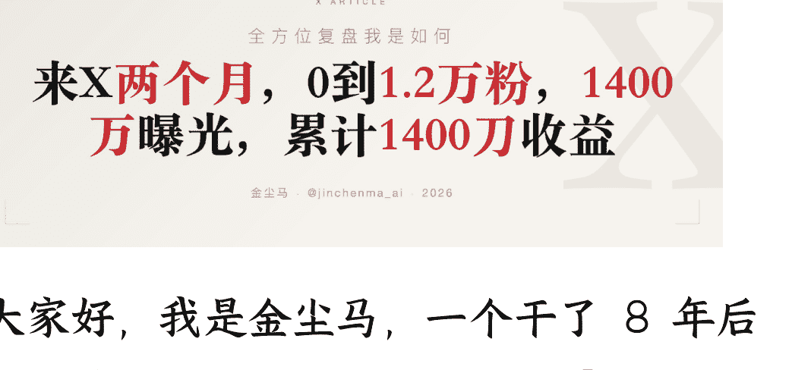
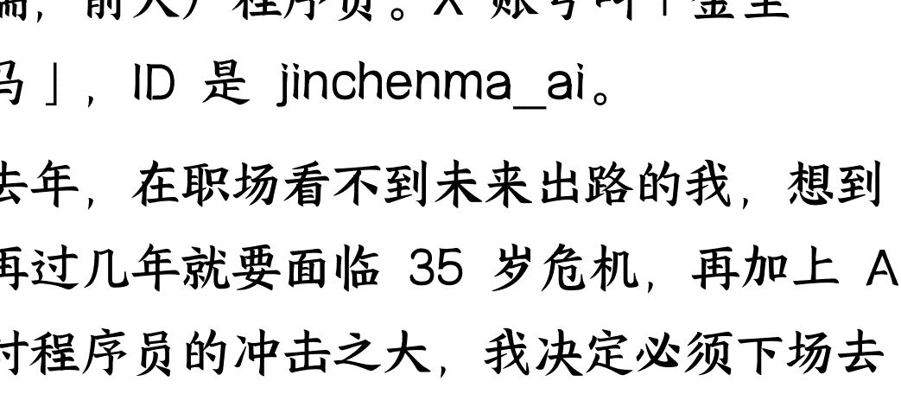
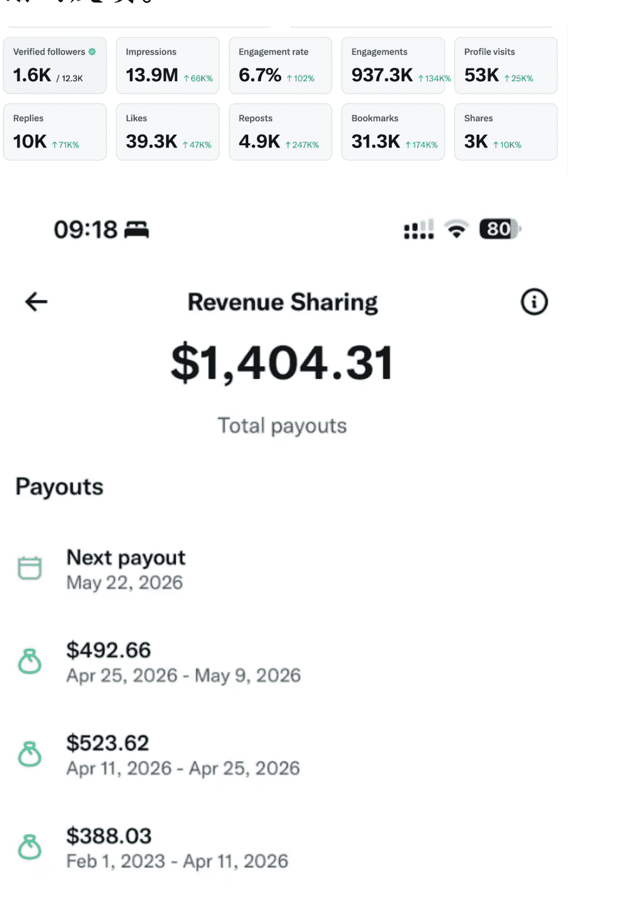
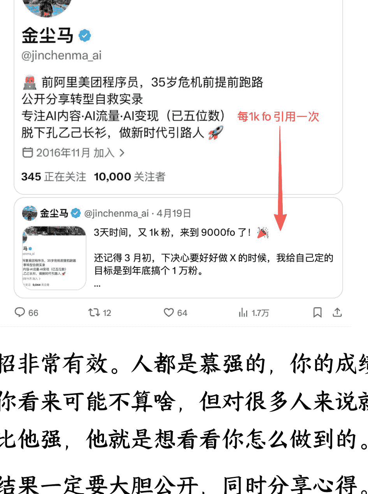

# 大厂程序员来 X 两个月，0 粉做到 1.2 万粉、1400 万曝光、1400 刀收益的复盘

**260514 副业 SC 精华**

公众号懒人搜索，[懒人专属群](https://t.me/lazyhelper1) 懒人微信：lazyhelper1

懒人微信：lazyhelper1

大家好，我是金尘马，一个干了 8 年后端，前大厂程序员。X 账号叫「金尘马」，ID 是 jinchenma_ai。

去年，在职场看不到未来出路的我，想到再过几年就要面临 35 岁危机，再加上 AI 对程序员的冲击之大，我决定必须下场去转型，去接触真实的商业世界，尽早为自己构建一套新的赚钱体系。

离职前，我做过一阵公众号。去年也在生财发过一篇复盘：【万字长文】如何创作一篇 10W+？做公众号 AI 爆文写作三个月经验与复盘分享》。当时写公众号三个月，做出了 5 篇 10W+，最高一篇 80 万阅读，收益大概 5000 元，那篇帖子反响也不错，最后有幸拿到了精华。

最近两个月，我又开始做 X。

从 0 粉做起，两个月做到 1.2 万粉，1400 万曝光，期间最猛的几天连续单日涨粉 1000+。跑到这个体量的同时，X 平台也给我发了 1400 多刀的创作者激励收益，对刚开始做内容的新人来说算是个不错的反馈。

所以这篇文章，我想把自己这次从 0 起号的过程、关键判断、踩坑和一些能复用的动作，完整拆给大家。

## 先说一下投入强度

我现在每天大概花 3 到 4 个小时在 X 上，平均每天会产生 15 到 20 条内容，包括原创帖、长文、转发评论和回复。评论区回复大概 50 条以上。这个强度不算特别夸张，但关键是每天都在做，而且不是瞎发，是带着目标去发。

## 一、流量怎么搞

### 先讲透 X 的底层逻辑：账号权重

讲具体打法前，先把 X 的底层逻辑点破。我做下来最重要的体感是：X 的核心变量就一个——账号权重。

新号权重低，所以你自己再怎么埋头发都起得慢。权重高了，你随便发都有流量。

权重怎么起来？两条路：跟高权重账号产生持续高质量互动，或者被高权重账号转发、评论或推荐。

注意是「持续」。它不是某次互动就立刻见效，也不会某条评论被回了你的曝光就突然起飞，而是一个慢慢积累的过程。我前期密集跟宝玉、玉伯几位老师互动，大概互动了半个月、十几条之后，才慢慢进入他们视野，偶尔能拿到回复或转发。

一旦权重起来，后面所有动作——评论吃曝光、自己发推被推荐、长文涨粉——都会顺很多。前期看起来在「给别人打工」，其实是在给自己积累系统识别度。这件事想清楚了，你后面所有动作的优先级就清楚了。

### 新人先做高质量互动

新人想搞流量，第一件事是放下「我要发自己的内容」这种执念，先去做高质量互动。

为什么？

第一是借势。在大 V 热门帖跑到一两万曝光的时候进去做高质量评论，你的评论本身就可能拿到十几万曝光。这是用别人的流量给自己加曝光，效率比自己发推高得多。

第二是养权重。持续跟大 V 互动，系统会逐渐识别你的账号，你后面自己发推也更容易吃到推荐。

我前期的具体做法有两类。一是锁定目标赛道的大 V 和 IP 号，在他们的帖子下做高质量评论。我做的是 AI 方向，前期大量评论宝玉、玉伯等老师的帖子，久而久之进入了他们视野，偶尔能拿到转发和评论，账号权重起得非常快。二是找泛流量账号的爆款帖去评论，纯粹博曝光。

### 前期最容易踩的两个坑

有一个很重要的坑是，前期不要每天大量发原创推。

新号权重还没起来，硬发原创又耗精力又拿不到流量，性价比极差。等账号被系统识别、有了初始推荐和关系链托举之后，原创才更容易被看见。

还有一个坑是操作频率。

**新号前期不要太频繁操作，也不要集中在某一个时间段疯狂点赞、评论、关注、发帖。**X 对新号的风控还是比较敏感的，轻一点可能会给警告，重一点可能直接封号。尤其是刚注册或者刚开始活跃的账号，不要把自己搞得像机器号。

我的建议是把动作分散到一天里，正常一点，像真人一样使用。你要做的是持续活跃。

### 自己发推怎么获得高曝光

权重还没起来时，新号发推想爆，只有两个路子。

**第一是蹭热点。**热点自带流量。当天的爆炸新闻、热议话题、高热度事件，只要关键词命中，你的帖子就比平均水平更容易吃到推荐。

我自己最典型的一次是 AI 算命那波。那个热点是群里一个朋友先发现的，然后我又炒了一波，围绕 AI 算命发长文、做自己的 Skill、分享相关提示词，那几天密集发帖，单天曝光过百万，流量和粉丝都涨得很猛。

**第二是大号带小号。**被高权重账号转发、评论或推荐，既能直接导流，也会持续拉高你自己的账号权重。

我也是因为这个原因，加入了一个 X 运营的付费社群。这类社群通过互相转发托举，能快速把新号权重拉起来。我之前做过其他平台，深知这套模式的含金量，果断加入了。

**进群第三天，我一篇长文就被直接拉爆。**

事实证明这是个非常正确的决定，反馈给我的价值远超门票。早就是优势，X 在自媒体圈还处在比较早期，看准了就该尽早占生态位。

**2026 在 Mac 上双开/多开微信指南！(可以直接把本文给 Claude Code 自动配置)**

好多人都想要在 Mac 上多开微信，过去可能还很麻烦，现在非常简单，你只需要把我这篇文章给你的 AI 工具看，比如 claude code、openclaw、codex 等，ai 就能帮你搞定了。
例如：...

我这 1400 万曝光的分布也印证了这两个路子的有效性，主要是个别几条单条贡献了七八十万曝光，单天能达到过百万曝光，剩下的是大量万级曝光的帖子积累起来的。

至于发帖文案怎么写、长文标题怎么起、怎么下钩子、怎么引发情绪共鸣，这话题太大，后面单独展开。

### 起号心得小结

*第一，先找 5 到 10 个同赛道账号，尽量找低粉爆款号，每天看他们发什么、什么内容容易爆、评论区的人在问什么。*

*第二，每天认真写评论。不是“支持” “学到了”这种无效评论，而是补充信息、给出不同角度、提供一个案例，或者把对方内容里没说透的地方再往前推一步*

第三，主页一定要有几条像样的代表性内容。别人从评论区点进来，至少要知道你是谁、你在做什么、你能持续提供什么价值。如果主页全是零碎转发，别人很难关注你。

第四，等账号开始有一点互动之后，再开始加大原创内容。这个时候原创才更容易被看见，也更容易形成正反馈。

这套逻辑说白了就是，先进入流量场，再建立识别度，最后才放大自己的内容。

## 二、粉丝怎么涨

我回顾了一下自己的发帖数据，真正涨粉的内容只有三类。

第一类是赚钱方法分享。用自己账号跑通了一个小副业，把方法免费分享，同时拉私域带大家一起做。这几条涨粉最猛，连续好几天单日涨粉 1000+。

第二类是干货，主要是 AI 工具、AI Skills 的用法整理。

第三类是长文。最高一篇跑到 58 万阅读，主要是我对一些时下社会热门现象、对 AI 的一些看法。

总结起来一句话，真诚利他。把我学到的、整理的、搬运的有用东西、大家爱看的东西，高质量分享出来。

## 三、X 的内容漏斗：流量不等于涨粉

这是我做号两个月最重要的一条心得，也是 X 跟公众号最大的不同。

流量和涨粉不是一回事——先看两条真实数据

第一条是搞抽象，我用别人做的 Image2 做了一张图恶搞 Anthropic 进入中国市场——50 多万曝光，只涨了 60 多个粉。

第二条是干货整理，「26 个爆火 Skills 清单」——19 万曝光，涨粉 480 多。

@金尘马
@jinchena_ai
#114,071
248/h
推广
公众号懒人搜索，懒人专属群分享

总结了最近 X 上爆火的 26 个 SKILL。

一切的起源都是那个“同事.SKILL"吧😂

### 一、职场、自媒体系列:

1. 同事.skill 把真实同事蒸馏成 AI（SKILL 流火爆起点）。
github.com/titanwings/col...

2. 女娲.skill 能自动蒸馏任何人的终极工具（想蒸谁蒸谁）。
github.com/alchaincyf/nuw...

3. X 导师.skill（X/Twitter 运营导师）最新迭代，能分析你的账号数据、写推文、给诊断报告。
github.com/alchaincyf/x-m...

4. 老板.skill 把老板炼入 token，把生产力的解放留给自己。
github.com/vogtsw/boss-sk...

5. 前任.skill 把前任蒸馏成 AI Skill，用 ta 的方式跟你说话。
github.com/therealXiaoman...

6. 自己.skill 把你自已蒸馏成 AI，数字永生/第二大脑。
github.com/notdog1998/you...

7. 博主.skill 把公开社交媒体语料整理成一个能对话、能分析、能改写风格的 Persona Skill（目前支持推特和小红书）。
github.com/YourongZhou/ch...

8. 蒸馏.skill（人格蒸馏引擎）人格蒸馏引擎·蒸馏自己看清自己，蒸馏亲友留住余温与回声。
github.com/YIKUAIBANZI/fo...

9. 反蒸馏.skill 公司让你写 Skill 文档时“投毒”，核心知识自己留着（打工人自保神器）。
github.com/leilei926524-t...

### 二、名人系列

10. 乔布斯.skill 思维模型 + 现实扭曲力场 + 决策风格，已开源。
github.com/alchaincyf/ste...

曝光差了 2 倍多，涨粉反过来差了 8 倍。这就是「流量不等于涨粉」最直接的证据。

### 为什么 X 跟公众号完全是两套打法

理解这件事的关键，是先想明白用户为什么在 X 上。

公众号的逻辑是精准需求命中。算法把内容推给真正在乎这个话题的人，所以一篇好的垂直干货能直接转化成关注。

X 的逻辑完全反过来。大家来 X 主要是社交和找乐子——刷热点、看抽象、看吐槽、看观点冲突。所以泛流量内容（抽象、抖机灵、争议话题、热点梗）更容易拿曝光，但这些内容的读者本来也不是冲着关注你来的——他们是冲那条信息来的，看完就走。

真正促成关注的，是用户被引流帖吸引过来后，点进你主页发现「这个号还有别的好东西」——尤其是长文。所以你账号里那些有价值的干货、个人经验、长文，看起来流量没那么炸，但它们才是涨粉主力。

一个账号要完成整个漏斗

所以 X 上做内容，正确姿势是用一个账号完成一整个漏斗：

- 泛流量内容：负责拿注意力、拿曝光，把人引到主页；
- 垂直 / 干货 / 长文内容：负责承接，把「路过的」变成「关注的」，再从「关注的」里筛出「真心认可你的」。

很多新人在这里受挫，发了干货没人看就不发了。其实每条帖子的角色不同，不能拿一种标准衡量另一种。如果你想又做个人 IP 又快速起量，就老老实实尊重流量规则：要么蹭热点，要么被大号带，这都叫借势；但同时，IP 属性的内容必须持续输出，不能因为某条干货数据不好就停。

### 我的内容矩阵

具体到执行，我把上面漏斗的两层进一步拆成四类。

第一类是流量型内容，负责把人带进来。比如热点、争议话题、强情绪观点，或者大家正在集中讨论的事件。

第二类是信任型内容，负责让别人认识我。比如我从大厂离职、转型做自由职业、从公众号做到 X 的过程，还有阶段性的结果复盘。

第三类是价值型内容，负责让别人觉得这个号值得关注。比如 AI 工具、AI Skills、赚钱方法、内容创作经验。

第四类是承接型内容，负责把人留下来。它可能数据没那么炸，但很重要。别人点进主页时，看到这些内容，才会知道你不是只会蹭热点，而是一个持续有输出的人。

所以做号不能只盯着单条爆不爆。一个账号要能长起来，本质上是这几类内容一起工作。

## 四、内容素材从哪来

很多新人卡在「不知道发什么」。这一节我把自己的几个稳定素材来源整理一下。

### 来源一：X 上的爆款推文做二创

爆过的还会再爆。X 上每天都有大量已经被验证过的爆款推文，你完全可以针对这些推文做二创：加入你自己的观点、补充信息、换个角度，再发一遍。

二创不等于搬运。平台允许甚至鼓励「基于热门话题的再创作」，关键是要有你自己的东西在里面。

我自己用 AI 来辅助二创：把爆款原推丢给 AI，让它帮我提炼核心观点，然后我加自己的视角和经历，组合成新的推文。

### 来源二：公域热榜 + 跨平台热门内容

第二个稳定来源是公开渠道的热榜和爆款内容——只要是公网上正在被讨论的话题、爆过的内容，都是天然的素材池。

最常用的是热榜聚合站，我用的是 今日热榜，它把当天各平台的热榜聚合在一起，刷一遍就能感受到当下大家在讨论什么。

公众号、知乎、小红书、抖音、B 站上跟你领域相关的热门长文、热梗、争议话题，也都可以拿来用。具体动作是：把内容拷到本地，丢给 AI，让 AI 提炼核心观点或情绪点，然后再用你自己的语言改写成推文格式发出来。

一个判断原则：在其他平台已经爆过、引起讨论度高的内容，搬到 X 大概率也会爆，因为情绪和话题是相通的。但记住要二创，不要原封不动搬运。

### 来源三：自己的灵感和笔记

这是我个人最重要的一类素材，因为它最真诚。

碎片化的想法、某一时刻的感受、对一个现象的看法、一句突然蹦出来的话——这些不记下来过两天就忘了。但如果当时记下来，过段时间回头看，稍微整理一下，往往就是一条非常有共鸣的推文。

工具上，我自己用 Obsidian 做主笔记库，平时配合 OpenClaw（小龙虾）的「灵感助理」随时把想法丢进 Obsidian 对应目录。如果不想搞这么重的工作流，Flomo 这种轻量工具也完全够用，核心动作只有一个：有想法立刻记。

从灵感里提炼出来的内容，因为是你真实所想，非常容易引起读者共鸣——比刻意憋出来的「干货」涨粉效果还好。

### 来源四：生活场景和群聊

最后一类是日常生活里的私域素材。

群聊里大家的讨论、谁说了一句金句、谁吐槽了某个现象、咖啡馆里隔壁桌聊了什么、街上看到的一个小观察——这些都是非常鲜活的素材。

公域素材每个人都能看到，竞争激烈；但你身边的具体场景、群聊讨论、个人观察是别人写不出来的，这一类素材的最大优势是独家性和真实感。它跟来源三（自己的灵感笔记）是配套的——一个是你脑子里的，一个是你眼睛和耳朵接收到的，都需要你随手记下来。

总结一下，素材的核心逻辑就一句话：不是凭空创造，而是持续把外部信号和自己的真实想法做嫁接。

## 五、创作者激励——确定的与不确定的

很多人关心 X 的创作者激励。我把目前自己跑下来摸到的「确定的部分」和「不确定的部分」分开讲。

### 确定的：开通门槛和结算规则

X 创作者激励开通的硬门槛有两条：

- 粉丝条件：至少有 500 个 Premium（蓝 V）用户关注你；
- 曝光条件：近 3 个月你发的内容累计获得 500 万次曝光。

两个条件都达成，就可以申请开通。

结算周期是每两周一次，提现门槛是累计超过 30 美元就可以提，整体流程对新人来说没有太高的操作壁垒。

我自己两个月跑下来，激励收益突破 1400 刀，而且还在持续往上走。

### 确定的：平台鼓励原创、打击搬运

另一条比较确定的规律是：平台明显在鼓励原创、打击纯搬运。

我们最近观察到的现象是，收益并不完全跟流量挂钩。有些账号流量很高，但内容主要是搬运或低质拼接，最后拿到的单价（每千次曝光对应的收益）其实远低于那些坚持原创、持续输出干货的账号。

换句话说，流量是基础，但单价由内容质量决定。

### 不确定的：内容形式和算法波动

- 另一个朋友流量也涨了，收益跟着同步涨，区别是这位长文发得更多。

所以激励单价跟「内容形式 + 内容质量 + 当下算法权重」都有关，没有一个固定公式。能做的就是：坚持原创、多写长文、试视频、持续观察自己的数据变化。

**总结成一句话就是**

门槛是确定的，原创导向是确定的，内容形式权重和算法波动是不确定的。把确定的部分先吃掉（开通账号、坚持原创、多发长文 / 试视频），不确定的部分边发边调，激励收益自然会持续上来。

## 六、有结果就大胆秀出来

除了上面这些方法层面的东西，还有一个动作我想单独拎出来讲，因为它给我带来的复利远超我的预期。

那就是有结果就大胆秀出来。

1000 粉时我就发帖庆祝。之后每涨 1000 粉，都引用前一条继续展示成果，宣布新的里程碑。

金尘马 @jinchenma_ai · 4 月 24 日
终于终于终于，我也加入万 fo 俱乐部了！🎉

历时一个半月，从 0 到 1 万粉。这一个多月经历的很多事情，现在回头看，真的像做梦一样。

这一切的起因，都源自 3 月初看到阿川 @AI_jacksaku 那篇让他 3 天涨到万粉的百万流量文章。也是因为这件事，让我毅然决然地加入了 Stanley @Stanleysobest

这招非常有效。人都是慕强的，你的成绩在你看来可能不算啥，但对很多人来说就是比他强，他就是想看看你怎么做到的。

有结果一定要大胆公开，同时分享心得。哪怕心得只有一两句话，对还在门外的人也是帮助。然后就会形成正循环，你越公开分享，越能吸引更多人，也就越快达到下一个里程碑。

自媒体就是表达者在吃沉默者的红利。

## 七、写给觉得自己没什么特别的朋友

很多朋友说自己很普通，没特长，搞不到流量。

大家把所谓的大佬想得太高大上了。我也就是个普通人，一个普普通通的程序员。

- 一开始我也不敢公开发声，怕被喷，怕有人不同意。
- 后来我想明白一件事。你不发声，不代表没有讨厌你的人，只是你感知不到而已。公开表达只是把他们显形了。这些人不会因为你沉默就停止讨厌你。
- 所以不要怕犯错。尤其新人，在学习过程中持续公开分享进展，本身就非常有吸引力。
- 因为你要吸引的不是大佬。你不需要跟大佬对齐，你只需要写给两三个月前的自己就可以。你能帮到的，是还在你来时路上的那批人。他们看到你的成长过程，会有天然的亲近感，会觉得这个路径我也能复制。
- 大佬离普通人太远，追不上。但你这种边走边记录的账号反而更有价值。我已经看到很多在校学生这样起号。论阅历他们不如职场多年的人，但他们敢想敢做、一直在路上，照样能拿到大流量。
- Learn in public 本身就是价值。

### 最后

啰嗦说了这么多。两个月做到 1.2 万粉、1400 万曝光这件事，加上从职场出来做自由职业的半年多，算是一个小小的里程碑，也给了我很大的鼓励。作为一个干了 8 年后端的程序员，我之前从来没想过自己能在内容创作上拿到结果。

我觉得生财圈友其实很适合做 X。因为很多人不是没有内容，而是手里已经有项目经验、赚钱经验、踩坑经验、工具经验，只是过去没有把它们持续公开表达出来。X 这个平台很适合这种内容。它不一定要求你一上来就写很完整的大文章，很多时候一个真实感想、一个踩坑提醒、一个工具用法，只要真诚利他，对别人有帮助，都有机会被看见。不要把 X 当成一个单独的流量平台看，它更像是一个公开学习、公开试错、公开建立信任的地方。你在这里持续展示自己怎么判断、怎么行动、怎么拿到结果，时间久了，别人自然会知道你是谁。最后，祝大家都能在 X 起号成功，拿到自己想要的成绩 🚀

——分割线——

看完这篇 SOP，你觉得你懂了。但 90%的人一到实操就会卡在第一步。工具和教程只是最低级的壁垒，真正的壁垒是“立刻动手”和“圈层信息差”。

如果你想看全网最新的变现玩法，并且和一群执行力极强的极客一起下场拿结果，欢迎围观我的核心私域：【懒人专属群】。我们不聊虚的，只做商业闭环的拆解与 AI 效率的压榨。系统内已沉淀 1000+ 跑通的套利实战局。

👉 查阅圈子完整数字资产与上车门槛：
https://lazyso.com/insider/

认同价值、准备好下场干活的，扫码加我微信（lazyhelper1）

备注：【实操上车】，不闲聊