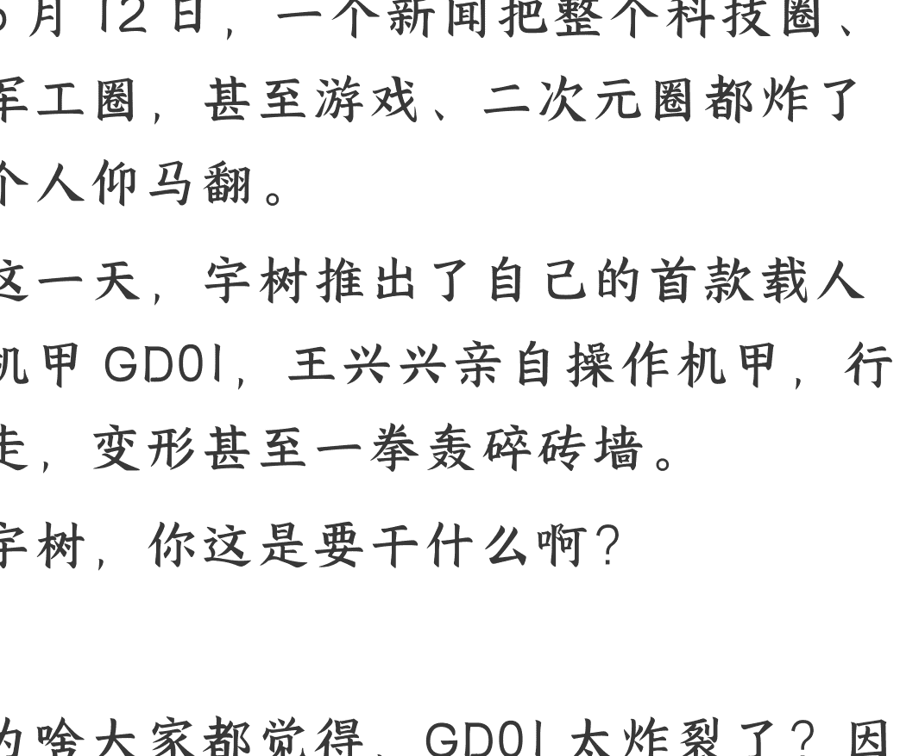

# 中国载人机甲诞生，第四次工业革命要来了？

**260514 文/卢克文工作室嘉宾 概略北方**  
整理：公众号懒人搜索，[懒人专属群](https://t.cn/A67XqJzO)精选  
懒人微信：lazyhelper1

5 月 12 日，一个新闻把整个科技圈、军工圈，甚至游戏、二次元圈都炸了，个人仰马翻。

这一天，宇树推出了自己的首款载人机甲 GD01，王兴兴亲自操作机甲，行走、变形甚至一拳轰碎砖墙。

宇树，你这是要干什么啊？

为啥大家都觉得，GD01 太炸裂了？因为宇树这次真的把一个科幻产物，变成了实实在在的工业品。

从 70 年代日本的《高达》，到 90 年代的《新世纪福音战士》，再到《环太平洋》和《阿凡达》，人类曾经无数次幻想过，如果有一款能够由人操纵的战斗机器人，该有多好？

某种意义上说，这种机甲情结寄托了人类对肉体脆弱性的一种天然焦虑。我们的骨骼承受不了重压，肌肉没有爆发力，皮肤挡不住子弹，所以渴望拥有钢铁之躯，而机甲，就是寄托人类对“肉体苦弱、机械飞升”梦想的最佳载体。

不过现实很骨感，不管电影里的机甲多酷炫，现实中，很难让它成为一种工业品。

因为造机甲太难了。

最简单的道理，一个机甲几百公斤甚至上千公斤，全部重量都要压到双腿上，你用什么来驱动各个关节行动？光这一条就难死人，波士顿动力也想造机甲，但被动力问题难住了，最后选择了液压。

主要是液压缸劲儿大，不信你看看工地上的挖掘机，都是液压的。但液压也有缺点，它太复杂了，需要极其复杂的泵、阀门和管路，极度笨重，漏油、噪音大，维护成本高，最关键的是响应慢，动作有延迟。

在千钧一发的战场上，能容忍你像挖掘机那样缓缓抬起枪口么？

所以波士顿搞了几年，根本搞不定，于是转头去做轻便的人形机器人了。除此之外，还有一个难题是站立和运动。

半吨重的钢铁，不仅要稳定站立，还要在不平整的地面上行走、奔跑甚至战斗，每一次落地的瞬间，庞大的冲击力加上重心的偏移，都会影响身体平衡，人怎么操纵？

所以，机甲在几十年的时间里，只是停留在了科幻电影和游戏之中。

但宇树用 GD01 证明了，人操双足机甲，在现有的技术条件下，完全可行。

宇树的关节电机技术已经独步天下，以宇树最强关节电机 M107 为例，其峰值扭矩甚至达到了 360N·m，超过很多 1.5T 排量的汽车扭矩了。

M107 才多大呢？拳头大小。如果把它放大，放大到一本书大小，那扭矩密度能有多高？驱动机甲还是问题么？

更关键的是大脑和小脑。

在游戏和电影中，人操机甲是需要人精确控制机甲的每一步行动的。

但现实中，如果人要像挖掘机一样，用两个手柄去分别控制机甲，那机甲连半步都走不出去。毕竟，人操纵肢体的逻辑，和机甲操纵肢体的逻辑是不一样的。

所以，机甲需要的，只是人的宏观指令，比如前进、左转、打拳、变形，机甲的小脑要在毫秒级的时间内，通过遍布机身的激光雷达和力矩传感器，计算地面的摩擦力、坡度和重心的偏移，然后把电流精准分配到每一个电机上，让机器自己去保持平衡和按照指令运动。

这就像人骑一匹马一样，你不用告诉马怎么走路，你只需要告诉马前进后退左拐右拐，马就自己知道怎么跑才不会摔倒。而这，都极其依赖平衡算法和控制算法。巧了，这刚好是宇树所擅长的。

那么，宇树好好的机器人不做，干嘛要做个机甲呢？还卖 390 万一台，谁会买啊？

只盯着价格看，说明你格局小了。表面上看，GD01 是个吃力不讨好的大玩具，普通人买不起，民用市场极其狭窄。那宇树为啥还要造它呢？回顾一下今年 3 月的一件事，也许你也就豁然开朗了。

3 月，宇树刚刚向上交所提交了科创板 IPO 申请，预计募资规模 42 亿。

在这个冲刺上市的节骨眼上，资本市场最需要什么？需要故事！

还有什么，能比造出一台人类在电影、游戏中看了几十年，但就是造不出来的机甲，更好讲故事呢？

宇树用 GD01 告诉资本，我的技术，就是机器人领域的天花板，能把科幻变成现实。

某种意义上，这就是宇树版的"Roadster"时刻。

2008 年，马斯克孤注一掷造车，但第一台车是什么？不是走量版的 Model S，而是一台零百加速 3.7 秒，干翻保时捷、法拉利的纯电跑车 Roadster，价格高达 10 万美元一台，根本没几个人买。

但这不重要，重要的是定调，告诉全世界，我的电动车技术很牛 X，可以秒杀法拉利。

只要确立了这个高端的技术图腾，后来那些相对便宜的 Model S 和 Model 3，自然会被疯狂买单。用马斯克的原话来说：新技术一开始一定贵，只能先卖给愿意尝鲜的富人，赚的钱再投入研发，一步步做便宜车，最后普及。

同样的道理，宇树造出一台看起来没啥用的 GD01，也是想树立一个高高的标杆，凸显宇树的技术天花板。

它告诉所有投资机构、审核委员以及未来的股民，我们不是做电子玩具的，我们已经掌握了改变物理世界的终极力量。

有了这么个震撼全球的大玩具，对于资本讲故事，对于拉高上市后的估值，其实际收益远超那 390 万的售价。

中国企业在技术和资本运作上，走向双重成熟的标志。

那么，390 万的大玩具，真能卖得出去吗？

不用担心，宇树早就规划好了。

根据宇树自己的说法，GD01 未来会在文旅展示、特种作业、私人高端出行等领域落地应用。

文旅展示很容易理解，像科技馆、科技公司发布会、影视拍摄宣发等等，都非常喜欢这种极具科幻感的产品。

最不济，你把它摆到公园里，99 元上去体验操作机甲 5 分钟，信不信会有大量心怀机甲梦的人上去体验？要不了几年就能把成本收回来。

私人高端出行也容易理解，有钱人嘛，品味很难说的。他们不在乎钱，但在乎稀缺性，你花 390 万买一台古思特或者一块百达翡丽陀飞轮，大街上总能碰到跟你一样的。

选择这一天发布机甲，你觉得是偶然么？绝不是，宇树盯上的是一个千亿级的庞大市场——特种防灾与极限救援。

回想一下 2008 年的汶川，为什么造成如此惨重的伤亡？

地震烈度是一方面，救援能力不足也是另一方面，地震导致交通中断，传统救援车辆根本进不去，直升机也不够，废墟中更是地形复杂，难以施救。

当年我们是怎么办呢？只能派解放军手持铁锹、木棍，顶着余震、二次坍塌的威胁，往废墟里钻，用千斤顶、甚至是用手刨砖头去往外救人。问题在于，钢筋水泥块动辄数百公斤，救灾官兵光靠两只手，又能挖出来多少呢？

某种意义上说，如今中国各种救灾能力的大爆发，都是在竭力弥补当年的亏欠。

所以，我们有了大型运输机，有了铺天盖地的直升机，还有五花八门的通信无人机、救援无人机，以及生命探测器等等，不过，在废墟中搜救，仍然存在短板。

而 GD01，把那个短板补上了。

首先，它是带壳的，虽然壳还没装上，但只要有需要，完全可以造成全封闭式，救援人员坐在里面，可以无视外面飞溅的落石，在没有路的地方强行突进，尽早赶到灾区，如果地形实在复杂，也没关系，它能变形啊！四条腿行动，稳当得很。

最核心的是，它力大无穷，发现被困人员时，不需要呼叫后方的大型吊车（吊车也进不来），它的机械臂直接就能扒开几百斤重的楼板，把人救出来。

390 万，看起来很贵，但对于国家应急管理部、大型矿山企业和各地的特种消防大队来说，花几百万买一台能无视地形、能隔绝飞石毒气、能徒手搬楼板碎石的救命神器，那可一点也不贵，毕竟机器再贵，也没有人命贵啊。

如果脑洞再大一点，这玩意能救灾，能不能打仗？虽然宇树一再强调民用，但让 GD01 上战场，有啥不可能的？别看它现在的胳膊是空的，但你咋知道未来，它的左手不会挂一挺 12.7 毫米加特林重机枪，右手不会挂一具 35 毫米自动榴弹发射器呢？

这不妥妥就是《阿凡达》里面的 AMP 战斗机甲嘛！

也许让他在正面战场冲锋陷阵还有困难（威胁火力太多），但让他到残酷的巷战里面去，那可就是神器了。

城市巷战被公认为现代步兵的地狱，高楼林立，到处都是死角，坦克开进去就是活靶子，炮管都转不开，步兵战车也进不去狭窄的胡同和小区。

最终只能靠步兵一点一点啃，但代价就是伤亡巨大。

把武装版的 GD01 投进去会如何呢？它就是巷战步兵最需要的近距离重火力中坚。

首先，它防弹，无视各种轻武器射击。第二它力气大，能一拳砸碎墙，不用走门就能穿墙作战，第三它火力强，遇到火力点，加特林直接进行火力压制，或者一发榴弹送对方上天。

由于是纯电驱动，噪音极小，可以在夜色的掩护下悄无声息地摸到敌人眼皮底下，突然发起攻击。这么个玩意，对敌方步兵来说，绝对是心理和物理双重降维打击。甚至 GD01 根本不需要拿枪炮，拿个大锤就能吓唬住很多人了。

我们都记得 2020 年的加勒万河谷冲突，双方不能使用热兵器，只能用棍棒械斗，但如果中方突然派出一台战斗机甲呢？三米高的钢铁怪物，全身装甲，手持铜锤，那是什么场面？

在高原缺氧地带，一台永不疲倦、毫无感情、力大无穷的钢铁杀神往那一摆，那是一种多么巨大的心理冲击？谁还敢上来？

最妙的是，战时可以拿来威慑敌军，平时也可以拿来运输补给嘛，边境交通不便，很多物资需要人背肩扛，现在呢？GD01 就是完美的钢铁牦牛，一次性能背几百公斤补给，穿过冰川和碎石坡如履平地，直达前哨阵地。

这种全地形的后勤投送能力，足以改变局部战争的走向。当然，现在的 GD01 还只是个初代版本，想要真正实用，还需要解决一些问题。

比如能量问题，虽然 GD01 很厉害，但耗电量也是惊人的，电池能量密度还不够，总不能让他拖着一根电缆行动吧？

比如可靠性问题，机甲的冲击力，会毫无保留地传导到减速器和电机轴承上，金属是会疲劳的，现在的零部件耐久度，能否支撑一台半吨重机甲长年累月的折腾，依然是个巨大的问号。

还有监管的问题，这么大个玩意走在路上，万一操作不当，极容易造成路人的死伤，甚至演变成恶劣的社会事件。所以，在机甲的伦理定责和交通法规彻底完善之前，民用机甲上路绝无可能。

不过，这些终归都能解决。

GD01 也许不完美，但它更大的意义在于开辟了机甲时代。也许在未来，我们能看到机械机甲战警，能看到太空机甲矿工，还能看到机甲战士和机器狗并肩作战。

这么多充满科幻感的玩意，本质上是什么？

本质上，是中国科技与高端制造业积累到临界点后的疯狂溢出。

电机、电控、电池、轴承、芯片、AI 等等产业链，随便组合一下，就能瞬间诞生一个新产业，今天是机甲，明天又会是什么呢？

毫无疑问，当各种各样改变人类生活方式的新玩具在中国诞生的时候，第四次工业革命，就会瞬间到来。

时代变了，让我们准备好迎接新纪元的降临吧。

———分割线———

绝大多数人只盯着眼前的工资，却不知道一次远在中东的冲突、一次降息的决议，就能在一夜之间洗牌普通人的财富。

看懂宏观，是为了在周期切换时，不被当作代价。

如果你认同这种“抬头看路”的长期主义，欢迎围观我的个人情报智库：【懒人专属群】。

圈子已稳定运行 7 年。我们每天利用 Python 爬虫与大模型算力，过滤全网最顶级的政经内参和搞钱风向标，做你最冷酷的“外部大脑”。

查阅圈子完整数字资产与上车门槛：
https://lazyso.com/insider/
认同价值的。扫码加我微信，备注：【进群】