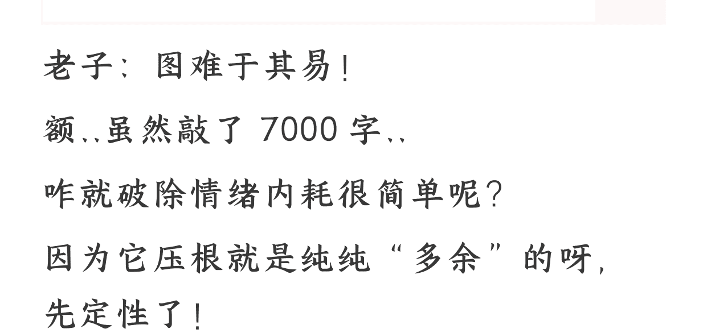

敲个问题：最大但最简单的——破除情绪！
260514 第三只眼观付费
整理：公众号懒人搜索，[懒人专属群](https://www.zhihu.com/question/39875666) 精选
懒人微信：lazyhelper1

老子：图难于其易！
额..虽然敲了 7000 字..
咋就破除情绪内耗很简单呢？
因为它压根就是纯纯“多余”的呀，先定性了！
咋多余呢？
例如：
你生理上，比如脸上长个黑痣，给你抠下去可挺难..
你意识上，比如思维上有问题，给你捋顺了也很难.
但情绪就好办了，为啥？
打个比方啊：
你的生理是硬件；意识是软件；情绪就是缓存垃圾.
所以呢？
按道理来说，你把垃圾给清理掉不会“疼”的，而且可以一键清理！
那为啥不好清理？

## 为啥垃圾把你粘住了？（绪=粘住）被啥玩意粘住了？

正是——我！

所以一键清理技术就一句话：

你没有一个“我”存在，你只有“我的”存在！

听起来有点云里雾里，其实很简单的逻辑哟，保住药到病除.

你除了把这句逻辑搞懂之外，剩下啥也不需要你做！

## 比如心理专家动不动让人跑跑步深呼吸啥的缓解情绪，或者在那不停分析刺激你情绪的人事啥的“安慰”你，

这些统统都没用，属于舍本逐末..

就好比啥呢？你被箭射中了，疼得嗷嗷叫。

## 心理专家说你得跑步啊蹲起啊来缓解，有的帮你分析箭是咋射过来的，

是不是三眼射的，进一步分析三眼那家伙老坏了，小时候拿羊粪当麦丽素让他吃。

## 试问阁下把我搞这么坏，能解决患者的疼痛吗？

此时，你已经疼吐沫子了.

这些“行为放松”以及“耐心开导”是不是没啥用？

只需要把箭拔下来就好了呀！

## 再回到计算机比喻，这个“我”就是个 Bug，是你心系统运行出错了..

例如：

我很焦虑、我很悲伤、我很快乐、我很没面子、我很委屈、我很懊悔等等..

转码：

Bug 很焦虑、Bug 很悲伤、Bug 很快
乐、Bug 很没面子、Bug 很委屈、Bug
很懊悔等等.

当你把这个 Bug 去掉，不就没后面那
一排垃圾缓存了嘛！对不？

所以佛法甭管大小乘，都紧紧围绕一
个词——无我！

重点：

不是你修出个无我，所谓“我”是系
统多余的垃圾啊，这玩意压根就不是
系统运行本身，所以对于你的系统而
言本身就无我，你只需要认识这一点
即可。

咋认识？当然是通过解构你心系统的
运行逻辑呀！

老子：图大于其细！

一会解构完成后你发现，哎哟，真的
没有“我”存在哟，然后就齐活了，
就这么简单..

最后呢？

再来一个《实操小妙招》搞一下，特
别简单的实操，就跟吃饭拉屎一样简
单。

开始正文：

咋个系统逻辑呢？

捎带手把“八识”讲一遍了..

你的系统叫做——心。

翻译过来就是——整体系统作用！

不是心脏、心理、大脑啥的哟，这些都是心的小弟们，还有你的眼睛鼻子嘴巴啥的都属于小弟，你的所有东西都属于心，心外无物嘛。

然后把小弟们分几个队伍：

1、前五识。

眼、耳、鼻、舌、身，应该叫眼识、耳识啥的，但这个“识”就复杂了，为了方便一些，你就暂且当成感知器官即可。

这些感官嘟嘟嘟接收外界的影相，例如在星球里有个小伙伴提问，说初中时候老师给他骂抑郁了，那这是不是要接收声音？接收老师的气流震动？

2、第六识。

即俗话说的意识，意识并不是大脑啊，但还是为了方便，你暂且就当成大脑即可。

这玩意的作用是分别能力，上面那个坏老师不断气流震动，那个小伙伴的意识就把此震动声音分别成骂街信息了..

也就是说，如果没有意识参与，他压根不知道老师在骂街。

**插一嘴，别觉得这些知识很远的样子**

子，实则特别重要特别近的，好家伙对有些人还得哄着学习.

### **3、第七识。**

这个有点麻烦了，因为没有器官对应..咋办呢？你就当成总经理看！

**前五识**，是一线业务员，负责收集信息，但是业务员没脑子，不知道信息是什么，只是负责跑腿的。

**比如眼睛咔咔咔拍照**，耳朵嘟嘟嘟接收声波，这时候没有上下左右的风景，也没有都来咪发烧拉稀这些啊，这需要通过第六识才行。

**第六识**，是业务主管，负责把信息给分析成 PPT、报告啥的，就形成分辨的“信息风景”了呀。

**比如红色绿色啥的**，并不在物体上面，没有任何一个物质具有颜色，这都是意识加工出来的。

**第七识**，总经理负责审核！

总经理是最累的，为啥？因为一线业务员和业务主管都会有“下班休息”的时候，但总经理是 24h 工作的.

**例如：**

当你睡觉时候，你的前五识就下班了呀。

当你喝断片或者昏迷时候，你的第六识就下班了呀。

但此时你的第七识一定没下班，因为它下班你就死了。

例如：

医院手术时候对患者做全麻，其实这时候患者已经“小死”过去了，道家动不动练功夫就主动来个“全麻”状态啊，此时前六识都被麻药弄成集体罢工了，如果大夫回头不给人弄醒，人真的就死了..

此时，虽然前六识罢工，但你的肉体细胞是不是还活着？

这就是第七识总经理的作用，它一直在“执持”着你的细胞们，要不细胞们就分散开了，不一会保质期过了不就死了嘛。

没有第七识的话，这个“家”就散了..

4、第八识。

这个解释起来更麻烦了，佛陀说“阿陀那识甚深细，一切种子如瀑流；我于凡愚不开演，恐彼分别执为我”。

阿陀那识就是第八识，这玩意佛陀解释起来都难受.

那方便一点咋说呢？

上面说你是无我的，压根不存在“我”啊，但你肯定还要“是个啥”对不？

这个阿陀那识就是你的真身了！

你的真身老牛逼了，只不过你不知道，嘿嘿我也有.

科学家说人的大脑开发不到 5%，全面开发就老牛逼了，而大脑跟第八识比，还只是个小卡拉米！

为了和上面的比喻配套，你可以把第八识看做——企业或家。

道家说生者寄也，死者归也，就是回到第八元神了呀。

那么好了，你的整体系统摆在这了。

这玩意先不用搞太细，玄奘法师一生的功力都在搞这个系统呢，大体如上明白用于破情绪就管够了。

来到一键技术：

你没有一个“我”存在，你只有“我的”存在！微信 1、我的。

信 pep854 公众号把它逻辑化就是作用关系！

在《道德经》里老子管这叫做——名！

这里提一嘴啊，这个“名”深度解释正经挺烧脑呢..

这里咱们先简单理解啊，啥叫作用关系？

例如：

妈妈怀胎你了，你借助子宫不断汲取外界养分，这就个作用关系。

例如：

你渐渐从受精卵长成到幼儿、少儿、少年啥的，这就是作用关系过程。

例如：

你眼睛看到石头，并且呈现出红色，这就是作用关系。

上面被老师骂吐了那位，老师用气流震动恶心他，这个互为震动的过程就是作用关系。

例如：

他又把气流震动分析成废物、狗屎、完犊子之类的信息，这就是意识振动的作用关系。

等等吧不举例了。

换个角度：

你一切的存在都是基于作用关系，所以你才能不断变化运动着，上面说的“八识系统”就是产生作用功能的，就像一个纯物理机械一样咔哒咔哒着。

重点来了：

机械运行起来有苦吗？有乐吗？有焦虑吗？

没有！没有！没有！

重要话说三遍..

也就是说，如果人能以“纯粹的系统运行”去面对世界，那么他就会极其冷静！

如果上面表述不带感的话，还是回到计算机的比喻。

计算机本身有苦吗？有乐吗？

没有！

当然了，这里一定要注意，我这个表达是“断人慧根”的！

啊？

佛法可不是让我们修成计算机啊，那还不如修成石头呢？石头也没有苦乐对吧？

所以我这样比喻肯定容易把你带歪喽，比喻肯定是不完美的嘛，必然会有知见上的扭曲，佛家诸多方便法门也是如此，要不然人们就不会把佛法搞乱七八糟了..

但是呢，讲法一定先要方便，这样才能“开门”啊，后面一步步“登堂入室”修证，所以才叫做方便法门嘛。

佛法最终目的：连计算机也没有！

因为计算机属于“无明”啊，因为它不像我们“有情众生”一样具有觉知啊，它只是按照程序运行。你骂它它也不会生气，不是因为它“觉悟”了，而是因为它压根不知道被骂是什么。

修到连计算机也没有，即佛法说的断除无明，比计算机牛逼多了，虽然算力没它快，但是它没有智慧啊.

这块不扯远啊，依然延续上面企业的比喻，来说明“我”是如何产生的。咋产生的？

因为总经理不能下班，必须 24h 不断“审核执持”着心系统，这么高强度

**加班工作，是不是会产生“错觉”啊？**

对头！

这时候就把“一直审核”的工作加入了一个“主体性”了，这个主体性错觉就是——我！

**Bug 是不是就出现了？**

这里插一嘴：这个“主体性”一词可不是在此借用的，这个词本身就没逻辑性，本身就是个逻辑错觉。例如上帝是主宰，这就是人的意识错觉。诸如主体性、本体论啥的，佛道都是没有的，都是驳斥的。

这里提一嘴，这玩意挺枯燥的，回头别的枯燥文章再聊.

**当然，上面一坨字说“我”是错觉就是了？咋证明啊？**

反向证明开始：

1、你的身体是“我”吗？
你是一堆细胞和原子构成的，请问哪个原子是你啊？
如果你说 A 原子是你，那么 B 原子是啥？
如果 B 原子也是你，那么出现了 AB 两个你？

**或者再通俗点：**

你的手不小心弄丢了，是不是“我”还在啊？

手 vs 其余身体部分，正如 A 原子 vsB
原子一样，哪个是你啊？

再换个例子：

人体每十二年彻底更新一次，细胞骨
骼眼睛等等全都新陈代谢换一遍，那
你的“我”是不是还在啊？

所以身体里找不出“我”啊！

2、感受是“我”吗？

假设你翻开本文之前时候，你正因为
一件事情痛苦，现在看文章变得好受
些了，可能因为你看懂了，也可能因为
被动玩了个“转移注意力大法”
了，或许你现在跟我扯的还挺开心呢..
那么好了：

如果之前的“苦受”是你，那么现在
你开心了，你的“我”消失了吗？
所以感受里找不出“我”啊！

3、思维想法是“我”吗？

我们的思维意念如同江海奔流，是一
刻也停不下来的，我们下一个思维念
头是啥？我们压根就控制不对不对？
不服你现在控制一下试试？

那么这些想法意念是“你”吗？
如果是你的话，你岂不是一直不断在
跳出“新我”出来啊？

再深度寻思一下：

此时你正观察着“你的想法”呢，可
见你的想法只是工具，压根不是
“你”啊。

**所以想法里找不出“我”啊！**

4、习惯是“我”吗？

假设你是个男士，而且是烟瘾很大的。

那么抽烟这个习性是“你”吗？

如果是你的话，你把烟戒掉了，是不是把你的“我也给杀死了呢？

明天你又来个看小电影的好习惯，那这个习性是“你”吗？

所以习惯里找不出“我”啊！

**5、觉知是“我”吗？**

这个麻烦了，是最容易迷惑的。

前面四个很好理解对吧？

你知道它们里面都没有“我”存在，但问题来了，这个“你觉知到它们非我”的作用，难道不是“你”吗？

**这块难度在哪？**

诸多西方唯心主义就在这掉坑里了，而且这都多少年了也爬不出来..

唯心和唯物共同错误在于，都认为会有一个“独立存在”的东西，一个叫物质第一性，例如叫做最终粒子，一个叫做精神第一性，例如黑格尔叫做绝对精神。

这些认识都是错误的啊，但多多少少破除有点难度，毕竟这些大哲人还在这犯错呢..

咱们简化破除一下:

这个“能知”是念念生灭的，就是你的
“能知”是建立在一串“嘟嘟嘟
嘟”震荡作用基础上，念就是一种震
荡，速度老快了。这个震荡过程是不
可能独立存在的，如果独立存在，那么
你还能觉知到“其它”吗？你只能
觉知到“独立本身”了呀！

就好比你就会 A 念-A 念-A 念这样
子，无法产生出 BCDE 等等意念了呀.
再通俗点说的话:

这个“嘟嘟嘟嘟”的过程你是留存不
住的，它是转瞬即逝的，它就不是永
恒的，压根就没有实体可言。

难道你会在“不实”之中找出一个
“我”来吗？

也就是说，你刚找出一个我，它就生
灭没了，又找一个，又生灭没了.

所以觉知里找不出“我”啊！

那么好了，以上 5 点全面破除了
“我”的存在，由此证明了“错觉”
对吧？

大饼翻个个，再换个正面角度:

这种错觉是你“假名”出来的，所谓
“我”就是个假名！

啥意思呢？

你就好比一部车，当你把车子拆开
了，什么方向盘啊、轮子啊、发动机
啊一大堆，此时任何一个部件都不能
叫做“车”对吧？

所以“车”就是个假名，是为了我们沟通用的。
咋个方便呢？

我们如果按照真实逻辑讲话：“小伙子别发呆啊，快把那 8 个部件因为作用关系构成的系统给我开过来啊”，换成假名沟通：“小伙子，快把车开过来”！

对不对？

但我们一直这么“方便且错误”的沟通，就慢慢的把“车”给认定为一个牢牢存在的东西了。

同理，我们的“我之错觉”也是这么构建出来的..

然后呢？

这个错觉形成 Bug，Bug 就是产生运行错误的意思啊，我们遇到点啥事就会“我认为”、“我觉得”等等这样子习惯..

是不是随着错误运行就产生垃圾缓存了？

缓存的意思就是，我知道它是“暂缓方便”的，对于系统来说一会清除即可。

但是呢？

垃圾太多了！

如果存储盘是 1tb，那么我们的垃圾会有 1 兆兆兆那么多，不夸张..

为啥？

因为我们生生世世 N 次了，所谓轮回
正是因为这些垃圾导致的。

啥叫轮回？

就好比计算机垃圾太多“卡”住了，
鼠标啊键盘啊都动不了，你压根关机
不了，一直卡在这“涅槃”重生不
了！

好家伙，这个错觉虽然看起来挺简
单，没想到这么可怕..

可怕在于：

我们 90%的时间都处于我的情绪里
面，还有 9%处于无记发呆之中，只有
1%才正确利用我们的强大心系统，其
实 1%都往多了说了！

那么好了，情绪是咋个过程呢？

例如：

还是上面那个被老师骂吐的小伙伴，
好家伙还在骂呢，辛苦这个小伙伴了..

第一步：

老师对着他气流震荡，逼逼叨逼逼叨
这样子。

这个声音有伤害性吗？有情绪性吗？
并没有，可见情绪不是老师发出的，
对吧？

反向证明：

如果老师逼逼叨能发射情绪波光弹，
那么对于 50 位同学来说，应该遭受一
模一样的情绪对吧？但这肯定不可能
啊..

第二步：

小伙伴前五识接收气流波光弹，第六识随之开始解析编码，气流震荡立马翻译成废物、狗屎、王八犊子这些信息。

这些信息有伤害吗？有情绪性吗？并没有，可见情绪也不是意识产生的，对吧？

反向证明：

如果意识产生的话，50 位同学又不是没长脑子，肯定也会躺枪遭受波光弹啊。

第三步：

第七识产生错觉了，第七识都加班不知多少劫数（多少前世今生）了，错觉已经形成习惯了，不自觉就进入“我”的“叙事模式”了呀。

也就是把种种外部作用关系，非要挂钩在一个“虚构主角”的我上面：

对于废物信息，我可真废物，好悲伤..

对于狗屎信息，我可真狗屎，好痛苦..

对于王八犊子信息，我可真没面子，

我一点不被任何，我总是被排斥..

嘟嘟嘟嘟就这么不断累积伤害 +999!

就好比啥呢？

上面“被箭射中”的比喻，小伙伴一直在很主动的“叙事”来感受“箭伤”的痛苦，并且反反复复播放着，上课播放着，下课播放着，回家还是

播放着，这个过程就是所谓内耗，对人体极大的破坏力！

所以要干嘛？

把箭拔掉啊，因为压根没有箭，有也是自己的错觉“凭空挨射”啊！

直接把“我”这个 Bug 错觉认识出来不就好了嘛，外境作用不就“无的放矢”了嘛..

绝对不能干啥？

千万不能把情绪当做敌人看待！

为啥？

因为一旦当做敌人，一旦跟情绪做对抗，就相当于默认了“我”这一错觉的真实性，认为一直有这个“真实主角”存在着，那岂不是越敌对越“继续编叙事”吗？

所以佛陀一直警告我们要恢复——本来面目！

啥叫本来面目？

这个先不要太深入，什么明心见性、大圆镜智啥的太高难。

简单来说呢？

暂且把本来面目当做——我的！

我的是啥来着？

就是我们这个“心系统”的诸多作用功能和关系。

什么气流震荡啊、意识分别编码信息啊、总经理一直审核啊啥的..

这个“我的”是确实存在的，你否定它不了的，我打你一下，你就产生了“我的受力”了呀，就产生了作用关系了。

如果逐步回到这个本来面目呢？

例如：

老师再骂那个小伙伴，小伙伴只需要关注在“真实发生”上即可，例如关注“气流震动”这件事，而不是关注在“错觉”上，非要把气流震动弄个“情绪叙事”出来。

这时候恭喜小伙伴，增加了人生新技能——皮！

佛法这玩意学习之后一定会皮实耐造，而不是消极疲软的，那不叫佛法，那只能叫做心灵鸡汤.

当然了，最后再来个实操小技巧。

为啥？

因为上面掰扯这么细，但肯定还是难以“入心”的。

说回到本来面目就咔嚓一下回去？再说本来面目深了去了，层层的更加本来呢..

学习就是这样子，不是说现在逻辑上明白就等于学会了，要这么简单岂不人人都上天了？

这玩意必须得反反复复的操练起来，逐步的“知识上身”才行，这必须要有个过程的。

上面把逻辑打通叫做——修。
修完了搞实操就叫做——炼。
啥实操技巧呢？
特别简单：平时说话少用“我”字即可！
啊？
这么简单？狗都会..
好使吗？
嗯..不信你试试？听起来简单做起来有点难度的..
啥原理呢？

1、每天无数次说“我”的时候，就是在不断强化这个错觉，减少说我就是主动断开这个错觉 Bug 运行。

2、能够创造一个观察距离，例如“我觉得这个看法咋咋地”变成“一般来说咋咋地”，瞬间就从主角变成观察者。

平时社交之中，最怕的就是不自觉的让自己唱主角，肯定会招来敌对的，可能我们都不知道。

你先甭管实操到啥程度，最起码这能够尽量远离“低级纷争”是不是？

3、当心系统留出了距离空间，就会自动的起“观照”作用了，就能照出我相、人相、众生相了。

通俗说就是，你就比以前更容易察觉到每个人的“话里有话”了，大家七
嘴八舌的都在表达“我”咋咋地呢，
你就能看到一个个“我”在碰撞了。
公式：只要你无我了，他人的我立马
显露无疑！

但是呢，这玩意虽然看似简单，但也
很容易画虎不成反类犬。

1、很容易制造出一个更强的主角。
就好比心里在寻思，你们都好傻逼
啊，看我多牛逼，我这个实修小骚招
你们居然都不知道，嘿嘿。

2、压住变成憋住了，把骚招刻意当做
任务，说话吞吞吐吐的反倒放不开
了，而且还很容易讲话绕弯子，这不
就远离“解脱”之道了嘛。

3、若有上面两条出现，根本就在于还
是虚假，心理依然“我咋咋地”却在
嘴上搞分裂，那岂不是精神分裂？
重点就在于实事求是，是真的要在心
系统里放下对“我”的执着，虽然一
时半刻不容易放下，但这个初衷目的
始终不变才行，画虎就是画虎，而不
是为了画画而画画。

总之呢，小妙招还只是“小”的，就
好比一把刀，刃的效果强不强，还在
于刀身的厚重程度，有只卖刀刃的产
品吗？
所以呢，平常思维修证才是更关键的
它才是刀身厚度，它直接决定了
刀刃锋利度，才能将最朴素的招数变
得有力！

**小懒人补充：**

一、核心观点梳理

文章逻辑链：
- 情绪是“垃圾缓存”，根源是“我”这个错觉（Bug）
- “我”是第七识长期运作产生的主体性幻觉，不是真实存在
- 解法不是对抗情绪，而是认识到“我”本来就不存在
- 实操：少说“我”字，创造观察距离

这条逻辑链主体上是**佛教唯识学（八识论）**的科普版，用计算机比喻重新包装。

二、有实质支撑的部分

无我的论证逻辑是成立的。身体、感受、思维、习惯、觉知这五层逐一破除“我”的存在，对应佛教的五蕴分析（色受想行识），思路严密，不是乱说的。

情绪非外界产生这个观点有心理学支撑。Ellis 的 ABC 理论（刺激→信念→
[/content]

结果）以及 Lisa Feldman Barrett 的情绪建构理论，都说明情绪是内部建构，而非外界射进来的。文章的“气流震荡”比喻虽然土，但方向对。

少用“我”字的实操有一定的语言认知依据。第三人称自我对话（self-distancing）的研究（Ethan Kross 等人）表明，把“我”替换成名字或第三人称，确实能降低情绪激活强度，提升理性判断。不是作者发明的，但推荐方向是对的。

***不要把情绪当敌人***这个判断非常准确。对抗情绪会强化它，这是 ACT（接受承诺疗法）的核心发现，比 CBT 更进一步。文章这里比很多心理鸡汤都清醒。

## 三、偏颇和问题

### 1. 八识讲解有明显简化失真

第七识（末那识）的功能被解释为“总经理执持肉体”，这是把第七识和第八识（阿赖耶识）的功能混淆了。

实际上：

- 第八识才是执持根身（肉体）和种子的
- 第七识的核心功能是“恒审思量”——以第八识的见分为“我”，这才是我执的根源

文章说“第七识加班太久产生错觉”，这个表述把一个深刻的哲学命题讲成了疲劳失误，有点失真。不影响结论，但误导了读者对唯识学的理解。

文章开头说情绪是“垃圾缓存”、“不会疼”、“可以一键清理”，但佛教自己说的是“无量劫修行”，文章结尾也说“这必须要有个过程”，前后出现明显的张力。

实际情况是：理解“无我”的逻辑和真正脱离我执是两回事，差距可能是几十年的实修。把这个降维成“少说我字”，对读者有误导——认知到位了≠情绪就解决了。

“心理专家让你跑步、分析刺激来源，没用”这个批评，把认知重构和行为激活全部否定了，理由是“没拔箭”。

但这个批喻本身有问题：很多情绪困境不是“有箭”，而是“反复想象有箭”。认知重构（分析刺激来源）恰恰是在告诉你：那根箭可能是幻觉。这和文章自己的“无我”论其实是同一方向，只是路径不同。

文章说“暂且把本来面目当做——我的”，这个替换在唯识语境里是不准确的。“本来面目”在禅宗语境里指的是佛性/觉知本身，用“我的系统功能”来替代，反而可能加强了功能主义的执着。

文章自己也说"比喻肯定不完美", 但没有给出修正方向，读者很容易卡在这里。

## 四、总结判断

这篇文章的**核心逻辑是成立的**, 用计算机比喻讲唯识学的"无我", 思路清晰，适合普通读者入门。实操建议（少用"我"字）有轻量的实证支撑，且有自我纠偏（提醒了三个走偏的陷阱），这点比很多同类文章成熟。

**主要问题是**: 把佛教里最难的修行目标（破我执）讲得过于轻巧,"一键清理"的定性容易让读者高估认知上通后的实际效果，以及对心理学的批评有失公允。

适合群友阅读，但建议补充一句: **理解这套逻辑只是入门，情绪模式的真正改变需要反复的实际操练，不是懂了就好了**。

在这个 AI 能替你写代码、写文章的时代，基础技能正在迅速贬值。绝大多数人正被淹没在海量的免费垃圾信息里，陷入低效的体力内卷。

当“努力”不再是壁垒，人与人之间唯一的护城河，只剩下“信息过滤”的效率与“认知系统”的维度。

圈子已稳定运行 7 年。我们每天利用 Python 爬虫与大模型算力，过滤全网最顶级的政经内参和搞钱风向标，做你最冷酷的“外部大脑”。

如果你认同这种“重塑认知防线”的极客主义，欢迎围观我的个人情报智库：【懒人专属群】。
https://lazyso.com/insider/

认同信息过滤价值、想省下每天 3 小时无效阅读时间的读者，扫码加我微信（lazyhelperl）

