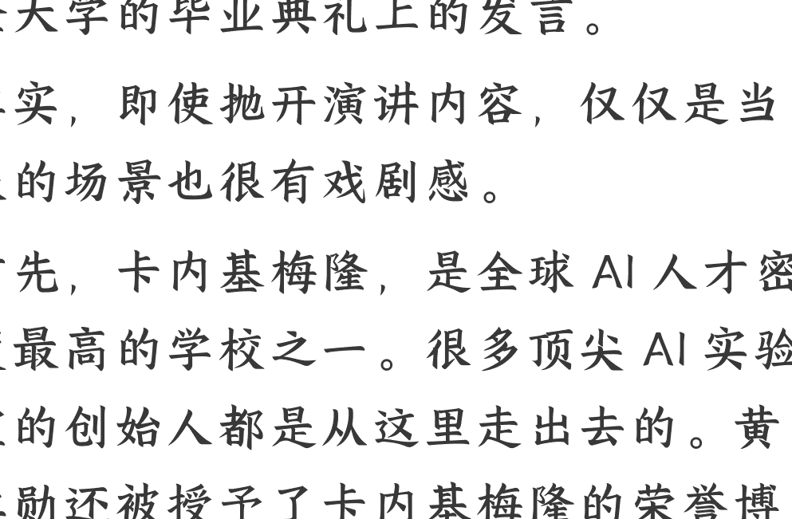

# 黄仁勋：奔跑吧，为了食物，或者“不成为食物”

260515  
整理：公众号懒人搜索，懒人专属群精选  
懒人微信：lazyhelper1  

最近很多媒体都在转载黄仁勋的新演讲。也就是 5 月 10 日，他在卡内基梅隆大学的毕业典礼上的发言。

其实，即使抛开演讲内容，仅仅是当天的场景也很有戏剧感。

首先，卡内基梅隆是全球 AI 人才密度最高的学校之一。很多顶尖 AI 实验室的创始人都是从这里走出去的。黄仁勋还被授予了卡内基梅隆的荣誉博士，而给他披上博士披肩的人，是这所学校的校董、英特尔的 CEO 陈立武。陈立武还在现场透露，说英特尔与英伟达正在合作，正在开发令人期待的产品。

台下听演讲的学生是 2022 年入学的，他们正好是第一批在 AI 浪潮里完成大学教育的毕业生。

换句话说，台上讲话的人，是 AI 时代最大的受益者。而坐在台下的，是 AI 时代最大的“被影响者”。

黄仁勋的演讲，就是在这个背景下展开的。

其中被转载最多的一句话，是这么说的。黄仁勋说，计算范式在过去 60 年里首次被重写了。旧有的经验不再绝对管用，旧的技术路径也在被抛弃。所有人都回到了同一条起跑线上。

他的意思是：**这个时代对新人来说，不是劣势，是机会。你们不需要在一开始就无所不能，任何新时代的开局，都没有人是准备万全的。**

但是今天，我们不是要把这场演讲再复述一遍。要知道，关于 AI 会给普通人带来什么影响，科技领域一直分成两派观点。黄仁勋代表的只是其中的一派。而我们今天要做的，就是建立一个更完整的视角，看看这两派观点到底是什么，各自有哪些依据。看完之后，也许你会对"AI 到底会怎样影响普通人”这个问题，有一个更加全面的认识。

好，咱们正式开始。先说黄仁勋这一派，我们可以叫他们"**技能均等派**"。

他们的核心逻辑是这样的：AI 是一个工具民主化的过程。过去，你要写出一段好代码，需要多年的编程积累；你要做出一份专业分析报告，需要扎实的统计学基础；你要做出一个可用的设计稿，需要熟练掌握各种软件。

这些“入门门槛”，是“行业前辈们”的优势所在，也是他们积累多年的护城河。

但 AI 出现之后，这些门槛在某种程度上被压低了。原本需要 3 年才能勉强上手的技能，现在借助 AI，几个月就能被大致掌握。

注意，这里说的均等，不是说 AI 让所有人变得一样强，而是说它压缩了进入一个领域的门槛。过去需要先用几年时间啃基础，AI 的出现把这个时间大幅缩短了。

这一派有很多拥护者。

比如，我们之前讲过《巴拉吉预言》。科技投资人巴拉吉就是技能均等派的坚定拥护者。在他看来，AI 出现之后，你的老板有更多的底气炒掉你。但反过来，你也有更多的底气炒掉你的老板。在这波新的技术浪潮里，谁先吃到 AI 红利还不一定呢。

再比如，黄仁勋自己的经历，其实也算是这个逻辑的人格化版本。他在演讲里说了自己的真实经历。他 9 岁的时候飞到美国，和一个哥哥一起被送到肯塔基州一个偏僻小镇的寄宿学校。家里很穷，他清晨起来打扫厕所、做清洁，在餐厅洗碗。后来他读了俄勒冈州立大学，再到斯坦福，创立了英伟达，把它做成了一个市值惊人的公司。他还讲了早年英伟达押注可编程着色器技术，遭到任天堂和世嘉拒绝，他亲自飞到日本向世嘉 CEO 鞠躬道歉的事。

尽管有这么多挫折，为什么英伟达还是做成了？最大的原因之一，是他们赶上了新的技术浪潮。

黄仁勋通过这些故事想表达的也许是，起点不决定终点，勇气和执行力才决定终点。尤其是在规则被重写的时刻，过去积累的优势会被部分抹平，敢于行动的新人反而有机会。

好，这是黄仁勋这派，也就是“技术均等派”的逻辑。

现在我们再看看另一个阵营，“能力放大派”。他们也有着自己的逻辑，但结论完全相反。

比如，有研究发现：美国的入门级岗位，在过去一年多时间里大幅减少，主要原因就是 AI。那些过去专门留给应届生的职位，包括数据录入、基础代码编写、客服支持、初级内容整理，这些初级岗位正在大量消失。不是因为需求没了，而是因为 AI 比人更便宜，比人更快，而且不会请病假。

再比如，还有统计发现：AI 对高薪、高技能工人的生产力提升效果，明显高于对低技能工人的提升效果。换句话说，AI 放大的是你本来就有的东西。如果你有 10 分，AI 能帮你做出 50 分的事；如果你只有 2 分，AI 能帮你做出 10 分的事。两个人的绝对值都在提升，但差距没有缩小，反而扩大了。

这一派还有一个更深的观察：**AI 不只在就业市场上放大差距，在学习速度上也在放大差距**。一个本来就很强判断力的人，借助 AI 可以学得更快、深挖得更准。而一个本来判断力就比较弱的人，用 AI 往往也只是在更快地输入平庸的知识。工具是一样的，但使用者之间的差距，在 AI 的帮助下被放大了。

简单说，**一把好刀，在厨师手里和普通人手里，效用的差距是几十倍**。AI 不改变这个逻辑，只是把倍数放得更大。

好，这是“能力放大派”的逻辑。

现在，我们面对两个阵营，都有数据，都有逻辑，都有真实的证据。

乍一看，两派的结论好像截然不同。但是，仔细观察，你又会发现，他们的很多逻辑是共通的，只不过，双方关注的“维度”不一样。

黄仁勋关注的层面是，技术范式转换的窗口期。在这个窗口里，旧规则正在失效，旧积累的优势在暂时下降。这是真实的。每一次技术革命的早期，确实存在这样的机会窗口：先发优势不太明显，运气和行动力的权重在上升，入场门槛相对较低。

**电气化时代如此，互联网时代如此，移动互联网时代也如此。窗口期里，新人确实和老人站得更近。**

而放大派关注的是，技术冲击下的“人的差异”，也就是，当人人都在用 AI，新的竞争维度会浮现出来，主要看谁用 AI 用得更好？那么谁能用得好呢？这在很大程度上取决于你本来的基础、你的判断力、你对好坏的辨别力。到那时，AI 会让人与人拉开差距，而且拉得比过去更大。

换句话说，机会确实存在，但窗口有限，而且不同的人受到的影响也完全不同，关键看你能不能用新技术加持自己。长期看，AI 时代真正的竞争，是“有基础的人加 AI"对阵“没有基础的人加 AI"。在这场对阵里，有基础的人的优势不是被缩小了，而是被 AI 放大了。

从这个角度看，黄仁勋说所有人都站到了同一条起跑线上，是因为在这个窗口期里，旧积累确实在暂时失效。但换个角度，起跑线是平了，但新的比赛，又提出了新的要求。

那么，面对这个情况，毕业生们应该怎么办呢？

黄仁勋在这场演讲里，给毕业生提了很多具体的建议。不只是这一次，他这些年出席过很多次毕业典礼，每次都会给年轻人一些建议。我把这些建议整理了一下，有这么几条。你听完之后假如觉得有用，也推荐你转发给身边的年轻朋友。

## **第一，拥抱 AI，不要恐惧。**
黄仁勋说："AI 不太可能取代你，但一个比你更擅长使用 AI 的人可能会。”每个人都应该拥有 AI，机会不应该只属于会写代码的人。他在加州理工出席演讲时还说过：深度使用 AI，哪怕 AI 的结果让你失望，也必须享受使用 AI 的过程。

## **第二，要奔跑，不要慢走。**
这是黄仁勋几乎在每次毕业典礼上都会强调的一句话。他说：不论是为了食物而奔跑，或不被他人当做食物而奔跑。你往往无法知道自己正处在哪一种情况，但无论如何，都要保持奔跑。

## **第三，学会战略性放弃。**
黄仁勋说：“战略性的撤退、牺牲、决定放弃什么，是成功的核心。”他讲了英伟达从手机市场撤退的故事，讲了向世嘉 CEO 鞠躬道歉的故事。他想说的是：知道什么时候该停下来，知道什么时候该换方向，这和知道什么时候该往前冲一样重要。

## **第四，不要把失败看作成功的反面。**
黄仁勋说：“每一次失败都只是一次学习的时刻，一次保持谦逊的时刻，一次锤炼心性的时刻。挫折中锻造出的韧性，才会给你再次出发的力量。”他说：“承受痛苦和苦难，是在追求愿景的路上必经之痛。”他还说：“伟大不等同于智慧，伟大源于品格，而品格并不是源于智力，而是源于磨难。”

## **第五，找到一门愿意用一生去完善的技艺。**
黄仁勋在卡内基梅隆演讲时引用了这所大学的校训：“我全身心投入工作。”他说：“把你们的心投入到工作中。去创造，让你的创造配得上你们所受的教育，配得上你们的潜力，配得上那些自始至终都相信你们的人。”

这些建议仔细想想，它们其实都指向一个逻辑：**AI 时代的起跑线确实被拉平了，但新的竞争维度也同时出现了**。而使用 AI 的能力、快速行动的决心、战略性放弃的智慧、从失败中学习的韧性，以及找到终身事业的耐心，这些东西，不会因为 AI 的出现而贬值，反而会因为 AI 的出现而变得更值钱。

———分割线———

在这个 AI 能替你写代码、写文章的时代，基础技能正在迅速贬值。绝大多数人正被淹没在海量的免费垃圾信息里，陷入低效的体力内卷。

当“努力”不再是壁垒，人与人之间唯一的护城河，只剩下“信息过滤”的效率与“认知系统”的维度。

圈子已稳定运行 7 年。我们每天利用 Python 爬虫与大模型算力，过滤全网最顶级的政经内参和搞钱风向标，做你最冷酷的“外部大脑”。

如果你认同这种“重塑认知防线”的极客主义，欢迎围观我的个人情报智库：【懒人专属群】。
https://lazyso.com/insider/

认同信息过滤价值、想省下每天 3 小时无效阅读时间的读者，扫码加我微信（lazyhelper1）

