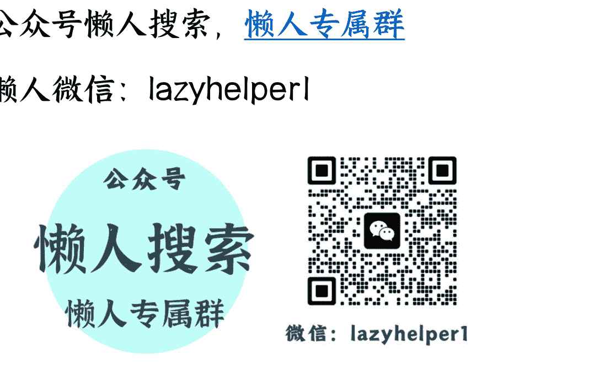
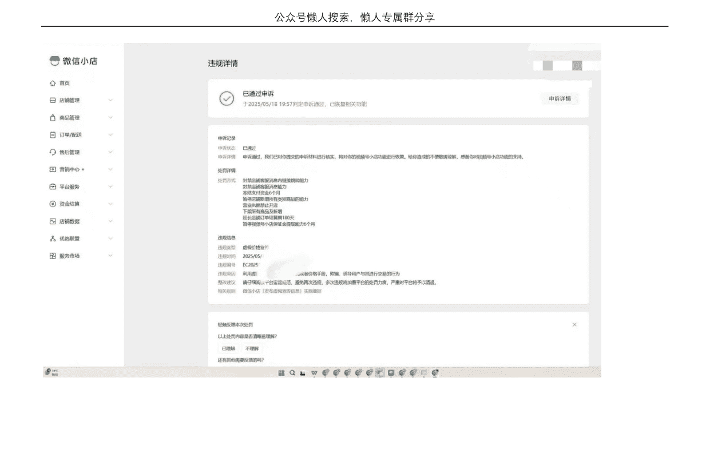
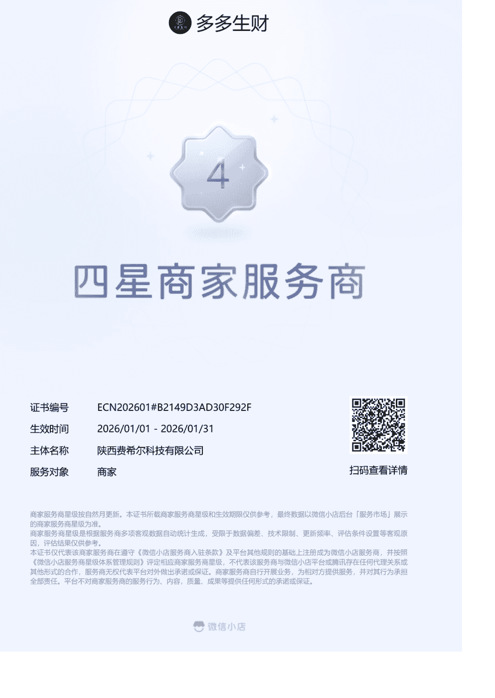

## 业务还能赚钱，但越来越消耗你，该不该关掉？这是我踩坑后总结的6个判断标准

**260515 副业SC精华**  
公众号懒人搜索，[懒人专属群](https://t.cn/A6qXJz8L)  
懒人微信：lazyhelperl  

**大家好，我是孟哥，一个00后，6年自媒体创业者。**

**我这几年一直在短视频和内容电商里折腾。**

2021年开始做短视频带货，先做多多视频，靠那波机会赚到第一桶金，年入百万。  
后面转到视频号，视频号红利起来的时候，我又吃到了一波。做过达人孵化，也做过视频号供应链团长，23-24年带货GMV做到过3个亿，也在微信公开课上拿过腾讯2025优秀带货机构，多个类目做到过平台头部。

25 年开始，我们又切到小红书带货，团队自营，年利润跑到7位数。  
如果只看结果，好像我每年都在换项目，而且每次都能赚到钱，但真实情况没那么潇洒。  

很多人只看到我每年都在换项目，没看到我每次换之前，都先做了一件更难的事：把旧业务从核心位置上撤下来。

很多时候不是我喜欢折腾，也不是我天生爱换方向。是狗日的平台规则变了，流量结构变了，原来的打法没那么好用了，你不换，就会被旧业务一点点拖死。  
我这些年最大的感受是：创业最难的地方，不是找到新项目，而是承认旧项目的ROI变低了。  

因为新项目能不能做，反而可以测出来。但旧项目要不要停，才是真的折磨人。尤其是那种过去帮你赚过钱，现在还能赚一点钱，但越来越累，越来越难放大的业务。

它不死，它就吊着你！我自己就亲手关掉过一个每个月还能赚几万块利润的团长业务。  
关的时候，我也纠结，也不甘心，甚至怀疑自己是不是太急了。  

但现在回头看，那次停掉是对的。因为我不是单纯关掉一个业务，而是把团队从低复利、重沟通、重人情、重救火的旧模式里抽出来，重新压到微信小店服务商、小红书 AI 带货这些更值得长期下注的方向上。

所以这篇文章，我想聊一个特别现实的问题：当一个旧业务开始不起势，但账面上还没死，老板到底怎么判断要不要停？怎么做业务取舍？  

2025年12月底，我刚从武汉出差去外地。深夜11点多，机场外面的冷风顺着脖子往里钻。我拖着行李箱刚下飞机，手机就开始疯狂弹消息。

达人群、客服、商家，一堆未接提醒。  
起因其实很小，客服沟通的时候没跟商家对齐信息，导致达人以为线上的链接可以转到线下结算。结果佣金对不上，达人觉得自己被坑了，客服在群里被骂，商家那边也觉得我们不专业。  

客服给我打电话的时候，声音都快哭了：“孟哥，这事我搞不定了，你看看怎么办？”  
那一瞬间，我站在路边等车，看着满屏的投诉和质疑，心里只有一个念头：太累了。

这件事损失的钱不多，也就几千块，我补给达人就行。但真正让我难受的地方在于，为了这几千块钱的纠纷，我出差谈项目的精力被打断了，员工心态崩了，商家信任裂了，达人群里一堆情绪还要我去兜底。  

回到公司以后，我看着展示架上那个腾讯2025年度优秀带货机构的奖杯，心里没什么波澜。以前看到奖杯，我会觉得这是成绩。

  
那天我突然觉得，奖杯只能证明你过去吃到过红利，它决定不了你未来还能不能继续赢。  

我以前一直以为，业务下滑是执行问题、团队问题、达人问题、素材问题。后来才发现，更底层的问题是：这个业务的终局变窄了。很多老板做取舍的时候，真正卡住他的地方，往往也在这里。他看得到新机会，也知道旧业务越来越难，但手就是抽不出来。

因为旧业务里面有过去的成绩，有团队惯性，有沉没成本，还有那口咽不下去的气。你会觉得：  
“我都做到过这个规模了，再调整一下会不会还能起来？”  
“我都投了这么多人和钱，现在停了是不是很亏？”  
“这个业务每个月还能赚几万，直接砍掉是不是太可惜？”  

这些想法我都有过，后来我慢慢明白，停掉一个业务，本质上是资源重排。把人、钱、注意力，从低 ROI 的地方挪出来。

# 一、判断一个业务要不要停，先看终局，不要只看眼前还能不能赚钱  
很多老板判断一个业务，习惯先看今天有没有利润，这个判断当然有用，但它不够。因为有些业务最迷惑人的地方，就是它今天还能赚钱。  

我当时的视频号团长业务，关掉的时候，每个月还能有几万块利润。

| 项目 | 介绍/分类 | 动销达人数 | 动销商品数 | 带货销售额 | 平均佣金率 |
| :--- | :--- | :--- | :--- | :--- | :--- |
| **团长广场** | - | - | - | - | - |
| 爱逛 | 服饰家居第1名 食品生鲜、玉翠文玩 | 46 | 923 | 500万以上 | 20.5% |
| 赚¥67.25 | 广东名鸡（正宗清远鸡） 广式盐焗风味，常温保存开袋即食 芒果奶盖沙琪玛 甜玉米粒 东北粘苞米段 | - | - | - | - |
| **皓裕传媒** | 个护美妆第1名 服饰家居 | 35 | 78 | 500万以上 | 35.1% |
| **多多生财** | 食品生鲜第5名 家清日用、个护美妆 | 7642 | 798 | 500万以上 | 56.2% |

所以同行听说我要关，第一反应是：孟哥，你疯了吧？现成的钱不赚？  
如果只看账面利润，这句话没毛病。但我当时真正看的，已经不是这几万块钱，我看的是这个业务未来还能不能放大。  

因为视频号现在的生态跟抖音不一样。抖音达人多如牛毛，品牌方忙不过来，需要团长撮合。但视频号目前的中小型达人，稍微做点规模，品牌方就上赶着加微信了。大家都是直接对接，你团长在中间起什么作用？而且平台规则一直在变，以前靠打短期账号、玩短平快的达人，生存空间越来越小，恰巧我们原来服务的就是这类达人。  

我们当初吃到的，本来就是一波平台发展的红利。既然是红利，那它就不可能一直都在。吃到了，是本事。红利退了，你也得认。我也想过要去服务那些长期账号的头部达人，但人家需要的是能够在选品测品、大场策划、投放增长全链路的机构服务，不需要中间商赚差价。  

当你发现一个业务需要你耗费巨大的心力去维护，而天花板却在不断下压的时候，最聪明的做法不是坚持，而是止损。我可能有表达不清楚的地方，但我骨子里是个草根，我只信一件事：哪里的土肥，我就往哪儿扎。

我给自己定了一个判断标准：如果一个业务的收入还在，但天花板在下降，协作越来越重，平台规则越来越不友好，你投入越多，边际收益越低，那就不能再按短期波动去看，这大概率是终局变窄。业务还有利润，不代表它还有劲。很多时候，只是过去的底子还没消耗完。能赚钱的业务很多，值得继续下注的业务没那么多。

# 二、老业务最可怕的地方，是让团队每天看起来很忙  
老业务最烦人的地方，未必是亏钱，亏钱反而简单，账面亏了，大家都知道疼。真正麻烦的是，它让团队每天忙得要死，但忙出来的东西没有增量。  

**以前我们做视频号带货，团队每天都很忙。**达人要维护，商家要对接，素材要测，客服要盯，售后要处理，平台规则一变，运营又要改流程，办公室看起来很热闹。群消息一直响，运营一直催，客服一直解释，老板一直兜底。  
**但月底一复盘，发现增长没起来，人是累的，钱没多多少，团队状态还越来越差。**  

团队忙在一堆低价值动作里，然后每个人还觉得自己很努力。**这就像一个人陷在泥里，他越用力，陷得越深。**很多时候，你看公司灯火通明，以为这是战斗力。  
**仔细一拆，很多动作都只是在维护一个越来越低效的系统。**

我的判断标准是三件事：
1. 团队忙完之后，有没有形成可复用资产？
2. 今天多招一个人，利润能不能跟着增长？
3. 老板不盯的时候，业务会不会立刻变形？  

如果一个业务每天都要靠老板救火，靠员工硬扛，靠人情、沟通、情绪去填坑，那它看起来像业务，本质上是在消耗组织。这种业务做久了，团队会越来越钝，大家每天都在处理问题，却很少有人思考增长。每天都在完成任务，却没人知道下个月靠什么变好，最贵的成本不是工资，是一群人把时间花在没有复利的事情上。

### ### 三、很多老板舍不得停，真正原因是那口不甘心  
这个点我自己感受特别深，我最开始舍不得停视频号老业务，并非完全看不到问题。恰恰相反，很多问题我早就看到了，只是我心里不愿意承认。  

因为这个业务曾经给我带来过结果，我们靠它做出过不错的成绩，拿过奖，跑出过规模，也养过团队。你让一个老板停掉一个曾经证明过自己的业务，他心里会很别扭。这件事表面上是算账，底层其实是自尊。你会想：  
“我以前都能做到，为什么现在不行？”  
“是不是再换一批达人，再调一下团队，再优化一下素材，就能起来？”  
“我现在停掉，会不会显得我输了？”  

尤其草根创业者更容易这样，因为很多东西都是自己一刀一刀砍出来的。一个业务从 0 做到有收入，从没人信你到有人跟你干，从一间小办公室做到有团队，这里面每一步都有血汗。所以停掉的时候，你会本能地觉得，像是在否定自己。但生意不管这些，生意只看 ROI 高还是低。  

过去这套打法帮你赚过钱，说明你当时判断对了。现在这套打法 ROI 变低了，你还继续死磕，就变成了跟自己较劲。所以我会用一个问题逼自己冷静：如果今天这个业务不是我自己做出来的，而是别人拿一个新项目给我看，我还会不会投钱、投人、投精力进去？  
如果答案很犹豫，那就要小心了。你舍不得的，很可能已经不是机会。只是过去的成绩、过去的投入、过去那个赢过的自己，老板做业务最容易被这东西绑住。因为人很难承认，曾经的优势正在变成今天的包袱，老板最难砍的，往往是那个曾经靠这门业务赢过的自己。

# 四、新业务不能拿来补窟窿，要看它能不能带来更高 ROI  
很多人一讲转型，就容易着急，老业务下滑了，赶紧找个新项目顶上。今天看视频号带货不错，明天看小红书带货不错，后天又觉得AI漫剧有机会。每个都碰一下，每个都没打穿。这样做，表面上是在寻找机会，实际上是在用新业务缓解焦虑。  

我后来做新业务，不是随便找个东西补老业务的窟窿。我真正想验证的是：公司能不能从原来那套重人力、重撮合、重维护的能力，迁移到一套更高ROI的能力上。比如微信小店服务商，这个业务跟以前做团长完全不一样。以前做团长，更多是撮合达人和商家，赚中间那点佣金。  
做服务商，核心变成了帮商家解决真问题，有个商家我印象特别深。

  

他几个店被连坐封杀，几百万货款冻结在里面。他自己找了各种渠道，折腾几天，钱花了不少，问题没解决，后面他找到我。我们没有搞什么玄乎东西，就是把半个月订单、客诉记录、售后记录一条条拉出来看。最后找到问题源头：某个达人为了冲销量，直播间夸大宣传，触发了系统关联违规。  

我们做了一份很厚的复盘材料，该退款退款，该拉黑拉黑，把违规链路拆清楚，再给平台审核部门看。最后店保住了，资金后面也解冻了。

  

那个商家给我发信息，没说太多煽情的话，就一句：“孟哥，救命之恩。”后来他想请我吃饭，我没去。因为这种事儿，靠的是对平台底层逻辑的死磕，不是靠酒桌上的真诚。这种感觉跟做团长完全不一样，做团长是赚牙缝里的钱，做服务商是在救商家的命。在规则面前，眼泪没用，专业才有用。  

**这件事给我的感受很强，以前赚的是牙缝里的钱，现在靠的是对平台规则、商家经营、风险处理的理解。**另一块让我兴奋的业务是小红书笔记带货。25年我们在小红书自营笔记带货，做了7位数的利润。最让我爽的不是挣了多少钱，而是效率的革命。  

以前我们做内容，简直是拿命在填。不仅要熬夜憋文案，运营要一张张磨图片，还得手动一个号一个号去发。现在呢？我全面接入了AI。**文案：**爆款脚本喂给AI，几秒钟二创出10个版本，句句带钩子。**图片：**AI自动生成图片，预设好提示词即可**发布：**配合矩阵软件，全自动分发。以前要三五个人干的活，现在一个人配个AI工具就能搞定  

很多人还在观望AI，觉得那是大公司玩的东西。我呸。**很多人觉得 AI 离自己很远，其实它就是个不睡觉的超级外挂。**以前写文案、做图、剪辑，每一项都是门槛。现在门槛没了，剩下的全是效率。**我不需要懂什么高深的技术，我只需要懂生意，AI 负责帮我把想法落成钱。**

  
所以我看新业务，会重点看几个问题：它有没有更高天花板？交付结构能不能更轻？团队能力能不能沉淀？老板投入进去，是在升级认知，还是换个地方继续干苦活？  

如果一个新业务只是换个壳，底层还是重人力、低复利、靠老板救火，那它也不值得重仓。

# 五、止损不能靠情绪，要设观察期、止损线和资源上限  
很多人一讲止损，就以为是今天想明白，明天全砍掉，现实里不能这么干。尤其是有团队、有现金流、有客户、有供应链的时候，老板不能靠情绪拍脑袋，我当时也没有一上来就把老业务一刀切。我先看了几个周期：看看素材测试成本有没有下降？达人配合度有没有改善？平台规则对我们这类打法是变友好，还是继续收紧？团队执行是偶发变形，还是系统性变形？我自己继续投入时间，能不能把业务重新拉回增长？如果只是短期低谷，那应该调整。如果连续几个周期都没有改善，就要按结构性问题处理。  

这里面最重要的是提前设线，很多老板为什么越陷越深，因为他没有止损线。今天亏一点，觉得还能扛，明天团队忙一点，觉得再优化，后天又投几万测素材，觉得万一爆了呢。最后钱花了，时间花了，人也拖疲了，业务还是没起来，止损不能靠感觉，要提前写清楚三条线：观察期多久？最多投入多少钱？到什么结果就停？  

比如一个老业务，我会给它设一个观察期。30天看关键数据有没有回暖。60天看团队效率有没有改善。90天看利润和增长有没有重新站住。同时设资源上限，最多保留几个人，最多投入多少素材测试成本，老板每周最多投入多少时间。如果到线没结果，就别再讲情怀，该缩就缩，该停就停。很多时候，拖着不决策，对团队反而更残忍。  

因为你拖的不只是一门业务。你拖的是团队的时间、公司的现金流、老板的注意力。没有止损线的坚持，最后都会变成硬扛。

# 六、真正的取舍，是从我还能不能做，切到这件事值不值得继续做  
很多老板做取舍的时候，脑子里想的是：这个业务我还能不能做？这个问题会把人带偏。因为很多业务，老板当然还能做。你有经验，有团队，有资源，有客户，咬咬牙肯定还能做。但还能做和值得做，是两回事。  

我以前做视频号带货，当然还能做。继续维护达人，继续找商家，继续测素材，继续救火，继续赚点佣金，不至于马上做不下去。但我后来发现，这件事对我来说，已经不值得占核心资源了，因为它占的是最贵的东西：老板的注意力。  

创业到后面你会发现，钱不是最稀缺的，人也不是最稀缺的，最稀缺的是老板每天醒来，脑子里最先想的那件事。如果你每天最先想的是一个低 ROI 业务的琐事，你就很难腾出空间去抓真正能翻盘的新东西，所以我现在判断业务，会更冷静一点。它还能赚钱，我承认，它过去帮过我，我也承认，但它未来不值得我继续把主力压进去，我就要撤。  

每天被一堆琐事绑住，看起来有收入，实际上没增量，看起来挺稳，实际上是在慢慢变傻了。创业就像骑驴找马，但你得先把驴卖了，你才有心思去找马。人就是这样，手里还有一点安稳钱，就舍不得转身。总想着两边都要，最后两边都做烂。所以这次我干脆一点，主力资源，全部压到更有未来的方向上。  

我不怕少赚一点，我怕的是，把时间浪费在没有未来的地方。

# # 七、业务取舍的6条判断标准  
我现在看一个旧业务要不要继续，会用这6条来判断。

### 1、看终局：这个业务未来还有没有放大空间？
不要只看今天还能不能赚钱。要看平台趋势、客户需求、竞争结构、利润空间有没有继续变好。如果收入还在，但天花板一直往下压，就要重新评估。

### 2、看效率：团队忙完之后，有没有形成复利？
如果团队每天都很忙，但忙完没有资产沉淀，没有流程沉淀，没有数据沉淀，没有客户沉淀，那就是体力活。体力活可以做，但不能长期占核心资源。

### 3、看边际成本：每多赚一块钱，是更轻松，还是更痛苦？  
好的业务，规模上来以后，单位成本会下降。差的业务，规模越大，问题越多，人越累，纠纷越多。如果增长带来的主要是救火，那就要停下来重看。

# ### 4. 看老板注意力：这个业务还值不值得占你每天最清醒的时间？
老板的注意力比现金流贵。一个业务如果只能赚小钱，却长期占用你最核心的判断力，它的真实成本远远高于账面成本。

# ### 5. 看新旧能力：新业务是在升级能力，还是换地方继续干苦活？
不要为了逃离老业务，随便抓新业务。新方向必须能带来更高 ROI 的能力结构，比如更轻交付、更强复利、更高利润、更高效率，否则只是换个坑继续累。

# ### 6. 看止损线：有没有提前定好观察期、投入上限和退出条件？
不要靠情绪止损，也不要靠幻想坚持。  
观察多久，投多少钱，做到什么数据继续，做不到什么数据撤，提前想清楚。没有止损线，老板就会被不甘心牵着走。

# 八、写在最后  
很多老板旧业务不起势，其实看得到新机会，只是还被旧成绩绑着。过去赚过钱，说明你当时判断对了，现在该停，说明环境变了。别让一个曾经帮你赢过的业务，变成后来拖住你的东西。  

赚钱的生意很多，但不是每一门，都值得一直干下去。尤其是那种，今天还能给你一点甜头，明天却一点点把团队拖进泥里的生意，这种生意最烦人，它不会让你立刻死。它会让你每天都很忙，每个月还能进点钱，然后一点点把你的判断力、注意力、团队心气耗掉，等你反应过来，可能半年一年就过去了。  

所以我现在对旧业务会更狠一点，不是账上还有钱就继续干，是要看它值不值得继续占团队主力。该收的时候就收，该换牌桌的时候就换牌桌，别死在自己曾经赢过的地方。

我是孟哥，00后，6年自媒体创业者，也是6年生财圈友，这篇文章是我关掉一个老业务之后的真实复盘，如果你也在做微信生态、小红书带货，或者正在纠结旧业务要不要继续死磕，欢迎交流。  

> ————分割线————  
看完这篇 SOP，你觉得你懂了。但 90%的人一到实操就会卡在第一步。工具和教程只是最低级的壁垒，真正的壁垒是“立刻动手”和“圈层信息差”。如果你想看全网最新的变现玩法，并且和一群执行力极强的极客一起下场拿结果，欢迎围观我的核心私域：【懒人专属群】。## 我们不聊虚的，只做商业闭环的拆解与 AI 效率的压榨。系统内已沉淀 1000+ 跑通的套利实战局。

👉 查阅圈子完整数字资产与上车门槛：
https://lazyso.com/insider/

认同价值、准备好下场干活的，扫码加我微信（lazyhelperl）

备注：【实操上车】，不闲聊