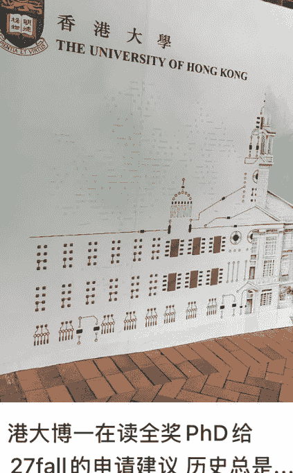
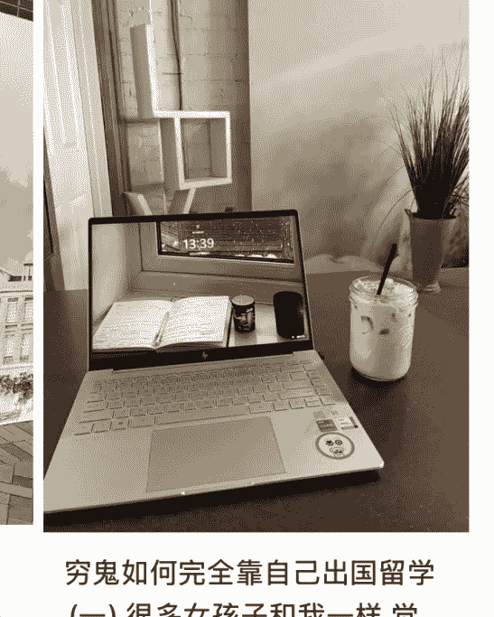
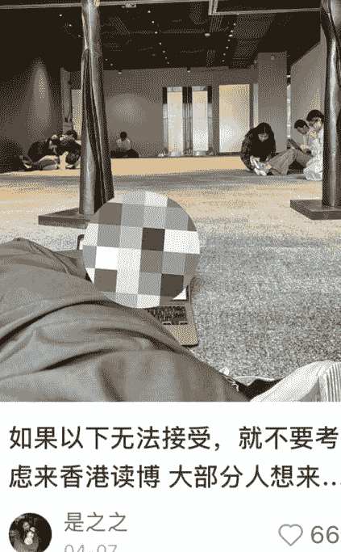
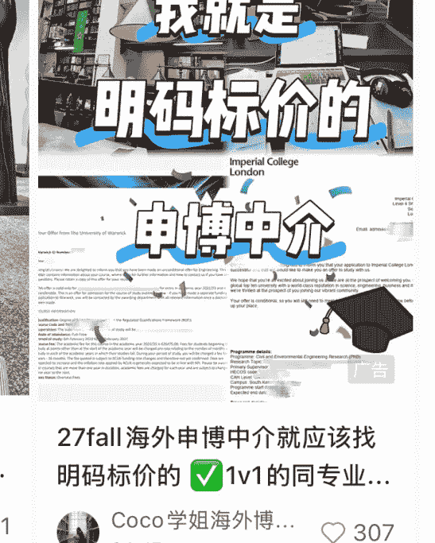
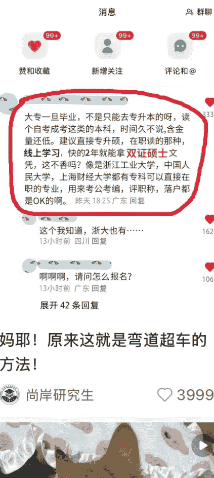

# 从零接触陌生行业到跑出第一单：我用 AI Skill 搭建小红书获客 SOP 的全流程复盘
**260515 副业 SC 精华**

**公众号懒人搜索，[懒人专属群](https://t.cn/A6qX5Y2w)独享**

**懒人微信：**lazyhelperl

## 介绍

大家好啊，我是阿达，一个还在不断折腾的自由职业者。

这是我第一次写帖子，主要想分享一下，我最近开始做获客这件事的时候，怎么用 AI 做提效。

**先说明一下**，我做获客也刚开始，很多东西都是一边摸索一边做，不一定完全对。

但过程中碰巧跑出了一单，所以想把这段经历整理出来，给大家做个参考，也希望抛砖引玉。

**一开始**，我只是想用 AI 做一些数据收集和整理。

结果做着做着，慢慢把流程串了起来，最后形成了一套很简易的 SOP：
采集 → 拆解 → 沉淀 → 生成
目前这套流程还在不断优化，但它已经帮我减轻了很多重复工作，也让我从一开始完全无从下手，变成至少知道下一步该怎么做。

这篇主要分享我的探索过程，以及这套 SOP 的雏形。

## 为什么开始做获客这件事

之前我做过很多东西，比如抖音的流量号、小红书的无货源，去年也做了下 YouTube。

这些事情有些能赚到一点钱，但我最大的感受是：很累，而且难以形成自己的长期积累。

很多事情一旦停下来，基本就归 0 了。

所以去年我停了大半年，没做什么，也是在重新想：到底有没有一个方向、一个什么东西，是可以慢慢沉淀下来，可以自己掌控的。

后来和一些朋友交流时，让我开始重新去看待“获客”这件事。

以前我做的很多事情，其实都是给平台打工。平台的规则变了，玩法变了，那基本很多东西都要重来。

但获客不一样。

如果能把用户 需求、内容、私域 这些东西慢慢做起来，它更像是一种可以迁移的能力。

因为用户需求一直都在。

只要你能持续找到人、理解需求、接住需求，这件事就可以长期做。

我记得涛哥之前在线下聚会的时候分享过一个例子：他认识一个房屋中介，就专门做一个区域。时间久了，大家有关于这个地区的买房、租房相关需求，都会去找他。虽然听起来不是特别高大上的事情，但因为在一個范围里积累了足够多的信任，最后也拿到了很不错的成绩。

这件事给我的最大触动是：

很多项目不需要很大。

但只要能持续找到需求，持续积累信任，它就有可能慢慢滚起来。

所以我决定试试。

## 一开始我也不知道具体做哪个方向

一开始我也不知道具体做哪个方向。后来通过一次聚会认识了一个圈友，刚好他那边可以做申博的后端可以承接（注意：这里是出发点，但是结果有点出乎意料，我自己也没想到），我就顺势先从这个方向开始试。

我当时想得很简单：

先别想太多，先进场。

行业不行可以换，但是获客的方法是可以迁移的。

## 一开始遇到的问题：完全无从下手

接回上面，在真正开始决定去做，去实操以后，我发现很多问题之前没想到。

### 我不懂获客

我之前做的不管是做流量号、无货源，还是 YouTube，本质上都是流量。

就是看别人什么内容好，就复制、改一改某些东西，仅此而已。

但获客就不太一样了。

获客只有流量是没用的。

在流量的前面还有更重要的东西，就是用户需求。

要知道用户到底需要什么，才能做后面的事情。

而这个留学申博相关的东西我是完全不懂的。

### 我也不懂后端

我就是个普通本科，没留过学，也没申请过。

所以刚开始我对这个行业的需求，没什么概念。

连最基础的专业术语，什么套磁、rp、bg，我都不清楚。

这就导致我根本不知道发什么。

### 我不知道第一步该做什么

刚开始做的时候，我也去问后端的伙伴。

但因为我完全不懂，所以其实也不知道该问什么。

问太泛，对方也不知道要说什么。

而太细，我自己又不知道从哪里开始。

所以最后我决定，先做自己能做的。

就像之前做内容一样，先去看看市场上大家现在都在发什么，什么内容有流量，用户又会在下面问什么。

我的想法也很简单：

能做什么先做什么，就像之前一样，先看看市场是什么情况吧。

## 我是怎么找到切入口的

### 我去看看什么有流量

我先注册了一个小红书的新号，然后就搜留学、博士之类的。

然后看看最近半年有什么帖子有流量。看看大家都发些什么东西。

看了一段时间以后，我突然发现一个情况。就是官号（XXX 机构之类的）、以及帖子营销性质非常明显的。

都是有“广告”的标志，也就是投流了。

而还有些营销性质明显的，数据都很假，上千的点赞和收藏，但是评论没几个。

而且很假，都是些什么“太专业了”、“价格”、“咨询”这些，一看就知道是水军。

港大博一在读全奖 PhD 给 27fall 的申请建议历史总是...

Captain

04-23

穷鬼如何完全靠自己出国留学 (一) 很多女孩子和我一样觉...

屿小屿

03-30

如果以下无法接受，就不要考虑来香港读博大部分人想来...

是之之

04-07

27fall 海外申博中介就应该找明码标价的✅1v1 的同专业...

Coco 学姐海外博...

04-17

### 公众号懒人搜索，懒人专属群分享

博士申请

全部

用户

商品

图片

地点

群

问一问

港大博一在读全奖 PhD 给 27fall 的申请建议历史总是...

Captain

04-23

穷鬼如何完全靠自己出国留学 (一) 很多女孩子和我一样觉...

屿小屿

03-30

如果以下无法接受，就不要考虑来香港读博大部分人想来...

是之之

04-07

27fall 海外申博中介就应该找明码标价的✅1v1 的同专业...

Coco 学姐海外博...

04-17

### 博士申请

全部 用户 商品 图片 地点 群 问一问

“

很烂的 bg
可以申到
全奖 phd 嘛

有的兄弟有的。

0pub0connection 申到北美...

文艺极客 AIGC

02-06

“

任何一个专业，
读到博士，毕业后
都会达到中产阶级的水平吗？

任何一个专业，读到博士，毕业后都会达到中产阶级的水...

大刘老师

2025-06-22

REAL PhD 先知全...

别再乱找中介了，这家申全奖
博士超专业的想申请全奖博...

REAL PhD 先知全...

04-03

不要读博
不要读博
不要读博

现在读博没有用!!!

不要读博
不要读博

不要读博#都说博士读的就是心态 #读博还是工作#
博士生#不懂就问有问必答 #学术 #49 年入国军#

想读博却全是劝退帖，求真实
读博体验！最近想读博的心...

凌晨 1 点的 pingu

02-05

8 / 36

### 发现
广州

### 你们看到忍得住吗
十六

### 你们一年要花费多少呀
飞天猪猪仔

### 住在养老院里的，摇滚青年
一块碗布

### 妈耶！原来这就是弯道超车的方法！
尚岸研究生

### 首页
### 市集
+ 
消息
我

而且没“广告”标志的、评论区有讨论的。

很多是这几类（我一开始也没总结，是后面用 AI 的时候，它自动帮我总结出来的，所以有事没事找 AI）：
- 分享文
- 经历文
- 问题型内容
- 避坑内容
- 判断型内容

很烂的 bg
可以申到
全奖 phd 嘛

有的兄弟有的。
0pub0connection 申到北美...

任何一个专业，读到博士，毕业后都会达到中产阶级的水平吗？

任何一个专业，读到博士，毕业后都会达到中产阶级的水...

不要读博
不要读博
不要读博

现在读博没有用！！！
不要读博
不要读博
不要读博#都说博士读的就是心态 #读博还是工作#
博士生#不懂就问有问必答 #学术 #49 年入国军#

想读博却全是劝退帖，求真实
读博体验！最近想读博的心...

### 申博

### 全部  用户 商品 图片 地点 群 问一问

### 没有申不上的博士

### 25fall 给 26/27fall 的一点申博建议 1.不要因为担心而犹豫...

### 无发表申上香港 phd，贡献一下我的申博思路 先分享我 b...

### 能吃苦也不要来申港博。。。。目前港中文博二...

这时候我就有点高兴了。
（一）没投流，那至少可以少花试错钱。
（二）找到了流量在哪里。

这个时候就可以反推出。

(一) 现在用户不愿意看官号的硬广，也就是发方案、价格和优惠之类的东西，在这一步没用。所以我可以把专业知识的稍微延后一点学习（不是不学，是先做最重要的事情——流量）

(二) 现在市场上有流量的，多是“讨论交流”类型的帖子。所以主要还是打痛点用户。

## 所以我决定做什么

经过上面一步，我就发现，其实现在专业知识在流量这一步，还用不上。

所以我就决定之前一样，先复制市场上的东西，然后边做边学习，这样比较高效。因为用户越痛的地方，流量就越好。而越痛的知识点，就越急需。

这样我客可以针对性去问后端（和前面不知道问什么形成闭环了），好过我自己盲目去学。

## 为什么开始做 skills

光是知道什么有流量也不够，还需要大量的收集去整理。

我一开始是一篇篇一点点的去收集，手动整理，每一个细节都不放过。

结果就非常的累，而且因为专业的东西都不懂，所以其实做出来的很多东西都不行，可以说是效率和成效极低的无用功。

### 小红书 博士弹窗

| 提示词 | 用户阶段/画像 | 深层动机（他在担心什么？） | 文案属性（标题/封面建议） |
| :--- | :--- | :--- | :--- |
| 博士生活（案例） | 迷茫期小白 | 听说读博很苦，怕坚持不下来。想看真实感。 | 虚（吸粉/曝光） |
| 博士脱单 | 已经是博士 | 想找对象 | 虚 |
| 博士申请面试 ppt | 在申请博士的路上 | 担心因为 ppt 不行，申请不到，不安全 | 实 |
| 博士申请 | 想要尝试申请博士 | 还不懂具体的，细节的 | 半虚半实 |
| 博士求职简历 | 博士毕业了 | 找工作，想知道怎么找 | 实 |
| 博士招生 | 确定申博 | 想读博但是不知道要申请哪个 | |
| 博士申请简历 | 确定读博了 | 不知道如何写简历，担心简历不行 | 实 |
| 博士面试 ppt | 已经申请了，现在面试 | 担心面试不上 | 实 |

### 专业用词

| 行业标准术语 (Jargon) | 意思 | 用户大白话 (White-words) | 用户专业误区 (The "Wrong" Belief) | 行业内黑学术语 (The "Black" Knowledge) | 避雷/推荐 (标题/封面建议) |
| :--- | :--- | :--- | :--- | :--- | :--- |
| RP (Research Proposal) | | 申请整个几千字的东西，研究计划、开题报告 | 觉得只要字数够多，引用了大文献就能通过。 | 导师其实只看你的研究方向跟导师手里的"Funding（经费）"匹不匹配。 | 《这词对吗？！导师回怼 Welcome 其实是在看你是否省钱》 |
| Theoretical Framework (理论框架) | 基于理论搭建的、支撑整篇论文的逻辑结构。 | "逻辑框架说明书"，告诉导师你打算用哪几把尺子来量这块地。 | 觉得是抄一段书，其实是你自己选定并组合出来的逻辑。 | 它是你的"免死金牌"，只要框架稳，给啥逻辑也没人敢说你错。 | "10 分钟搭出导师点头的高级框架，告别逻辑混乱。" |
| RQ Research Question (研究问题) | 一项研究核心想要通过数据回答的语句的核心意义，就是为了辩中它。 | ""逻辑鬼打墙"或"废话文学"，比如："因为他厉害，所以他成功。" | 觉得"题目"当成"RQ"，题目是门面，RQ 是要充实的具体堡垒。 | RQ 定得越小，越具体，论文越好写。 | "RQ 定得好，论文不跑题！3 步教你精准定位研究方向。" |
| Circular Circular Reasoning (循环论证) | 结论已经包含在前提里，逻辑原地打转。 | ""逻辑鬼打墙"或"废话文学"，比如："因为他厉害，所以他成功。" | 觉得"自圆其说"就是完美，其实没有循导过闭环的闭环就是废话。 | 好的研究必须公开被证明是错的，这种逻辑闭环是学术自杀。 | "拒绝逻辑鬼打墙！教你识别论文里最隐蔽的废话逻辑。" |
| Theory (理论) | 解释现象的系统性规律。 | ""破壁的总想"，公认好使的工具，拿来就能用。 | 觉得是没啥数据的情操，其实是经过验证的"真理"。 | 它不是标准答案，而是一种视角（看问题的逻辑）。 | "别再盲目踩雷！用这个经典理论，瞬间看透本质。" |
| Paper Academic Paper (学术论文) | 发表在期刊上或用于学位考核的、具有逻辑严密性的研究报告。 | "学术界的没名状"，是你向同行证明"我发现了一个新秘密"的正式报告。 | 觉得字数越多越好，其实学术论文讲究越大。 | 论文的核心不在于"写"，而在于"贡献"，即便你写了 1 万字，如果没有提出新观点，在导师眼里就是一张废纸。 | "拒稿率 90%？掌握这几个核心逻辑，让你的 Paper 起死回生。" |
| 套磁 Academic Networking / Cold Emailing (学术套磁) | 申请人在正式递交申请前，通过邮件与潜在导师联系，展示科研背景并询问对方是否有组人名额。 | "私底下加好友"，在正式报名（投简历）之前，先私下问问老师："您那还招人吗？看咱行不行？" | 觉得就是发个邮件问候，其实有效的套磁必须包含你对导师研究方向的深刻理解，而不是套着套着。 | 很多博士名额在网申开始前就已经通过"套磁"定下了，没看邮箱很稳，很容易成为"套磁"。 | "回复率不到 100%！手把手教你写出一封让大牛导师无法拒绝的套磁信。" |
| 二区在投 Under Review in JCR Q2 / CAS Tier 2 (中科院 JCR/二区论文投稿中) | 有一篇质量不错（排名前 25%-50%）的学术论文正在投稿审核中。 | "有个半成品利益"，虽然论文还没正式发表，但已经写完并投出去了，证明有科研产出能力。 | 觉得"在投"等于"发表"，学术界只认已接收（Accepted），在投状态没被接收大。 | 在计算机（NLP）领域，大家更看重 CCF-A/B 类顶会（如 ACL, EMNLP），越二区"难带搭 SCI 期刊。 | "手握二区在投论文，如何在一众"顶会大牛"中杀出重围拿到 Offer？" |
| RA (研究助理) Research Assistant (研究助理 / RA) | 由教授用科研经费（Funding）聘用的短期科研工作人员。 | ""高帽科研打工人"，你还没正式入读博士，但先法教授的实验室干活，做工资、攒论文。 | 觉得 RA 就是行政助理，其实 RA 的核心工作是做实验、跑代码、写论文，是纯粹的科研。 | 很多博士名额在网申开始前就已经通过"套磁"定下了，没看邮箱很稳，很容易成为"套磁"。 | "得意不得 RA 米来！手把手教你如何透过 RA 职位看清博士三头六臂。" |
| CCF Class A (中国计算机学会 A 类推荐会议/期刊) | 由中国计算机学会（CCF）认定的、国际上最顶尖的学术会议或期刊。 | "学术界的品牌"，在 AI 领域，像 CVPR, ICCV, NeurIPS, AAAI 这些都是"A 类"，拿下一篇，就相当于拿到了名校的入场券。 | 觉得只要发了论文就行，其实在顶会没被接收，与跟普通论文也搭不上"A 类"的含量。 | 现在的墙博申请越来越"卷"，评区很严，尤其是港三（HKU, CUHK, HKUST, CityU, PolyU）的计算机专业，没有 A 类一作论文，创得可能过不去。 | "没 A 类论文真的无缘港五院？揭秘 2026 港博 CC 申请的"隐形硬指标"。" |

15 / 36

### 用户提问/吐槽原文分析

| 用户提问/吐槽原文 | 核心痛点/卡点 | 用户情绪 | 用户白话词 | 衍生选题/一锤定音方向 | 来源链接/笔记 ID | 备注 |
| :--- | :--- | :--- | :--- | :--- | :--- | :--- |
| “我这种双非本科、授课制硕士，一篇核心都没有，真的能申到港三吗？” | 背景薄弱/学术成果缺失 | 自卑、焦虑、怕被拒 | “零论文”、“双非”、“跨专业” | 《双非零论文逆袭港大：导师到底看中我哪一点？》 | [链接] | |
| 用两个或者多个理论做框架完全可以，关键是**要写清楚**为什么这两个理论需要同时出现。逻辑上分三步： 第一步：分别说清楚每个理论是什么，它能解释你研究问题的哪个层面 第二步：用出单个用其中一个的局限——A 理论能解释 X，但解释不了 Y；B 理论能解释 Y，但忽略了 X 第三步：说明两者互补之后能更完整地框架你的研究问题 | 核心是：两个理论不是"1+1=解释不同维度，合起来才能完整回答你的 RQ。你用的是哪两个理论？说说看，我帮你判断互补逻辑写得清不清楚👏 | | | | | |
| 老师 想请教一下 如您所说 RQ 要基于某个理论框架，如果 RQ 的设定带着理论框架的痕迹会不会有过度预设的风险？或者被当作一种 circular 先答案倒推问题的感觉 谢谢老师 | | | | | | |
| 老师 想请问 theory 和 theoretical framework 概念一样吗？paper 里经常既有 theory 又有 theoretical framework | | | | | | |
| 人工智能方向有码 | 选方向 | 探索 | 想读人工智能 | 现在什么方向好？人工智能如何？ | 90【-新西兰全奖博士申请仅需 1w+ -Toby 博士留学（实话版）小红书 - 你的生活兴趣社区】👏 | |
| 建议手搓，没有人能比你更了解你的研究方向 | 专业度问题 | 自强 | 市场上都是骗钱的 | 机构都是骗钱的？总结到底能帮你做什么？ | KaAzxU45WMEhaki😊 | |
| 英国基本都是自费，很少有奖学金。香港背景不够港府奖学金很难的 | 留学奖金问题 | 英国要自费，香港看背景 | 不要考虑英港的奖金了 | 如何拿英/港的奖金？去英/港有什么缺点？ | www.xiaohongshu.com/discovery/item/68c010220000000021007dcf?source=web&share_token=ABZVQicBif_p287TcuCn9gNO45BzadZaJodBO2el:1A&ssec_source=pc_share | 英国文书 89 月很忙 3-6 月还行 |
| 你是更看重导师资源还是文科科研辅导呀 | 客户需要什么？ | 着急 | 你需要什么？ | 导师资源和文书辅导，应该怎么选？如何判断你要什么？ | | |
| 有个清华大佬开的工作室文书巨专业，现在在英国独立 ps，都是各高校大佬，就是他们班 | 有好的文书工作室，但是太忙 | 有专业的，但是它很忙你要快一点 | 文书到底什么时候应该准备。旺季是什么时候？ | | | |

而且其实小红书的内容，其实很多都是没用的。

但是不你点开又不知道什么它到底有没有用。

而这个时候，航海开始了。

本着不报白不报，所以我就报了“小红书 AI 提效工作流”。

由航海做出发点，开始做 skills 了。

因为数据收集需要大量的数据，而正好航海里有爬虫工具，我就借机用上了。

## 我本身用 gpt 比较久，所以我就用直接把航海的工具丢给了 codex。

直接让它帮我配置设置，需要什么 id 信息之类的，我就给它。

就这样有了爬虫工具，算是开始我的 skills 第一环了。

在爬虫以后，其实我也没开始做后续的东西，我是看数据表格来一个个看。

直到突然间，我看到了下面这一篇东西。

我觉得写得很好，而且数据也不错，关键是评论区是有真实的讨论。

## Captain

港大博一在读全奖PhD给27fall的申请建议

历史总是惊人的相似，去年这个时候，我也在到处翻经验贴。现在回头看，有些事早点知道，能少走很多弯路。结合我自己的申请，还有lab师兄师姐的情况，分享几个tips

1. 背景差，焦虑没用。我本科学校一般，澳门mphil也不算顶尖。但我观察下来，双非本的同学，如果均分能到90左右，或者有不错的科研产出，机会是有的。你需要用其他东西证明潜力，比如一份扎实的rp。把内耗的时间拿去读导师近三年的论文，更实际

2. 找导师，不用当tg。不用把他所有论文背下来。重点看他最近三年在做什么，知道他的学术脉络就行。好导师比名校招牌重要太多，这直接决定你未来几年幸福or痛苦

3. 邮箱没回复，很正常。教授可能在看论文，在写本子，或者单纯忘了。别自己加戏，觉得全完了。可以一周后礼貌跟进一次。我翻过很多申请总结，发现高转发的文章都是因为提供了内部信息，比如怎么筛选掉不招人的导师

4. 被拒绝，不一定是你不行。很可能只是导师今年没名额，或者funding没批下来。别把原因都归到自己身上。申请季，心态比什么都重要

5. Research Proposal，是关键。它可能和你以后做的课题完全没关系，但这是你向导师展示逻辑思维的唯一机会。我写RP那几个月，每天都在想怎么把一个问题讲清楚，这个过程比结果更重要。后来面试时，导师说就是因为RP的逻辑才要了我

6. 别活在邮箱里。设定每天固定时间查看，其他时候该干嘛干嘛。世界很大，读博只是其中一条路。做实验做不下去的时候，我就去海边走走

7. 敢于问，不丢人。问师兄师姐，问有经验的人。我申请时也找人聊过，获取信息不丢人。那些说风凉话的，可能自己也没搞明白

8. 休息是你的权利。不用为放松感到愧疚。长期紧绷，做不出好研究

9. 面试不用死磕PPT。很多导师更看重对话。多模拟，练好怎么讲清楚你的研究。面试时紧张很正常，但你要相信，你为这个方向准备的时间，比谁都长

10. 现在就要开始规划。理想的节奏是，现在到三月定方向、筛导师；春天开始套拖、写RP；夏天打磨所有材料；九月开放就递交。你再拖，好坑位就没了

保持平静，一步一步来。就跟做实验做疯了的时候，想想这些都会过去的

## ip中九 现在大二下 车辆工程均81 六级600 想问下接下来是应该先把绩点搞好看一点吗 如果还是这个均分申港三有机会吗

03-26 上海

赞 3

paper怎么样，gpa还好

03-26 中国香港

赞 回复

展开 2 条回复

请问一下港澳的套磁都有带rp是吗？

03-21 广东

赞 3

最好带上

03-21 中国香港

赞 回复

展开 2 条回复

我也是想27fall，也很想现在联系导师看看能不能提前进组，但我是跨专业的现在专业能力还差一截怎么办求助🆘，然后机构给的规划是等到8月底再去开始套磁，请问学姐我到底是现在就开始联系心仪导师还是听取机构建议资料都准备好再去接触导师。🏠

03-21 江苏

赞 2

跨专业具体是指哪个方向呢？八月去陶瓷名额少了很多了就，导师一年就一两个；你可以详细发我，另外我是男生🥺

我希望我也能够写出这种帖子。所以我对他就进行了拆解。

我拆解完后发给 gpt 交流，结果没想到！！！

## Thought for 11s >

你的第一篇拆得有用。

但现在的问题是：

你还在“翻译原文”，还没完全进入“拆运营结构”。

### **你做得好的地方**

你已经抓到了这篇的核心：

它不是单纯讲申博技巧，而是在安抚焦虑。

你最后那句判断是对的：

> 这个人是真的懂学生，也明白大家的焦虑点是什么。

这就是这篇能跑数据的原因。

它不是靠信息量赢。

它是靠：

懂焦虑 + 给判断 + 给路径。

### **你现在的问题**

你的「人话」栏还可以。

但「作用」栏有点散。

比如你写：

> 要找机构去筛选对的律师

这里应该是“导师”，而且原文没有明显推机构。

你这个判断可以保留，但要改成：

它埋了一个服务入口：导师筛选 / RP指导 / 面试模拟。

不要直接说“找机构”。

这样更准。

还有你写：

> > 给大家打激素

应该是“打鸡血”。

但更准确地说，不是打鸡血，而是：

制造时间紧迫感。

### **这篇真正值得学的结构**

这篇不是 10 条建议那么简单。

它的底层结构是：

#### 1. 先建立身份

港大博一

全奖PhD

自己申请过

见过师兄师姐案例

作用：

我不是空讲，我是过来人。

#### 2. 再安抚低背景人群

背景差也不是没机会。

双非也可以靠均分、科研、RP补。

作用：

先把用户留下来。

因为很多用户点进来时，第一反应是：

> > 我背景不行，我是不是没戏？

它先回答这个问题。

#### 3. 再给关键判断

好导师 > 好学校

RP > 空泛履历

对话能力 > PPT包装

导师没回复 ≠ 你失败

作用：

把用户的错误关注点纠正过来。

#### 4. 再给具体动作

看导师近三年论文

一周后 follow up

固定时间看邮箱

现在到三月定方向

春天套磁写 RP

夏天打磨材料

九月递交

作用：

让焦虑变成行动

## - gpt 非常清晰的告诉我。
- 我拆解出现了什么问题，还告诉我要如何修改。

- 我一看。

- **你那么厉害，那你来做吧！**

- 由此，我就开始了做 skills。

### - **skills 分享**

- 在开始做 skills 的时候。
- 我的初步设想是数据收集 - 处理 - 输出。

- **而且这里面最重要的是数据处理。**
- 因为我不懂专业知识也不懂流程，而且输出是要基于数据来进行的，所以这个数据处理非常的重要的。
- 可结果比我想象的更加重要也更加困难和曲折。

- **工具是需要不断和 AI 交流、不断修改的，所以这里没办法给的太细节。**
- 因为修改了很多次，太细的我都找不到了。

## **而且每一个行业或者个人需求都不一样，**
**仅做分享，不建议照搬。**

### **历程**

**现在这里发一下我 skills 的过程经历分享，下面环节会有提示词。**

**大家要是对经历不感兴趣，可以直接看下一节。**

**注意：skills我是放在hermes里面用的，**
**编辑 skills就是用的codex。**

**我一开始想着让gpt来分解帖子，就像上面一样。**

**但是我发现，它对每一篇都拆解了。**

**可是不一定全部帖子都有拆解的必要。**

**因此，在拆解之前，我又增加了一步：判断价值。**

**在判断完以后，再进行拆解。**

**在拆解的数量多了以后，我发现gpt进行了很多无用的拆解，而且很多东西都混在了一起。**

**一篇文章可以产出无数种东西，正如一千个读者有一千个哈姆雷特，所以必须要知道我们到底要什么，标准是什么。**

## 所以基于我的最终目的（挖掘需求和发帖子）出发。我就进行了大改，相等于重做了，在拆解以后，只对留下最重要的东西素材以及类型。（工程量很大，整个流程的70%的工作量可以说都在这）。

（知识点这一块，我发现直接找gpt交流就好了，因为做了也不看，又不是读书要背，看多了用多了自然就记住了，比知识点更重要的是申请的过程案例结果，而这些是我这个阶段还没法做的）。

做完重构这一步的时候，我以为这一步基本搞定了。

结果呢。。。还没呢。。。。

因为我们这个最终的目的是写帖子。

可光有素材是不够的。

同样是写字，王羲之把它写成了书法；同样是写作，鲁迅把它写成了文学。

光有素材也是不够的，帖子是有骨架的。

素材就像是果实，而骨架就像是树桩。

没有骨架果实也就烂在地上了。

所以在原有的基础上，拆解这一步，我又增加了一个模块。就是别人文章的架构。

最后再融合。

至此，算是完成了基础闭环。

## # 小红书深拆与素材筛选逻辑图
不是把整篇笔记拆成很多字段，而是先深拆，再经过两层过滤，只保留可复用的高质量片段

1 原始输入
一篇小红书笔记

2 深度拆解
先看整篇内容，再提炼可复用片段

3 第一层过滤
• 内容清晰
• 值得保留
• 具有复用价值

4 写入结果
报告表
• 整篇拆解结果
• 等级判断
• 骨架摘要
候选表
• 候选素材
• 保留原因
• 当前状态
到这里，保留下来的已经不是原文全部内容，而是可复用素材

5 第二层过滤
输出前再筛一次，只保留更适合进入后续流程的素材

6 进入选题器
从候选素材里挑出可组合的方向

7 进入成稿规划
形成后续选题与表达结构

skills 模板分享

飞书表格案例

我用 AI 跑通内容获客 MVP-案例分享

这个表格是我现在用的模板。里面分为
小红书帖子
小红书拆解报告
小红书候选素材
小红书输出选题
小红书成稿
其中“小红书帖子”是爬取的内容。
“拆解报告”、“小红书候选素材”和
“小红书输出选题”是拆解出来的结果。
“成稿”是输入的稿子，有标题和正文，
以及写作的逻辑和观点设计等等。

## # 拆解模板

这个主要是把一篇小红书拆成“素材”和“骨架”。

用的时候，把标题、正文、链接、标签尽量贴完整。

先让 AI 先判断这篇内容值不值得留。

如果值得，再往下拆：

这篇内容为什么有用，它靠什么东西来打动人。

里面有哪些素材，以后可以多次使用的。

重点不是把整篇文章都留下。

而是只保留后面真正可以用上的东西：

+   1. 可复用的素材点。
2. 可迁移的写作骨架。

拆解模板：

你是一个“小红书内容拆解助手”。

你的任务不是改写原文，也不是生成新帖子，而是把这篇内容拆成“可复用的素材点”和“可迁移的写作骨架”。

请按下面顺序完成：

+   1. 判断这篇内容的整体价值等级
- A1：很强，值得重点复用
- A2：有明显价值，可以复用

- B：有一些价值，但不够强
- C：价值较低，更多是参考

2. 提炼这篇内容的核心作用
- 它解决了什么问题
- 它抓住了什么情绪或需求
- 它最值得保留的不是“内容本身”，而是“可迁移的逻辑”

3. 总结它的写作骨架
- 开头怎么切入
- 中间怎么展开
- 结尾怎么收束
- 这篇内容最稳定的表达结构是什么

4. 拆出高质量候选素材点
只保留真正值得复用的点，不要凑数。
每条素材点都要说明：
- 素材类型
- 素材内容
- 为什么值得保留
- 建议去向

素材类型可参考：
- 选题
- 痛点
- 判断
- 信息差
- 结构
- 工具资料
- 转化入口

- 案例

5. 输出时请遵守:

- 不要改写成新文章

- 不要写新标题

- 不要扩写成正文

- 不要把所有内容都当成素材

- 宁可少，不要硬凑

- 如果没有高质量候选点，就输出空数组

输出格式:

# ## 结论

- 等级:

- 核心价值:

- 适合复用的方向:

# ## 写作骨架

- 开头:

- 中段:

- 结尾:

# ## 高质量候选素材点

1、

- 素材类型:

- 素材内容:

- 为什么值得保留:

- 建议去向:

2、

- 素材类型:

- 素材内容：
- 为什么值得保留：
- 建议去向：

# ## 输出模板

这套模板是用来“合成文章”的。

用的时候，要说清楚：主题、人设、核心立场、素材、其他要求

然后让 AI 围绕一个明确观点，去选用素材，生成文章。

最后再看出来的质量如何。

有需要优化的，就直接和 codex 说，让他修改。

你是一个小红书内容合成助手。你的任务是把给定的素材整合成一篇完整、自然、可发布的文章，而不是机械拼接，也不是逐条复述。

### **写作要求：**

1. 文章必须有明确主题，围绕一个核心观点展开。

2. 只能使用我提供的素材，不要凭空新增事实。

3. 可以重组顺序、合并同类信息、压缩重复内容，但不能丢掉关键价值点。

4. 文章要像真人写的，表达自然、有重点、有节奏。

5. 结构要清晰，通常包括：

- 开头：直接点题，说明这篇文章要解决什么问题

- 中段：展开分析、举例、说明原因
- 结尾：总结判断，给出建议或提醒

6. 如果素材里有冲突信息，以更具体、更稳定的内容为准；不确定的地方保留模糊表达，不要硬编。

7. 文章风格要符合目标人设，语气保持一致。

8. 输出只要成文，不要解释过程，不要列素材清单，不要输出分析报告。

写作目标：

- 让文章读起来连贯
- 让素材之间有逻辑关系
- 让结论落在一个清晰的判断上
- 让读者能直接看懂、愿意继续读下去

请根据以下素材生成文章：

【主题】
{主题}

【人设】
{人设}

【核心立场】
{核心立场}

【素材】
1. {素材 1}
2. {素材 2}
3. {素材 3}

4. {素材 4}

【写作要求】
- 文章长度：{长度}
- 风格：{风格}
- 重点：{重点}
- 不能写的内容：{禁区}

跑这套流程时，我碰到的一个偶然结果，以及我现在的想法总结

惊喜

突然的成交
在边优化 skills 时候，我也在到处测试，流量不大稳定。
但是也是有点人来咨询聊天的，不过大多数都是白嫖党。

在这过程中，有一个本科的女生，来找我聊天想了解硕博。
虽然她不是直接申博，和我合作伙伴不大相匹。

但是呢，来者都是客。
正好在过程中，我通过另外一位朋友认识了一位留学机构的后端朋友，我就交给她了，之后继续专心做我的东西。

结果突然有一天，这个朋友说谈成了，这是我完全没想到的。

它让我意识到一件事：
前端内容的价值，不只是写内容。
它更像是在市场里捕捉真实需求。

## **用户不一定按你原本设想来。**

你以为自己在测试 A 方向。

结果市场可能给你 B 需求。

**这时候真正重要的，不是你一开始设计得多完美，而是你能不能识别需求，能不能找到人接住需求。**

所以我现在对获客的理解，也有了一点变化。

### **关于 AI 的使用**

#### **有事没事找 AI**

**人的认知是有限的，视野是有盲区的。**

而当你认识到问题及时去补，也是需要时间的。

**但是借用 AI 我们可以快速发现问题。**

然后通过 AI 也可以快速做到某些事情，从而去做更有价值的东西。

**最好的案例就是我的拆解那部分。**

如果真的要我完全吃透拆解这一环。

我不知道要做多少次，花多少时间。

**但是现在有了 AI，我们都不必花时间做这个固定性的东西了。**

因为 AI 仅仅是通过我们的聊天来理解任务的。

所以它可能会局限在某一个范围内徘徊。

最终可能会离我们的目标越走越远。

所以我们一定要先知道，我们的最终目的到是什么？为了做到这件事需要什么东西。

最好的案例就是我的历程里面的重构，只抓重点！

每个人的精力都是有限的。

如果不断的去做重复性的东西，其实是难有什么成长的。

而一个 skills 最大的价值就是让你脱离流水的工作，去做那些没办法被“定义”的事情。

而且人是变化的，而且代码、流程是死的。

光靠人去手动做，质量是难以保证的，就像同一个厨师都难以保证次次出品都一样。

所以如果如果工作是流水式的，而且还是可定性的东西。还是建议做一下的。

## # 结尾

这帖子不是关于成熟项目的复盘。

而是我从 0 开始做获客，摸爬滚打偶然踩出来的粗糙方法。

skills 真正帮到我的地方，也不是让我批量输出。

而是让我更快吸收市场信息，把零散内容拆成结构，再变成可以测试的动作。

对我来说，这套 SOP 最大的价值不是“写得更快”。

而是：

让我不再完全靠感觉做内容。

让我能用更低成本，把每一篇内容都变成一次市场测试。

我知道在获客和 AI 这条路上我还有很多不足，有很多需要学习的地方。

还请大佬们看完后可以多指点指点。

## ————分割线————

看完这篇 SOP，你觉得你懂了。但 90% 的人一到实操就会卡在第一步。

工具和教程只是最低级的壁垒，真正的壁垒是“立刻动手”和“圈层信息差”。

如果你想看全网最新的变现玩法，并且和一群执行力极强的极客一起下场拿结果，欢迎围观我的核心私域：【懒人专属群】。

我们不聊虚的，只做商业闭环的拆解与 AI 效率的压榨。系统内已沉淀 1000+ 跑通的套利实战局。

👉 查阅圈子完整数字资产与上车门槛：

https://lazyso.com/insider/

认同价值、准备好下场干活的，扫码加我微信（lazyhelperl）