结合 3 个超级标，用时 2 个月，跑通从 0-1，第一单就赚了 3000 块

**260515 副业 SC 精华**

公众号懒人搜索，[懒人专属群](https://mp.weixin.qq.com/s/7X9qQ4y8zJvKjLmNpOqRsA)

懒人微信：lazyhelper1


## 前言：我的心路历程

哈喽，大家好，我是卞言，03 年，一名刚毕业的本科生，目前保持着 100%精华贴概率，哈哈哈哈（我乱说的）

两年前，通过 RPA+ChatGPT+Lark 做自动化爆文写作赚到了人生第一桶金，而后由梦想的驱使，尝试成为一名旅行博主，花费了大量的时间和金钱去做旅拍，但事与愿违，在惨淡的流量下，我选择了向现实妥协。

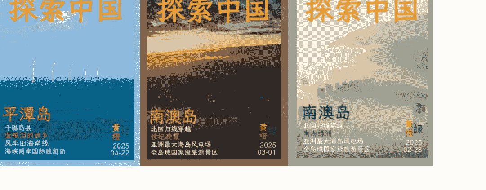

现在，我跟搭档都已经顺利毕业，与绝大多数的应届生一样，进入了深圳一家公司为生活而奔波。但我们俩又与他们很不一样，我们不甘心，我们绝不仅于此！！！所以，在去年底，时隔一年我们重新加入了生财，利用下班时间寻求副业的方向。在找项目时，我们定下了一个准则：以 AI 为核心，做与时俱进且我们有积累的方向。

按常理来说，应该要先去把生财里面的精华帖尽可能都过一遍，但我们比较简单粗暴，直接在超级标里面挑，因为这是亦仁老大严选，项目本身绝对没有问题，要考虑的只是我们自身能不能做好。

我们把所有的超级标都认真地看了不下十遍，发现里面有不少方向存在共性，或者说互相可以组合起来，形成一个超超超级标。

比如 05AI 服务、11AI 工作流、12AI 工作流定制服务商是同一类，如果将 10 垂直小号+AI 工作流定制服务结合起来，那不就解决流量和产品这两个关键点了吗？

所以，我们最终选择了用垂类的公众号获客（我们做过），做 AI 工作流定制服务（与时俱进）。后来的超级标 16 企业 AI 学习与服务，也给我们打了个强心剂，更加坚定了这个方向没有问题。

好了，废话不多说了，后面直接根据我们整个的 OKR 进度表来划分写作结构，正文开始！

| 阶段 | 关键目标 (O) | 关键结果 (KR) | 规划 | 进度 | DR1 | 奖励 | 备注 |
| :--- | :--- | :--- | :--- | :--- | :--- | :--- | :--- |
| 学习阶段(1.20-2.08) | 建立文章定位、写作结构 | 1. 确定文章类型的定位<br>2. 开头、正文、结尾：引言结构清晰<br>3. 第四段标题式（主体行图、开头结尾），引言的先不放——先放我的内容 | 1.24 完成初版 | 1.√<br>2.√<br>3.√ | 赏 | 去收稿的 | 各公众号任务进度 |
| | 搭建选题库和对标账号库 | 形成一个汇总的表格（重点在于找到人想要的账号） | 1.25 前 | √ | 赏 | | 后期将自动对热点资讯 |
| | 构成文章写作提示词 | 先两个版本（实践类） | 2.1 构成实操初版 | √ | 赏 | 周末加班就行 | 主要是开头故事 |
| | 完成所有关于 n8n 的教程学习 | 1. 读教程学<br>2. 读教程补充学习 | 2.8 前 | 1.√<br>2.√ | 钟 | 去收稿的 | 1. 参考小号自动 Q（https://qian.com/2024/01/20/20240120/<br>2. n8n 自动化工作流（https://qian.com/2024/01/20/20240120/<br>3. 参考小号自动 Q（https://qian.com/2024/01/20/20240120/） |
| | 提升 AI 编程基础 | 明白生财顾问中所有代码的意图和作用 | 2.8 前 | √ | 钟 | 唐山 | 通过 AI 编程学习，目标达到 n8n 基本要求 |
| | 每周写有 11 个讲解教程（公众号类） | 每日 4 篇 | 2.5 前 | √ | 钟 | | 复现的同时植入自身的代码逻辑 |
| | 每周写 5-6 篇文章 | 1. 1.30 前每个号 2 篇<br>2. 2.7 前每个号 3 篇（共 5-6 篇） | 阶段性任务 | √ | 共 | | |
| | 保持每天发布 3-4 篇文章 | 1. 两个号，每个号至少写 4 篇<br>2. 进入流量池，每个号每周流量在 300 以上 | | 1.√<br>2.√ | 共 | | |
| 跟踪账号(2.08-3.08) | | | | | | | |

具体步骤可以参考航海，我们就不详细说了，只说一些关于工作流定制相关的信息。

- 垂类小号入口：
https://scys.com/activity/landing/9635

- 公众号自动化 n8n 航海：
https://scys.com/course/detail/104

## 1. 平台调研

AI 305,814,215 2.17% ▼

+ 添加对比词 ☆ 订阅

指数趋势


**Coze**  

255,054   

13.40% ▼

+ 添加对比词   

☆已订阅

指数趋势  

i

近7天   

i

近30天   

i

全部   

i

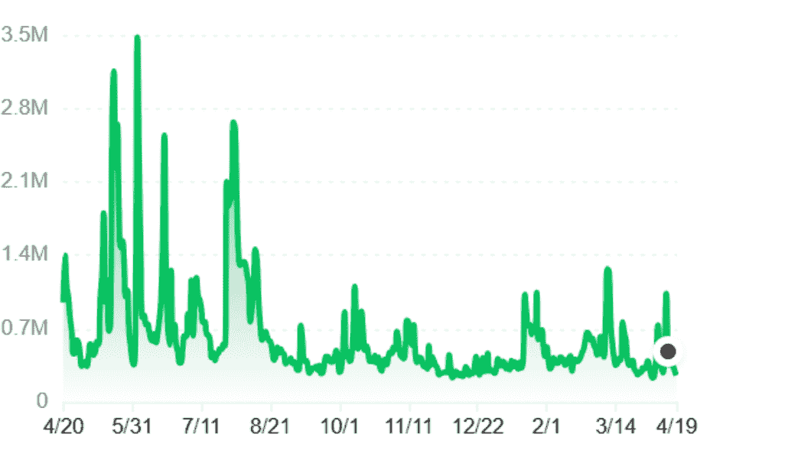

**N8N**  

38,769   

14.25% ▼

+ 添加对比词   

☆已订阅

指数趋势  

i

近7天   

i

近30天   

i

全部   

i

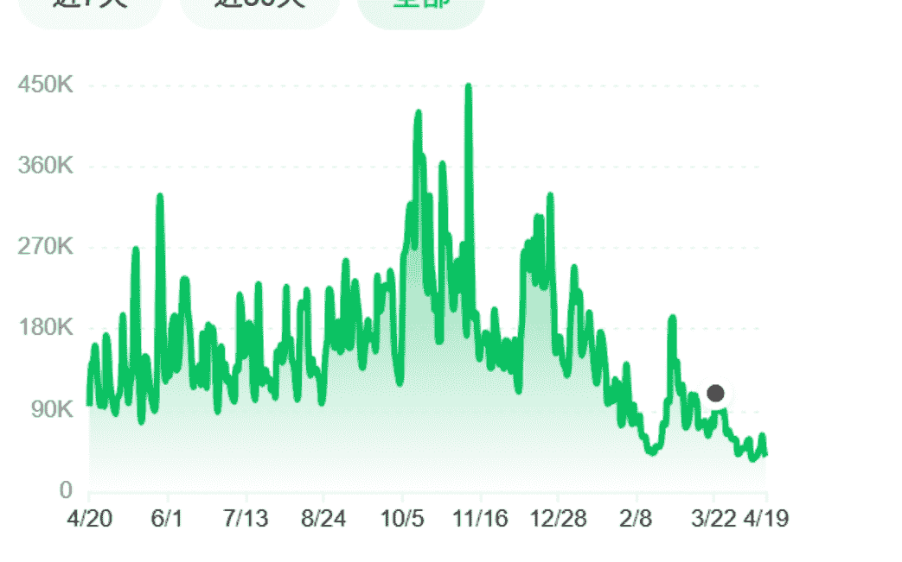

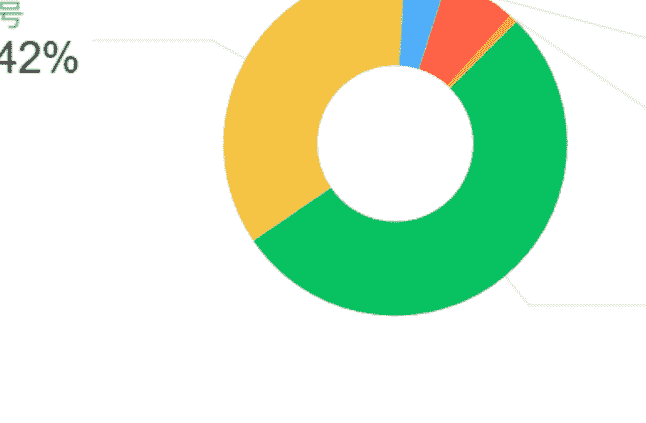

**视频号**   

35.42% 

**搜一搜**   

4.05% 

**直播**   

6.72% 

**其他**   

0.86% 

**公众号**   

52.95% 

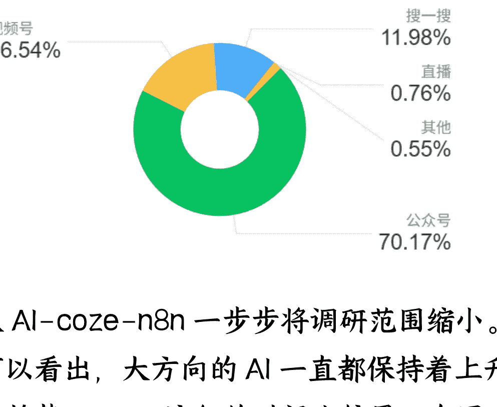

从 AI-coze-n8n 一步步将调研范围缩小。
可以看出，大方向的 AI 一直都保持着上升的趋势，coze 流行的时间比较早，在国内比较流行，视频号占比大，而 N8N 在公众号上占比更大，搜索流占比更大，我们本身也更擅文字，而不是做视频。

## 2. 对标账号

参考垂类小号航海里的模板（[垂直小号选题库](https://www.zhihu.com/question/627943807)），我们汇总了大量的对标账号，观察其文章内容和私域运营主要有以下发现：

- 懂技术的，思维太理工化

这类账号所写的内容全是技术向的：最近发布了什么新技术啊、这个技术怎么用啊、怎么部署啊……

文章开头就是讲技术，里面混杂着大量的代码，排版也非常差，毫无美观可言，一个对技术不了解的人是根本看不下去的。

# 万字干货！Agent Skills从入门到精通
4月13日 赞332

# Lovart这次更新，有点把品牌设计师“锁死”了
星期五 赞58

# Seedance 2.0封了两个月的真人视频，今天终于放开了 | 附实测
4月10日 赞77

# 全程0代码！一句话生成完整互动影游
4月8日 赞69

# Qwen3.6-Plus实测：能力像Claude，价格像拼多多
4月4日 赞67

# 《OpenClaw 从入门到精通指南》正式发布，开源免费！
3月12日 赞564

# 我把微信 cli 开源了，群消息终于不用爬楼了！
4月8日 赞939

# 接入Seedance 2.0后的OiiOii，太让人上头了！
4月7日 赞181

# TRAE SOLO 独立，不止写代码了（附免费码）
4月3日 赞209

# 一个被严重低估的原生 OpenClaw 工具，免费！
4月2日 赞133

# Skills

# Lovart

# LibTV

# Yoroll

# 阿里


# 什么！微信允许接入个人客服了？24小时替自己回答用户简单问题。

2025年9月22日 赞263

# 用Hermes替代了3个工具，直接打通Mac日历+微信+飞书客户档案

今天 赞11

# 小龙虾：记忆丢失、Skill不生效、断线就废——3大痛点1键迁移Hermes全部搞定

星期五 赞13

# 不用花钱找人剪视频，1个平台+3个技能，0剪辑基础也能批量复刻10万赞同款

4月13日 赞27

# Coze 老玩家实测：2.5 这波升级，值得把工作流全部重做一遍

4月10日 赞22

## 01

### 这5个核心员工是谁？

- **大总管 (lead)**：唯一与人在飞书对接的接口，负责需求拆解、调用 `sessions_send` 跨节点分发任务。
- **VOC市场分析师 (voc-analyst)**：全网抓取评价数据，提炼用户痛点与竞品弱点。
- **GEO内容优化师 (geo-optimizer)**：负责亚马逊和独立站内容撰写。
- **Reddit营销专家 (reddit-spec)**：负责执行严格的5周养号SOP。在 r/BuyItForLife、r/SkincareAddiction 等精准版块潜水、互动。
- **TikTok爆款编导 (tiktok-director)**：负责分析TikTok爆款逻辑。

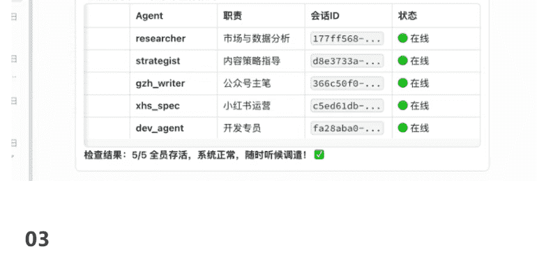

## 03

### 从0到1飞书配置教程

首先，要在本地跑通这套协作，核心在于 OpenClaw 的路由隔离和通信放行。

1. **工作区物理隔离**：每个 Agent 必须有自己独立的 `Workspace`。`voc-analyst` 的市场研报绝不能和 `reddit-spec` 的养号记录混在一个目录里。
2. **多账号长连接路由**：在飞书开放平台建5个独立应用，走 WebSocket 长连接。通过 `openclaw.json` 中的 `bindings` 数组，将飞书的 `accountId` 精准路由到对应的本地 Agent。
3. **A2A底层通信协议**：必须在 `tools.agentToAgent` 中开启白名单，这是让大总管能在后台发号施令的“唯一数据总线”。

接着看具体怎么做。

**步骤一：构建文件结构**

在你的 `~/.openclaw/` 目录下，建立如下结构:

```
~/.openclaw/
├── openclaw.json # 全局路由和通道配置
├── skills/ # 全局技能库（放 nano-banana-pro, seedance2.0 等）
├── workspace-lead/ # 大总管工作区（含 SOUL.md, AGENTS.md）
├── workspace-geo/ # GEO内容优化师工作区
├── workspace-reddit/ # Reddit营销专家工作区
└── workspace-tiktok/ # TikTok爆款编导工作区
```

从评论区里面也可以看出，他们吸引的大多也是同行，很多是过来要代码要案例的、讨论技术迭代的，与我们理想的目标群体不符：中小企业的老板。

紫苏子ACG 美国 4月8日 🐂🍻

七音 广东 4月8日 👍 1
类似工具被封几个号了，谨慎点用吧😂

曦远Code 广东 4月8日 👍
这个 wechat-cli 太赞了，感谢开源🤓

张鹏 山东 4月8日 👍
提示：
已更新到最新版本 0.2.4，但 Windows 二进制包仍然缺失。问题根源：
@canghe_ai/wechat-cli-win32-x64 这个包不存在于 npm registry，所以无论怎么更新都无法解决。

啊Devil啃你... 江苏 4月8日 👍
我乐了，评论区都是我关注的大佬😂

峻菁 湖北 4天前 👍
哪些是大佬，我也要关注关注。

TATALAB 北京 4月8日 👍
牛逼👍👍👍

inono 北京 6天前
都是智慧的精华，感谢分享，读完之后茅塞顿开👍👍👍🙏🙏

笔记同步助手 北京 6天前
试试搭配笔记同步助手插件做obsidian知识库，方便的obsidian剪藏工具，手机上的obsidian助手

Ploars 陕西 6天前
🤩飞书生态也很好 怎么不用飞书

饼干哥哥AGI 作者 6天前
之前有写过飞书版本的是可以更新一版➕飞书cli的，功能互补属于是

曾有范 福建 6天前
非常不错，我去实操下

Roman 广东 3月25日
买到用起来，除了豆包自己家的，其他都是降智，或者限速。豆包自己的模型...唉，做个图可以，做任务...就差把你电脑程序删干净了

hAI 澳大利亚 3月25日
真惨啊

Dd 四川 3月25日
openclaw感觉请求次数特别多，我的lite天天就发个股市早报，20天用了75%

晓强 上海 3月25日
其实你这个是换了个方式 本质还是多智能体 指定模型

Alchemist 河南 3月25日
豆包，慢、笨、没一点好处

LiJian.Mac 上海 3月25日
还有很多细节没写，期待详情🤪

猫来gogogo 安徽 3月25日
请问飞书要建5个机器人吗

- 懂业务的不懂技术，业务还没结合 AI 自动化

这一类账号主要是讲业务认知的，比如选品的核心要点、数据调研怎么做....但比较少涉及到把 AI 自动化结合进业务里面的，整体的市场还处于一个比较早期的状态，而这就是我们的核心突破点。

亚马逊安全运营守则：100条高压红线与防封店指南【6800字长文，收藏阅读~】

阅读 317 赞 7

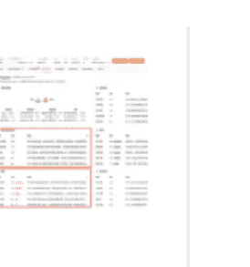

亚马逊选品工具！卖家精灵免费薅羊毛攻略！


星期六

独立站SEO全面优化指南：从0到1打造高排名网站【3500字长文~实操版】

阅读 108 赞 1


星期五

亚马逊关键词库搭建：我是如何30秒拿到5000+流量词的

阅读 360 赞 6

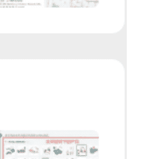

星期四

亚马逊AMC+优麦云广告实战指南：投放精准受众让ACOS减半

阅读 190 赞 2

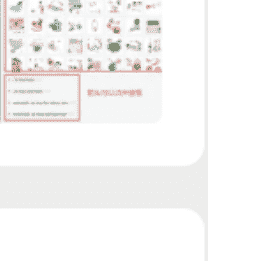

# 分享一个很作弊的TikTok跨境电商选品法
做跨境电商2年多，有一个很明显的感受：**选品**对了是有“推背感”的。经常是标题头图还没来得及优化，还没投广告，就开始咔咔出单了。怎么选到对的品呢？
锡切斯海边的Nemo 12个月前

# 普通女孩从0到20万（4个月）的**选品**秘籍（上）｜搞懂小红书**选品**，看这篇就足够了！
目前正在研究小红书虚拟电商和AI提效，我会在这里毫无保留地分享我的实战思路和踩过的坑。关注我，让我们在这条路上，结伴同行，彼此照亮。hi，你好，... 麦子的成长笔记 6个月前

# 分享我单干 4 年总结的**选品** SOP，或许不够漂亮，但至少能让你少踩坑
之前的分享基本上都是点状的，整个**选品**过程还是从对标竞品的角度（当然，这非常重要，也是我的第一步），但我发现使用之前的方法选出的产品在上架后... 知无不言 10个月前

# 一套可复制的正确**选品**底层逻辑
工具入口：卖家精灵 → 工具 → 选产品 月销量：产品30天的销量月销售额：产品30天的销售总金额子体销量：变体产品中单个子体的销量月销量增长率：过去3... 卖家精灵 6个月前

# 一人做跨境电商，新店第4个月：我在Shopee的9条**选品**思路
以下是我的**选品**思路分享。01 在平台上选择被市场验证过的热销品 我觉得被市场验证过的热销品是相对靠谱的。因为我目前还是新店阶段，平台热销品我也会...

**部分账号沟通流程生硬，私域运营不成熟**
需求沟通全靠硬聊，没有引导话术、没有需求收集表格，要案例没案例，我这里放的案例还是一个每篇文章流量平均 1000+ 的自动化工作流垂类博主。
后面我们会给大家提供一个需求收集表参考。

你好

想定制一个亚马逊选品的工作流

可以描述的具体一些不

3月30日 22:05

怎么描述呢

比如你选品是啥品，数据来自哪里，输入格式是什么，输出格式又是什么

3月30日 22:06

我们希望从亚马逊获取一些爆款商品的数据，比如销量评论等等，然后AI对这些数据分析总结，帮我选出几个好的商品，然后再去1688找货源，最终上架亚马逊

你这一套全部自动化吗》

对的

你那边有做好的类似的案例吗

我们有小红书的，但没做到自动找1688货源，自动上架的，商家自己自带产品的

预算有5位数吗

可以的

小红书的效果可以看看吗

都有用户隐私的，我们不方便给具体的效果给你看。之前他们是做的小红书竹制品类的，自动挖数据->分析->写笔记+发布


这也看不出啥😂😂

我不知道你们能做成什么效果

这个本来用户那边就不能放，所以我才让你具体描述一下啊，最好你直接给我贴截图，或者发视频。我一下就能看出来做不做的了，你文字给我描述，我只能意淫

- 目前主打工作流定制的账号还比较少

我们加了很多所谓工作流定制的博主，从他们朋友圈发的成交案例里，发现他们主要的营收和产品主要还是来自于卖课、训练营、小程序开发、网页端定制、或者是局部的 coze 实现工作流自动化，自动化定制垂类订单的比较少，定制转化率普遍在 1%-5% 之间。

🔥斑码三箭齐发｜2026搞钱必冲「OPC一人公司」全技能服务来了！...

🔥斑码三箭齐发，2026最火的「OPC一人公司」全技能服务来了！...

🔥2026破局新思路：打造你的"AI一人公司”！【OpenClaw实战训练营...

最近被「OpenClaw」刷屏了吧？其实剥开它神奇的表象...

🔥【顶配独享】谷歌 Gemini 3.0 成品号...

牛牛老师这个豆包训练营太棒了，真的是用好豆包，万事不求人呀，下...

昨天

电竞俱乐部双端 App 开发已付 1.2W 专业定制！服务靠谱，欢迎各位老板...

27 4 月

DIY 手串小程序项目 2.8K 开发中🎉🎉🎉 小程序、网站、APP 项目火...

19 4 月

电竞娱乐陪玩项目 5500，经过成员全力配合，项目完成顺利交付🎉🎉🎉...

08 4 月

艺术馆小程序项目 6K 开发中🎉🎉🎉，专业定制，欢迎咨询

03 4 月

做软件开发我们是认真的👊

APP、小程序、网站、...

23 3 月

棒球核销系统小程序开发中，总额 1.6w，是专业定制！服务靠谱，欢迎咨...

18 3 月

陪玩小程序定制开发，

今天
本科 给同学加急做出来了
🙈别被我朋友圈吓跑了
😂价格肯定都是根据具...

30₄月
强化学习二区顺利交付🐧🎉🎉🌹

27₄月
图像分类顺利交付🌹

18₄月
目标跟踪两个创新点顺利交付🌹

11₄月
都说晴西湖不如雨西湖。
难怪暴雨还这么多人😂

10₄月
哈哈哈跟个风~(´▽`~)~

## 3. 最终选择

有了以上的初步调研以后，我们把公众号写作的大方向基本确定了：从业务和认知的角度出发，结合AI自动化的案例，吸引中小企业的老板。

保证老板第一眼看到的不是眼花缭乱的技术，而是老板本身懂的业务，由业务引申到如何将AI技术结合到业务里面去，让老板看到，哦，原来时代已经发展到这种程度了，我们公司也要把AI引入进来。

## 二、活跃账号（2.08-3.08）

| 阶段 | 关键目标 (O) | 关键结果 (KR) | 规划 | 进度 | DRI | 奖励 | 备注 |
| --- | --- | --- | --- | --- | --- | --- | --- |
| 活跃账号(2.08-3.08) | 保持周末发布3~4篇文章 | 1.两个号，每个号至少发1~4篇<br>2.进入流量池：账号每篇稳定流量在300以上 |  | 1.<br/>√<br/>2.<br/>√ | 共 | 出国旅行 |  |
| 完成现在有文章的开头标题+排版发布 |  |  |  | √ | 黄 | 出国旅行 | 参考:<br>1. @nan35N源文件及其他资料（可复制）<br>2、复刻别人公众号内容<br>3、多个工作流互相融合 |
| AI辅助持续挖掘新的工作流 | 持续复现工作流，并撰写技术讲解 | 阶段性任务 | √ | 钟 | 跟爸妈去旅行 | 

**这段时间临近过年，我们的账号也算是起步阶段**，所以核心任务就是**保持账号活跃度**，确保新注册的公众号能够进入流量池，剩下的时间，春节在家好好陪伴家人。

**这里面有几个点可以注意一下：**

- 多个账号同时进行，提高进池的概率：有些新号真的是发几十篇文章都进不了池的
- 保持更新频率：这个就不用说了，我们过年期间还抽空写文章发公众号
- 尽可能从第一篇文章开始就保证高质量内容：不要写垃圾文章、不要全是 AI 生成的内容、排版尽可能美观
- 尽可能把 AI 融入进去：不要说每个步骤都实现自动化，至少在内容创作上一定要用上 AI 吧，就像涛哥说的 LV3（AI 的路人甲阶段）

**我们当时只用了两个新号，最终有一个账号成功进池了。**

其他注意事项可以看航海和别的大佬写的文章，更加详细全面！

## 三、赚到第一块钱（3.08-4.6）

| 阶段 | 关键目标（O） | 关键结果（KR） | 规则 | 进度 | DRI | 奖励 |
| --- | --- | --- | --- | --- | --- | --- |
| 赚到第一块钱<br>（3.08-4.6） | 整理现有3D客户的需求 | 给每位客户整理一份MAP需求拆解 | 3.18前 | √ | 钟 |  |
| 找技术需合作 | 1、3.18前找到1-2个试用<br>2、至少储备5人技术人员 | 阶段性任务 | 1、√<br>2、√ | 钟 |  |
| 写实操类的文章并发布 | 每周1篇<br>1、3.23-3.29<br>2、3.30-4.5 |  | 1、√<br>2、√ | 钟 |  |
| 收集案例 | 1、公众号案例 2、case案例 | 持续性任务 | √ | 钟 |  |
| 形成客户、技术需求模板 | 整理成飞书模板 |  | √ | 钟 |  |
| 掌握售后和技术交付的能力 | 跑通一次典型的技术交付和运维一次售后 |  | √ | 钟 |  |
| 借助AI总结目前采上主流的AI工具 | 写一份总结性文档 |  | √ | 钟 |  |
| 掌握了解用户需求的能力 | 做一个需求收集模版，形成对接SOP | 持续性任务 | √ | 赏 |  |
| 学习了解电商行业知识 |  |  | √ | 赏 |  |
| 梳理私域成交业务流程 | 形成一份SOP及话术 |  | √ | 赏 |  |
| 学习引流和转化 | 达成引流100人以上，至少转化1人 |  | √ | 赏 |  |
| 总结被拒绝的原因 |  | 持续性任务 | √ | 共 |  |
| 总结文章写法、引流沟通转化率低原因 |  | 阶段性任务 | √ | 共 | 去跑项目 |
| 发文章，保持每周2-3篇 | 实现单篇流量破5000 |  | √ | 共 |  |
| 出单 | 赚到第一块钱 |  | √ | 共 |  |

在李笑来老师的《财富自由之路》里面提到了一个观点：人生和做事，呈现出指数函数的趋势。在触及爆发点之后，才会呈现出指数级增长。

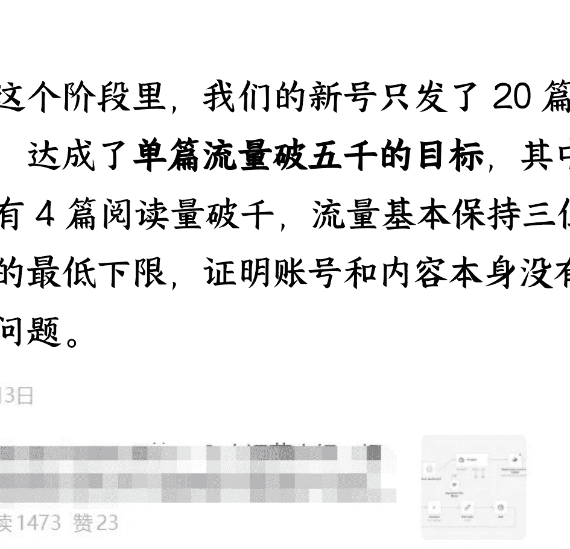

在这个阶段里，我们的新号只发了 20 篇文章，达成了单篇流量破五千的目标，其中还有 4 篇阅读量破千，流量基本保持三位数的最低下限，证明账号和内容本身没有大问题。

## 流量分析

| 指标 | 阅读 | 分享 | 跳转原文 | 收藏 |
| :--- | :--- | :--- | :--- | :--- |
| **范围** | 近7日 | 近30日 | 自定义 | - |
| **时间** | 2026/02/05 — 2026/04/05 | - | - | - |
| **渠道** | 全部 | - | - | - |

**数据趋势**

阅读总人数：21390

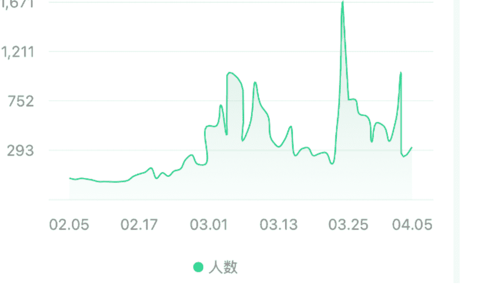

一篇 5000+阅读量的文章，就可以带来上百个精准客户，后续的长尾流量也持续会让客户加微信咨询。

## 新的朋友

姜治国 King@跨境
n8n流程分享

已添加

JARHEAD
电商工作流方案咨询

已添加

许政
我是许政 n8n

已添加

梦雨
我是梦雨

已添加

叶可盛
体验N8N

已添加

行者
我是行者

已添加

Ellen Fu🌻熠坤
我是🌻Ellen Fu🌻熠坤

已添加

JIM
我是 JIM

已添加

三疆牧羊® | 胡子福
我是三疆牧羊® | 胡子福

已添加

杨中华🌟Kazaf🌈🌈
定制电商做图自动流程

已添加

罗龙虎
我是罗龙虎

已添加

余
我是余

已添加

## 公众号懒人搜索，懒人专属群分享

22:31 
5G 59%
<
新的朋友
添加朋友
三天前
#彧
我是#彧
已添加
泉仔
我是粉丝，需要 n8n json。
已添加
Richie佃礼权
我是 Richie 佃礼权
已添加
Jack chen
我是 Jack chen
已添加
飞飞
我是飞飞
已添加
晓栋
电商生图
已添加
梅丹
您好，我是梅丹
已添加
楊昕
我是楊昕
已添加
刘洋
我是刘洋
已添加
叶梓佳
我是叶梓佳
已添加
尋信者 :)
我是尋信者 :)
已添加
清风
我是清风
已添加

**最重要的是，赚到了第一块钱，接了三个订单（其中有个单出现了违约......），盈利 3000+，以上都是在这一个月里发生的，我们似乎触碰到了增长的触发点。**


*4 周六*
网转 +3,000.00

## 自动化部署 (3)

昨天 23:43

👍👍👍

昨天 23:43

可以的老板

昨天 23:43

费用明
天一早安排可以吧

昨天 23:43

按之前说的 399 就好了

还有需求的话找我们，还是优惠价给您

06:56

👌👌👌

06:54

¥399.00
已被接收
转账

08:54

你有一笔待接收的转账

15:59

¥399.00
已收款
转账

收到，合作愉快🤝🤝

16:34

很愉快的一次合作☕👍

期待后续进一步合作

太耽误时间了

@n... 
实在不好意思老板🙏🙏

多了

我们违约多了几天，按合同给您多退...

### 1.方向调整

刚开始我们是打算掌握自动化基本的技术，去接一些相对简单的定制商单，但后来发现，这个思路并不是最优解，也不适合我们：

- 我们不是技术出身，学习成本太高：复杂的工作流定制只用 n8n 等低代码平台根本无法实现，还需用到纯代码编程，甚至是网页封装。
- 技术迭代过快：刚把 n8n 学会了，小龙虾就发布了，人学习技能的速度永远更不上技术本身的迭代，反而通用的底层能力才有迁移性。
- 每个人的产能和产出有限：一个人在阶段时间内只能接一单，无法做到一份时间售卖多次，复利效率极低。

那有没有一种更好的思路呢，我们看了几篇生财的文章后，决定调整方向：做技术与客户的中间商。

这样一来，我们的重心就从技术定制转换成了获客 + 需求收集 + 串联技术服务方。

获客就是如何把公众号的内容和流量做好，需求收集重点在于私域运营，技术服务商必须要找到靠谱的。

## 2.技术方找寻

我们把闲鱼、淘宝等平台上关于 n8n、工作流定制的商家基本都找了个遍，还用多套相同的需求测试了不同商家的报价，发现这个市场还是非常的混沌。

同样的需求，有人报价 2000，也有人报价 20000，在定制的服务上，不存在一个相对统一的衡量标准。

**但这也让利润有了自由把控的空间，如果谈得很好，80%的利润率都是很正常的。**


| 模块序号 | 功能模块名称 | 核心功能说明 |
| :--- | :--- | :--- |
| 1 | 选品需求自动归集 | 支持「客户提报 URL / 图片」 「内部主动选品」双入口，自动汇总整理所有选品需求，无需人工手动统计归集 |
| 2 | 多平台商品信息批量抓取 | 自动对接 1688、淘宝等主流平台，批量抓取商品名称、详情、单价、主图、视频、客户评价、销售量等全量信息，自动过滤广告、冗余内容 |
| 3 | 商品数据标准化处理 | 自动把不同平台的商品数据统一格式（需提供参考）、清洗整理，适配跨境自有平台的发布规范 |
| 4 | 商品数据存储至飞书 | 按格式要求自动存储数据至飞书 |
| 5 | 商品分析 | 商品内容分析（需提供参考） |

**已读**

你好，这个需求能做吗，能做的话报价多少？

3月21日 18:22

**软件开发工作室**

你好

**软件开发工作室**

用 n8n搭建吗

**已读**

对的

**软件开发工作室**

像这种定制在 **3w左右**

| 模块序号 | 功能模块名称 | 核心功能说明 |
| :--- | :--- | :--- |
| 1 | 选品需求自动归集 | 支持「客户提报 URL / 图片」「内部主动选品」双入口，自动汇总整理所有选品需求，无需人工手动统计归集 |
| 2 | 多平台商品信息批量抓取 | 自动对接 1688、淘宝等主流平台，批量抓取商品名称、详情、单价、主图、视频、客户评价、销售量等全量信息，自动过滤广告、冗余内容 |
| 3 | 商品数据标准化处理 | 自动把不同平台的商品数据统一格式（需提供参考）、清洗整理，适配跨境自有平台的发布规范 |
| 4 | 商品数据存储至飞书 | 按格式要求自动存储数据至飞书 |
| 5 | 商品分析 | 商品内容分析（需提供参考） |

已读

你好，这个需求能做吗，能做的话报价多少？

已读

知柿科技

你这个需求有点大 价格不会低于

**8000**

安全提醒：脱离淘宝交易可能面临被骗或者信息泄露的风险，请务必在淘宝内完成所有的沟通及交易！

抓数据不要用爬虫

已读

知柿科技

需要的

| 模块序号 | 功能模块名称 | 核心功能说明 |
| :--- | :--- | :--- |
| 1 | 选品需求自动归集 | 支持「客户提报 URL / 图片」「内部主动选品」双入口，自动汇总整理所有选品需求，无需人工手动统计归集 |
| 2 | 多平台商品信息批量抓取 | 自动对接 1688、淘宝等主流平台，批量抓取商品名称、详情、单价、主图、视频、客户评价、销售量等全量信息，自动过滤广告、冗余内容 |
| 3 | 商品数据标准化处理 | 自动把不同平台的商品数据统一格式（需提供参考）、清洗整理，适配跨境自有平台的发布规范 |
| 4 | 商品数据存储至飞书 | 按格式要求自动存储数据至飞书 |
| 5 | 商品分析 | 商品内容分析（需提供参考） |

**最终我们再结合生财社群、n8n等技术社群，链接了数十个技术服务方，并且根据客服回复的态度和报价合理性给不同的技术进行评级分层。**

AIY2科技（技术方）

piano（生财技术）

阿东来哉（技术方A）

陈辉（生财技术）

软件定制（技术方）

楚漫CMAJ（n8n技术方）

黄小木（生财技术方）

小飞侠（生财技术方）

每天笑哈哈（n8n技术方）

折扇书生（生财技术方）

### 3.流程优化

整个完整的闭环流程主要有以下几项：文章发布 - 引流私域 - 需求沟通 - 技术协调 - 签订合同 - 开发交付。

其中，需求沟通和技术协调是最重要的，
如何把客户的需求精准收集，并且把需求
与技术串联出方案，这个步骤我们踩了很多坑，流失了不少客户。

刚开始我们也是口头上跟客户硬聊，发现
这种方式颗粒度还是很难对齐，聊完还得
重新整合给技术对接，非常麻烦。

好一点的我们会说跟客户语音电话沟通，
详细了解流程和需求，甚至直接把技术拉
上一起开腾讯会议，但这样没有成交的
话，非常消耗技术方的耐心，他们开两次
会没成交就不想来了。

所以，根据以上的痛点，我们重新对这个
环节进行了优化：

有定制意向的客户填写需求收集表 - 将收集
表发送给技术方 - 技术方仅需提供报价和交
期 - 客户接受报价和交期 - 双方需求确认 -
签订合同交定金 - 会议详细沟通流程和技术
细节 - 开发交付

用收集表降低沟通成本，用交期和报价确
认 pass 非目标客户，用会议统一拉拢客
户和技术沟通细节。

这里向大家分享我们优化过的需求收集
表，包含价格、交期、需求细节等信息的
收集。需求收集表_副本、

## 在双方需求确认时，我们会大致评估技术难点 - 向客户提前告知风险项 - 并提供一份需求确认书。用一份电商图自动化定制的案例来给大家展示。

### 二、业务流程拆解（4个步骤）

订群信息表定制保存 → 匹配衣服款式 → AI生成效果图 → 确认归档

| 步骤 | 需求 | 优先级 | 当前痛点 |
| :--- | :--- | :--- | :--- |
| 1、信息对接收集 | 自动从钉钉群采集定制信息并校验 | 高 | 人工信息采集，易出错 |
| 2、款式匹配 | 根据信息自动匹配合产品款式 | 中 | 人工耗时匹配 |
| 3、AI出图 | 根据定制要求生成预览效果图 | 高 | 依赖美工用PS手动出图，耗时长 |
| 4、信息归档 | 确认图片归档管理 | 低 | 手动整理 |

### 难点1：钉群信息自动采集（难度：🔥🔥🔥）

- **问题**：钉钉对接平台对接消息监听有严格限制，需要企业内部分应用权限
- **原因**：客户聊天信息格式不统一（自然语言描述定制需求），需要NLP解析
- **痛点**：钉钉AI群主功能可能影响开发周期

### 难点2：AI精准出图（难度：🔥🔥🔥🔥🔥——最大难点）

- **原因**：客户需要“准确无误”的定制效果图，这对 AI 图像生成要求极高
- **痛点**：
    - 很难定制涉及具体款式 + 具体颜色+Logo/图案精准定位。当前 AI 生图（Stable Diffusion、DALL-E、Midjourney）在精确控制方面仍有局限
    - Logo需要单独，不同场合和风格对 logo 特定位置（胸口、袖子等），这不是简单的文字能解决的
    - 不能面料，不同角度的效果模拟需要大量精力
- **核心矛盾**：客户期望“文字描述 + 精准出图”，但现有 AI 技术在精确商业场景下的可靠性不够

### 难点3：产品库匹配（难度：🔥）

- **原因**：需要建立结构化的产品数据库（款式、颜色、尺码、可定制区域等）
- **痛点**：已经能够相对简单，便于单点开发

### 难点4：Logo转PNG（难度：🔥）

- **原因**：成熟方案很多（rembg去背景等），难度低

| 方案 | 可行性 | 效果预期 | 说明 |
| :--- | :--- | :--- | :--- |
| 纯 AI 生成图 | ❌不可行 | 无法满足“准确无误”+ | 生成结果不可控，商业场景不可接受 |
| 模型合成+AI辅助（推荐） | ✅高度可行 | 70%+准确率 | 控制服装版型 + 图像合成，AI 辅助裁剪 |
| 全自动化做到级 | ⚠️有可能 | 7-15天内难以完成 | 钉钉集成+AI出图+归档，工程量巨大


# 还有个一定要注意的点：能签合同签合同，能走平台走平台，尽可能用法律效益去保障自己的权益。

因为我们第一单就遇到了技术方装死的情况，搞得我们还给客户赔了违约金，最终我们把这个技术方提交给法院了。所以，靠谱的技术方是难得的，我们还需要不断找寻。


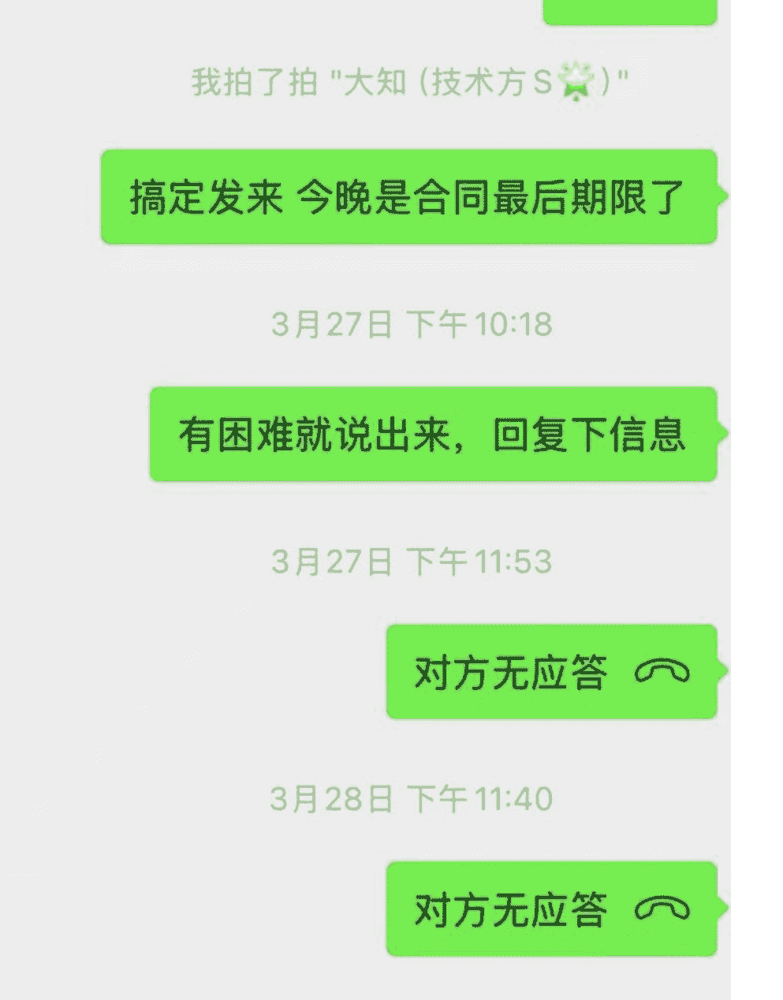

公众号懒人搜索，懒人专属群分享

21:58 5G 42

< 小橘 AI 智能体 会员名：x***5 百次好评 ...

¥9.00 含运费 0.00元 立即购买 江西·南昌

① 由于对方设置，你无法与 ta 进行对话

已读

已读

想跟 TA 说点什么...

34 / 50

4"

兄弟，我不跟你废话，你直接等着收那律师函就行了。

3月29日 下午7:05

已过期
转账

6"

你去看看合同上面怎么写的啊，
你这转给谁呢？

8"

我不跟你废话，我不要你的钱，
你就等着收律师函就行了，兄弟，别他妈在这搞了。

戴智超技术合同纠纷
待审核

一案

案件类型
民事一审案件

参与人
原告：
被告：戴

案由
技术合同纠纷

立案法院
深圳市龙华区人民法院

申请时间
2026-03-30

立案申请撤回 | 复制立案 | 案件空间

### 4.期间的发现

- **定制现状：**转化率、价格问题

目前我们跟这么多客户接触下来，对于小公司、个人工作室、个体创业者，等小微群体来说，自动化定制有需求，但很多时候并不是硬需求，意思就是他们不太愿意花太多钱去尝试一个相对未知的东西。

非标的定制，在刚开始沟通的时候，没法给他们展示最终效果，顶多只是用口头上的表述，但这也是个未知的东西。

这类客户，他们对于价格也比较敏感，不管技术难度如何，他们大致能接受的价格区间在 5K 以下，再往上走都不太愿意试错（但也可能是我们信任基础和案例不够充足的原因）。

所以，可能最终转化率只有 1-5%，我不知道这个数字是否合理，但是问了几个同行，他们也说转化率不高。

# - 沟通成本很高

作为中间商，最花时间的就是私信沟通，微信加过了没有及时通过，会流失客户；客户发的信息没有及时回复，也会流失。所以，信息要及时回，并且还要有一套对应的话术，引导客户按照我们的既定流程来走，不要互相耽误时间。

# - 搭建信任基础

对于定制化且相对高客单的产品，客户对你没有一定的信任基础是不可能成交的，

**而信任基础最直接的来源就是朋友圈，而朋友圈的核心是案例。**

**什么才是有效的案例？**交付的产品展示、交付的过程展示、客户的沟通过程展示等等，尽可能让客户看你的朋友圈能感觉到：**你有真实的成交、有靠谱的售后保障**，不只是嘴上说说。

因为，客户最担心的主要就是两个问题：一个是你能不能把他需求的效果做出来，另一个是你的售后保障靠不靠谱。

> **Microwave oven**
> HMW use...trust .doc
> 300KB 已过期

> 拿到一本这样的说明书，然后先用 AI 将其里面的英语全部检查一次，修正错误的语法或者错误的用词。然后，将这个 WORD 文档里面的内容，转到一个叫 Indesign 的软件里面，套用我们特定要求的设计模版，然后在 Indesign 里面直接将其翻译成多国语言，再调整因为翻译产生的其他语言的排版错误，你看是否可以？

> 甚至有时我们一开始投喂的并不是一个 WORD 文档，是一个转曲之后的 PDF 英文版说明书。AI 做检阅的时候需要从说明书里面理解怎么使用这个说明书里面的家电产品，再将说明书的内容重塑一次。

> 在技术层面，我这个需求能不能实现

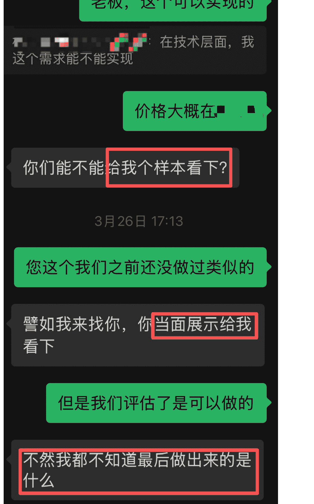

"你怎么保证最终能做出我想要的效果？" "如果后续我不会用怎么办？" "你们的售后保障多久，可以帮我们调试吗？"

以上这些，都是我们在跟客户沟通时被问得最多的问题。

那如何保障客户的诉求和售后问题呢？最直接的：走平台或者签合同。

在合同里面写清楚要交付的结果有哪几项、交付周期是多久、违约怎么办、售后保障多少天，尽可能写清楚，双方确认需求以后再进行开发，定期跟客户汇报开发进度。

另一个方法就是，你手上要有足够多的案例，如果能拿出类似的案例给客户展示的话，成交率也会大大提升。

# 四、一些浅薄的看法

## 1.自动化定制服务的未来方向

在和足够多客户交涉以后，就会发现沟通成本非常高、后期的维护保障成本也非常高，在自动化定制服务的选择上，后期一定是往高客单深度定制或者把高需求的做成标准化来进行交付，这样才能覆盖沟通成本和减少后期维护的时间。

特别在电商生图的自动化定制上，已经有不少人封装成一个标品来交付。每次根据不同的需求，针对微调里面的节点和流程就变成了一个定制化的标品，甚至能达到当天交付。

做成标品的另一个好处是：可以在前期沟通的时候，直接给客户演示大致的效果。

对于定制化的服务，有参考效果能大大提高成交率，打消客户的顾虑。

下面分别是电商服装和饰品生图的两个案例：

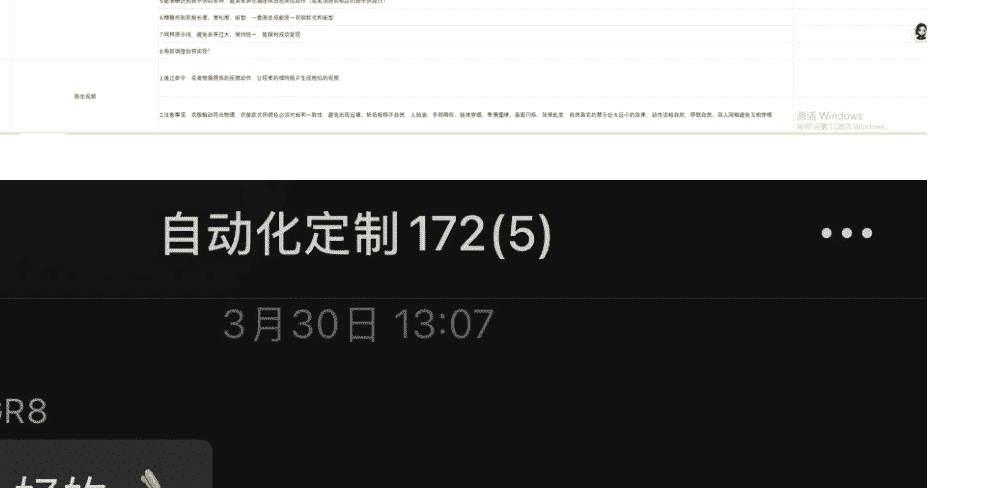


## 自动化定制 172(5)

Su

还有一种是：保留我原有这种素材姿势和造型，男女站队，背景统一，脚底光影自然


Su

造型和姿势不变，纯粹拼图，其他自然融合

3月30日 14:16

GR8

可以的，通过提示词描述

Su

好的

Su

其实这些都只要一个工作流可以了吧？只要提示词更改都能实现吧

GR8

[对的，具体今晚展示]

我帮您测一下效果图

可以帮您测三张图

4月13日 14:31

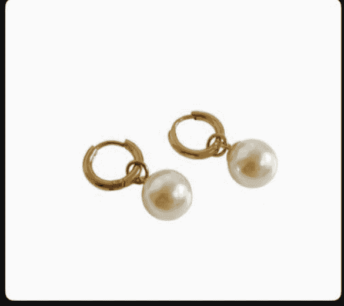

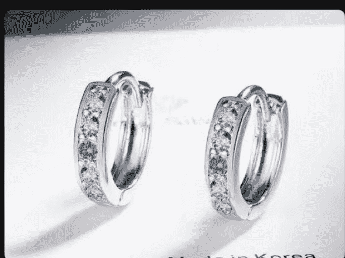

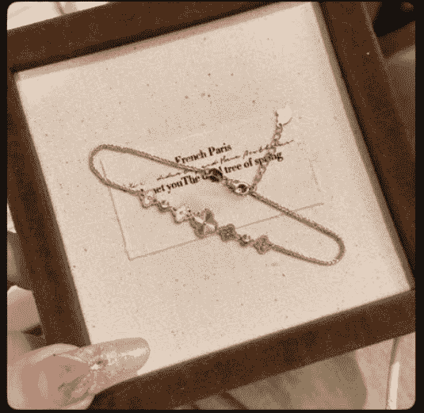


## 2.做垂类，做好一个行业

我们现在的账号虽说流量还行，私域也持续有人过来咨询，但是，由于我们发的文

章所涉及的领域还比较泛，有电商的、有生图的、有公众号的、有各种不同领域的工作流，以至于引流的客户也来自不同行业。

这时，就会碰到一个问题：我们电商只懂一点，生图只懂一点，公众号也只懂一点，我们没法理解客户这个流程的具体需求，我们不知道客户描述的流程要怎么实现。

比如，有的客户说，我要定制选品的工作流，从亚马逊采集销量、评论等数据，并用 AI 分析，得出结果到 1688 等平台选品……最终得出最优产品上架到亚马逊等平台。

### 2.1 智能化选品流程

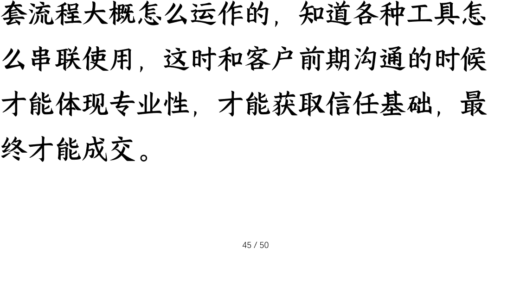

如果可以的话，选择一个高需求的行业，持续深耕，公域里所发的文章、朋友圈展示的案例，都做成垂类，这或许是更好的路径。

## 3. 持续学习是破解一切恐慌的唯一正解

在这几个月里，我们最大的恐慌是技术的恐慌。25 年流行 n8n，26 年变成了小龙虾、Claude code，25 年 banana，26 年又变成了 GPT image2...

你会发现，技术的迭代速度太快太快了，刚把一项技能学会，马上又出了一个新的 AI 模型，这时，你又要从头去学习一个新的东西，感觉是一条无休止的道路......

但是，当你有一点勇气，踏出学习新技术的一小步的时候，就会发现：哎，其实这项新技术没有想象中的困难啊。

甚至，未来的新技术新模型，所需要的学习成本会越来越低，所需要的学习时间也会越来越短。从最初的纯代码编程，到 RPA、n8n；从用 GPT 辅助写代码编程，到现在用自然语言就能通过 Claude code 编写 skills，每一次的技术迭代，都让学习成本和难度指数级下降。

所以，与其顾虑未来，不如现在就开始行动！

## 五、一些疑惑，需求助

### 1. 深耕领域的选择

目前我们在公众号自动化工作流、电商作图工作流、电商选品工作流这三个方向上都有不少客户咨询，但受限于我们对这三个板块都不是很了解，特别是电商相关的板块，具体的流程我们自身都没有去实操过，现在的工作也和这几个板块没有关联性。

这就会导致，我们只清楚电商里面大致有哪些板块，在跟客户交流起来很多时候也没法清晰理解对方的具体需求，所以很多订单都能成交，卡在了沟通这一步。

针对这个问题，我们能想到的就是尽快换掉现有的工作，先让肉身和工作入行，然后才能接触到本行业相关的资源和信息。

当然，更理想的状况是，有这方面的老板，愿意让我们投入进去学习，然后结合我们对业务流程和技术的理解，帮老板解决问题，互相成就。

我们目前能想到的就是电商和公众号这两个领域的需求，是否还有别的领域存在工作流繁琐，急需融入 AI 自动化的需求呢，希望大家可以一起讨论提供一些灵感！

最近也去拜访了一个主做电商服装出图的朋友，他们现在主要仍然依靠实拍，特别是涉及到人物模特的服装图，品牌稍大些的客户，基本都是要求实拍。因为 AI 生图在这方面会涉及到两个问题：一个是人物肖像版权问题，另一个是服装细节问题。

对于模特肖像，AI 生成的人物是否具有版权，如果肖像涉及到侵权如何处理，大一些的品牌都不敢去冒这个险，依然追求实拍。

对于服装出图，首要的需求就是保证图片里的服装和买家拿到手以后的实物两者对的上，AI 生成的服装图仍然会存在一定的不稳定性，搞不好就把服装的细节修改了。

以上是我们在 AI 电商服装板块碰到的一些问题，不知道是否有比较好的解决方法，或者说这些都是我们瞎操心。

前面说了这么多，其实我们现在还是挺迷茫的，一时竟不知该往哪里发力，到底该往哪个领域深耕？要不要做标品？现在我们的流量也没之前稳定，那我们重点是先做好流量还是关注如何提高转化率？

要不要立马辞职全身心出来把这件事做好？不然感觉总是不温不火的，所干的工作也跟 AI 没有半点联系。

碍于我们自身的认知不够，以上的问题都在深深困扰着我们，我不知道该如何抉择。

这是一篇分享帖，更是一篇求助帖！快三年了，我们都在埋头苦干独自摸索，局限在自己的小圈子里，没有对外打开自己，也没有所谓的“师傅领入行”，也就到不了“修行在个人”。

所以，我愿把尽可能多的细节，尽可能多的信息都分享出来，只为换取大佬们的一丝指点，哪怕一句话也好。

希望我们的真诚、活力、执行力、不甘心能被看见和肯定，谢谢大家看到能这里！

————分割线————

看完这篇 SOP，你觉得你懂了。但 90% 的人一到实操就会卡在第一步。

工具和教程只是最低级的壁垒，真正的壁垒是“立刻动手”和“圈层信息差”。

如果你想看全网最新的变现玩法，并且和一群执行力极强的极客一起下场拿结果，欢迎围观我的核心私域：【懒人专属群】。

我们不聊虚的，只做商业闭环的拆解与 AI 效率的压榨。系统内已沉淀 1000+ 跑通的套利实战局。

👉 查阅圈子完整数字资产与上车门槛：
https://lazyso.com/insider/


备注：【实操上车】，不闲聊