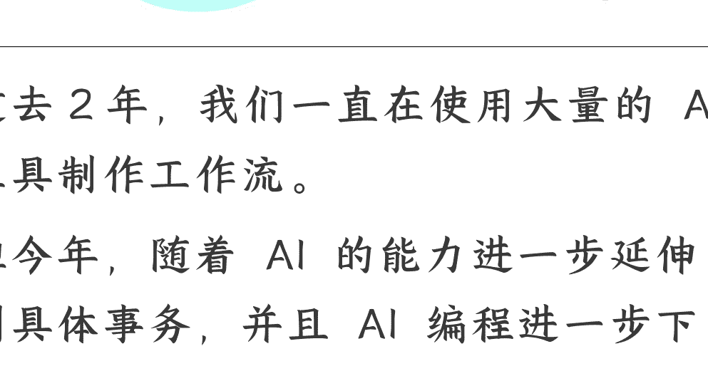
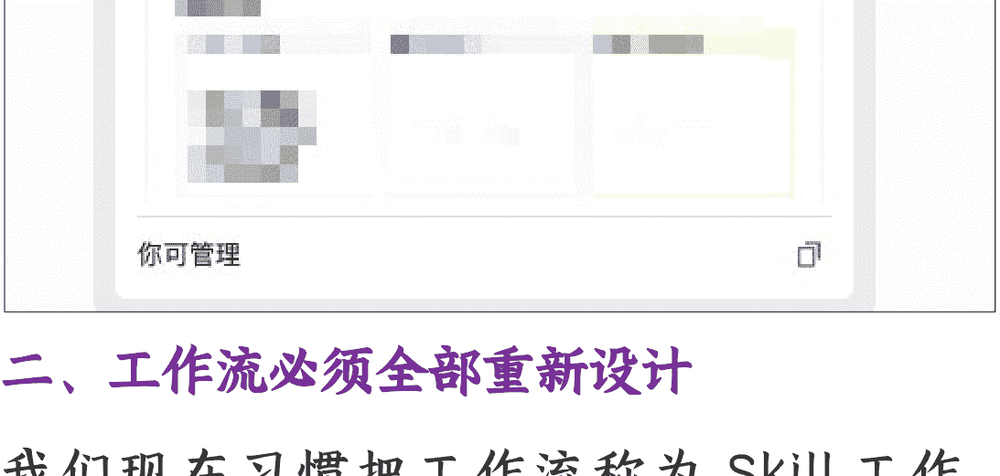
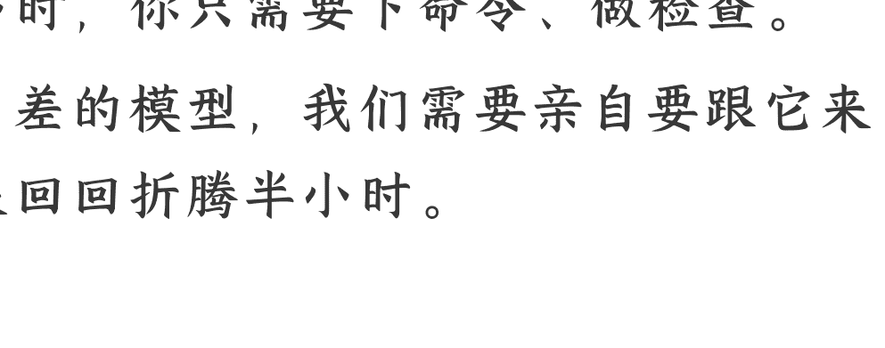
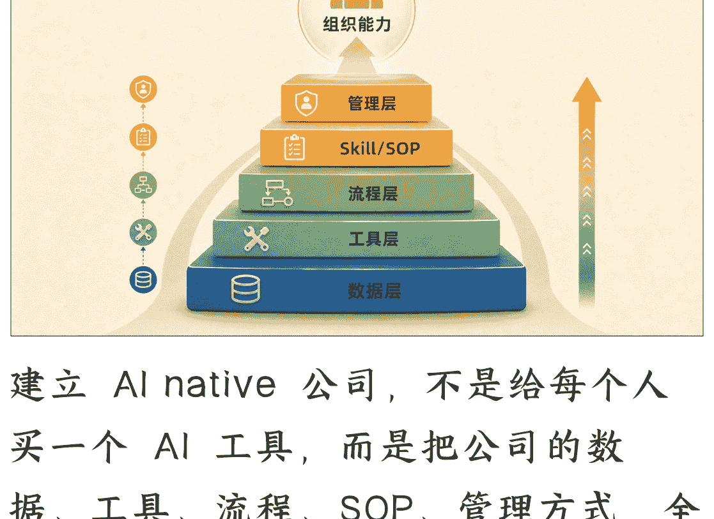
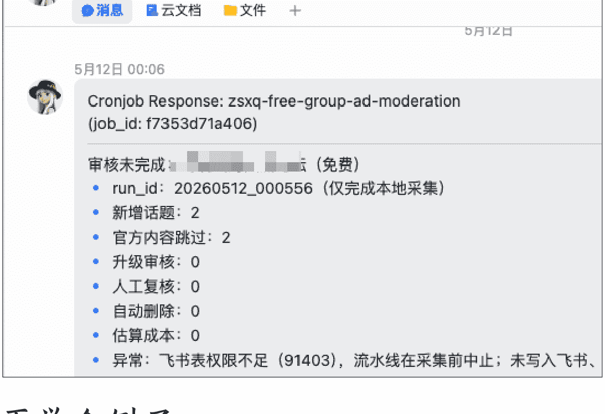

# 小团队如何建立 AI native 公司？我的 9 点建议

260518 副业 SC 精华
整理：公众号懒人搜索，[懒人专属群](https://t.cn/xxxx)精选
懒人微信：lazyhelperl

过去 2 年，我们一直在使用大量的 AI 工具制作工作流。

但今年，随着 AI 的能力进一步延伸到具体事务，并且 AI 编程进一步下放到普通人之后，我意识到组织的价值其实更大。

以下是我的关于建立 AI native 公司（或者叫做 AI 原生公司、AI first 公司）一些实操和感受和分享。

## 一、工具其实越少越好

飞书 + Codex + Workbuddy + OpenRouter，这就是我们团队的 AI 最简配置。

**数据沉淀：飞书。**但每个人必须开通飞书 CLI，这样 AI 能自由读取飞书的文档和表格。

**编程和 AI 工具：**Codex 一个就够了，每人开 100 美元的套餐，不够再开 200 美元。

**中文内容写作：**Workbuddy。因为 DeepSeek 和 Kimi 在中文内容上确实不错，而 Workbuddy 的好处是可以自由切换模型。

如果你有批量调用 AI 的需求，再加一个 Open Router 的 API。可以自由切换各种模型去批量化生产内容、审核内容，举例子来说，用 GPTImage-2 的模型来做图，用 Gemini 模型来检查图片效果，作为质检环节。

而且还要思考能不能减少工具或者减少动作，因为越少的工具，越熟练，习惯越好。

比如以前开会我们用飞书，但飞书不支持自动会议总结，我们就再开个豆包在旁边记录。

但是后来飞书支持了，会议结束自动生成。

## 二、工作流必须全部重新设计

我们现在习惯把工作流称为 Skill 工作流。

在团队内，为了更好地理解 Skill，我一般让大家把 skill 理解成一份好的 SOP 文档。

问题是，AI 出现之前 SOP 文档就存在了，但大多数公司是什么情况？要么没人做 SOP，要么做了没人执行，要么执行了没人更新。

所以一个好 SOP 必须符合两个标准：有人更新，且有人按它执行。缺一不可。

回到 Skills 改造工作流的问题，最重要的一点：工作流要全部重新设计。不是在一个节点里塞进一个 AI 就完事了，而是重头设计彻底重构。

如果你只是在工作的某个环节加一个 AI 节点，然后把它打包成一个 Skill，它大概率不会被更新。人用一下觉得麻烦、没意义，就不用了；或者觉得还不如自己点两下搞定，AI 做还会犯错——做了 5 分钟，发现问题再改 10 分钟，我自己做 5 分钟就行了。

这就是工作流里加入 AI 最大的问题。

怎么解决？让这条流程离开 AI 就彻底没法做。

举例子。主管跟我说，把每周排班表交给助理做。

我说很好，但你必须这样设计：

- 把每个人员的特点、需求，以及排班的过往经验写成一个文档。
- 让助理把文档丢到 Workbuddy 里生成排班表。
- 最后生成一个 HTML，截图发群里。

核心点来了：必须强制助理用这个 Skills 工作流来生成排班表。不能说为了简单，把上次的复制一下随便改改。只有让这个节点缺了 AI 就没法做，大家才会去推行、去迭代。

### 三、为什么用 Codex？

用 Codex 一个人一个月可能花 100 到 200 美元。

**Codex：把工作流交给代理执行**
但换个角度算：做一个 Skill，用 Codex 可能 5 分钟就搞定了——甚至不用 5 分钟。因为 Codex 可以自己运行 1 到 2 个小时，你只需要下命令、做检查。用差的模型，我们需要亲自要跟它来来回回折腾半小时。

5 分钟和半小时，差的这 25 分钟也是成本？时间成本是最容易被忽略的成本，因为是隐形的。

还有第二点更重要。新人用 AI，结果发现 AI 这么笨，一个事情都做不好，他就会抵触。从更大层面讲，影响了整个公司的 AI 化改革。另一层的隐性成本——对氛围的影响。我们很容易习惯只看到明面上的钱，看不到后面的东西。

所以团队付费飞书的账号，从长远来看，也是性价比很高的事情，虽然我也纠结了很久。

## 四、方法的方法

要建立“方法的方法”这个概念。什么意思？比如让 AI 做一张电商主图，得先回答：好的电商主图标准是什么？AI 可能找出一堆标准，但标准从哪来？再具体一点。我们用 AI 分析 Shopee 上的广告，AI 可能找一堆资料告诉你该怎么改。但平台的算法经常变化。AI 找的资料是从平台官方来的，还是第三方博主来的？第三方博主的信息有新有旧，侧重点不同，有的优质，有的就是 AI 拼凑的。

- 所以用 AI 调整广告之前，前面必须先回答：标准是什么？
- 如果是采纳别人的标准，来源可靠吗？和当下的阶段匹配吗？
- 产品在什么阶段？新品期还是老品期？广告策略可能完全不同。
- 目的是什么？推销售额还是拉 ROI？目标不同，策略就完全不同。

这叫方法的方法——做事之前，先搞清楚思路。思路搞不清楚，一切都只是在错误的路上狂奔。

## 五、做 Skills 的标准流程

做一个 Skills，标准流程应该是：

- 。有没有现成的 Skills 可以直接用？
- 。如果没有，有没有现成的开源工具可以打包成 Skills？
- 。如果上面的都没有，或者现有工具只满足一半——能不能在它的基础上改？
- 。如果这些都实现不了，动手之前先确定方法论，再来做 Skills。

这跟上一条是挂钩的：找方法论的时候，先判断它是不是你想要的、你需要的，而不是一个过时的方法论。很多方法论可能正好相反，这个时候就需要个人的判断力。

## 六、AI Native 公司的五层结构

建立 AI native 公司，不是给每个人买一个 AI 工具，而是把公司的数据、工具、流程、SOP、管理方式，全部改造成 AI 可以参与执行的系统。

- **第一层：数据层。**把数据沉淀到云端，让 AI 能读到上下文。
- **第二层：工具层。**减少前台工具入口，但增加后台 API/MCP 连接。
- **第三层：流程层。**把高频重复工作改造成 AI-first 工作流。
- **第四层：Skill/SOP 层。**把每个工作流沉淀成 Skill，明确 owner、输入、输出、检查标准和更新机制，同时注意一定要有质检或者评估的环节。
- **第五层：管理层。**默认先系统扩容，再考虑加人。

真正的 AI native 不是某个员工会用 AI，而是公司里的流程离开 AI 会明显变慢、变贵、变得不可复制。

## 七、核心：培养 AI 习惯

语音输入，这就是个小事。但是要鼓励大家使用。手机端用豆包输入法，电脑端也可以用豆包，Typeless、闪电说等等。这张图是我用 Hermes 每天帮我看下我的一个免费的知识星球是否有人打广告，有的话自动踢出去并拉黑。

再举个例子。以前我们每天要统计社媒数据和订单数据，那就想：能不能用 API 拉？如果没有 API，我能不能用 AI 的浏览器能力，直接从浏览器层面去获取数据？或者 RPA？即使是发布这么个简单的动作，也得想，能不能每周自动统计、自动发，而不是让人来发？

还有一个核心：要鼓励大家用各种 AI 工具来代替现有的工具。比如现在我就反对大家用 Canva、稿定设计这类工具，必须用 API 直接做图或者至少用 Lovart 这类工具。

调，陷入到很多价值不大的小细节上面。但如果是用绘图 API 或者 Lovart 这类工具，那就要求你必须把提示词沉淀下来，才能做到高效的创作。新的工具使用过程中会出现很多问题，甚至一开始非常影响效率，但这恰恰是在培养我们的习惯。就像我以前说的，要习惯“万事问 AI"，而不是万事都自己先动手。理论上 AI 比我聪明 10 倍，而且它会越来越聪明。去折腾、去提问、去调试、去尝试——也许当下没有直接产出，但你能得到最有价值的东西：AI 习惯。这是一个不容易被意识到，但价值极大、复利极大的东西。

## 八、许多工作流 80-90 分就够了

我一直在尝试用 AI 更高效地做内容，把这过程分为：找选题、分析选题、内容创作、个性化改写、排版检测优化、发布、反馈搜集。但在做排版优化的时候，如果你试图穷尽 AI 常见的句式问题并加以限制，会发现：不可能穷尽这些问题。然后我意识到：

第一、穷尽没有意义。AI 在不停进化，今天写下的限制，明天可能就成了新 AI 的负担。所以很多人习惯给 Claude.md 写大量的规则，其实这是很不利的。当然，如果你是在具体工作流下这么做没问题，但如果是在全局下面，那就不是一件很好的事情。

第二、内容的本质不同于程序。内容永远无法做到绝对精密。追求 100% 的精密和自动化，这条路一定会碰壁。我们用 AI 做出 80-90 分就够了，而且这几乎就是极限。再往上追求，投入产出比会非常低。这是一个很重要的领悟，只有亲自上手做，才能悟出来。

## 九、AI 是 0，人的判断和精力才是 1

最后我想从两个点来讲，作为九点的分享。第一个就是有了 AI，我们可以同时开 10 个窗口，做 10 个任务，跑 10 个项目。无形中，这就像是一种虚荣感，就好像是我拥有了 10 个员工、100 个员工在帮我做事情。但问题是，他们可能是在错误的方向上做。

因为所有东西最终都要拿到市场上去检验，市场是非常残酷的，如果不是一个好东西，那大概率只会被残酷的淘汰掉。

第二个是要保护好自己的精力。因为我们可以同时做 10 个项目，所以我们分配到每个项目上的精力实际上都变少了。那我们的判断力实际上也会下降，所以我们的产品能够更好地吸引别人吗？这也许比没有 AI 之后效果还变得更差了。因为我们可能是在批量的产出 50 分、60 分的東西，但市场不需要 50 分、60 分的東西，因为这些东西都已经有了，市场需要的是 80 分、90 分的東西。所以只有把精力保护好，放在最值得投入的事情上面，再加上 AI 的执行力，那么我们才能做到用更少的时间、更少的成本创造出 90 分的東西。

---

分割线

如果你想看全网最新的变现玩法，并且和一群执行力极强的极客一起下场拿结果，欢迎围观我的核心私域：【懒人专属群】。我们不聊虚的，只做商业闭环的拆解与 AI 效率的压榨。系统内已沉淀 1000+ 跑通的套利实战局。

👉 查阅圈子完整数字资产与上车门槛: https://lazyso.com/insider/

备注：【实操上车】，不闲聊