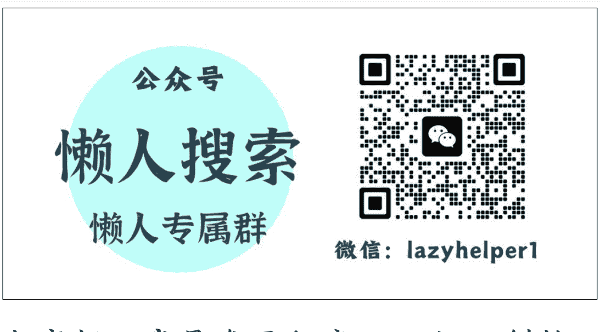
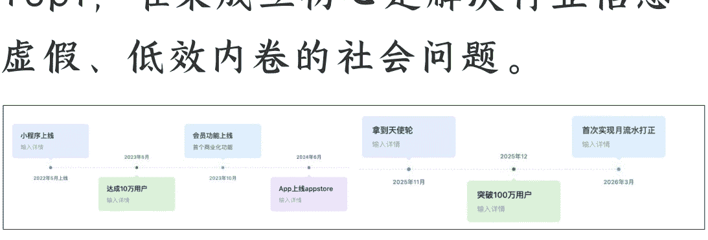
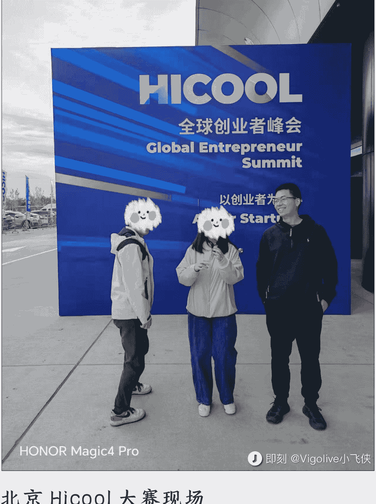

# 公众号懒人搜索，懒人专属群分享
## 我用 AI Agent 做租房平台：拿下 100 万用户的心得与踩坑经验分享

**整理：**公众号懒人搜索，[懒人专属群](https://mp.weixin.qq.com/s/15943XJq86QwvYzZ072gW)精选

**懒人微信：**lazyhelperl

**大家好，我是唯果租房 Vigolive 创始人徐闻春**，很开心给圈友分享唯果从副业到全职创业历程，把我 4 年来从阿里技术人跨界做租房平台，0 广告投放做到细分领域 Top1 的完整经历一次性讲透。

# **一、从被坑到想改变租房行业**

**先说成绩**，2022 年 5 月唯果租房平台第一版上线，到 2025 年底，唯果在 0 广告投放的情况下做到累计用户超 100 万，合作商家超过 1000 家，月 GTV 过 500 万，是真房源直租平台细分赛道 Top1。唯果成立初心是解决行业信息虚假、低效内卷的社会问题。

**唯果平台发展经历**

我曾在阿里妈妈广告事业部工作 7 年，负责 DMP 和向量数据库产品，性能做到了集团领先。10 年职场历练，尤其是阿里从 0 到 1 解决复杂问题的经历，让我有了独当一面的能力和对平台更深的理解。

**阿里用了 7 年的头像**

但真正让自己下定决心干租房是一次脊背发凉的经历——2020 年遇到蛋壳公寓倒闭事件，维权的过程发现租房行业的混乱对普通人的伤害有多大。科技发展已经这么先进，年轻人租房还有这么多问题，既然不服，那就干！做一个真正让租客安心、房东省心的平台。

在 2022 年 2 月大年初一写下唯果第一行代码，当时团队只有两个人，我负责后端，另一个字节伙伴负责前端，到 2022 年 5 月 6 日产品第一版上线。产品上线后的第一个月正好遇到北京疫情，我在豆瓣、公众号等渠道找到房东信息，每天打电话，花了一周多拉新 500 多个房东直租房源。作为平台最开始没知名度，没租客，原以为找房东发房子很难的，还担心被认为是骗子😮，但硬着头皮实践下来发现并没想象的难。我们让房东发到平台，然后把房源链接转发社群免费帮房东推广形式，成功说服房东愿意发布到平台，从电话到房源发布转化率达到近 70%。

当积累第一批房源后，我开始把房源大量发到各种无中介费租房群，2 周后平台 dau 稳定在 200 左右。发现有用户认可并使用产品后，立即启动组织升级，通过豆瓣小组找到第一位设计师，然后通过朋友介绍找到另一个研发同学，因为没有找到运营，于是我转向运营做增长，在 2022 年底尝试小红书，发现效果突出，到 2023 年后初八 dau 突破 1000，2023 年 3 月开通第二个城市上海，到 2023 年 5 月底累计用户突破 10 万里程碑。

到 23 年下半年唯果开始做矩阵，多个素人账号发内容种草，引导去平台租房，后来小红书政策逐步严格，随后引导方式为先进群再从群引导到平台的路径，到 23 年底产品用户突破 30 万。

公众号懒人搜索，懒人专属群分享
Vigolive小飞侠
2023/12/29 📍北京市
2023 最后一个工作日，产品达成 30w 小目标～😄

有两点感受很深，一个是业务方向，另一个是副业团队合作。

**业务方向上**，回顾这一年见了聊了好多朋友（不少来自黄即），不同人关于产品理解差异非常大。有的人完全不认可，也有小伙伴理念出奇一致。既然这件事有争议无法达成共识，那就从用户需求本质出发，先做一个好的且有机会活下来的产品再说。

**关于副业**，目前行业下行大多都会受影响，很多人想做副业，其实副业难度真的不小，能把副业做到超过主业非常难，不过这段经历真的是锻炼个人独当一面能力机会，尤其是经营意识，这个意识只有面对的时候才有机会构建。团队仍在寻找副业合作小伙伴，运营、产品和技术都看，目前看这不是一个赚钱好项目，但确定的是它有足够社会价值，明年我们会更务实的做商业化，期待可以不负每一位用心参与的伙伴💪

**收起**
**副业做到 30 万用户**

到 2024 年后，平台 dau 突破 5000，这时协作团队伙伴增长到 9 个人，分布全国各地，连面都没见过，白天 12 小时求生存，周末追理想。唯果在 2024 年 6 月上线 App，最开始决定做 App 的时候收到不同意见，团队认为 app 维护成本过高，不适合线上形式维护，但我认为这是重要获客渠道，坚持推进，上线迭代后第 3 个月，给团队带来实际收入，到目前为止 App 新增客户占比超 30%。

时间到 2025 年初，我们团队遇到真正低谷期，最初做前端和设计的伙伴，在共事近三年，没有看到业务收入显著增长后决定退出，自此我理解到为爱发电不可持续，必须面对现实，好服务背后是成本，必须盈利才可持续推动。经历这些后，意识到要做好一件事，需要投入足够精力，在调研找到平台盈利可行方向后，2025 年 6 月决定从阿里辞职启动创业。

# **线下办公首次开张揭幕**

出来做认可的事情之后，发现连呼吸都不一样😊，虽然收入断崖式下降，还是负的，但是会很开心，带着团队做没有人做过的事，难而有趣。去年 10 月我们去 hicool 大赛玩立下 flag，让更多人知道有这样一个默默无闻的团队在为中国租房行业发展而努力！💪

**北京 Hi cool 大赛现场**

# **二、为什么这是个机会：三个趋势正在加速**

很多人问我，租房赛道不是有贝壳、自如这些巨头吗，为什么还有机会？其实恰恰相反，大厂的模式恰恰给了我们这样的创业者空间。不同于传统贝壳、安居客是围绕服务经纪人的平台，唯果直接服务租客和房东，帮助房东营销出租，推动不向租客收费，向房东收费的模式，尤其经济下行，会加速服务费转向房东承担，唯果从成立之初就在推动这一进程。

**趋势 I：社会环境变化：从卖方市场→买方市场**
房地产市场从卖方转向买方。过去租房平台主要向租客收费，未来一定是向房东收费。2024 年我国房屋租赁规模已经达到 3 万亿元，随着政策支持和行业规范化发展，房源还在持续增长，在经济下行环境，租客更倾向于性价比房源，商家房源空置率高，需要更多渠道推广。

# **趋势 2：科技趋势变化：AI 重构劳动密集型行业**
AI 技术正在重构劳动密集型行业。租房行业本身就是劳动密集型行业，AI 让重构租房产业成为可能。我们正在用 AI 技术提供高效智能的租房连接和数据服务。

# **趋势 3：人口结构变化：00 后成为租房主力**
00 后逐渐成为主流租房人群。这批年轻人对买房没有执念，更愿意选择租房，他们偏向透明、真实、性价比高的租房渠道，相比老一辈被中介坑怕，00 后更需要一个真正靠谱的平台。过去贝壳打造的模式非常优秀成功，但是让经纪人 0 底薪、0 社保的模式，很难让服务者从容的提供好服务，不成交就没收入和尊严，而为了成交，注定免不了套路。

# **三、平台如何赚钱：三层商业模式**
唯果目前跑通 3 层商业化，从免费到付费，从低频到高频：

-   **第一层：**平台会员费。租客和房东都可以免费使用平台，同时我们提供会员增值服务。
-   **第二层：**CPS 成交佣金。帮助商家房东确定性出租房子，从中收取推广服务费。这需要我们真正帮房东解决问题，而不是单纯收信息费。
-   **第三层：**SaaS 服务。面向商家内部，提供 SaaS 软件服务费。这一层是通过服务商家的过程中，发现他们业务流程中的低效痛点，从而找到的切入机会。

目前唯果平台收入主要是会员和 CPS 成交服务业务，CPS 业务毛利 30%-40%，其中 SaaS 业务是未来营收增长重要方向，这个行业非常传统，毛利预估在 8%左右，但营收有很大增长空间。

# **四、怎么做增长：从 0 到 1 的实操路径**
做平台最难的是双边冷启动，我把它拆成 3 个阶段，每一步都可复制：

### 第一阶段：冷启动
-   - B 端冷启动是最难的。2022 年 5 月唯果上线第一周，我们没有房源，就靠打电话，一家一家地邀请房东发布房源，一周积累了 500 间房东直租房源。
-   - C 端冷启动，我找了十几个租房社群，把平台信息发出去，收获第一波租客用户，dau 很快达到 200+。

## **第二阶段：迭代阶段**
这个阶段要在 B 端和 C 端双端发力。核心策略是降低商家 B 端的门槛，快速大量引入商家，补充平台产品数量，满足 C 端需求。只有房源足够多，C 端用户才会留下来。在 C 端增长方面，2022 年末我发现小红书流量起来，开始使用小红书做自然流，分为 2 个阶段：

-   - **在小红书做单个账号**，发现租房板块流量很大，dau 达到 500+
-   - **然后开始做矩阵账号**，做了 5 个账号，dau 达到 2000+
-   - **接着继续做知乎、抖音等全渠道种草**，dau 达到 4000+

在 B 端增长方面，唯果有 3 个发展阶段：

-   - **1.0 阶段：**房东直租平台。最初考虑是中介容易出现问题，那就只做租客跟房东沟通平台，但发现房源市场真正房东直租非常少，难以支持平台发展，大量租客过来找不到想要的房子流失掉。
-   - **2.0 阶段：**广告模式直租平台。发现市场纯房东直租很少的问题之后，开始 2023 年升级到跟公寓、二房东合作，房源规模大幅提升，但此时平台营收主要来源于广告业务，而对于平台，供需双方有限的时候，广告模式对商家非常不友好，付费不一定带来效果，会影响续费，同时因为商家不买会员发布房源，还影响房源供给。
-   - **3.0 阶段：**CPS 模式直租平台。发现问题后，从 2025 年 5 月开始升级 CPS 模式，商家发布信息免费，只有在确定性帮助商家出租才收推广费，这样做可以很好解决商家入驻合作意愿，且在经济下行市场，没有商家会拒绝一个按结果确定性收费的渠道。

## **第三阶段：稳步运营**
当平台逐步找到方向后，就开始面向目标稳步发展，当有了一定的用户基础和房源规模，开始逐步提升 B 端的准入门槛，提升商业化收益水平。在这个过程中，我们还发现了 SaaS 的机会。通过服务商家，我们发现他们的业务流程非常低效，大量靠人工操作。这就是 SaaS 切入的机会

# **五、AI 时代的租房产业如何做**
不同于大多数人研究使用 AI 解决线上问题，AI 在线下产业提效有巨大空间。租房就是劳动密集型行业，AI 技术发展让这个行业变革成为重要推动力量。租客在这里使用小果 AI Agent，一句话让 AI 7*24 小时帮自己找房，找到合适房源后可以联系唯果线上找房师 lVI 安排带看，线下有看房师带客户看房，AI 会支持线下看房师给客户介绍房源，根据客户画像需求，调整沟通话术，从而提升转化率。

**AI 租房里 AI 不是核心**，真正的核心是背后的真实数据，而唯果目前是除贝壳以外唯一的真房源平台，海量真实数据，实现让租客不仅高效，还能放心的租到房子。相信在 5-10 年后，小果 AI 可以给租客在线上推荐房源，自动规划看房路线，预约无人车带租客去看房，给租客介绍房源信息及协助合同签约。

**小果 AI 在此**
# **六、底层逻辑：普通人的能力模型**
我认为唯果能走到今天的底层逻辑有三点：第一，选小而精的细分需求市场，且团队能力在这个细分市场有竞争力。我们是互联网背景，在产品技术和用户体验上比传统中介公司要高很多，叠加团队务实，深入了解行业。第二，快速且持续地验证试错，唯果干了 4 年，中间经历了 3 次大的模式迭代，才实现流水打正，养活全职团队。第三，不下牌桌，只要是正确方向，剩下的就是拿时间去验证迭代。中间走弯路很正常，重要的是不轻易放弃。

**普通人入场需要什么技能？**我作为普通人，还是跨界创业，有几个建议：
1.   首先，找到自己擅长的能力，形成降维打击。我是程序员出身，就用自己的技术优势切入去改造传统行业。
2.   其次，要有韧性。平台是所有商业模式里难度最高的，需要足够韧性才能走下来。
3.   最后，找志同道合的伙伴一起同行，才能走得更远。

# **七、可复制 SOP：普通人跨界做平台**
我把 10 年大厂经验 +4 年创业，浓缩成 5 步可复制 SOP，适合绝大多数平台型项目：
1.   选对赛道挑大厂不愿做、小团队看不起、用户愿意付费的细分领域
2.   社群验证不用先做 App，先用社群快速验证需求、迭代模式，直到有人付费
3.   极简上线小程序 /App。第一版只留核心功能，先推出去，再优化
4.   按需求迭代：用户要什么做什么，根据收入去调整迭代商业化，必须要活下来
5.   B 端优先，螺旋增长：先搞定供给，再拉需求，双边互相带动，越做越大

这套思路适用于绝大多数平台型项目。确定终局目标后，其达成路径一定曲折，走弯路是必然的，真相是在实践中逐渐具象化。尤其做平台往往是创新，走的是没有人走过的路。如果为了解决一个跟钱无关的问题，可以支撑你走得更远；如果想短期赚快钱，会很快结束。

# **八、写给生财圈友：创业最重要的不是智商，是耐心**
这几年我亲眼看着几十款租房 App 上线又消失，大多倒在两个点：
-   - 想短期赚快钱，熬不过冷启动
-   - 只为赚钱，没有解决真问题的愿力

复盘回看，做租房平台，出发点是被坑后感性的理想，但过程是极度理性的执行。真正支撑我走下来的，不是智商、情商和资源，而是大多数普通人能拥有的——耐心、韧性和愿力。如果你也想做细分平台、想跨界创业、想找长期稳定的生意，唯果这 4 年的路，希望能成为你的地图 + 避坑指南。不用羡慕风口，扎根一个真需求，慢慢做，就是最快的路。最后，感谢生财邀请分享这篇可能很不一样的平台创业经历，期待对圈友能有启发，同时欢迎对 AI+租房产业感兴趣的伙伴交流合作，一起推动解决租房行业信息虚假不透明、服务低效的社会问题，我们始终相信一群人能走的更远！💪

————分割线————
看完这篇 SOP，你觉得你懂了。但 90% 的人一到实操就会卡在第一步。**工具和教程只是最低级的壁垒**，真正的壁垒是“立刻动手”和“圈层信息差”。如果你想看全网最新的变现玩法，并且和一群执行力极强的极客一起下场拿结果，欢迎围观我的核心私域：【懒人专属群】。我们不聊虚的，只做商业闭环的拆解与 AI 效率的压榨。系统内已沉淀 1000+ 跑通的套利实战局。

> **查阅圈子完整数字资产与上车门槛：**
[https://lazyso.com/insider/](https://lazyso.com/insider/)

