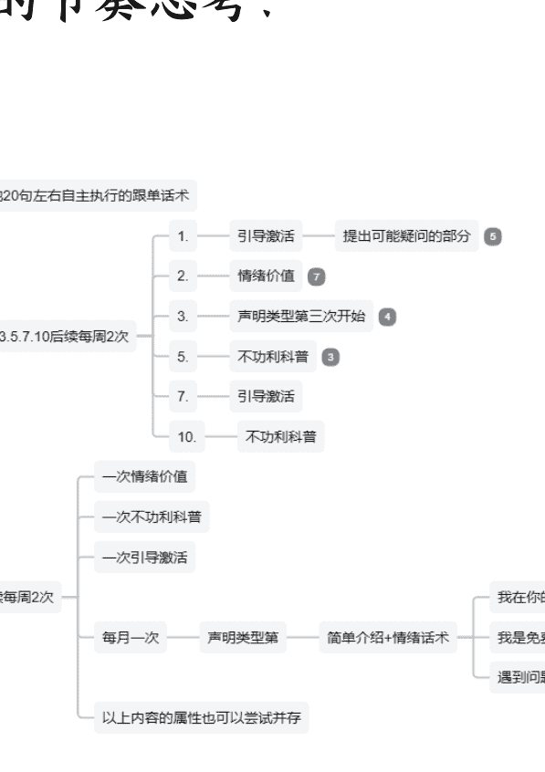
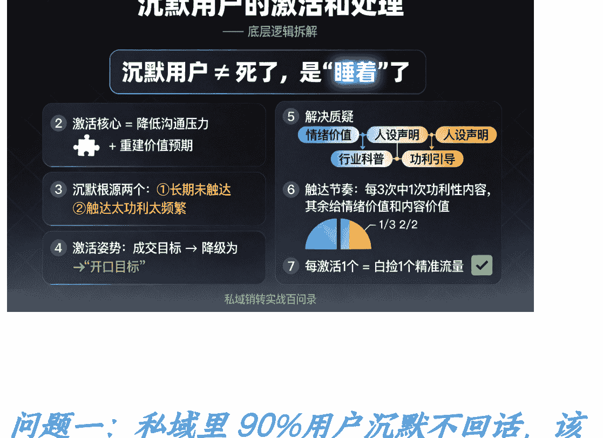
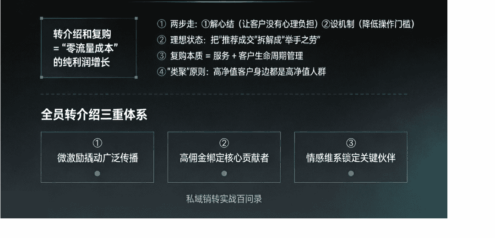
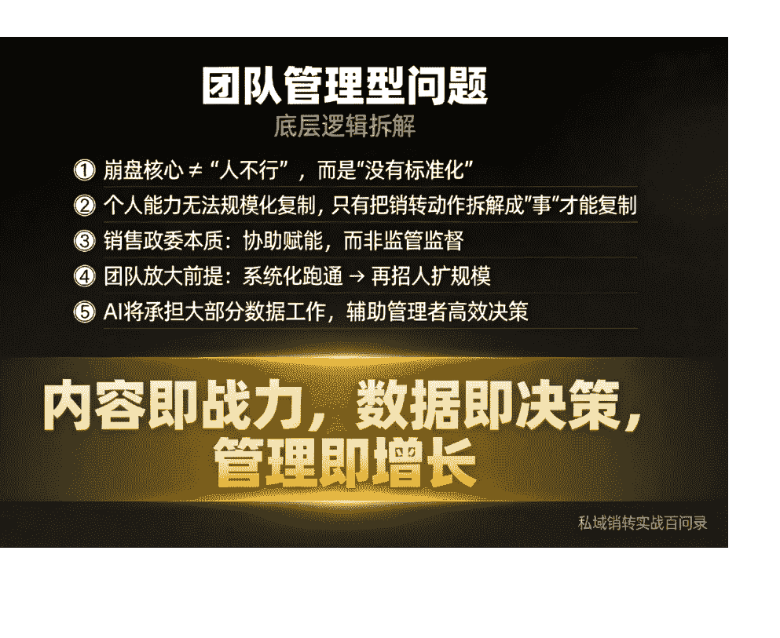

## 从高客单转化到私域 AI 应用：私域销转 8 大场景，精炼 25 个真实问题解答实录 · 零篇

**260519 副业 SC 精华**
公众号懒人搜索，**懒人专属群**独享
懒人微信：lazyhelperl

## 前言

大家好，我是天堂地狱，销转 mini 航海的教练，也是超级术之一《“转化大于流量”——一套全员销冠的 SOP 搭建流程（90% 私域行业适用）》的作者。

以这篇文章为基础，我开了销转 SOPmini 航海和航海家夜话，上次活动讨论结束以后，我答应过七天出一篇问题答疑文章。结果一直忙于销转内容的升级和补完，这一欠就是这么长时间，好惭愧。

最近又回头关注了一下大家，发现很多小伙伴的进步很神速度，已经把各种方案甚至是智能体都应用起来了，很欣慰。

在收集需求这个阶段会花一些时间才到出方案。有时候发现可能因为价位比较高或者他们没有这么高的预期去解决这个问题，导致成交迟滞。

我就感觉很累

当然也有百十的转单

这个是用大模型，还是自己搭建？基于什么平台？最近我也在测试各种方案，有机会可以详细讨论下

南南 1.1号咨询：我把你教的内容做成了一个 agent 来指导我的销转😂

但是有没有更好的办法在前期就知道他们有没有购买需求

可以的 非常好用

王自在 (天堂地狱私人号)：这个是用大模型，还是自己搭建？基于什么平台？最近...

augment 对上下文的理解非常好，而且很得体很到位很准确，还能喂专业语料

2025年12月27日 下午16:19

> **公众号懒人搜索，懒人专属群分享**
> 
> **4:07**
> HD 5G 📶 🔋
> < 群聊 ...

> **有AI**

> **Elsie**

> 有AI后，我们做了3件事（我们是电销+微信私域）：
> 
> 一是用 get 笔记去记录最优秀的销售，连续一周，然后整理出来一个销售转化话术，然后一个常见问题列表；
> 
> 二是用 get 笔记去记录了各个普通销售的 sales 话术，然后把她和最优秀的话术做对比，各个部分打分，比如开场，比如介绍产品，比如跟进，比如逼单等；找出薄弱点；
> 
> 三是让实习生用最优秀销售提炼出的话术，也能做到3天上岗就能出单；

> **Elsie**

> 嗯，现在的结果是，一不怕销售离职，二开始招没有销售经验的人进来做销售。

> **Elsie**

> 通常销售管理人员不直接拿销售提成，他们拿带组的销售的整体的业绩的一个 x%的抽成。所以我们对于这个最优秀的销售借鉴了这个做法，给了除了她自己业绩之外，一个很小的 x%的全组的抽成，以激励她。

> **Elsie**

> 自营的，所以话术是一轮一轮迭代出来的。

1. 把问题按分类归纳，并精选问答填充。
2. 每个分类都做了底层逻辑拆解，让大家配合食用更好理解。
3. 最后的部分，会给大家分享当下 AI 工具能给私域销售带来多少质的改变，让大家可以结合问题去思考更高效的解决方案。

内容上比单纯问答的质量高了不止一个档次，也算是还利息了哈哈。

这篇文章整理了8个核心场景、精选25个真实问答。它们来自不同的赛道——知识付费、心理咨询、夜校艺培、糖尿病 IP、设计师教练——全文2W多字，如果觉得是你需要的，投个锚点，方便回来再看。

为了方便阅读，我把文章放在飞书表格里，大家可以在左侧选择适合自己的大分

类和分类下的小问题来单独阅读，私域 AI 相关在最后的部分。

好了，话不多说，上干货。

# 一、高客单客户提高转化效率

**底层逻辑描述：**

高客单成交的本质，是”信任溢价“的构建。这个构建至关重要——可能你的成本没变，但构建方式不同，效果天差地别。
高客单客户看的不再是单一的产品功能，而是对结果的确定性，以及对服务者的信任。

**所以高客单销售时可以用三个方法完成额外价值传递：**

第一个是错位信任背书，通过建立专业壁垒甚至差异化壁垒，让客户感受到你的不可替代性；

第二个是精准价值锚定，让客户清楚地知道钱花在哪里、能换回什么；

第三个是风险对冲设计，用分期、对赌、体验课等方式降低决策门槛。关键不是”说服“客户花钱，而是让客户”看懂“价值、”感受“到保障、”比较“出优势，

平时很多用来“锁客”的方案都是来源于这个思路。

初读这部分或许有些抽象，没关系，后面的问答精选会详细展开。这里你需要先记住一个核心认知：高客单的竞争的一个策略，是用”多维度价值差异”作为销售撬动点。

销售的本质是价值传递，而高客单成交的本质，是如何更简单明了地把你的价值传递给客户。面对泛粉，拉长培育周期；面对精准粉，缩短转化路径。高净值客户用专业深度打动，低净值客户则需要情绪价值的陪伴。

试着在你的服务中找到更多维度的价值供给点——这是打动客户购买高客单产品的关键。换句话说，即便是标品，你还能提供什么样的额外服务？这个思路可以从产品维度、销售个人维度、销售背景背书维度逐一挖掘。

举个例子：夏晋宇老师的大片课，除了教你做课程，还能额外帮你链接高端客户资源——这正是学员需要的。再比如生财有术，除了给你一个社群体验，还能给你多维度的搞钱玩法和资源对接——这也是成员需要的。再举个更通俗的例子：很多行业都有美女和帅哥销售，男卖女、女卖男，本质上也是满足了客户的附加需求。

思考两个问题：你的产品是否可以通过额外开发创造附加价值？销售本产品的公司，是否可以用极低的边际成本，为客户提供另一重价值？

当然，之前文章提到的”讲清楚“这件事本身，也是一种价值差异。（我们讲清楚了，而同行没有讲清楚）

我们通常把解决客户痛点或销售异议的话术称为”成交抓手“，负责帮客户建立成交意向；

而在高客单场景中，我们更需要的是”销售撬动点“——更像临门一脚，帮客户最终按下付款键的那个推力。

问题一：高客单价知识付费业务，该怎么做内容传递，提升私域转化率？

内容传递的本质，是把产品价值讲清楚，让客户真正理解并认可，而非单纯把内容说一遍。所有的成交，其实都是内容传递到位后的自然结果。

具体落地有四个关键动作：

第一，放大干货内容的传递比重。把课程核心内容的30%-70%拿出来，通过公众号、视频号、朋友圈、私域私信等渠道做传递，不用怕内容泄露。免费内容里的干货越足，客户的信任度越高，越会相信付费内容能带来更高价值。同时，极少有人能完整看完、吸收所有免费内容，所以不会影响付费转化。

第二，多渠道内容触达，不局限于朋友圈。朋友圈只是基础的内容触达渠道，还要通过公众号长文、系列短视频、直播公开课、私域定向私信，做多维做内容传递触达。让客户从多个渠道反复接收到产品价值，强化认知，解决”只看朋友圈，很多客户看不到、看不全“的问题，多渠道触达本身也是给客户“洗脑”的一种体现。

第三，内容传递要贴合客户痛点，做定向输出。针对客户的核心顾虑——比如贵、不信任、怕没效果——单独做对应的内容，用”一说明、二解释、三佐证“的逻辑把问题讲透。比如针对”怕没效果“，就做学员成功案例、陪跑全流程拆解、结果数据佐证的内容，定向传递给有对应顾虑的客户，而非泛泛输出。

第四，内容传递要反复做，不用怕重复。客户对内容的吸收是有限的，同一个核心价值点，需要通过不同的形式、不同的案例反复传递，才能真正让客户理解并记住。哪怕是同一套核心内容，拆分成不同的小节、不同的主题分多次传递，也不会让客户反感，反而能持续强化价值认知。

另外，如果私域流量体量允许，并且自己有能力，建议用直播公开课或视频号直播做批量转化。一次直播可以同时解决多个客户的信任问题和价值认知问题，比纯IVI电话沟通效率高得多。即便只有200个私域客户，也能通过公开课实现转化。同一套内容重复讲3-5遍也不会引起大量反感，真正完整听完还不付费的客户，本身就不是目标客户。

> **问题二：设计师IP教练做万元高客单陪跑，拆成999元训练营后想重新聚焦，怎么打磨产品？要不要等产品打磨到100分再发售？**

你的产品打磨思路是完全正确的。作为IP主理人主导的非标品，你的核心优势是对产品有很强的自主掌控和调节空间，产品优势可以直接左右流量获取和销售转化效果。

你可以精准匹配市场客户的核心痛点做产品调整，把痛点做成专属服务内容，既能

**降低销转难度，也能把独家服务作为流量钩子，获取更多精准线索。**

关于”要不要打磨到100分再发售“，答案很明确：**不用**。

可以用飞轮效应做产品迭代，第一轮先做到阶段性合格的程度，拿到市场结果和现金流后，再用实际结果支撑第二轮、第三轮的产品优化。这样在赚钱这件事上的效率会更高。

一定要重点关注行业窗口期。**如果你的赛道有明确的市场红利窗口期，不要因为过度打磨产品而错过红利**。可以先变现再优化服务，先收钱不代表不做服务，先拿到现金流，再根据实际交付反馈优化产品也是一种思路。避免出现”自己磨了一年产品，学员已经拿着你的内容变现百万“的尴尬局面，这是**过来人**的忠告。

## 你的产品打磨建议是：
高客单产品打磨要做窄做聚焦 (尤其是初期)，不要做全流程陪跑，而是围绕”**设计师高客单商业模式设计**”这个核心点做产品。交付会更轻，核心价值也更突出：**核心是帮设计师筛选锁定高付费意愿、高付费能力的精准人群**，帮他们完成个人价值塑造。**这个核心卖点足够清晰，才能支撑高客单的成交**。

产品的价值感会反向推动成交转化——产品抓点越精准、打磨越深入，成交的抓手就越多，能覆盖的客户层级也会更广，甚至能让原本没有强需求的客户，也因为你的价值输出产生付费意愿。记住，流量、销售、产品是商业铁三角，三者不管哪一点打得足够深，都能拿到对应的结果。站在产品角度把单点打透，是你当前最容易落地、也最能快速拿到结果的路径。

最后要强调：产品是销转和流量的基础。只有先把产品的核心价值和卖点提炼到位，后续搭建销售团队、细化运营颗粒度，才能实现高效成交。如果前端产品的核心价值不到位，后续销售环节再怎么优化，也很难实现稳定的高转化。

> **问题三：**客户会跟我倾诉大量的负面情绪和生活难题，怎么更快、更礼貌地截断倾诉？

这个问题的核心话术逻辑是”先给价值，再做边界说明“。不要直接生硬地打断客户，而是先明确告知客户你能提供的核心价值和专业帮助，再坦诚说明当下的时间情况，给客户留下后续沟通的钩子。

标准话术框架可以分三步走：

**第一步，共情接纳。** 先跟客户说明”我非常理解你当下的处境和情绪，也很愿意帮你解决对应的问题”，先跟客户建立共情，不让客户觉得被冒犯。

**第二步，明确边界。** 再告知”我当下的工作安排比较紧凑，空闲的时候我们再深入细聊”，坦诚说明情况，设定沟通边界。

**第三步，留好钩子。** 最后补充”平时你有核心的问题，随时都可以给我留言，我看到后会免费给你做基础的解答和建议”。既给了客户价值预期，又把沟通拉回到了专业服务的主线上，避免无意义的情绪倾诉无限延伸。

**在日常沟通中，要坚持”你动我才动”的原则：**客户给出明确的问题、明确的反馈后，你再针对性跟进，不用客户一直倾诉、你就一直被被动承接。这样既能保护你的精力，又能把沟通节奏拉回到成交主线上来。

**建议提前设计好这类客户的跟进话术，**把”截断倾诉”这个动作，转化成一次客户筛选和价值传递。既不会让客户觉得被冒犯，又能快速结束无意义的情绪消耗，让每一次沟通都有明确的推进目标。

> **问题四：**开场白转化效率低、后续客户跟进转化效率低，该怎么优化第一印象？

你们的客单价不低，客户通常会对比很多家。在这种”多家比价、需要多次跟进才能成交“的行业里，第一印象是第一次对接的主要目标，也是后续跟进转化的门槛。 毕竟要先进决赛才能拿冠军，八强就被淘汰了，你也没机会展示实力。

建议优化方向有三个层面：

第一，把价值和背书做起来。如果自身品牌或背书不够强，就要从其他维度建立差异化优势。要么展示专业特长，要么展示服务差异化。在没有强品牌的情况下，客户对你印象有多深，直接决定了后续跟进时他是否还愿意理你。

第二，沟通前期适当放大价值感知。具体可以参考上篇文章中”如何过渡承诺，再圆回来“的部分。你的业务很少一次咨询就成交，所以前期不管用什么方式，核心目标都是给个好印象，至少客户愿意让你进入”备选池”。

第三，明确开场白的真正目标。开场白的核心目标不是直接成交，而是让客户产生初步好感，建立基础信任。破冰做好了，后续所有销转动作都会顺畅；破冰做不好，后续话术再打折扣，客户也会天然产生抵触。

关于背书建设，本质上是一种包装策略：用专业、用服务、用案例（哪怕是合作案例）来体现自己的内容价值。很多时候不是你没有，而是没有花费足够多的精力去搭建。多花点功夫把这些做好，其实大部分同行已经不如你了。产品和解决方案当然也要随着市场需求持续优化，但别忘了计算边际成本——如果确定边际成本很低、未来收益很大，那就尽量早做早收益。

比如文眉小姑娘展示绘画艺术奖项，就是一种错位差异化的背书，就变成了文眉老师。

我记得罗振宇老师还讲过一个案例：“XX啤酒17天深度酿制”，什么啤酒都是17天酿制，但是客户不知道啊，你讲出来就是你的。

这部分你可以把我的文章和你的行业和信息喂给AI，和AI讨论，你行业如何做。很多行业都有的，重点是找出来，用起来。

# 二、泛粉客户提高转化效率

### 底层逻辑描述:

泛粉转化的核心，是”落差管理”和”分层培育”。

而资料粉（泛粉）与业务粉（精准粉）本质的区别在于预期一致性不同——用户为资料而来，你不能直接推产品。泛粉转化的正确路径是：先放弃”来了就成交“的功利目标，把资料粉从”原材料“加工成”精准客群”，也就是我们常常讲的“洗一遍”流量，但是这里要注意，这个“洗一遍”的重点不是“筛除”，我个人感觉更像是“培育”。

通过激活开口→基础信息收集→价值分层传递→精准匹配产品，逐步完成从低意向到高意向的筛选和培育。

请记住：泛粉转化的核心目标不应该直接看成交率，而是先看开口率和培育率。

而泛粉成交的另一个大头，是”激活沉默”。

泛粉的沉默率很高，所以另一个必须抓的维度是跟单，跟沉默客户的激活。

我一直强调，成交的本质是价值内容的精准传递。那么面对泛粉已产生的沉默，我们该如何传递？答案是多维度、缓节奏的跟进触达，目的是激活。每激活一个，我们就相当于获得了一个精准流量——这个赛道的精准流量值多少钱，你激活一个就赚了多少。为什么是精准流量？因为你是用传递价值内容的方式打动并激活了他，所以这个时候展示你的高价值内容尤为关键。

这部分的具体跟进节奏，我们放在”沉默用户激活”部分详细展开。

问题一：靠资料粉引流到私域转化率极低，不靠资料粉又无法完成私域引流，这个两难困境该怎么解决？

首先，明确两类流量的核心差异。资料粉是靠免费或低价资料引来的泛流量，特点是体量大、精准度低；业务粉是靠业务核心抓手引来的流量，用户本身有明确的消费需求，精准度更高。这是两类流量，有本质区别，不能用同一套销转逻辑去应对。

其次，看清转化率低的根源。资料粉转化率低，不是因为资料没用，而是因为流量、销转、产品三者之间出现了巨大的价值落差。用户是为了领资料而来，但销转环节直接推送高客单产品，前后预期完全不一致，最终就会出现大量用户沉默、无法转化的结果。

最后，破局的核心在于转换思路。不是靠资料粉直接转高客单，而是把资料粉作为”流量原材料”，先做分层筛选，再逐步做好价值传递和转化。放弃”来了就成交“的强功利目标，把资料粉从”原材料“加工成”精准客群”，再做成交动作。

具体操作上，先通过免费服务、价值传递、基础信息调研，跟用户建立基础链接，拿到用户的核心需求、付费能力、个人情况等关键信息，再针对性地做价值传递和产品推荐，逐步完成从低客单到高客单的转化。绝对不能上来就直接聊高客单、聊成交。

# **问题二：泛粉初步跟客户交流后，怎样才能进一步提高转化率？**

资料粉转化的核心原则只有一个：先忘记成交，你的目标是培育。把成交率提升的目标，拆解成链接每一个环节的提升——添加率、开口率、资料领取率、成交转化率、复购率。看似更远，反而更高效。

具体落地，建议分三步走：

第一步，拉出数据，找到瓶颈。把自己的添加率→开口率→资料领取率→成交转化率→复购率做成数据表格，逐个环节审视哪里掉了链子。优化开口率：客户要什么先给什么，开口率一定高；在给的内容里，再自然植入你的需求和价值体现。优化资料领取率：不管是模糊钩子还是明确**资料**，都不是最终目的，要准备一套完善的过渡方案，描述清楚”为什么到了私域聊的内容和引流时有些差异”，这个差异要圆的上。如果送资料，资料里可以加入联系方式和付费引导。

第二步，用内容培育筛选出付费意向客户。**泛粉的转化**，其实是挖掘有付费需求的客户。成交的重点是”帮“有可能付费的客户，对比出免费与付费的区别。这就需要大量的内容去描述、去给客户讲清楚。学会用”一说明、二解释、三佐证“的逻辑传递价值，让客户自己看出付费的价值所在。

第三步，做好跟单，**撬动沉默客户**。我一直说，成交率低于3%的情况下，跟单一定是性价比最高的工作，没有之一。**单靠跟单都可能让你的转化率不止翻倍**，更何况你们还是高复购型业务。同时，持续传递价值，做客户微信里最方便能找到、提供帮助的那个靠谱专家。我记得罗振宇老师讲过，对客户来说，终身陪伴的、靠谱的销售才是最值得信赖的。客户不怕花钱，怕的是一直换人服务。**把这个价值传递给客户**，他会更愿意长期留在你的私域里。

此外，多维护老客户，不管是续费还是转介绍，价值都很大。记住：**培育到位了，成交是自然而然的结果**。

# **问题三：全网已经有2万糖尿病精准粉丝，私域也有沉淀，但是一直变不了现，该怎么解决？**

精准粉丝变不了现，核心问题通常是”有流量、无产品、无路径”。解决思路可以从五个方向同步推进：

**第一，先跑通从0到1的初级变现。** 不用一开始就追求高客单、高收益，核心是先验证用户的付费意愿。比如合规的低客单控糖食品、血糖监测耗材带货，先把基础带货变现跑通。这些产品门槛不高，哪怕利润不高，也能很快打通变现路径，建立”我的粉丝愿意为我付费“的信心。

**第二，把免费社群升级为精细化运营阵地。** 不要只做用户的沉淀池，要在社群里持续输出有价值的内容，建立用户信任。同时筛选出有深度需求的精准用户，逐步引导到付费星球、IVI咨询、陪跑服务等更高客单的产品里，完成分层变现。

**第三，把粉丝规模变成商业谈判筹码。** 主动去找合规的食品、医疗器械品牌方谈合作，拿代理权限、分销佣金，甚至可以谈定制内容、专场直播合作。你的精准粉丝本身就是核心商业价值，哪怕你自己不卖货，也能通过品牌合作、广告植入实现变现。

## 四、内容复用与粉丝规模放大

第四，内容复用，放大粉丝规模。把现有的粉丝内容、用户的提问做二次复用，形成优质的内容输出体系。如果精力不够的话，就专注一个平台做流量。当粉丝规模、用户粘性做到一定程度，品牌方合作方会自然找上门来。

第五，也是最重要的前提：所有的变现动作，都不能伤害粉丝信任和 IP 人设。不能为了短期收益推不合规、低质量的产品，否则会把之前的粉丝积累全部消耗掉，得不偿失。

参考同行成熟的模式，“免费地域社群 + 付费星球 + 全国线下沙龙”是一个轻量且可行的路径。

- 第一阶段用免费社群沉淀精准人群。
- 第二阶段开通付费星球完成轻量变现。
- 第三阶段用免费线下沙龙对接品牌赞助商，实现更大规模的变现，这样既不赚粉丝的钱，还能有不错的收益。

以上步骤可以逐步推进，离你近的事，可以先落地，不用一开始就规划全链路的所有细节。

## 三、沉默用户的激活和处理

### 底层逻辑描述：

沉默用户并非“死”了，而是“睡着”了。

激活沉默用户的核心，在于降低沟通压力和重建价值预期。私域里大量的用户沉默，根源往往有两个：一是沉默客户没有触达，长期沉默；二是触达频率太高，推送内容太功利，引起反感而被屏蔽。所以我们应该把目标放在“有效触达”上。

正确的激活姿势，是把成交目标降级为“开口目标”——先让用户愿意回复你，再谈后续转化。具体要做到三点：

1. 用无功利性的免费服务和交叉问题引导回复，降低用户开口的心理门槛；
2. 用“私域小 IP"思维替代“广告号”定位，让客户把你当成可随时取用的备用资源，而非急于推销的陌生人；
3. 用标准化跟单表和分节奏策略，让跟进有章可循，而不是凭记忆随性发挥。

类似以下的节奏思考：

更关键的是，你需要换一个角度理解激活的价值：每激活一个用户，哪怕暂时没有成交，也等于白捡了一个你们赛道的精准流量。因为你是通过传递价值内容来打动客户的，能被内容激活的用户，本身就是对你有真实需求的精准人群。

激活的节奏可以用一个小公式来拆解。先锚定一句人设定位：

> “我是你朋友圈里最近能接触到的这个领域专家，专业、和善、愿意分享，你随时可以免费找我了解业内最新信息。”

想想看，如果你的微信里医生、律师、甚至开锁师傅都给你这种印象，为什么你不可以成为“他”的专家？

这个激活公式的基础逻辑是：先尝试解决客户之前的成交质疑（如果没有就跳过），接着传递情绪价值，做个人设声明，再输出不功利的行业科普内容——当这些非功利性内容做好了铺垫，才是偏功利的引导激活。后续的触达节奏建议“每三次中安排一次功利性内容”，其余两次分别提供情绪价值和内容价值。具体比例可以根据你的赛道灵活调整。

### 问题一：私域里 90% 用户沉默不回复，该怎么激活？

私域里沉默用户占绝大多数，这是常态而非异常。面对这种情况，核心策略是彻底放弃“一步到位”的成交目标，把原本直接跳转到成交的销售路径，拉回到跟单节点重新设计。第一阶段的核心目标，不是成交，而是“让用户开口、跟你建立沟通”。

具体落地可以分四步走：

**第一步，用无功利性的价值触达，降低用户开口门槛。** 对沉默用户做标准化的激活动作，核心是提供免费服务、免费价值，而非一上来就推产品、聊成交。当用户感受到的不是推销压力，而是真诚的帮助意愿，回复的意愿自然会提升。

**第二步，设计交叉式基础问题，引导用户开口。** 围绕用户所在的赛道、个人情况、核心需求、创业状态等维度，设计简单易答的问题。这些问题一方面能降低用户的回复成本，另一方面能在对话中完成基础信息的收集和分层，为后续销转积累判断依据。

**第三步，把“开口率”作为激活阶段的核心考核指标。** 不要急于推进成交，先把开口率做到预期目标（比如 50%），磨透激活这个节点，再进入销转的第二步。没有完成激活就直接推成交，等于在沙滩上盖楼，根基不稳。

**第四步，建立“用户回话即重回起点”的标准化路径。** 只要沉默用户开始回复，就按销转的第一个节点重新推进（参考开头的上一篇文章）。每一个回话的用户，都是重新被拉入转化漏斗的潜在机会。

### 问题二：夜校业务 3000 用户，推送新课程、发短信激活沉默用户反馈很差，怎么办？

私域沉淀了 3000 用户，但用推送新课程、发短信的方式激活长期沉默用户，反馈极差——大多已读不回，少数以“近期忙碌”婉拒。这说明你的触达方式、内容设计和频率节奏，都需要系统性调整。

首先，从“推广告”转向“立人设”，重塑跟单内容的核心。停止单纯推送课程广告的做法，把内容重点调整为突出“我是谁、我能提供什么长期价值”。让客户清晰感知到：你是一个长期存在、专业可靠的本地培训资源对接者，而非一个只发广告的陌生推销号。增加诚恳的沟通感，而非生硬的推销感。

其次，优化触达频率，从高频轰炸转向精准节奏。把两三天就推送一次的高频触达，调整为一周 1 次的合理频率。逢年过节、学生暑假等客户需求明确的时间节点再重点推送，既能提升触达的相关性，也能避免日常打扰引发的反感。

第三，强化客户的精细化分类，告别无差别群发。基于成交与否、客户意向高低、人群属性（成人/学生家长）做好标签拆分，针对性推送对应内容。比如针对家长群体，可以围绕“神兽在家”的场景痛点设计课程解决方案；针对成人用户，则侧重职业技能提升和业余时间规划。分类越精细，触达效率越高。

第四，把自己打造成微信里的“私域小 IP"。优化微信名称、朋友圈内容，增强客户辨识度，让客户形成“沈阳本地找培训班，可以找他”的固定认知。可以参考房产中介等行业的优质跟单文案，把自身形象包装成值得信赖的本地培训资源专家，而非单纯的课程推销员。

第五，持续传递长期价值，成为客户的“备用资源”。定期向客户推送行业资讯、转介绍福利等内容，引导客户把你当成相关需求的备用资源。即使当下没有培训需求，当客户自己或身边人有需要时，也能第一时间想到你。这才是沉默用户激活的**终极状态**——不是每次都要成交，而是每次需要时，你都会出现在客户的选择清单里。

### 问题三：私域客户时隔一年才自然成交，决策周期太长怎么优化？

很多去年添加的私域客户，时隔一年才自然成交——要么是因为觉得你做得久、靠谱，要么是之前买了别家服务觉得不好又回头找你。这种长达一年的决策周期，本质不是成交率的问题，而是私域跟单和沉默客户激活的问题。客户自然成交靠的是朋友圈被动触达，而你需要做的，是把这种被动等待转为主动运营。

**优化跟单体系**，可以从以下六个方面入手：

第一，每次沟通结束后，用标准化话术留下跟进钩子。不管电话里是否成交，结束时要有一个固定的收尾表达，比如“不管您最终买不买，相关的问题都可以随时找我”。切忌客户说“再考虑一下”之后就没下文了，一个不留钩子的收尾，等于亲手关上了后续跟进的大门。

第二，打完标签，按节奏跟进，而不是凭感觉。电话结束后，立刻给客户做标签分类，不用太复杂，3-5 个就够了——高意向、中意向、低意向，同时标注客户的核心异议点和断联节点。不同标签对应不同的跟进节奏：高意向客户 3 天内跟进 2 次，趁热打铁解决顾虑；中意向客户每周定向传递内容，逐步拉升意向；低意向客户只做批量内容触达，等待激活。

第三，主动做多次内容传递，不要只依赖朋友圈触达。你一定能感受到客户在哪个节点不认可你——是价值没讲透，还是觉得贵，还是不信任。根据标签定向输出内容，客户在意哪个点，你就往哪个方向发私信。只要把握好节奏，前期不要太频繁，带着具体内容去聊，而不是空洞地问“考虑得怎么样了”。

第四，给客户灌输一个长期价值认知。让客户明白，他的微信里有你这么一个小红书 + 私域销转的专家，不管什么时候遇到相关问题，随时都可以找你，小问题免费咨询也没问题，哪怕平时看看你朋友圈的内容，对他也有帮助。各行各业的私域都应该这么做——让用户觉得，他的微信里有你这么一个专家，现在用不到没关系，用得着的时候，拿起手机就能找到你。

第五，养成做跟单表的习惯，让每个客户都有个基础档案。每一个聊完的客户，都要做总结、做分析，判断他是在哪个节点断联的，定好下次跟进的时间。跟单表最大的好处，不仅是规范自己的跟进动作，更是为未来的团队复制做准备。没有这个流程和记录，你几乎很难把这套能力复制给团队。

第六，缩短成交周期的关键是抓住“成交窗口期”。客户的决策热度是会冷却的。90 分以上的客户要立刻逼单，不要让热度自然流失；逼单失败后也不要放弃，转入“养客户”模式，用持续的价值传递重新把热度拉回来。

### 问题四：简单回复后客户不再追问，怎么设计追问话术？

客户简单回复之后就没了下文，这是很多私域销售都会遇到的场景。设计追问话术的关键，不是追求一套话术应对所有人，而是先区分客户类型，再匹配不同的跟进策略。

**第一类，愿意沟通、有明确回复的客户。** 对这类客户，正常按你的成交 SOP 往下推进即可。结合客户的核心需求，针对性设计追问话术，一层层挖掘客户的深层痛点，逐步推进成交流程。这类客户不需要特殊的“激活”，需要的是专业、精准的推进。

**第二类，简单回复后就沉默、不愿意继续沟通的客户。** 这类客户不用做精细化的追问，只需要做低成本的批量激活动作。设计一套笼统但价值明确的激活话术，每隔几天做一次批量跟单，核心目标是“激活开口”，而不是一次性完成成交。

激活话术的核心框架可以概括为“价值传递 + 零压力邀请”：先清晰传递你的专业价值，同时主动降低客户的沟通压力。比如“平时如果有相关的困惑，随时都可以跟我聊，哪怕不付费，咱们简单聊聊没所谓的”——先激活客户的沟通意愿，再考虑后续的追问和成交。

需要特别说明的是，你不需要追求每一个沉默客户都能被重新激活。只要这套话术能把部分沉默客户拉回沟通流程，就已经达到了目的。对于完全不回复的客户，不必浪费过多的时间和精力，把精力聚焦在那些有回应、有互动迹象的用户身上，才是性价比最高的选择。做好了流程，我们只管种，然后收该收的就好。

## 四、转介绍和复购的提升

### 底层逻辑描述：

转介绍和复购，是私域里“超低流量成本”的纯利润增长方案，要很重视。它的核心逻辑可以分两步走：先解决客户的心理顾虑，让客户没有负担；再用低门槛的激励机制和内容设计，把转介绍的操作成本和心理门槛降到最低。

最理想的状态，是把“推荐成交”拆解成客户“几乎没有心理负担的举手之劳”。比如让客户转发一条朋友圈——但这里的前提是，你能不能帮客户把朋友圈内容针对性做好？能不能设计出“客户只要照着转发就行”的完整路径？同样是发一次朋友圈，能不能做出转化率更好的广告效果？所以，这条朋友圈本身，必须是你用心打磨过的。

能拿到结果，才是持续推动你、推动客户长期推广的动力。

而复购的本质，是服务，是客户生命周期的长期管理。成交不是终点，而是服务的起点。很多销售成交后对客户的态度就变了，这是大忌。做销售时间久了你会发现，你积累的每一个“朋友”和“人脉”，都是未来销售的宝贵资产。尤其要深谙“类聚”原则——高净值客户身边都是高净值人群，高客单客户身边都是高客单人群。当你的时间精力有限时，优先维护谁、先服务好谁，答案不言而喻。

在这个基础上，才有可能搭建“全员转介绍”的三重体系：用微激励撬动广泛传播，用高佣金绑定核心贡献者，用情感维系锁定关键伙伴——最终把老客户变成一个持续产出低成本精准流量的私域池。

### 问题一：客户成交意愿低、不愿意分享转介绍，该怎么解决？

客户不愿意转介绍，核心往往不是客户“不乐意”，而是你的转介绍机制没有帮他解决心理顾虑，或者操作起来太麻烦、太尴尬。解决这个问题，关键在于“先解心结，再设机制”。

第一步，先分析客户不愿意转介绍的真实原因，针对性化解。不同赛道的顾虑各不相同。比如求职辅导类产品，客户不愿意分享，往往是不想让别人知道自己用了辅助工具，想对外呈现“靠自己拿到 offer"的形象。如果是这种情况，就不能设计让客户私下发给朋友的转介绍机制，或许可以转向小号公域分享的形式，让客户既能表达感谢，又不暴露自己的“秘密武器”。

第二步，调整激励设计，不要只盯现金和红包。激励机制可以更丰富，匹配客户的心理预期设计荣誉类、服务类、权益类激励、逢年过节的礼物、微信送礼功能、甚至是一杯咖啡奶茶。有些客户更看重“被认可”的感觉，有些客户更在意能否获得额外服务时长或专属权益。激励形式越贴合客户心理，转介绍的动力越强。

第三步，帮客户把操作门槛降到零。不要指望客户自己组织语言、编辑海报。帮客户写好公域分享的文案、做好可直接使用的海报，客户只需要一键转发即可。这样做有两个好处：一是客户不用费心编辑内容，二是你不会破坏客户的个人人设——分享内容的专业感来自你，而不是客户“硬推”的推销感。同时，用公域分享的形式，也能避免客户在私域熟人圈里感受到社交压力。

**第四步，把握好转介绍的时机，不要成交后立刻要求。** 转介绍动作必须在客户建立深度信任、对服务结果高度满意之后再做。通常需要一段时间的服务和情绪价值铺垫，用标准化话术做引导，而不是成交后立刻伸手要推荐。心急吃不了热豆腐，转介绍的时机感，直接决定客户是欣然同意还是勉强应付。

### 问题二：20 元现金红包浅层激励适用于任何赛道吗？适合什么人群？

20 元现金红包作为浅层激励，是否适用于任何赛道？比如 500 元低客单的夜校课程，这个激励话术该发给什么样的人群，还是需要无差别地发给所有人？

答案很明确：红包本身不是关键，关键是你怎么设计它。发红包这个动作不重要，发出去的内容和产生的效果才重要。本质上，这和投广告的逻辑是一样的——开广告的动作不重要，投产比才是核心。20 元红包只是让客户愿意行动的动力和成本而已，如果内容没有价值，红包发得再多也是打水漂。

所以你真正需要考虑的，不是“发不发”，而是“效果价值比”。这个比例没有标准答案，需要你自己慢慢测出来。建议先收集几十个微信账号，用不同的内容组合做小范围测试，观察哪种内容 + 红包的组合转化率最高，再下结论。

记住一个核心原则：内容是地基，红包只是催化剂。内容有价值，红包才能让价值扩散；内容是你们自己出的，这才是一切的前提。

顺带补充一个低客单夜校课程常见的关联问题——如果不能承诺无理由退换，客户纠结 500 元学费时该怎么设计？答案是打造“有保障的感受”。针对客群诉求，清晰描述客户能获得什么结果，但不做绝对承诺，且确保多数学员都能达成。

比如声乐课可以说"8 节课让小白学会 3 首歌，录制一首成名曲”；
健身课可以说"8 节课学会胸肩背腿的发力动作，学会以后可以自行练习”。

这种“大概率能达成的结果描述”，本身就是一种保障，但又不因个体差异而产生承诺风险。多跟机构讨论、磨合出这样的有效模板，就是最好的引流品设计。

记住这句话：有保障的感受，也是一种保障。

# 五、团队管理型问题类

### 底层逻辑描述：

销售团队崩盘的核心从来不是“人不行”，而是“没有标准化”。个人能力再强也无法规模化复制，只有把销转动作拆解成可落地的“事”——标准化节点、话术、流程——才能让普通人做出业绩。销售政委体系的本质不是“监管监督”，而是“协助赋能”：通过聊天记录审查萃取优质话术，通过数据化管理发现问题，通过激励机制推动执行。请记住一个原则：团队放大的前提是系统化跑通，而非先招人再建体系。

未来的销售团队管理中，AI 将承担大部分数据相关的工作，同时 AI 也会辅助管理者在各个维度高效管理。管理者可以基于数据做出更精准的决策，同时腾出更多精力投入真正的管理动作。

AI 也会帮助公司沉淀大量的优质内容结果，基于这些内容，协助销售做初步判断、洞察客户需求等。

这些就是我所说的：内容即战力，数据即决策，管理即增长。

### 问题一：销售团队搭建后到二三十人就容易崩盘，怎么通过标准化避免？

团队一到二三十人就崩盘，核心根源往往不是“人不行”，而是没有建立销转标准化体系和可落地的 SOP，业绩完全依赖销售的个人能力。这种模式下，规模化复制根本无从谈起。

转化运营具备叠加效应——每个运营小节点优化 1%，二十个节点叠加下来，整体转化率就会发生质变，这些都是后续支撑团队发展的“富矿”，直接决定公司的生死存亡。

迭代节奏上，切忌同时优化流量、销售、产品全维度。要一圈一圈推进：先优化销售环节，再优化流量渠道，最后倒逼产品升级。贪多求快，欲速则不达。

对年营收 200 万到 1000 万的中小老板而言，当务之急是搭建全员销冠 SOP 体系，把优秀销售的个人能力转化为全团队可复制的标准流程。先打磨单个运营节点、形成闭环验证，再逐层放大团队规模，稳中求进。盲目扩充团队而体系未稳，团队的风险很大。

### 问题二：销售政委体系的核心价值是什么？核心职能有哪些？

销售政委是销转标准化体系落地的推进人，是团队的“规则维护者、能力辅导者、氛围管理者”。其核心解决三个痛点：老板精力不够、销售管理无法落地、标准化体系无法持续执行。用最小成本，实现团队转化能力的持续提升和规模化复制。

### 三大核心职能：

第一，聊天记录审查与销售辅导。每日审查 7 到 10 个销售的全量聊天记录，从中萃取优质话术，发现共性问题，并开展一对一辅导，把个人能力沉淀为团队能力。

第二，团队激励的设定与发放。设计合理的激励机制，落地奖金发放，化解团队矛盾，做好氛围管理，让制度驱动行为。

第三，话术体系搭建与目标推进。明确各节点话术目标，牵头迭代优化，跟进销转目标达成，组织团队培训。

延伸职能同样关键：通过聊天记录评估销售能力，判断新人是否值得培养，为招聘、淘汰、流量分配提供依据；同时通过客户沟通数据反向给流量端提优化建议，实现流量与销转的闭环优化。

如果你想系统了解销售政委体系的搭建方法，建议回顾上一篇文章里中销售政委章节，结合 SOP 搭建流程深入理解。

这里单独提一下，当下一些基础职能已经可以通过 AI 实现，这些基础职能占比工作量的一大部分。文章的描述更多的是在执行层面上让大家理解是怎么运作的。

### 问题三：自己销转能力很强，但无法复制给团队，该怎么解决？

个人销转能力无法复制，本质在于你在复制“人”，而非复制“事”。

传统师傅带徒弟，一辈子也只能教出寥寥几人，概率极低。想要规模化复制，必须先把销转动作拆解成可落地、可标准化的“事”，我叫做“量化”销售行为，而非让团队模仿你的个人表达和共情能力。

### 具体分三步走：

第一步，把销转全流程拆解为七个标准化节点：破冰挖需、痛点诊断、方案输出、价值传递、异议处理、逼单成交、收尾跟单。每个节点定好核心目标、必做动作、标准话术和常见问题应答方案。即便团队- 成员只做到你个人能力的 80%，复制 10 个人也相当于拥有了数个完整的“你”。

- **第二步**，把销转经验沉淀为可复用工具。把客户高频异议——“能不能分期”、“没效果怎么办”、“能不能便宜”——全部做成“一说明、二解释、三佐证”的标准化应答方案。把电话里的共情表达、价值传递逻辑拆解成文字版优质话术，让团队成员直接套用核心逻辑，而非模仿你的语气。

- **第三步**，先把自己的单节点销转模型打磨到极致，再考虑复制。先把个人转化率从 1% 拉升到 3% 以上，把流程跑通、工具沉淀好，再做团队复制。模型不完善就强行复制，只会事倍功半。

### 问题四：业务风格难复制，新人培养周期太长，怎么降低复制难度？

- **培养周期长**、复制难度大，根源在于你试图让新人复制你整个人的沟通风格和综合能力。**降低复制难度**，核心思路是把复杂能力拆成简单动作，运用小助理思维，把综合要求变高效完成单一流程，把重复且简单的工作交出去，达成释放你时间的目的，再慢慢培养替代者。

## 以下是五个具体方法：

- **①** 分类思维拆分最小单元。不要让员工复制你整个人，只让他负责某一个最小单元的标准化动作——比如只负责打招呼、基础信息收集，或只负责客户激活、话术整理。把复杂综合能力拆成简单、可复制的单一动作，上手门槛大幅降低。
- **②** 用“宏脚本”思维搭建执行体系。把部分工作做成标准化 SOP、话术模板和执行流程。新人只需按流程执行自己负债的部分，就能拿到基础结果，不需要具备你的天赋和综合能力。
- **③** 用“先教感冒把脉，再教疑难杂症”的培养逻辑。先教员工处理占比最大、最简单的高频客户问题，把这部分做熟练、做标准，再逐步过渡到更复杂的内容。一开始就让他复制你所有能力，培养周期自然被拉长。
- **④** 用晶核学习法做员工培养。先把这件事的核心本质讲给员工，让他入门建立认知框架，再让他只学习能挂在这个核心本质上的内容，其他无关内容一概不学，学习效率大幅提升。
- **⑤** 接受 60% 到 80% 的复制率。不需要员工 100% 复制你的能力，就已经足够支撑业务运转。完美主义会大幅提升培养难度和团队搭建成本。记住这个原则：先完成，再完美。

# 六、话术设计类问题类

### 底层逻辑描述：

很多销售团队对话术编撰和设计深感困扰，认为这是一件既难又耗时的事。但在当下的 AI 时代，这已不该成为困扰——只要懂得相应规则，提出合适的目的要求，话术几乎可以说是无限的。

规则是什么？是话术 10 原则。目的要求是什么？是量化销售过程、拆分为节点——每个节点的核心目的都不同且重要。有了清晰的目的，话术设计的思路就顺了，不会再陷入“既要又要”的纠结。

这种方式不仅给人增效，用来约束 AI（也就是提示词），AI 就能高效地产出话术。一般来说，一个行业高频成交的疑问不超过 100 个，把这些问题的解决方案标准化，就是你的话术库。

而好的话术遵循“一说明、二解释、三佐证”的黄金原则：说明核心好处（用大白话）、解释实现逻辑（让客户听懂）、佐证可视化素材（案例、图片、视频）。一旦形成这样的话术体系，团队话术问题基本不复存在，只需定期萃取更好的话术方案，长期迭代即可。

# 问题一：客服式咨询没有成交抓手，该怎么搭建话术体系？

你当前的“客服式咨询”——虽然能引领对话节奏，但缺少把客户推向成交的内容抓手。回顾过往，成交更多是靠“随缘”成交，只命中了业务大盘里 3% 的先行者客户。

更大的增量在哪里？在第二梯队——那些有需求但不够强烈、需要稍加培育和教育才可能成交的客户。这部分预计占业务大盘的 50%，是销售增长的核心增量来源。但现在，你判断这部分客户的推动有阻力，核心症结在于不会做跟单，甚至基本没启动这个动作。

记住这句话：内容来自于行业客户的需求和疑问，包含那些客户没说出口的隐性需求。任何行业都存在共性问题——价格、质量、售后等，这些需求的解决方案就是你的成交抓手。聊到合适话题时，适时丢出这些抓手，就能有效把对话推向成交。

建议你花点功夫把这些“内容”找出来，然后参照节点三的方法做成标准化解决方案。不用急着一次找全，找到多少解决多少，这是一个持续推进的周期性动作，慢慢会越来越好。

# **问题二：怎么把产品价值真正传递给客户，而非自说自话？**

这个问题的根源在于：你觉得自己讲清楚了，但客户根本没理解、没接收到。解决它，核心是落地“一说明、二解释、三佐证”的黄金原则。

**一说明：** 用大白话讲清楚产品能给客户带来的核心好处，避免专业术语和官方套话。先让客户同频理解核心价值，比如“以您现在的情况，有压力的话可以分 5 年还，前两年不用还一毛钱，到期还能减免利息”。让客户先抓住核心利益点。

**二解释：** 用客户能听懂的逻辑，解释清楚产品为什么能实现这个效果。拆解背后的核心逻辑，让客户明白价值的来源，而非单纯听结果。

**三佐证：** 用可视化素材——客户案例、成果图片或视频、资质证明、师资背书、合同条款等——佐证前面的说明和解释，让客户真正信服，而非停留在口头承诺。

三个核心避坑点要特别注意：

第一，杜绝一大段长文一次性发送。一小段一个核心点，逐步推进。
第二，杜绝用长语音传递核心价值。至少 30% 的客户不会听完长语音，核心价值必须用文字传递。
第三，始终以“客户有没有接收到、理解到”为标准，而非“你有没有讲出来”。沟通过程中适时确认客户的理解程度，才是真正的价值传递。

# **问题三：身心灵/心理咨询赛道转型，销转流程该先抓哪些关键环节？**

第一必须抓牢的环节：**打招呼破冰与客户基础信息收集**。心理咨询和疗愈类客户的核心诉求是情绪价值和被理解，破冰环节不能一上来就推产品。要先通过共情式沟通，收集客户的核心痛点、情绪状态和核心诉求，做好基础标签分类。这是后续价值展示、方案输出的一切基础。

第二核心环节：**自身价值与专业度展示**。针对客户的核心痛点，输出对应的专业内容、解决方案雏形和成功案例，让客户快速感知到“他能解决我的问题”。价值展示必须精准匹配客户痛点，而非泛泛讲自己的资质和履历，这样才能建立初步信任。

**第三关键动作：** 把 AI 工具融入销转全流程的辅助环节。心理咨询客户的特点是感性诉求多、隐性需求多。用 AI 复盘客户聊天记录，能挖掘客户没说出口的隐性需求，针对性优化话术，实现“话术暴击”，精准解决“价值展示没命中痛点”的问题。

最后一点：不用急于搭建复杂团队和体系。先跑通单客销转的最小闭环——从引流到破冰、需求挖掘、价值展示、方案输出再到成交——全流程打磨成熟，再逐步标准化复制。

# **七、误区问题型类**

### 底层逻辑描述：

很多销售问题的根源，其实并不在动作层面，而在认知层面。一种是“厌恶成本”思维在作祟——明明该投入的时间、精力和金钱，因为心疼成本而迟迟不肯付出；另一种是“惯性思维”在主导——过去怎么做现在还怎么做，把路径依赖当成理所当然。只有学会正视问题、实事求是，你才会发现：那些你以为天经地义的做法，本身可能就是错的。所以，纠正认知往往比优化动作更重要。认知对了，动作才有价值；认知错了，越努力反而越偏离。

# **问题一：** 做好服务性跟进但是被客户白嫖怎么办？万一一直解答客户问题，客户一直不付款呢？

首先要建立一个基本认知：好的服务跟进与“被白嫖”，本质上不在同一条平行线上。真正的服务边界，是可以被清晰设计和从容把控的。

第一，**服务必须是"**设计好的服务**。哪些内容免费提供给客户，哪些价值必须付费后才能解锁，这些边界要经过刻意设计，而非临场发挥。你可以大大方方地告诉客户：“您有这方面的咨询，随时都可以联系我，公司允许范围内的内容，我免费给您做答疑。”在这个过程中，客户不痛不痒的基础问题，热情回应即可；一旦触及核心痛点和深度方案，就自然引导到付费环节。**核心原则是：** 该给的大方给，让人感觉你出手阔绰——这本身就是建立信任的投资；不该给的，委婉表达难处，寻求客户的理解。人心都是肉长的，正常的客户自然能领会这层边界，遇到胡搅蛮缠的，直接排除在外就好，不必纠结。

第二，服务更多是“感受上的服务”，而非“事实上的服务”，这两者要区分清楚。明明你给出的实际价值是 3 分，但通过表达方式、呈现节奏和情绪传递，让客户感受到的价值是 5 分。真正落地的成本可能很低：也许是一份提前备好的、缺了部分关键要点的解决方案，也许是一段复制粘贴就能发出、但包装得很用心的参考案例。客户感受到的“被重视”和“被服务”，往往比事实层面的资源投入更重要。

第三，服务设计可以先适度吃亏，再通过数据反馈逐步加上限制条件，实现动态平衡。比如送实体书，通常让客户承担邮费，用这种方式平衡赠送成本；再比如提供免费咨询服务，但在咨询过程中自然规避核心关键点，让客户听得懂大部分内容，真正动手做时却又困难重重——这在知识付费领域是极为常见且有效的服务设计。先用慷慨建立好感，再用一定规则保护边界，这是一种可持续的服务策略。

> **问题二：59 元低价精准付费粉很难转化 3000 元高客单，怎么破局？**

这是一个典型的认知纠偏问题。破局之前，必须先纠正一个根深蒂固的误解。

首先，认清流量的本质分层。付过 59 元的用户，只是 59 元低价资料的精准粉，绝不是 3000 元高客单的精准粉。这两类用户处于完全不同的消费决策层级，不能要求前者一步到位完成后者的转化，这本身就违背了用户的消费心理和行为逻辑。

其次，核心破局思路是拆解销售路径，降低阶段目标。把第一阶段的目标从“成交 3000 元”调整为“让用户跟你建立沟通关系”。低客单流量进来之后，第一步不是推产品、聊价格，而是完成用户激活——让他们愿意回应你、信任你、跟你产生基础链接。

最后，用渐进式价值传递完成升单转化。通过免费服务、持续的价值内容输出、基础信息调研，逐步拿到用户的核心需求、付费能力和个人情况，再针对性地做精准价值传递和产品推荐，完成从低客单到高客单的逐步转化。上来就直接聊 3000 元、聊成交，只会把沉默率推高。记住：资料粉是“原材料”，不是“成品客户”，你需要的是先把原材料加工成精准客群，再谈成交。

# **八、数据化、AI 化销售思维相关问题**

AI 在销售领域的应用，本质上是增效，并不一定是高精尖的炫技。很多基础层面的 AI 应用就已经非常实用——比如，你把开头的销转文章，每个节点分段喂给一个大模型，它就能生成像样的话术胚子，稍加调试就能投入使用。这种基础应用并不复杂，门槛也不高。

但要想真正的团队化 AI 转型，我可以断言：没有把系统化做好的私域团队，根本无法实现真正的 AI 化。不要幻想市场上会出现某款产品，你一用上，AI 就能代替人做销售。这种期待，就如同给石器时代的强壮士兵配发火药炸弹——他们不仅没有能力发挥它的威力，反而可能炸伤自己。没有相应的经验过渡和体系支撑，火药炸弹还不如一根长矛好用。

如果你的团队至今仍处在经验主义时代：销售过程是黑盒，沟通话术凭感觉，客户状态靠脑记——那么你根本就没有可以喂给 AI 的“食物”。AI 再强大，消化不了混乱的输入。

因此，我认为系统化是 AI 化的前提。

**系统化销转的核心，是把"**感觉”变成”**数字”：把销转全流程拆解成可追踪的节点数据——开口率、回复率、需求挖掘率、成交率——像优化广告投放一样，逐个节点打磨。AI 不是来替代销售的，它首先是“人形 AI 助理”的角色：先用标准化**让团队知道**”什么是好、什么是坏”，再用 AI 批量分析聊天记录、生成话术建议、辅助新人培训。先有规矩，再谈智能，这个顺序不能颠倒。

# **问题一：销转话术和流程优化，该怎么做数据思维落地，持续提升转化率？**

用数据思维做销转优化，核心是把销售流程当作可量化的运营工作来管理，而非单纯的依赖个人经验和感觉。

第一步，借鉴广告投放的优化逻辑，把销转全流程拆分成可追踪的数据节点。比如开口率、回复率、需求挖掘率、产品推荐接受率、成交率，或者按照七个节点逻辑，每个节点都建立数据追踪机制，逐个节点定位问题，是开口环节卡点多？还是报价环节卡点多？然后尝试打磨优化。数据让你知道瓶颈到底卡在哪一步，而不是笼统地觉得“转化率低”。

第二步，用小步快跑的方式迭代话术。不要试图一次性解决所有问题，一周只定一个核心目标——比如“夜间加微客户的回复率提升”——给销售团队明确的优化目标和激励机制，让一线销售自主设计、测试不同话术，最终筛选出效果最优的版本标准化落地。用极低成本解决长期困扰的转化率问题，积小胜为大胜。

第三步，让每一句销转话术都有明确的核心目的。话术发出去之后，要追踪它是否达成了预设目的。达成了，保留并持续优化；没达成，调整或替换。让销售团队清晰知道每一句话的意义和价值，而非机械地发送话术，知其然不知其所以然。

第四步，遵循二八定律，抓大放小。把 20% 的核心细节优化到位，就能拿到 80% 的转化结果。不必追求完美主义，更不要在 20% 的细枝末节上消耗过多精力。数据思维的本质是找到关键杠杆点，用最小的调整撬动最大的结果。

# **问题二：心理咨询/身心灵业务，怎么用 AI 精准识别客户隐性需求？**

心理咨询和身心灵疗愈业务的客户，需求往往感性且隐性，很多深层顾虑并不会直接说出口。AI 在这个场景下的价值是挖掘人工容易忽略的信息盲区。

核心落地逻辑要先厘清：**AI 是销转的辅助工具，而非替代品**。它的核心价值是挖掘隐性需求，但 70% 的效果取决于你给 AI 输入了什么信息，只有 30% 取决于 AI 的分析输出。前端输入越精准、越完整，AI 的洞察才越有价值，这个顺序不能本末倒置。

标准使用方法分为三步：
- **首先**，输入核心基础信息。给 AI 明确三个前提：一是客户的基础情况、行业属性、核心痛点；二是你的成交目标、售卖的产品与价格；三是完整的客户聊天记录或通话录音转写文本。这些是让 AI 精准分析的必要燃料，缺任何一项，输出质量都会大打折扣。
- **其次**，明确 AI 的分析目标。给 AI 下达清晰的指令，例如：“分析这个客户的显性需求和隐性需求，找出客户没说出口的深层顾虑，给出针对这个客户的销转话术优化建议，以及后续跟进的核心抓手。”指令越具体，AI 的输出越贴合你的销转需求。
- **最后**，聚焦两个核心应用场景。一是复盘环节：客户沟通中断、无后续跟进时，用 AI 分析客户不成交的核心原因和隐性需求，制定针对性的跟进方案。二是沟通前准备：针对高意向客户，用 AI 分析其过往聊天记录，提前预判核心顾虑和隐性需求，准备对应的话术和解决方案，提升 IVL 沟通的成交率。

需要特别注意：**AI 的分析结果只能作为参考**，绝不能完全替代人工的共情与沟通。心理咨询和疗愈的销转核心是情绪价值与信任建立，AI 可以辅助挖掘需求、优化话术，但不太合适直接替代销售与客户对话。失去了人的温度，反而会让客户产生抵触。

# **问题三：老板/负责人自己承担销售督导工作，精力严重不够用，该怎么解决？AI 能帮上忙吗？**

这是一个团队规模化过程中几乎必然会遇到的瓶颈。核心解决逻辑可以总结为一句话：**先用人形 AI 替代，再用工具 AI 提效；先标准化，再智能化**。四步落地方法如下：

第一步：把督导工作从老板身上剥离出来，交给专门的销售政委或助理。哪怕是新人也可以培养，关键是先给他们清晰、可量化的审查标准——什么是好的话术、什么是问题话术、每个节点的核心要求是什么。助理只需要按照标准做审查和记录，不需要懂深度的业务逻辑和销售技巧，相当于一个“人形 AI"。老板只需要做最终的审核和关键辅导，这样能直接节省 80% 的精力消耗。

第二步：用工具提效，先把基础工作量降下来。比如用堆雪球等 SaaS 工具实现聊天记录的全量留档和后台统一查看，无需手动逐条导出；用 GetTop，或者截屏长图等方式一键批量导出聊天记录，把重复性、机械性的基础工作交给工具完成。

**第三步：在前两步跑通的基础上，引入 AI 工具做深度辅助**。具体的落地场景包括：用 AI 批量分析聊天记录，自动识别销售的违规话术和节点执行不到位的问题，给出预警，大幅降低审查工作量；用 AI 智能体基于标准化话术体系，生成对应场景的销转话术建议，降低话术优化的工作量；用 AI 给新人做模拟销转演练，提升培训效率，减少老板和主管的培训精力投入。

**核心避坑点必须牢记：** 没有标准化的 SOP 和审查规则，AI 工具根本无法发挥作用。必须先让人把标准定下来、把流程跑通，再用 AI 工具提效，这个顺序不能本末倒置。**人没有标准，AI 就没有方向**。

## **AI 在私域销售上的极致增效**

之所以把 AI 部分放在最后，也是有原因的。整个提问过程中，涉及私域销售 AI 应用的问题占比其实比较少，这说明大家当时在销售工作上对 AI 的应用频次相比其他工作少很多。但在我的认知里，私域销售环境下，AI 的应用是可以极其丰富的，当下也已经落地了很多场景。最后这部分，我来给大家讲讲已经在应用的一些思路。

到截稿为止，我已经着手在开发或使用的有四款智能体。这四款智能体分别是：**销售跟单工作流**、**数据表格工作流**、**话术库搭建智能体**、**会话分析智能体**。以下的多功能很多还在开发法中，但都是可实现的，我们先感受下。

# **一、销售跟单工作流**

先说一个场景。如果你是做泛粉或者高客单，成交周期可能很长，甚至长到三个月、半年。在这个过程中，销售需要不停地跟进客户，用不同的方式、不同的话术、不同的角度去传递你的价值。

那是不是要在三到半年的时间内持续不停地做跟单动作？如果想把这个跟单动作标准化，让每个销售都会做，那就要编排好一套话术序列——比如跟单 30 次，第 1 次讲什么，第 2 次讲什么，第 3 次讲什么，后期循环讲什么，不同类型的客户做一套，我们就叫做**跟单话术库**吧。

但紧接着你就会遇到另一个痛点：这个客户是第 1 天加的，那个客户是第 2 天加的，每个销售每天可能要接 5 到 10 个新客户，一周就是三五十个，他根本分不清楚谁该跟到哪一步。如果是手动操作，你只能选择精跟 S 级客户，大量客户被放弃。

但如果有了 AI 跟单工作流，就可以精准跟进不同时间进线的客户——第 1 天进线的发什么，第 2 天进线的发什么，第 3 天进线的发什么。不同标签的客户跟不同的内容：已成交的客户跟转介绍内容，差临门一脚的客户跟逼单内容，沉默的客户跟激活内容。**跟单效率可以轻松达到 10 倍以上**。

回过头来看前文的问题，你会发现解法更深了一层。比如在“泛粉初步跟客户交流后，怎样才能进一步提高转化率”这个问题里——提问者的核心困境就是不会跟单、甚至基本没启动跟单动作。如果用销售跟单工作流，配合话术智能体先做好跟进内容序列、打好客户标签，剩下的就是一键精准跟进——每个客户在什么时间收到什么内容，全部自动化执行。

再比如“私域客户时隔一年才自然成交，决策周期太长”的问题——提问者痛苦的本质是被动等待客户自然激活。**跟单工作流可以把这种被动等待变成主动触达**：第 1 天加微后发什么，第 7 天发什么，第 15 天发什么，沉默 30 天后发什么——整个节奏

## 二、数据表格工作流

我一直说的是“数据即决策”，以往我们的决策是基于经验和拍脑袋，但在数据化的工作方式里，决策是基于准确的数据。不过数据表格工作流是我之前没有展开讲过的。

平时我会让助理把所有的数据整理到Excel表格，不时拉出近期的销售情况——某一个渠道、某一个人、某几天的ROI情况，这样可以判断销售是否出了问题、哪个环节存在瓶颈。

但这项工作依托于“做数据的那个人”，也就是说要有一个专人去帮你做数据整理和分析。

现在我把这个工作交给 AI，会基于我们的基础数据，直接输出分析结果。我只需要告诉它：我需要哪一天、哪个人、哪个渠道的数据。或者可以设置既定规则，让它每个周期自动输出一份既定规则下的数据分析报告，并且对数据做出分析协助，比如分析某一个渠道的 ROI 比较高，建议加量投放；分析某一个销售近期 ROI 长期波动，可能需要关注了解；分析某一个渠道在增量以后 ROI 明显下降，可能是因为换了流量钩子、加了流量但减了质量……
这些分析可以是日常的日报形式，也可以是你临时要求拉出某些数据后给出的分析结果。

这部分本质上和手动操作区别不大，核心价值有三点：第一，减少人力；第二，大幅提升效率；第三，也是最重要的一点——让原本觉得“做数据太麻烦”而根本没有启动这项工作的人，可以快速开始了。哪怕没有那么完美，从 0 到 1 本身也是质变。

## 三、话术库搭建智能体

文章前面我们一直在强调话术库搭建的重要性，包括节点三的话术库搭建，以及节点七跟单部分的话术库搭建。搭建的价值大家都理解了，但搭建是需要过程的，而且基于每个人对话术的理解不同，搭建的难度也不一样。

有了话术库搭建智能体，你只需要把你的行业和基本信息喂给它，告诉它你要生产哪个节点的话术，它就会帮你丰富这个节点、生成这个阶段的话术， 话术库搭建变得非常方便。

同时它会引导你按照节点一步一步往下走，相当于你的一个专属话术助理。

这个部分我计划两个方向。一个是AI小白版本，由智能体引导你来做，更适合刚刚使用AI工具的人，你只需要回答问题、提供信息，剩下的由它来组织和生成。另一个是进阶版本，由你来引导智能体生成更好更优质的话术，适合已经熟悉AI工具、想要更精准控制输出的人。

## 四、会话分析智能体

会话分析智能体是我目前觉得最厉害的一个。它的基本功能是用来替代销售政委”读取聊天记录“的那部分工作。在这个基础上，再延伸出更多高阶应用。

**最基础的话术萃取**：自动从销售的聊天记录里提炼出优质的成交话术，标注在什么场景下使用、取得了什么效果，协助沉淀到话术库。

**风控管理**：自动识别销售在沟通中的违规行为——比如过度承诺、贬低竞品、泄露客户隐私——实时预警，避免问题扩大。

进阶一点，智能体可以根据聊天记录的上下文，感知客户的情绪和核心痛点，提取关键信息，给销售提供沟通建议——“客户现在犹豫的核心点是价格”“客户对效果的顾虑比较深，建议发案例佐证”——相当于给每个销售配了一个实时军师。

更进一步，会话分析智能体可以根据销售的回复，分析销售的行为是否达标、能力是否足够、欠缺点在哪里，形成定期报告给管理者。比如”某某销售在异议处理环节经常跳过不回应““某某销售的逼单话术使用率低于团队平均水平”——管理者不用逐条听录音、看记录，看报告就知道谁需要辅导、哪个环节需要培训。

最后配合数据表格工作流的销售结果数据，再结合会话分析的聊天记录分析，给销售综合打分并给出指导建议。管理者就可以大量通过数据熟知销售工作的情况，把所有管理动作量化，不断提高管理的宽度和准确性，同时大量节省管理者做调研的时间。

## 写在最后:

私域销转没有捷径，但有方法。把每一个销转动作拆解成可落地的”事”，把每一个客户反馈变成可迭代的数据，把每一个销售经验变成可复制的话术——当”人”的能力变成”事”的标准，规模化就不是难题。

好了，今天就写到这。这篇文章我把它叫做”零篇“。因为最近在深耕私域系统化搭建和私域 AI 应用，有大量内容想分享给大家。如果这篇文章对你有用，可以投个锚点——让我知道这些内容确实是大家需要的。我会从“零”开始做这个方向的分享，以后还会有一、二、三、四、五……

你的每一个锚，都会变成下一篇内容的燃料。

看完这篇 SOP，你觉得你懂了。但 90% 的人一到实操就会卡在第一步。

工具和教程只是最低级的壁垒，真正的壁垒是“立刻动手”和“圈层信息差”。

如果你想看全网最新的变现玩法，并且和一群执行力极强的极客一起下场拿结果，欢迎围观我的核心私域：【懒人专属群】。

我们不聊虚的，只做商业闭环的拆解与 AI 效率的压榨。系统内已沉淀 1000+ 跑通的套利实战局。

👉 查阅圈子完整数字资产与上车门槛：
https://lazyso.com/insider/

认同价值、准备好下场干活的，扫码加我微信（lazyhelper1）

备注：【实操上车】，不闲聊