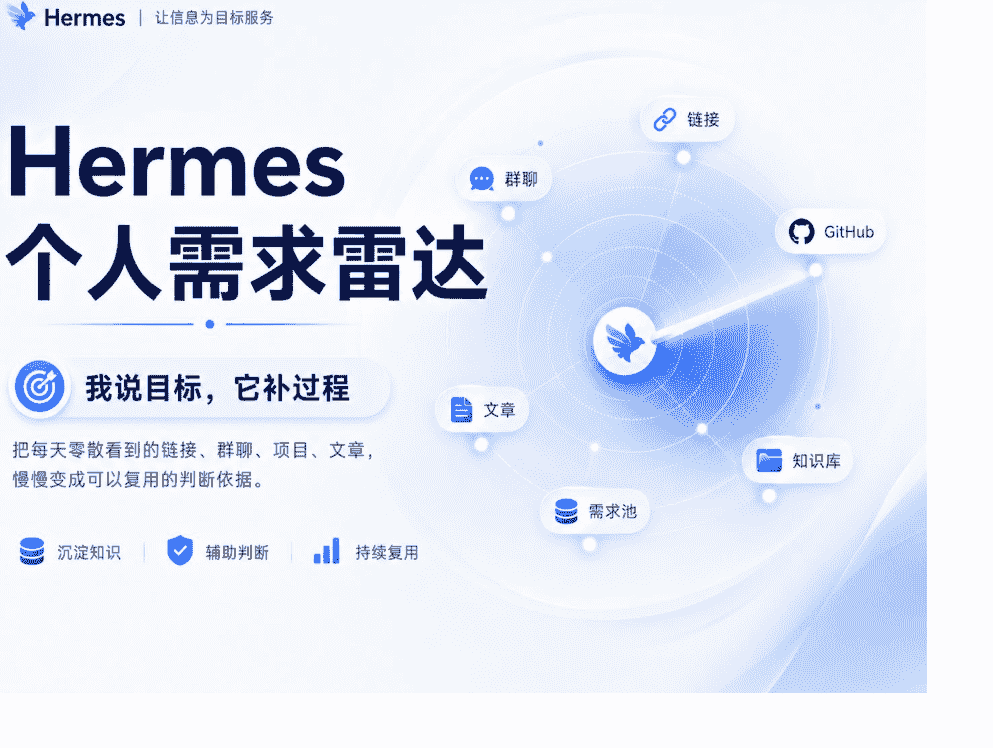
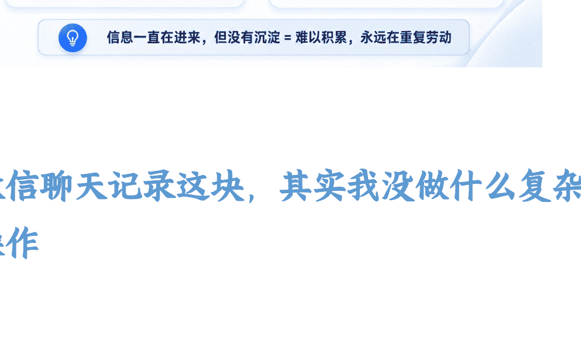
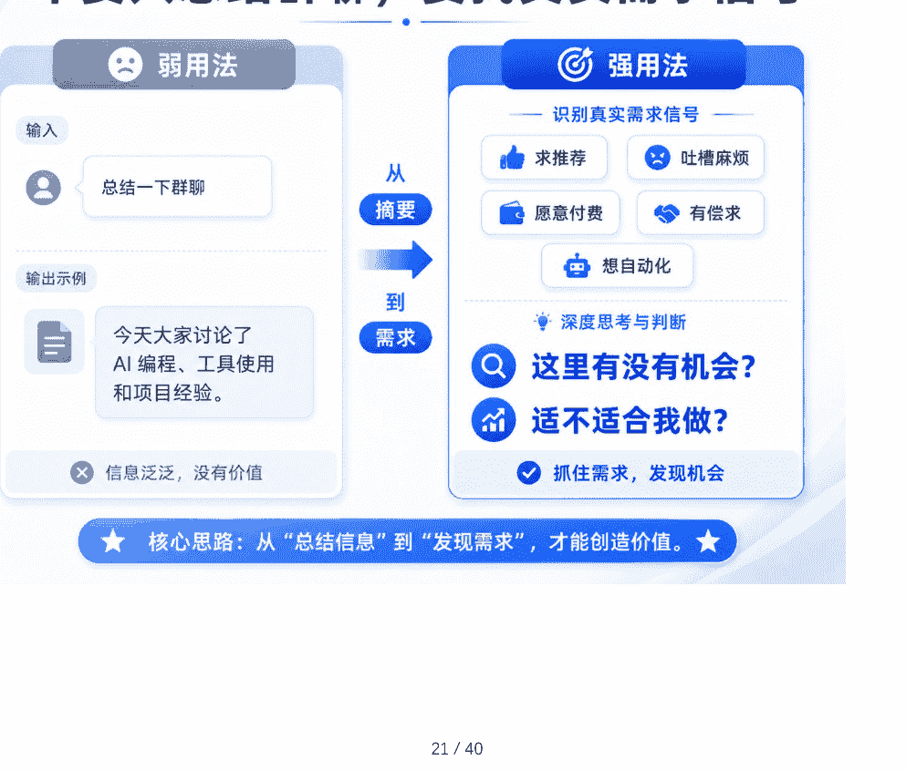
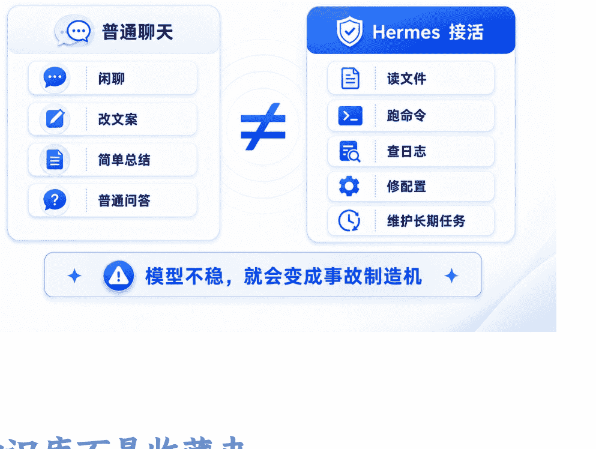

# 我是怎么把 Hermes 用成「个人需求雷达」的

**260519 副业 SC精华**

公众号懒人搜索，[懒人专属群](https://t.me/lazyhelper1)独享

懒人微信：lazyhelper1

## Hermes 个人需求雷达

这篇不讲怎么部署 Hermes。

我默认你已经部署好了 Hermes，能正常聊天，也能让它调用工具、读写文件、加载 skill。

我想讲的是：部署完之后，我是怎么使用的。

因为我发现，很多人装完一个 AI Agent，第一反应还是把它当 ChatGPT 用：问一句，答一句。

这样当然也能用，但有点浪费。

我现在更像是把 Hermes 当成一个长期跟着我的助理。

大多数时候，我做的事特别简单：

丢给它一个链接、一个想法、一个问题，然后让它自己查、自己读、自己判断、自己写进知识库。

比如我经常会直接发：

看看这个 GitHub 项目是干嘛的，适不适合我。

别瞎说，别乱编，自己求证了以后再发给我！

差不多就是这样。

我不会每次写一大段复杂 prompt，也不会手动告诉它第一步干什么、第二步干什么、第三步干什么。

我的习惯是：

我说目标，它补过程。

### 先放一张整体工作流图

如果你刚接触 Hermes，不用一上来想太复杂。

我现在的整体流程，其实就这几步：

**再说人话一点就是：**

| 我丢给Hermes的东西 | Hermes帮我干什么 | 最后留下什么 | 下次怎么用 |
| :--- | :--- | :--- | :--- |
| 链接 | 读取、查背景、判断有没有用 | 写进知识库 | 以后再遇到类似内容，直接接着分析 |
| 群聊 | 找吐槽、求推荐、有偿求、想自动化 | 放进需求池 | 以后做需求判断时可以翻出来 |
| GitHub项目 | 看README、issue、star、更新频率 | 变成项目分析笔记 | 判断值不值得学习、复刻、改成小工具 |
| 文章/课程/帖子 | 提炼对我有用的部分 | 变成学习笔记 | 以后做产品、找方向时继续用 |

**公众号懒人搜索，懒人专属群分享**

4 / 40

| 重复任务 | 整理成固定流程 | 变成 skill | 下次一句话触发 |
| :--- | :--- | :--- | :--- |
| 每天都要跑的任务 | 固定时间自动执行 | 变成 cron | 每天自动给我结果 |

这里简单解释一下：

- **知识库**：就是我长期存东西的地方，我用的是 Obsidian。
- **需求池**：就是把可能值得做的小需求先放起来。
- **skill**：你可以理解成一套固定动作。比如“扫群聊找需求”，以后不用每次重新说一遍。
- **cron**：你可以理解成定时任务。比如每天早上自动跑一次日报。

所以 Hermes 最有价值的地方，不是它单次回答得多好。

而是它能把我每天零散看到的东西，慢慢变成一个能复用的系统。

## 我真正想解决的问题

我是独立开发新人，刚刚接触 AI 编程。

对我来说，最麻烦的其实不是写代码，而是找需求，找方向。

每天能看到很多东西：

- GitHub 项目
- X
- 微信群讨论
- 生财
- 知乎
- 小红书
- V2EX
- 各种文章和帖子

但问题是：

- 哪些值得看？
- 哪些只是营销号？
- 哪些真有用户需求？
- 哪些适合我这种一个人做的小产品？
- 哪些东西应该保存下来，过几天继续看？

往往是刷了半天手机，却发现什么都没记住。

以前我看到一个项目或者文章，基本就是先收藏。

然后呢？

大概率就没有然后了。

它只是满足了我的学习欲望，但却什么都没学到，空做了无用功。

过几天再看到类似内容，又重新开始判断一次。

信息一直在进来，但没有真正沉淀下来。

直到我部署了 Hermes。

现在流程变成了：

1. 我看到一个链接，直接丢给它。
2. 它自己读内容、查背景、看有没有价值，然后反馈给我。
3. 如果值得保存，它就整理成 markdown 写进 Obsidian。
4. 如果里面有需求线索，就放进需求池。
5. 以后再遇到类似内容，它能接着以前的笔记往下分析。

这才是我觉得 Hermes 最有用的地方。

不是帮我“总结一下”。

而是把每天零散看到的东西，慢慢变成可以回头的判断依据。

## 我平时怎么跟 Hermes 配合

我和 Hermes 的配合方式，大概是这样：

我负责发现线索、补充偏好、拍板要不要继续。

它负责查资料、读内容、整理证据、写文档，以及把重复流程沉淀成 skill。

其实很多流程并不是我一开始设计好的。

作为一个新人，我确实也不知道该怎么写 prompt，不会描述自己的需求，甚至不知道自己有什么需求。

真实的情况是：

我不断把自己想要的东西丢给它。

然后根据它的回复，继续用很口语化的方式表达我的想法。

很多时候要两三个回合，才能得到我想要的东西。

跑多了以后，Hermes 自己会发现：

- 这个动作以后还会反复做
- 这个流程应该固定下来
- 这个坑下次不能再踩
- 这个输出格式可以统一
- 这个东西应该变成一个 skill

然后就慢慢形成了一套我的工作流。

比如现在我会用到这些 skill：

- obsidian：读写我的 Obsidian 知识库
- wechat-daily：看微信群聊日报和高价值讨论
- daily-demand-report：扫每天的需求线索
- scys-content-access：看生财有术内容
- market-research-miniprogram：调研小程序方向

但我日常并不会想着这些底层 skill 的名字。

这些 skill 很多都是 Hermes 根据我日常的行为自己做出来的。

我更多是直接说:

看看今天 xx 群里有什么值得保存的讨论。

或者:

扫一下今天有没有真实需求，写到知识库。

skill 的意义就在这里。

复杂流程被封装起来以后，日常使用就只剩一句人话。

### 最常见的用法：丢一个 GitHub 链接

这是我最常用的场景。

我看到一个 GitHub 项目，有点兴趣，但不想自己慢慢读 README、看 issue、判断它到底有没有价值。

我就直接扔给 Hermes：

看看这个 GitHub 项目是干嘛的，解决什么问题，有没有用户需求，对我这种独立开发者有什么参考价值。如果值得保存，写进知识库。

它接下来会自己做：

- 看 README
- 看这个项目解决什么问题
- 看 star、issue、更新频率
- 判断用户是谁
- 判断有没有产品机会
- 对我有没有用，如果有用，能提供什么帮助
- 如果我想试，它就帮我研究怎么安装、怎么跑 demo、怎么做本地验证
- 如果思路值得保存，就写进 Obsidian

我不需要说：

先打开网页，再读 README，再看 issue，再总结。

这些步骤它自己补。

这也是我觉得 Hermes 和普通聊天机器人的差别。

普通聊天机器人更多是在机械地回答你。

Hermes 更像是在接活。

它不光能给你答案，还能帮你直接把活儿干了。

### 第二个常见用法：丢文章、课程、帖子

我也经常把文章、X 链接、生财有术内容直接扔给它。

比如：

学学这个，看看对我找需求有没有用。

或者：

这篇整理成 markdown，学习一下，放到我的知识库。

Hermes 会先判断这个链接是什么：

- 文章
- 产品页
- 课程
- 帖子
- GitHub 项目

然后再看我的知识库里面有没有存过类似内容。

如果以前已经整理过，它就先读旧笔记，避免重复劳动。

如果没有，再去抓网页、读内容、提炼重点。

我现在不太喜欢让它做“全文总结”。

因为全文总结看起来很完整，但很多时候没用。

我更常说的是：

不要全文总结，重点说它对我有什么用。

也就是说，我不是要把知识库变成收藏夹。

我更希望它保存的是判断：

这个东西和我有什么关系？

对我找需求、做产品、做独立开发有没有帮助？

我真的记不住那么多东西。

而 Hermes 作为助理，会在我需要的时候告诉我：

你知识库之前有一份文件，可以帮你解决眼下这个问题。

这才是知识库真正有用的地方。

微信聊天记录这块，其实我没做什么复杂操作

很多人听到“读取微信聊天记录”，会觉得是不是要自己搞数据库、解密、SQL。

但我日常真不是这么用的。

我自己没有每天手动处理微信数据库。

我只是让 Hermes 用 wechat-daily 这个 skill。

后面的读取、清洗、提取、总结，都是它根据 skill 自己完成。

重点讲一下 wechat-daily 这个 skill。

> ~~它是有一天我在 X 上看到了一篇关于微信聊天记录解密的文章。~~
> 
> ~~我很感兴趣，就直接把 X 的分享链接发给了 Hermes。~~
> 
> > ~~经过我和 Hermes 互动，最终得出了 wechat-daily。~~

https://github.com/Thearas/wechat-db-decrypt-macos
更新一下 跟刘小排老师最新的帖子撞了...
刘小排老师提到了一个叫 wechat-cli 的工具，实测更好用，更加简单～当然我这个也可以做一个备用方式来使用～。
https://github.com/huohuoer/wechat-cli

Hermes
机器人

wechat-daily这个 skill 是你自己生成的么？
是。准确说：
- wechat-daily 这个 skill 是我/之前的 Hermes 会话在你本机生成并迭代出来的，不是飞书、微信、Hermes官方自带的标准 skill。
- 最早文件是在 2026-04-24 创建的，路径是：/Users/hec/.hermes/skills/wechat-daily/
- 后面根据实际跑微信数据库、日报、cron、密钥失效、LLDB 挂死、contact.db 解密失败这些坑，陆续补了很多说明和脚本。
- 当前 SKILL.md 最后修改时间是 2026-05-08 12:20:27。

但里面不是全都“凭空写的”：
- 流程、脚本、日报格式、踩坑记录：主要是我在你机器上实际调出来、修出来的。
- 微信数据库解密那块：引用/依赖了外部项目 Thearas/wechat-db-decrypt-macos，不是我从零实现的。
- 后续的 quick decrypt、群 ID 映射、contact.db 失效处理、单聊分析流程：基本是我们这边实测后沉淀进去的。

所以一句话：
是我生成并维护的本地自定义 skill，不是官方 skill；其中部分底层能力借用了开源项目和本机实测结果。

当然 这块只适合处理你自己有权限的本地聊天记录。

而且它对环境有要求，比如 macOS、微信版本、本地数据库状态，都会影响能不能跑通。

我用的是 macOS 方案。

理论上 Hermes、OpenClaw、Claude Code、Codex 这类 agent 都可以帮你研究这类项目。

但能不能真正跑通，还是看系统权限、微信版本和本地环境。

Windows 路线我没实测，就不乱说了。

我平时只会说:

看看 AI 编程群今天有什么有价值的讨论。

或者:

扫一下群里最近有没有人在求推荐、吐槽麻烦、想自动化、有偿求方案。

我关心的不是这个功能是怎么实现的。

我关心的是:

- 群里有没有人在反复吐槽同一个问题
- 有没有人在求推荐工具
- 有没有人愿意付费解决
- 有没有什么东西可以做成小程序、插件或者轻量工具

所以如果你是小白，不用一上来就研究微信数据库怎么解密。

不重要。

能跑通何必懂原理？

活儿交给 AI 助理去干。

我们当老板的提问题，做决策就好。

更值得学的是这个思路：

把复杂流程让 AI 来处理，让它自己生成和迭代 skill，我们享受成果。

> 不要让它只“总结群聊”

我一开始也会说：

总结一下群聊。

后来发现这句话太弱了。

# 公众号懒人搜索，懒人专属群分享
它很容易给你这种结果:

# 今天大家讨论了 AI 编程、工具使用和项目经验。

# 看完没什么用。

# 我现在更常说:

> > **从群聊里找真实需求信号**。重点看：求推荐、吐槽麻烦、愿意付费、有偿求、想自动化。不要泛泛总结。
> 
> 这样它输出的东西会更接近需求分析，而不是聊天摘要，说一两次后期 Hermes 会自己记住你要的是什么。

# 我希望看到的是:

### 需求名称
- **用户场景**:
- **原始信号**:
- **痛点**:
- **现有解决方式**:
- **为什么还有机会**: 

### 需求名称
- **用户场景**:
- **原始信号**:
- **痛点**:
- **现有解决方式**:
- **为什么还有机会**: 

### 需求名称
- **用户场景**:
- **原始信号**:
- **痛点**:
- **现有解决方式**:
- **为什么还有机会**: 

### 需求名称
- **用户场景**:
- **原始信号**:
- **痛点**:
- **现有解决方式**:
- **为什么还有机会**: 

### 需求名称
- **用户场景**:
- **原始信号**:
- **痛点**:
- **现有解决方式**:
- **为什么还有机会**: 

### 需求名称
- **用户场景**:
- **原始信号**:
- **痛点**:
- **现有解决方式**:
- **为什么还有机会**: 

### 需求名称
- **用户场景**:
- **原始信号**:
- **痛点**:
- **现有解决方式**:
- **为什么还有机会**: 

### 需求名称
- **用户场景**:
- **原始信号**:
- **痛点**:
- **现有解决方式**:
- **为什么还有机会**: 

这里的 MVP，你可以简单理解成：

先做一个最小能跑的版本，不要一上来做大而全。

普通总结是在说：

大家聊了什么。

需求分析是在问：

这里有没有机会。

这两个差别很大。

很多建议，其实是 Hermes 先提出来的

这点我觉得挺有意思。

我的工作流不是我一开始就规划好的。

很多时候，我只是丢一句：

看看这个。

它看完以后会反过来提醒我：

- 这个适合写进知识库
- 这个可以变成需求池条目
- 这个方向应该先查竞品
- 这个任务以后会反复出现，可以做成 skill
- 这个日报可以改成 cron 定时跑
- 这个输出格式可以固定下来

然后我再说：

行，你直接弄。

或者：

这个方向不对，别做 xx 相关。

或者：

以后这类内容你都按这个格式来。

来回几次以后，它就越来越知道我想要什么。

所以我觉得 Hermes 的使用方式，不是：

人类先写一份完美 SOP，然后 AI 照着做。

更像是：

你把真实任务丢给它，它一边干活，一边把流程沉淀下来，不停迭代自己的 SOP。

这点挺关键。

因为很多人卡住，就是总想先把流程设计完再用。

但实际用起来，流程通常是在一次次任务里长出来的。

这点我感觉就很适合新手小白去使用。

### 模型选择：这个坑我踩得挺多

Hermes 好不好用，不只看工具，也看模型。

这件事我踩过不少坑。

我的体感是：

这种会读文件、跑命令、改配置、维护长期任务的 AI 助理，模型稳定性非常重要。

有些模型聊天看着还行，但一到工具调用和系统排错就露馅。

比如前一段很火的 MiniMax。

说实话，我个人感觉它在这类场景里挺容易出问题，甚至有时候会把自己搞崩溃掉。

常见问题包括：

- 工具调用不稳
- 上下文突然断掉
- 明明应该查文件，它开始瞎说
- 执行到一半把流程搞崩
- 对 Hermes 自己的配置和工具链理解不可靠

如果只是闲聊，可能还能忍。

但 Hermes 不是闲聊工具。

它要能读文件、跑命令、判断错误、修配置，出问题还要知道换路。

模型不稳，就会从“助理”变成“事故制造机”。

我经常用 Codex 来修 Hermes 系统、查日志、改配置。

比如 Hermes 某个工具调用报错，或者 gateway 崩了，我就会让 Codex 来排查：

Hermes 报错无法使用了，你来找问题，跟我确定后修复。

它会去看日志、读配置、跑命令、改文件、重启服务。

给 Hermes 换了各种模型以后，我感觉 GPT-5.5 是最适合它的。

(因为 Claude Opus 4.7 太特么贵了！)

所以我直接订阅了 ChatGPT Pro 的会员，然后用 Codex 直接接入 Hermes。

双管齐下，一步到位。

怎么接入你直接问 Codex 就行。

需求不大的话，GPT Plus 其实就够了。

我也是为了用 Codex 跑项目，不然也没必要花这么多钱。

我的经验大概是：

别所有事都上最贵模型，也别为了省钱让弱模型干重活。

可以去 DeepSeek 充点钱，然后告诉 Hermes：

如果 GPT-5.5 失效了，转到 DeepSeek上，做一个后备。

模型搞错了，后面会非常折腾。

### 知识库不是收藏夹

我现在用 Obsidian 做长期知识库。

Hermes 会把有价值的信息写进去，比如：

内容生产/日报/
内容生产/分享稿/
知识库/出海方向调研/
知识库/技术观察/
需求池/

我以前对知识库的理解更像收藏夹:

## 看到好东西就存

但后来发现，收藏夹最大的问题就是存完不看。

现在我更在意的是：Hermes 以后能不能继续读这些内容。比如我过几天又看到一个类似方向，可以直接问：**这个方向我们之前是不是研究过？先查知识库，再判断要不要继续**。它会先读旧笔记，再判断要不要补充新内容。**这样信息才会累积**。

否则每次都从零开始，AI 再聪明也很浪费。

## 我给 Hermes 的边界也很明确

Hermes 很有用，但我也不会什么都让它乱来。

我的边界很简单：

读资料、查证、写知识库、跑本地脚本，这些它可以大胆做。

但涉及对外发送、公开发布、删文件、动账号、花钱、代表我表态，它必须先问我。

这个边界很重要。

否则 agent 越主动，风险也越大。

尤其是下面这些事，我不会让它完全自作主张：

- 删除文件
- 改账号设置
- 对外发消息
- 公开发布内容
- 花钱调用服务
- 代表我做决定
- 处理我没有权限的数据

我现在最常提醒它的一句话是：

先查证，别脑补。

尤其是做需求判断的时候，不能只靠模型感觉。

要看真实用户说了什么、有没有竞品、有没有付费场景。

Agent 真正有用的地方，不是它更会编。

而是它能替你多跑几步验证。

## Hermes 可以大胆干活，但边界要清楚

## Cron 可以用，但别一开始就追求全自动

Hermes 可以做定时任务。

也就是前面说的 cron。

你可以简单理解成：

每天、每周、每隔几个小时，让 Hermes 自动跑一次固定任务。

我现在确实有一些自动跑的东西，比如：

- 每日独立开发趋势
- AI 编程群日报
- 每日需求扫描
- 每日行动建议
- 每周机会复盘

**但如果你刚开始用，我不建议一上来就搞一堆自动化。**

**更好的顺序是：**

1. 先手动丢链接，看 Hermes 能不能处理好。
2. 再手动让它扫一个信息源，看输出有没有价值。
3. 再让它把结果写进知识库，形成固定格式。
4. 最后再把高频任务变成 cron。

**自动化本身没什么了不起。**

**稳定地产生有用结果，才有意义。**

**不然你自动化的不是工作流。**

**你自动化的是一堆垃圾信息。**

如果你想复现，可以从这几步开始

第一步，先告诉 Hermes 你的知识库在哪里

比如：

以后我的 Obsidian 主知识库在这个路径：xxx。调研、日报、需求池、分享稿都优先写这里。

你不用一上来把目录设计得特别复杂。

先让它知道东西应该写到哪里。

第二步，从“丢链接”开始

可以直接用这句：

以后我发你一个链接，你先判断它是什么类型：GitHub 项目、文章、产品页、课程、帖子。然后你自己读取内容，提炼重点，判断对我有没有价值。如果值得保存，就整理成 markdown 写进我的知识库。最后告诉我一句话结论和保存路径。

这一步最重要。

先别急着搞自动化。

先把“丢链接 → 判断 → 保存”这个动作跑顺。

### 第三步，把重复任务变成 skill

比如你发现自己总让它分析某个群、某个榜单、某类项目，就直接说：

这个流程以后会反复用，帮我整理成 skill，下次我一句话触发。

skill 不用理解得太复杂。

你就把它当成：

Hermes 给你记住了一套固定干活方式。

### 第四步，不要只让它总结

比起：

总结一下。

更好的说法是：

这对我有什么用？有没有真实需求？适不适合我做？下一步怎么验证？

你问得越接近“判断”，它输出的东西越有价值。

## 第五步，有价值的内容一定写进知识库

聊天窗口里的东西很快就没了。

直接说：

markdown 格式写进我的知识库。

不要只停留在聊天里。

要让它留下来。

以后才能继续用。

## 我常用的几句指令

这些都可以直接抄。

## 看 GitHub 项目

看看这个 GitHub 项目是干嘛的，解决什么问题，有没有用户需求，对我这种独立开发者有什么参考价值。如果值得保存，写进知识库。

## 看产品

看看这个产品在解决什么需求，用户是谁，收费方式是什么，有没有适合我做轻量版、小程序版或插件版的机会。

## 看文章

学学这篇文章，提炼对我有用的部分，不要全文总结，重点判断它对我找需求、做产品、独立开发有什么启发。整理成 markdown 放进知识库。

## 扫群聊

用 wechat-daily 看看最近群里有没有真实需求信号。重点找：求推荐、吐槽麻烦、愿意付费、有偿求、想自动化。不要泛泛总结。

## 做需求判断

这个方向别先脑补。先查真实用户证据、竞品、付费可能、MVP 难度，再告诉我值不值得做。

## 让它自己补步骤

你自己判断怎么处理，别问我一堆问题。能查就查，能读就读，能保存就保存，最后给我结论。

以上指令多执行几次 Hermes 通常会自己生成 skill。之后你只用简单的话语或者直接丢个链接。它自己就知道该怎么做了。

## 最后

我现在用 Hermes，最核心的感受是：

它不是一个单纯回答问题的东西。

更像是我把一个模糊任务丢过去，它会自己拆、自己查、自己跑工具、自己写文档。

跑多了以后，还能把流程沉淀成 skill。

我负责丢线索、提目标、补偏好、拍板。

Hermes 负责查资料、读内容、交叉验证、写知识库、维护 skill、定时跑重复任务。

系统出问题时，还能一起修。

这套方式对我这种独立开发者很有用。

因为我不缺信息。

我缺的是一个持续帮我过滤信息、判断价值、沉淀证据的系统。

如果你也刚开始用 Hermes，不用一上来研究所有底层细节。

先从一句话开始：

看懂这个链接，判断对我有没有用，有价值就写进知识库。

每天重复这个动作，你就会慢慢拥有自己的需求雷达。

它不会替你创业。

但它能帮你少漏信息，少做无效判断，也少一点靠情绪选方向。

对我来说，这已经很值了。

———分割线———

看完这篇 SOP，你觉得你懂了。但 90% 的人一到实操就会卡在第一步。

工具和教程只是最低级的壁垒，真正的壁垒是“立刻动手”和“圈层信息差”。

**如果你想看全网最新的变现玩法，并且和一群执行力极强的极客一起下场拿结果，欢迎围观我的核心私域：【懒人专属群】。**

我们不聊虚的，只做商业闭环的拆解与 AI 效率的压榨。系统内已沉淀 1000+ 跑通的套利实战局。

👉查阅圈子完整数字资产与上车门槛：**https://lazyso.com/insider/**

**认同价值、准备好下场干活的，扫码加我微信（lazyhelperl）**

备注：【实操上车】，不闲聊